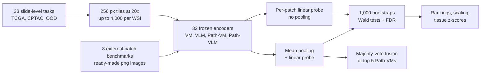

# A benchmark study of vision and pathology foundation models for computational pathology

> **Bibkey** `Bareja_2026` · **Venue** Nature Communications (2026) · **Category** foundation · **Relevance** high · **Access** open
> **Link** <https://doi.org/10.1038/s41467-026-76004-6>
> `status: complete` — 全文精读(`source.pdf` 在本文件夹,git 忽略;Nat Commun 17:9012,CC BY-NC-ND 4.0)。
> Bilingual convention (drives the site's EN⇄中文 switcher): put `<!-- ZH -->` 中文 and `<!-- EN -->` English on their own lines (or inline `- <!-- ZH --> 中文 <!-- EN --> English`). Use `<!-- ZH/EN -->` ONLY for a purely language-neutral line (a bare URL or code token) — never for bilingual prose or labels.

---

## 一句话 / One-liner
<!-- ZH --> 这篇 Stanford(Gevaert 组)的 benchmark 把 32 个基础模型分成四类——通用视觉 VM、通用视觉-语言 VLM、病理专用视觉 Path-VM、病理专用视觉-语言 Path-VLM——全部冻结、只训 linear probe,在 41 个任务、53 个数据集、17,500+ 张 WSI 上统一评测:Path-VM 稳居前列但头部模型之间差异多不显著,Path-VM 优于 Path-VLM,模型规模和预训练数据量都不能稳定预测下游表现,多数投票集成在总体上进一步提升(Abstract)。
<!-- EN --> This Stanford (Gevaert lab) benchmark evaluates 32 foundation models in four categories — general vision (VM), general vision-language (VLM), pathology vision (Path-VM) and pathology vision-language (Path-VLM) — all frozen with only a linear probe trained, on 41 tasks, 53 datasets and >17,500 WSIs. Path-VMs lead but differences among the top models are mostly non-significant, Path-VMs beat Path-VLMs, neither model size nor pretraining data size consistently predicts downstream performance, and majority-vote ensembling improves aggregate performance (Abstract).

## 要点 / Takeaways
- <!-- ZH --> 头部五个 Path-VM:TCGA 平均 AUROC Virchow2 0.830、Prov-GigaPath 0.829、H-optimus-0 0.824、UNI 0.824、UNI2 0.824;非 TCGA 上 Virchow2 0.836、UNI 0.835(Fig. 1b–c)。五者在 TCGA 上 AUROC/AUPRC/灵敏度/特异度均无显著差异(Wald 检验;Supplementary Fig. 4)。 <!-- EN --> Top five Path-VMs: mean TCGA AUROC Virchow2 0.830, Prov-GigaPath 0.829, H-optimus-0 0.824, UNI 0.824, UNI2 0.824; non-TCGA Virchow2 0.836, UNI 0.835 (Fig. 1b–c). The five show no significant differences on TCGA in AUROC/AUPRC/sensitivity/specificity (Wald tests; Supplementary Fig. 4).
- <!-- ZH --> 差异在 patch 级任务上才显现:8 个外部 patch 任务中 Virchow2 平均 AUROC 0.962,与 UNI、UNI2、Prov-GigaPath、H-optimus-0 的差异显著(FDR p < 0.001)(Fig. 2b,d)。 <!-- EN --> Differences appear at patch level: on 8 external patch tasks Virchow2 has mean AUROC 0.962, significantly above UNI, UNI2, Prov-GigaPath and H-optimus-0 (FDR p < 0.001) (Fig. 2b,d).
- <!-- ZH --> Path-VM 显著优于 Path-VLM(TCGA、CPTAC、外部基准;完全 OOD 的 slide 任务除外),但与通用 VM 相比**没有统计显著差异**——作者把 Path-VM 的优势解释为"稳定、常进前十",而非一致的统计优势(Fig. 3a;Results)。 <!-- EN --> Path-VMs significantly beat Path-VLMs (TCGA, CPTAC, external; not fully OOD slide tasks), but are **not significantly different** from general VMs — the authors read the Path-VM edge as consistency and frequent top-10 placement, not uniform superiority (Fig. 3a; Results).
- <!-- ZH --> 规模:模型变大(ViT-S→ViT-L)和预训练数据变多主要在 TCGA(尤其多分类任务)上有收益;在 CPTAC 二分类任务上有小幅显著收益;在外部和 OOD 数据上效应小且不显著(Fig. 4;Results §"Scaling")。 <!-- EN --> Scale: bigger models (ViT-S→ViT-L) and more pretraining data help mainly on TCGA (especially multi-class tasks); CPTAC binary tasks show modest significant gains; effects on external and OOD data are small and non-significant (Fig. 4; Results §"Scaling").
- <!-- ZH --> 集成:5 个头部模型多数投票的 fusion 在 TCGA 累计 balanced accuracy 第 1(0.702 vs Virchow2 0.696)、非 TCGA 第 2(Virchow2 0.712 第 1);逐任务检验与单模型无显著差异(Fig. 5a–c)。 <!-- EN --> Ensembling: majority-vote fusion of the top 5 ranks 1st on TCGA cumulative balanced accuracy (0.702 vs Virchow2 0.696) and 2nd on non-TCGA (Virchow2 first at 0.712); per-task tests show no significant difference from single models (Fig. 5a–c).
- <!-- ZH --> 我们的理解:对我们最重要的是"头部病理编码器差异小、域外排名会变"——选 backbone 不必纠结,但必须在目标域外数据(如独立的肾活检队列)上验证。 <!-- EN --> Our reading: the key lesson for us is "top pathology encoders differ little and rankings shift out of domain" — the backbone choice matters less than validating on target out-of-domain data (e.g. an independent kidney-biopsy cohort).

## 研究问题 / Problem
<!-- ZH --> 病理基础模型常用 TCGA 或单一机构的专有数据预训练,可能对特定数据集过拟合,而不是真正跨机构、染色、扫描仪泛化(Introduction)。已有 benchmark(refs. 50, 51)主要只比病理专用编码器,覆盖的癌种或任务类型有限(多为弱监督分类)。作者要回答:在统一协议下,四类模型谁更强?病理专用预训练带来多少收益?这些结论离开 TCGA(可能已进入预训练数据)后是否成立?规模和集成各起什么作用?
<!-- EN --> Pathology foundation models are often pretrained on TCGA or a single institution's proprietary data and may overfit to those datasets instead of generalising across institutions, stains and scanners (Introduction). Earlier benchmarks (refs. 50, 51) mainly compared pathology-specific encoders over a limited set of cancers or task types (mostly weakly supervised classification). Questions: under one protocol, which of the four categories is strongest; how much does pathology-specific pretraining buy; do conclusions hold outside TCGA (which may be in the pretraining data); and what do scale and ensembling contribute?

## 方法 / Method
<!-- ZH --> 1) **预处理**:H&E WSI 在 20×(0.5 µm/px)切成不重叠的 256×256 tile,Otsu 阈值去背景,每张 WSI 最多取 4,000 个 tile,存 HDF5;外部 patch 基准直接用其 png(Methods §"Whole slide image preprocessing")。
<!-- ZH --> 2) **特征提取**:tile resize 到各模型原生输入(多数为 224×224),32 个模型全部冻结,每个任务只提一次特征(Methods §"Model evaluation")。
<!-- ZH --> 3) **slide 级聚合 + linear probe**:一袋 tile 特征取平均(mean pooling),接一个线性层;lr 0.001、每 GPU batch 16、30 epoch、无数据增强;4 张 A100 40GB。TCGA / CPTAC / OOD 按患者 70/30 划分训练与留出测试;外部 patch 基准用其预定义划分,逐 patch 分类不聚合(Methods)。
<!-- ZH --> 4) **指标与不确定性**:AUROC、AUPRC、灵敏度、特异度;测试集 bootstrap 1,000 次得 95% CI(Methods §"Statistical analysis")。
<!-- ZH --> 5) **两两比较**:每次 bootstrap 算两模型 AUROC 差,用其经验方差做 Wald 检验,p 值做 FDR 校正(阈值 0.05);汇总成胜负矩阵,performance score =(wins − losses)/(wins + losses)(图注;Methods 中分母写作 wins + losses + 1)。类别间与规模分组间比较用 Welch t 检验 + FDR,规模效应用 Cohen's d 和 Spearman 相关(Methods)。
<!-- ZH --> 6) **规模分组**:架构 ViT-S(21M)/ ViT-B(85M)/ ViT-L(>300M);预训练数据 small(<0.1M WSI)/ medium(0.1–1M)/ large(≥1M)(Fig. 4)。
<!-- ZH --> 7) **集成**:取非 TCGA 排名前五(Virchow2、H-optimus-0、Prov-GigaPath、UNI、UNI2)的预测,不可训练的多数投票,用 balanced accuracy 与单模型比较(Results §"Model ensembling")。
<!-- EN --> 1) **Preprocessing**: H&E WSIs are tiled at 20× (0.5 µm/px) into non-overlapping 256×256 tiles, background removed by Otsu thresholding, up to 4,000 tiles per WSI, stored in HDF5; external patch benchmarks use their own png images (Methods §"Whole slide image preprocessing").
<!-- EN --> 2) **Feature extraction**: tiles are resized to each model's native input (224×224 for most); all 32 models are frozen and features are extracted once per task (Methods §"Model evaluation").
<!-- EN --> 3) **Slide aggregation + linear probe**: a bag of tile features is mean-pooled and passed to one linear layer; lr 0.001, batch 16 per GPU, 30 epochs, no augmentation; 4× A100 40GB. TCGA / CPTAC / OOD use a 70/30 patient-level train/hold-out split; external patch benchmarks use their predefined splits and are classified per patch without aggregation (Methods).
<!-- EN --> 4) **Metrics and uncertainty**: AUROC, AUPRC, sensitivity, specificity; 1,000 test-set bootstraps for 95% CIs (Methods §"Statistical analysis").
<!-- EN --> 5) **Pairwise comparison**: per bootstrap, the AUROC difference between two models; its empirical variance gives a Wald test; p-values are FDR-corrected (threshold 0.05); results form win/loss matrices with performance score = (wins − losses)/(wins + losses) (figure legends; Methods writes the denominator as wins + losses + 1). Category and scale-group comparisons use Welch t-tests + FDR; scaling effects are summarised with Cohen's d and Spearman correlation (Methods).
<!-- EN --> 6) **Scale groups**: architecture ViT-S (21M) / ViT-B (85M) / ViT-L (>300M); pretraining data small (<0.1M WSIs) / medium (0.1–1M) / large (≥1M) (Fig. 4).
<!-- EN --> 7) **Ensemble**: predictions of the top five non-TCGA models (Virchow2, H-optimus-0, Prov-GigaPath, UNI, UNI2) combined by untrained majority vote, compared with single models by balanced accuracy (Results §"Model ensembling").

## 方法图 / Method diagram


## 数据 / Data
<!-- ZH --> 41 个任务 / 53 个数据集 / >17,500 张 WSI,任务类型包括诊断(分型、分级、分期)、生物标志物状态、转录组亚型、通路活性(Introduction;Methods)。**TCGA(19 个任务,视为 in-domain)**:如 LGG/GBM IDH 突变(训练 884 / 测试 368)、转录组亚型、BRCA ER/PR/PAM50、BLCA 分型、PRAD ERG 融合、泛癌分级、通路与免疫分组;**肾脏**:RCC 四分类 ccRCC / ChRCC / PRCC1 / PRCC2(训练 194 / 测试 80)。**CPTAC(7 个泛癌任务)**:分级、SWI/SNF、p53、染色质修饰、mTOR、MYC 通路、7 类肿瘤类型(含 CCRCC,训练 441 / 测试 175)。**OOD(slide 级)**:Stanford 院内肺与脑肿瘤队列(如肺鳞癌 vs 腺癌、GBM MGMT 甲基化)、NLST、DHMC。**外部 patch 基准(8 个)**:BRACS、BACH、UniToPatho、SICAPv2、BreakHis、LC25000、MHIST、NCT-CRC-HE。
<!-- EN --> 41 tasks / 53 datasets / >17,500 WSIs covering diagnosis (subtyping, grading, staging), biomarker status, transcriptomic subtypes and pathway activity (Introduction; Methods). **TCGA (19 tasks, treated as in-domain)**: e.g. LGG/GBM IDH mutation (884 train / 368 test), transcriptomic subtypes, BRCA ER/PR/PAM50, BLCA subtyping, PRAD ERG fusion, pan-cancer grading, pathway and immune groups; **kidney**: 4-class RCC subtyping ccRCC / ChRCC / PRCC1 / PRCC2 (194 train / 80 test). **CPTAC (7 pan-cancer tasks)**: grade, SWI/SNF, p53, chromatin modification, mTOR, MYC pathways, 7-class tumour type (includes CCRCC; 441 train / 175 test). **OOD (slide level)**: Stanford in-house lung and brain cohorts (e.g. lung squamous vs adenocarcinoma, GBM MGMT methylation), NLST, DHMC. **External patch benchmarks (8)**: BRACS, BACH, UniToPatho, SICAPv2, BreakHis, LC25000, MHIST, NCT-CRC-HE.

## 主要结果 / Key results
- <!-- ZH --> **Path-VM 排名**:TCGA 平均 AUROC 前五为 Virchow2 0.830(95% CI 0.784–0.875)、Prov-GigaPath 0.829、H-optimus-0 0.824、UNI 0.824、UNI2 0.824;非 TCGA 为 Virchow2 0.836、UNI 0.835、H-optimus-0 0.832、Prov-GigaPath 0.827、UNI2 0.824(Fig. 1b–c)。逐任务第一:TCGA 19 个任务中 Virchow2 5 个、UNI2 3 个;非 TCGA 22 个中 Virchow2 6 个、H-optimus-0 5 个(Fig. 1d–e)。 <!-- EN --> **Path-VM ranking**: top five mean TCGA AUROC Virchow2 0.830 (95% CI 0.784–0.875), Prov-GigaPath 0.829, H-optimus-0 0.824, UNI 0.824, UNI2 0.824; non-TCGA Virchow2 0.836, UNI 0.835, H-optimus-0 0.832, Prov-GigaPath 0.827, UNI2 0.824 (Fig. 1b–c). Per-task wins: Virchow2 5 and UNI2 3 of 19 TCGA tasks; Virchow2 6 and H-optimus-0 5 of 22 non-TCGA tasks (Fig. 1d–e).
- <!-- ZH --> **统计上难分高下**:五个头部模型在 TCGA 上各项指标无显著差异;非 TCGA 上唯一显著差异是 Virchow2 vs UNI2 的灵敏度;按肿瘤类型分组后也无显著差异(Results;Supplementary Figs. 3–4)。 <!-- EN --> **Statistically hard to separate**: the five top models do not differ significantly on TCGA in any metric; on non-TCGA the only significant difference is Virchow2 vs UNI2 sensitivity; none after grouping by tumour type (Results; Supplementary Figs. 3–4).
- <!-- ZH --> **slide 级 vs patch 级**:14 个非 TCGA slide 任务上 UNI 0.761 ± 0.083 第一,头部模型间无显著差异;8 个 patch 任务上 Virchow2 0.962 ± 0.033、UNI2 0.953、Prov-GigaPath 0.949,部分两两差异显著(Fig. 2a–d)。作者解释:patch 任务没有 MIL 聚合,更直接反映细粒度表征(Discussion)。 <!-- EN --> **Slide vs patch**: on 14 non-TCGA slide tasks UNI is first at 0.761 ± 0.083 with no significant differences among top models; on 8 patch tasks Virchow2 0.962 ± 0.033, UNI2 0.953, Prov-GigaPath 0.949, with some significant pairwise differences (Fig. 2a–d). The authors attribute this to patch tasks probing fine-grained representations without MIL aggregation (Discussion).
- <!-- ZH --> **类别比较**:Path-VM 显著优于 Path-VLM(OOD slide 任务除外);Path-VM 与 VM 无显著差异;Path-VM 占前十名位置的比例 TCGA 0.55(168/304)、CPTAC+OOD 0.47(106/224;Fig. 3b 图注与 Methods 为 0.47;Results 正文写作 0.53,但 106/224 = 0.47)、外部 0.52(66/128)(Fig. 3;Results)。 <!-- EN --> **Categories**: Path-VM significantly beats Path-VLM (except OOD slide tasks); Path-VM vs VM is not significant; Path-VM share of top-10 slots is 0.55 (168/304) on TCGA, 0.47 (106/224) on CPTAC+OOD (Fig. 3b legend and Methods give 0.47; the Results text prints 0.53, but 106/224 = 0.47), 0.52 (66/128) on external (Fig. 3; Results).
- <!-- ZH --> **规模**:TCGA 多分类任务上数据从小到中、从小到大有显著收益(效应量约 0.25–0.30),中到大不显著;CPTAC 二分类任务从小到中在 AUROC 和灵敏度上有小幅显著收益(效应量约 0.25–0.40),CPTAC 多分类无显著收益;外部与 OOD 任务所有比较效应小且不显著(Fig. 4b;Results)。 <!-- EN --> **Scale**: for TCGA multi-class tasks, small→medium and small→large data gave significant gains (effect sizes ≈0.25–0.30) but medium→large did not; CPTAC binary tasks showed modest significant small→medium gains in AUROC and sensitivity (effect sizes ≈0.25–0.40), CPTAC multi-class tasks none; external and OOD tasks showed small, non-significant effects throughout (Fig. 4b; Results).
- <!-- ZH --> **集成**:fusion 在 TCGA 累计 balanced accuracy 0.702 ± 0.111 第一(Virchow2 0.696);非 TCGA Virchow2 0.712 第一、fusion 0.699 第二;逐任务与单模型均无显著差异。排名漂移:UNI 从 TCGA 第 5 升到非 TCGA 第 3,UNI2 第 6→第 9,Virchow 第 7→第 10(Fig. 5a–b;Results)。 <!-- EN --> **Ensemble**: fusion is first on TCGA cumulative balanced accuracy at 0.702 ± 0.111 (Virchow2 0.696); on non-TCGA Virchow2 is first at 0.712 and fusion second at 0.699; per-task differences vs single models are not significant. Rank shifts: UNI 5th→3rd, UNI2 6th→9th, Virchow 7th→10th from TCGA to non-TCGA (Fig. 5a–b; Results).
- <!-- ZH --> **组织偏好**(z-score):CONCH 在肺相关任务最强,Virchow2 强在结肠和前列腺,H-optimus-0 强在泛癌,UNI 强在脑和膀胱,Prov-GigaPath 在乳腺、膀胱、肺稳健(Fig. 5f);仅结肠组织中存在显著差异(Supplementary Fig. 24)。Discussion 给的列表略有不同:Virchow2 强在结肠、肺、前列腺,Prov-GigaPath 强在乳腺和膀胱,H-optimus-0 强在泛癌,UNI 强在脑、膀胱和乳腺。 <!-- EN --> **Tissue preferences** (z-scores): CONCH strongest on lung tasks, Virchow2 on colon and prostate, H-optimus-0 on pan-cancer, UNI on brain and bladder, Prov-GigaPath robust on breast, bladder and lung (Fig. 5f); significant differences appear only in colon (Supplementary Fig. 24). The Discussion gives a slightly different list: Virchow2 colon, lung and prostate; Prov-GigaPath breast and bladder; H-optimus-0 pan-cancer; UNI brain, bladder and breast.

## 创新点 / Contributions
- <!-- ZH --> 覆盖面:32 个模型 × 4 个类别 × 41 个任务 × 53 个数据集,统一冻结特征 + linear probe 协议(Abstract)。 <!-- EN --> Breadth: 32 models × 4 categories × 41 tasks × 53 datasets under one frozen-feature + linear-probe protocol (Abstract).
- <!-- ZH --> 显式区分 TCGA(in-domain)与非 TCGA 评测,并比较 slide 级与 patch 级设置(Introduction;Discussion)。 <!-- EN --> Explicit separation of TCGA (in-domain) from non-TCGA evaluation, and a slide- vs patch-level comparison (Introduction; Discussion).
- <!-- ZH --> 任务超出弱监督分类,包括通路活性和转录组亚型预测(Introduction)。 <!-- EN --> Tasks beyond weakly supervised classification, including pathway activity and transcriptomic subtypes (Introduction).
- <!-- ZH --> 每个比较都有 bootstrap Wald 检验 + FDR,并公开全部推断统计(Supplementary Data 1–15)。 <!-- EN --> Every comparison has bootstrap Wald tests + FDR, with all inferential statistics released (Supplementary Data 1–15).
- <!-- ZH --> 在线排行榜 PathBench 与 MIT 许可代码。 <!-- EN --> An online leaderboard (PathBench) and MIT-licensed code.

## 局限 / Limitations
- <!-- ZH --> 作者:只做冻结特征 + linear probe,反映表征质量而非微调后的上限(Discussion)。 <!-- EN --> Authors: frozen features + linear probe only — representation quality, not the fine-tuned ceiling (Discussion).
- <!-- ZH --> 作者:公开数据(TCGA、CPTAC)与预训练数据的重叠无法完全排除,可能抬高 in-domain 成绩;NLST、DHMC 未被报告用于预训练,但无法独立核实(Discussion;Methods)。 <!-- EN --> Authors: overlap of public data (TCGA, CPTAC) with pretraining corpora cannot be excluded and may inflate in-domain results; NLST and DHMC are not reported as pretraining data, but this cannot be verified (Discussion; Methods).
- <!-- ZH --> 作者:规模分析用参数量、切片数等粗代理,未考虑数据组成和质量;分析是相关性的(Discussion)。 <!-- EN --> Authors: scaling uses coarse proxies (parameters, slide counts) ignoring data composition and quality; analyses are correlational (Discussion).
- <!-- ZH --> 作者:slide 级用简单 mean pooling,可能稀释局部判别信号(Discussion)。 <!-- EN --> Authors: slide-level mean pooling may dilute localised signals (Discussion).
- <!-- ZH --> 我们的理解:任务几乎全是肿瘤相关(分型、分级、突变、通路);肾脏出现在 TCGA RCC 四分类任务中,另外 CPTAC 的 6 个泛癌任务(SWI/SNF、p53、染色质修饰、mTOR、MYC、肿瘤类型)覆盖包括 CCRCC 在内的 7 种癌;CPTAC 分级任务正文未列出癌种;没有肾脏专门的非肿瘤任务;没有非肿瘤疾病,也没有异常检测类任务。很多 slide 级任务测试集只有几十到几百例,置信区间宽。 <!-- EN --> Our reading: tasks are almost all tumour-related (subtype, grade, mutation, pathway); kidney appears in the TCGA 4-class RCC task, and the 6 CPTAC pan-cancer tasks that span 7 cancer types including CCRCC (SWI/SNF, p53, chromatin modification, mTOR, MYC, tumour type); the CPTAC grading task does not list its cancer types; there is no kidney-specific non-tumour task; no non-tumour disease and no anomaly-detection task. Many slide-level test sets have tens to a few hundred cases, so CIs are wide.
- <!-- ZH --> 我们的理解:名称易混——参考文献 60(Ma et al., arXiv 2505.20202)是另一个也叫 "PathBench" 的 benchmark;本文的在线站点是 pathbench.stanford.edu。 <!-- EN --> Our reading: naming clash — ref. 60 (Ma et al., arXiv 2505.20202) is a different benchmark also called "PathBench"; this paper's site is pathbench.stanford.edu.

## 与本研究方向的关系 / Relation to our direction
<!-- ZH --> 我们的理解:这篇不属于 detect → model → revert 的某一环,而是**评测层**,对课题 1 有三点直接用处。**其一,选 backbone**:Virchow2、UNI2、UNI、Prov-GigaPath、H-optimus-0 是同一梯队,差异多不显著,而且离开 TCGA 排名会变——对肾脏 H&E,与其事先挑"最好"的编码器,不如同时提 2–3 套特征,在目标肾脏数据上比较,或做集成。**其二,协议模板**:冻结特征 + 简单头作为诚实基线、in-domain 与域外显式切分、bootstrap + 两两检验 + FDR 而非只报均值——这些可以直接搬到肾脏异常检测 benchmark(把 linear probe 换成 kNN / 密度等异常打分器)。**其三,空白**:41 个任务里没有非肿瘤疾病和异常检测任务,肾脏只以 RCC 出现——这正是课题 1 要补的位置。注意:PathBench 只比较监督分类,不能直接说明哪个编码器做无监督异常检测最好。
<!-- EN --> Our reading: this paper is not one of the detect → model → revert stages but the **evaluation layer**, with three direct uses for Topic 1. **First, backbone choice**: Virchow2, UNI2, UNI, Prov-GigaPath and H-optimus-0 form one tier with mostly non-significant gaps, and rankings change outside TCGA — for kidney H&E it is better to extract 2–3 feature sets and compare them on the target kidney data, or ensemble, than to pick a "best" encoder in advance. **Second, a protocol template**: frozen features + a simple head as an honest baseline, explicit in-domain vs out-of-domain splits, bootstrap + pairwise tests + FDR rather than bare means — directly transferable to a kidney anomaly-detection benchmark (replace the linear probe with kNN / density anomaly scorers). **Third, the gap**: none of the 41 tasks is non-tumour disease or anomaly detection, and kidney appears only as RCC — exactly what Topic 1 fills. Caveat: PathBench compares supervised classification only and does not show which encoder is best for unsupervised anomaly detection.

## 可复用资产 / Reusable assets
- <!-- ZH --> **代码**(MIT 许可;部分改编自 facebookresearch/dino,Apache-2.0;含处理后的结果和图源数据;Zenodo 存档 doi 10.5281/zenodo.20618270): <!-- EN --> **Code** (MIT; parts adapted from facebookresearch/dino, Apache-2.0; includes processed results and figure source data; archived on Zenodo, doi 10.5281/zenodo.20618270):
<!-- ZH/EN --> <https://github.com/gevaertlab/benchmarking-path-models>
- <!-- ZH --> **在线 benchmark:** PathBench 排行榜。 <!-- EN --> **Live benchmark:** the PathBench leaderboard.
<!-- ZH/EN --> <https://pathbench.stanford.edu/>
- <!-- ZH --> **数据:** TCGA(GDC portal)、CPTAC(CPTAC Data Portal)、NLST(TCIA)、DHMC 以及 8 个公开 patch 基准;Stanford 院内队列不公开(Data availability)。 <!-- EN --> **Data:** TCGA (GDC portal), CPTAC (CPTAC Data Portal), NLST (TCIA), DHMC and 8 public patch benchmarks; Stanford in-house cohorts are not public (Data availability).
- <!-- ZH --> **模型清单:** Table 2–5 列出 32 个模型的 SSL 方法、架构、参数量和数据来源;WSI 数、patch 数只在 Table 2(16 个 Path-VM)中给出。可作选型速查表。 <!-- EN --> **Model inventory:** Tables 2–5 list SSL method, architecture, parameters and data source for all 32 models; WSI and patch counts are given only for the 16 Path-VMs (Table 2) — a handy lookup table.
- <!-- ZH --> **评测协议:** 256 px @20× tile、mean pooling + linear probe(lr 0.001、30 epoch)、患者级 70/30 划分、1,000 次 bootstrap、Wald + FDR 胜负矩阵、多数投票 fusion。 <!-- EN --> **Eval protocol:** 256 px tiles at 20×, mean pooling + linear probe (lr 0.001, 30 epochs), patient-level 70/30 split, 1,000 bootstraps, Wald + FDR win/loss matrices, majority-vote fusion.

## 待读 / Follow-ups
- <!-- ZH --> 对比的既有 benchmark(refs. 50、51)和 Ma et al. 的另一个 "PathBench"(ref. 60,肺、乳腺、胃、结直肠、脑五种癌)。 <!-- EN --> The prior benchmarks it compares with (refs. 50, 51) and Ma et al.'s other "PathBench" (ref. 60; lung, breast, gastric, colorectal, brain cancers).
- <!-- ZH --> Virchow2(本库已有 `virchow-2024` 的前代)、Prov-GigaPath、H-optimus-0 的原文。 <!-- EN --> Original papers for Virchow2 (predecessor `virchow-2024` is in the library), Prov-GigaPath and H-optimus-0.
- <!-- ZH --> Supplementary Tables 3–8:各模型预训练数据的组织组成——看哪些模型见过肾组织。 <!-- EN --> Supplementary Tables 3–8: tissue composition of each model's pretraining data — which models have seen kidney tissue.
- <!-- ZH --> 试跑 repo,把 linear probe 换成异常打分器,接入非肿瘤肾脏任务。 <!-- EN --> Run the repo with the linear probe replaced by anomaly scorers, on non-tumour kidney tasks.

## 引用 / Cite
```bibtex
@article{Bareja_2026, title={A benchmark study of vision and pathology foundation models for computational pathology}, volume={17}, ISSN={2041-1723}, url={http://dx.doi.org/10.1038/s41467-026-76004-6}, DOI={10.1038/s41467-026-76004-6}, number={1}, journal={Nature Communications}, publisher={Springer Science and Business Media LLC}, author={Bareja, Rohan and Carrillo-Perez, Francisco and Zheng, Yuanning and Pizurica, Marija and Nandi, Tarak Nath and Tian, Lu and Shen, Jeanne and Madduri, Ravi and Gevaert, Olivier}, year={2026}, month=jul }
```
