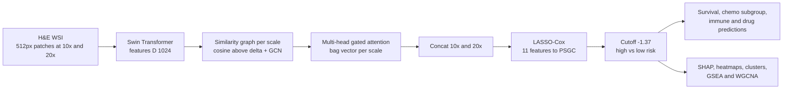

# Deep learning-based pathomics signature predicts prognosis and treatment response in gastric cancer: a multicenter retrospective study

> **Bibkey** `Wang_2026` · **Venue** npj Precision Oncology (2026) · **Category** pathology · **Relevance** medium · **Access** open
> **Link** <https://doi.org/10.1038/s41698-026-01381-6>
> `status: complete` — 基于本文件夹 `source.pdf` 全文(开放获取,CC BY-NC-ND 4.0)精读;补充材料(Supplementary Figs/Tables,含 C-index 表)未读。

---

## 一句话 / One-liner
<!-- ZH --> 作者用多尺度图神经网络 + 门控注意力 MIL(MS-GMIL)从胃癌 H&E 全切片提取特征,再用 LASSO-Cox 选出 11 个特征加权求和,得到病理组学签名 PSGC;它在 1 个训练队列和 4 个验证队列(共 3,138 例)中都是总生存的独立预后因素,并被用来分层辅助化疗获益和推测免疫治疗反应。
<!-- EN --> The authors extract features from gastric-cancer H&E whole-slide images with a multi-scale graph neural network plus gated-attention MIL (MS-GMIL), then use LASSO-Cox to pick 11 features into a weighted sum — the pathomics signature PSGC; it is an independent prognostic factor for overall survival in one training and four validation cohorts (3,138 patients), and is used to stratify adjuvant-chemotherapy benefit and infer immunotherapy response.

## 要点 / Takeaways
- <!-- ZH --> 规模:5 个队列共 3,138 例(训练 HMUCH 1,257;验证 HMUSH 752、QMUSH 540、YKPH 319、TCGA-STAD 270)(Methods "Study design")。 <!-- EN --> Scale: 3,138 patients in 5 cohorts (training HMUCH 1,257; validation HMUSH 752, QMUSH 540, YKPH 319, TCGA-STAD 270) (Methods "Study design").
- <!-- ZH --> 最终签名是线性公式:PSGC = 11 个编号特征(feature3、feature17 等)的加权和,阈值 −1.37 把患者分为高/低风险;5 个队列的 KM 曲线 log-rank 都是 p < 0.0001(Results; Fig. 2A)。 <!-- EN --> The final signature is a linear formula: PSGC = weighted sum of 11 numbered features (feature3, feature17, …), cut at −1.37 into high/low risk; log-rank p < 0.0001 in all 5 cohorts (Results; Fig. 2A).
- <!-- ZH --> 效应量大:训练队列 60 个月时高 PSGC 组的限制平均生存时间比低组少 21.0 个月,108 个月时少 49.0 个月(Table 2)。 <!-- EN --> Large effect: in the training cohort, high-PSGC patients have 21.0 months less restricted mean survival time at 60 months and 49.0 months less at 108 months (Table 2).
- <!-- ZH --> 治疗相关结论较弱:化疗获益来自小亚组分析且未控制关键混杂(作者自述);免疫治疗反应来自 TIDE、ImmuCellAI、submap 等算法预测,而不是真实的免疫治疗队列(Results; Discussion)。 <!-- EN --> Treatment claims are weak: chemotherapy benefit comes from a small subgroup analysis without key confounders (authors' own words); immunotherapy response is predicted by algorithms (TIDE, ImmuCellAI, submap), not observed in a treated cohort (Results; Discussion).
- <!-- ZH --> 解释层面:高风险区域对应核多形性、细胞密度高、肿瘤–间质纤维化;低风险对应上皮内瘤变和肠上皮化生(Figs. 4–5);转录组上高 PSGC 富集 EMT、血管生成、肌生成通路(Fig. 6A)。 <!-- EN --> Interpretation: high-risk regions show nuclear pleomorphism, high cellularity and tumour–stroma fibrosis; low-risk regions show intraepithelial neoplasia and intestinal metaplasia (Figs. 4–5); high PSGC is enriched for EMT, angiogenesis and myogenesis pathways (Fig. 6A).

## 研究问题 / Problem
<!-- ZH --> 胃癌(GC)的预后评估和治疗决策主要依靠 TNM 分期(肿瘤大小/侵犯深度、淋巴结、远处转移),但同一分期、接受相同治疗的患者结局差异很大(Introduction)。MSI、肿瘤突变负荷、PD-L1、EBV 等分子标志物受样本、技术、时间和费用限制。作者想用常规 H&E 切片做一个快速、便宜、可解释的病理组学签名,预测总生存(OS),并判断谁能从辅助化疗或免疫治疗中获益。
<!-- EN --> Gastric-cancer (GC) prognosis and treatment decisions rely mainly on TNM staging (tumour depth, nodes, metastasis), yet patients with the same stage and treatment have very different outcomes (Introduction). Molecular markers (MSI, tumour mutation burden, PD-L1, EBV) are limited by sample, technical, time and cost constraints. The authors want a fast, cheap, interpretable pathomics signature from routine H&E slides that predicts overall survival (OS) and indicates who benefits from adjuvant chemotherapy or immunotherapy.

## 方法 / Method
<!-- ZH --> 1. **切片与预处理**:4 家医院的切片用 Aperio AT2 在 20×(0.5 μm/像素)扫描;TCGA 切片从数据门户下载。WSI 切成 512×512 不重叠 patch,用 Canny 边缘数去掉背景,Macenko 染色归一化,RGB z-score 标准化,并做翻转、模糊、颜色扰动等数据增强(Methods "Acquisition…" / "Image preprocessing")。
<!-- ZH --> 2. **多尺度 bag**:每张 WSI 当作一个 bag,在 10× 和 20× 两个尺度各取一组 patch(实例);用预训练 Swin Transformer 提特征,维度 D = 1024(Methods "Pathomics feature extraction")。
<!-- ZH --> 3. **图构建 + GCN**:每个尺度内,patch 是节点;两 patch 特征的余弦相似度 > δ 就连边(注意:按特征相似度,而不是空间邻接);图送入 GCN 更新节点表示(δ 的取值正文未给)。
<!-- ZH --> 4. **门控注意力 MIL**:对 GCN 输出的节点特征用门控注意力 a_i ∝ exp(wᵀ(tanh(Vx_i) ⊙ σ(Ux_i))) 加权汇总成 bag 表示 z;用多头门控注意力并拼接各头输出。
<!-- ZH --> 5. **多尺度融合**:z_all = Concat(z_10×, z_20×) ∈ R^{2D}(Fig. 1C 把模型标为 "for classification")。正文没有说明网络的训练目标/损失,也没有说明最终的"feature3 … feature46"是如何从网络输出得到的。
<!-- ZH --> 6. **签名构建**:在训练队列用 10 折交叉验证的 LASSO-Cox 选出 11 个特征,得到 PSGC 线性公式;用最大选择秩统计确定阈值 −1.37,在验证队列直接套用公式和阈值(Results; Methods "LASSO Cox")。
<!-- ZH --> 7. **评估**:KM 曲线、限制平均生存时间(RMST)、单/多因素 Cox、E-value 敏感性分析、时间依赖 ROC、校准曲线、决策曲线(DCA)、相对 TNM 的 C-index / NRI / IDI 增量(Methods "Performance evaluation")。
<!-- ZH --> 8. **治疗与解释**:II/III 期患者按是否接受辅助化疗(XELOX 或 SOX)分组比较;oncoPredict(GDSC、CTRP)预测药物 IC50;TIDE、ImmuCellAI、submap(PRJEB25780 抗 PD-1 队列 45 例)推测免疫治疗反应;SHAP 看特征贡献;预测热图 + 每例取最高/最低风险各 10 个 patch 做 K-means 聚类(10 簇),两位病理医生盲评形态,Grad-CAM 显示注意区域;训练队列 193 例 mRNA-seq + TCGA 225 例(ComBat 去批次)做 GSEA、WGCNA、xCell(Methods)。
<!-- EN --> 1. **Slides and preprocessing**: slides from 4 hospitals scanned on Aperio AT2 at 20× (0.5 µm/px); TCGA slides downloaded. WSIs are tiled into non-overlapping 512×512 patches, background removed by Canny edge count, Macenko stain normalization, RGB z-scoring, and flip/blur/colour augmentation (Methods).
<!-- EN --> 2. **Multi-scale bags**: each WSI is a bag with patch instances at 10× and 20×; a pretrained Swin Transformer gives D = 1024 features (Methods "Pathomics feature extraction").
<!-- EN --> 3. **Graph + GCN**: within each scale, patches are nodes and an edge is added when feature cosine similarity > δ (feature similarity, not spatial adjacency); a GCN updates node features (δ not reported in the main text).
<!-- EN --> 4. **Gated-attention MIL**: node features are pooled with gated attention a_i ∝ exp(wᵀ(tanh(Vx_i) ⊙ σ(Ux_i))) into a bag vector z; multi-head gated attention with concatenated heads.
<!-- EN --> 5. **Multi-scale fusion**: z_all = Concat(z_10×, z_20×) ∈ R^{2D} (Fig. 1C labels the model "for classification"). The main text states neither the training target/loss nor how the final "feature3 … feature46" are derived from the network output.
<!-- EN --> 6. **Signature**: LASSO-Cox with 10-fold CV on the training cohort selects 11 features into the PSGC formula; cutoff −1.37 from maximally selected rank statistics, applied unchanged to validation cohorts.
<!-- EN --> 7. **Evaluation**: KM, RMST, uni-/multivariable Cox, E-values, time-dependent ROC, calibration, decision curves, and C-index / NRI / IDI gains over TNM.
<!-- EN --> 8. **Treatment and interpretation**: stage II/III patients compared by adjuvant chemotherapy (XELOX or SOX); oncoPredict (GDSC, CTRP) predicts IC50; TIDE, ImmuCellAI and submap (PRJEB25780 anti-PD-1 cohort, 45 patients) infer immunotherapy response; SHAP for feature contributions; prediction heatmaps, top/bottom-10 patches per patient clustered with K-means (10 clusters) and reviewed blind by two pathologists; Grad-CAM; 193 training-cohort mRNA-seq + 225 TCGA samples (ComBat) for GSEA, WGCNA and xCell.

## 方法图 / Method diagram


## 数据 / Data
<!-- ZH --> 回顾性多中心研究,3,138 张 H&E 切片 / 3,138 例:训练 HMUCH(哈尔滨医科大学附属肿瘤医院,1,257 例,2014–2016)、验证 1 HMUSH(752 例)、验证 2 QMUSH(540 例)、验证 3 YKPH(319 例)、验证 4 TCGA-STAD(270 例)(Methods "Study design")。纳入:≥ 18 岁、R0 切除、术后存活 ≥ 90 天、无其他肿瘤、资料完整;排除新辅助治疗者。中位年龄 60 岁,男性 71.64%,进展期 69.50%(Results; Table 1)。随访:HMUCH 中位 92.33 个月、5 年 OS 72.79%;TCGA-STAD 中位 19.9 个月、5 年 OS 45.66%。转录组:训练队列 193 例 mRNA-seq(GEO GSE184336、GSE179252)和 TCGA 225 例(Methods "Molecular insights")。
<!-- EN --> Retrospective multicentre study, 3,138 H&E slides / patients: training HMUCH (Harbin Medical University Cancer Hospital, 1,257, 2014–2016), validation 1 HMUSH (752), validation 2 QMUSH (540), validation 3 YKPH (319), validation 4 TCGA-STAD (270) (Methods "Study design"). Inclusion: ≥ 18 years, R0 resection, ≥ 90-day survival, no other tumours, complete data; neoadjuvant therapy excluded. Median age 60, 71.64% male, 69.50% advanced disease (Results; Table 1). Follow-up: HMUCH median 92.33 months, 5-year OS 72.79%; TCGA-STAD median 19.9 months, 5-year OS 45.66%. Transcriptomes: 193 training-cohort mRNA-seq (GEO GSE184336, GSE179252) and 225 TCGA samples (Methods).

## 主要结果 / Key results
- <!-- ZH --> **签名**:LASSO-Cox 选出 11 个特征;SHAP 显示 feature17 最重要,其次 feature8、feature3、feature34,feature10 最弱(Results; Fig. 4A, Supplementary Fig. 1A–B)。 <!-- EN --> **Signature**: 11 features selected; SHAP ranks feature17 first, then feature8, feature3, feature34; feature10 contributes least (Results; Fig. 4A).
- <!-- ZH --> **预后**:阈值 −1.37;5 个队列高/低 PSGC 组 OS 差异 log-rank p < 0.0001(Fig. 2A);单/多因素 Cox 中 PSGC 在训练队列为独立预后因素,并在验证队列重复(Results;具体 HR 在 Supplementary Table 2,未读)。 <!-- EN --> **Prognosis**: cutoff −1.37; log-rank p < 0.0001 in all 5 cohorts (Fig. 2A); PSGC is independent in multivariable Cox in training and validation (Results; HRs are in Supplementary Table 2, not read).
- <!-- ZH --> **RMST**:高 PSGC − 低 PSGC 的 RMST 差,60 个月时:HMUCH −21.0、HMUSH −20.0、QMUSH −17.4、YKPH −21.9、TCGA-STAD −18.4 个月,均 p < 0.0001(Table 2)。 <!-- EN --> **RMST**: high minus low PSGC RMST at 60 months: HMUCH −21.0, HMUSH −20.0, QMUSH −17.4, YKPH −21.9, TCGA-STAD −18.4 months, all p < 0.0001 (Table 2).
- <!-- ZH --> **相对 TNM 的增量**:PSGC + TNM 的联合模型 C-index 高于单用 TNM(Supplementary Table 5,未读),时间依赖 AUROC 更高(Fig. 2B)、预测误差更低(Fig. 2C),NRI 与 IDI 在多个时间点为正(Table 3)。 <!-- EN --> **Gain over TNM**: PSGC + TNM has higher C-index than TNM alone (Supplementary Table 5, not read), higher time-dependent AUROC (Fig. 2B), lower prediction error (Fig. 2C) and positive NRI/IDI at several time points (Table 3).
- <!-- ZH --> **辅助化疗**:II/III 期整体上辅助化疗未显著延长生存(Supplementary Fig. 4);高 PSGC 且接受化疗者预后更好,低 PSGC 者没有类似获益(Fig. 3A–B)。但药敏预测显示高 PSGC 组对化疗药物更"耐药"(Fig. 3D–E)。 <!-- EN --> **Adjuvant chemotherapy**: overall no significant survival gain in stage II/III (Supplementary Fig. 4); high-PSGC patients who received chemotherapy did better, low-PSGC patients did not (Fig. 3A–B). Yet drug-sensitivity prediction labels the high-PSGC group as more resistant (Fig. 3D–E).
- <!-- ZH --> **免疫治疗(算法预测)**:TIDE 149/246 vs 48/172(OR 0.253,95% CI 0.162–0.391),ImmuCellAI 144/246 vs 31/172(OR 0.157);submap 提示高 PSGC 更可能对抗 PD-1 有反应(Results; Supplementary Fig. 6)。 <!-- EN --> **Immunotherapy (predicted)**: TIDE 149/246 vs 48/172 (OR 0.253, 95% CI 0.162–0.391), ImmuCellAI 144/246 vs 31/172 (OR 0.157); submap suggests high PSGC is more likely to respond to anti-PD-1 (Results; Supplementary Fig. 6).
- <!-- ZH --> **形态与分子**:高风险簇(6、7)为低分化腺癌伴肿瘤–间质纤维化,低风险簇(0、2)为中分化腺癌伴上皮内瘤变和肠上皮化生(Figs. 4C–D, 5A);GSEA 中低 PSGC 富集 DNA 修复、增殖、代谢,高 PSGC 富集肌生成、血管生成、EMT(Fig. 6A);WGCNA 中 yellow 模块与 PSGC 强相关(Fig. 6D)。 <!-- EN --> **Morphology and molecules**: high-risk clusters (6, 7) are poorly differentiated adenocarcinoma with tumour–stroma fibrosis; low-risk clusters (0, 2) are moderately differentiated with intraepithelial neoplasia and intestinal metaplasia (Figs. 4C–D, 5A); low PSGC is enriched for DNA repair, proliferation and metabolism, high PSGC for myogenesis, angiogenesis and EMT (Fig. 6A); the yellow WGCNA module correlates strongly with PSGC (Fig. 6D).

## 创新点 / Contributions
- <!-- ZH --> MS-GMIL:10×/20× 双尺度 + 特征相似度图 + GCN + 多头门控注意力的 MIL 架构,用于从 WSI 学预后表示。 <!-- EN --> MS-GMIL: a two-scale (10×/20×) feature-similarity-graph + GCN + multi-head gated-attention MIL architecture for prognostic WSI representations.
- <!-- ZH --> 深度特征 + LASSO-Cox 得到 11 项线性签名,便于用 SHAP 解释。 <!-- EN --> Deep features + LASSO-Cox give an 11-term linear signature that SHAP can explain.
- <!-- ZH --> 作者称这是同类研究中最大的(3,138 例,4 个外部验证集)。 <!-- EN --> The authors describe it as the largest study of its kind (3,138 patients, 4 external validation sets).
- <!-- ZH --> 把签名与转录组(GSEA、WGCNA、xCell)和药敏/免疫预测联系起来。 <!-- EN --> Links the signature to transcriptomics (GSEA, WGCNA, xCell) and drug/immune predictions.

## 局限 / Limitations
- <!-- ZH --> (作者)回顾性设计,存在偏倚和隐藏混杂;TCGA 随访短;化疗获益来自小亚组分析,未控制 ECOG、淋巴结检出数、切缘、腹膜受累等关键混杂。 <!-- EN --> (Authors) Retrospective with hidden confounders; short TCGA follow-up; chemotherapy benefit from a small subgroup analysis not controlling ECOG, lymph-node yield, margins or peritoneal involvement.
- <!-- ZH --> (作者)GDSC、TIDE 等算法预测"很大程度上是假设性的",缺乏真实治疗数据验证;未分析 PD-L1、MSI、MMR;未与肿瘤分级、Lauren 分型等病理分级系统直接比较。 <!-- EN --> (Authors) GDSC/TIDE predictions are "largely hypothetical" without real treatment data; PD-L1, MSI and MMR not analysed; no direct comparison with tumour grade or Lauren classification.
- <!-- ZH --> 我们的理解:高 PSGC 组既"更能从化疗获益"又被预测"对化疗药更耐药",两者方向不一致,论文没有解释。 <!-- EN --> Our reading: the high-PSGC group is both "more likely to benefit from chemotherapy" and predicted "more resistant to chemotherapy drugs"; the paper does not reconcile these.
- <!-- ZH --> 我们的理解:正文未说明 11 个"featureN"从网络哪一层、如何得到,也没给 δ、训练目标等细节,复现困难;数据仅"应要求提供",无代码链接。另外正文说 yellow 模块与 PSGC 相关,而 Fig. 6E 图注写的是 blue 和 midnightblue 模块的富集,存在不一致。 <!-- EN --> Our reading: the main text does not say how the 11 "featureN" are obtained from the network, nor give δ or training-loss details, so reproduction is hard; data are "available on request" with no code link. The text links the yellow module to PSGC while the Fig. 6E caption describes the blue and midnightblue modules — an inconsistency.
- <!-- ZH --> 我们的理解:主要判别指标(C-index、HR)在补充材料中,正文只给出 log-rank p 值和 RMST,读者难以直接判断区分度大小。 <!-- EN --> Our reading: key discrimination metrics (C-index, HR) sit in the supplement; the main text gives only log-rank p values and RMST.

## 与本研究方向的关系 / Relation to our direction
<!-- ZH --> 这是一篇典型的"WSI → 预后签名"监督学习论文,和 detect → model → revert 的关系较间接。
- 我们的理解(检测环):门控注意力权重和 Grad-CAM 可以指出与不良预后相关的区域(如肿瘤–间质纤维化),但这是有监督的"风险区域",不是无监督的"异常区域";在肾脏项目里,类似做法需要结局标签(如 eGFR 下降、进展),而我们的 Topic 1 侧重无需标签的异常检测。
- 我们的理解(模型/回复环):论文把签名与转录组通路(EMT、血管生成、E2F/MYC/G2M)和药敏预测相连,但都是相关分析或算法推断,没有干预,不能直接用于"预测哪些基因能逆转异常"。
- 我们的理解(方法借鉴):多尺度(10×/20×)+ 图 + 门控注意力 MIL 是常见的 WSI 编码骨架;"深度特征 → LASSO-Cox 线性签名 → SHAP"的两段式做法,可以作为肾脏 H&E 预后基线的参考;"按特征相似度连边"的图与 PathPrism 那种"按空间邻接连边"的组织图不同,做肾脏空间结构分析时要注意区分。
- 相关性 medium:胃癌,不涉及肾脏和空间组学。
<!-- EN --> A typical supervised "WSI → prognostic signature" paper; its link to detect → model → revert is indirect.
- Our reading (detect): gated-attention weights and Grad-CAM highlight regions tied to poor prognosis (e.g. tumour–stroma fibrosis), but these are supervised "risk regions", not unsupervised anomalies; in the kidney project the same approach would need outcome labels (e.g. eGFR decline), whereas Topic 1 focuses on label-free anomaly detection.
- Our reading (model / revert): the signature is linked to transcriptomic pathways (EMT, angiogenesis, E2F/MYC/G2M) and predicted drug sensitivity only by correlation or algorithmic inference, with no intervention, so it cannot directly say which genes would revert an anomaly.
- Our reading (method reuse): multi-scale (10×/20×) + graph + gated-attention MIL is a common WSI encoder; the two-step "deep features → LASSO-Cox linear signature → SHAP" is a reasonable template for a kidney H&E prognostic baseline; note that its graph links patches by feature similarity, unlike PathPrism-style tissue graphs that link by spatial adjacency.
- Relevance medium: gastric cancer; no kidney, no spatial omics.

## 可复用资产 / Reusable assets
- <!-- ZH --> **代码 / 模型**:论文未给出代码或模型链接。 <!-- EN --> **Code / models**: no code or model link in the paper.
- <!-- ZH --> **数据**:临床与图像数据"应要求向通讯作者索取";训练队列 193 例 mRNA-seq 已存 GEO(GSE184336、GSE179252);TCGA-STAD 公开;免疫治疗参考队列 PRJEB25780。 <!-- EN --> **Data**: clinical and image data "available on request"; 193 training-cohort mRNA-seq in GEO (GSE184336, GSE179252); TCGA-STAD public; immunotherapy reference cohort PRJEB25780.
<!-- ZH/EN --> <https://www.ncbi.nlm.nih.gov/geo/query/acc.cgi?acc=GSE184336> · <https://www.ncbi.nlm.nih.gov/geo/query/acc.cgi?acc=GSE179252>
- <!-- ZH --> **评测协议**:KM + RMST + E-value + 时间依赖 ROC + 校准 + DCA + NRI/IDI 的完整预后评估清单,可借作肾脏预后模型的报告模板(作者遵循 REMARK、TRIPOD)。 <!-- EN --> **Eval protocol**: KM + RMST + E-value + time-dependent ROC + calibration + DCA + NRI/IDI — a complete prognostic-reporting checklist (the authors follow REMARK and TRIPOD).

## 待读 / Follow-ups
- <!-- ZH --> 读补充材料:Supplementary Table 2(Cox HR)、Table 5(C-index)、Fig. 4–6(化疗与免疫分析)。 <!-- EN --> Read the supplement: Supplementary Table 2 (Cox HRs), Table 5 (C-index), Figs. 4–6 (chemotherapy and immune analyses).
- <!-- ZH --> 对比前作 Chen et al., "Prognostic and predictive value of a pathomics signature in gastric cancer", Nat. Commun. 13, 6903 (2022)(本文参考文献)。 <!-- EN --> Compare with Chen et al., "Prognostic and predictive value of a pathomics signature in gastric cancer", Nat. Commun. 13, 6903 (2022) (cited by this paper).

## 图表 / Figures & tables

<!-- ZH --> **说明:** 本文为开放获取(CC BY-NC-ND 4.0),但该许可不允许发布改编材料,因此此处不嵌入原图,仅给出链接。
<!-- EN --> **Note:** The article is open access (CC BY-NC-ND 4.0), which does not allow sharing adapted material, so figures are linked rather than embedded.

<!-- ZH --> · 全文:<https://www.nature.com/articles/s41698-026-01381-6>
<!-- EN --> · Full article: <https://www.nature.com/articles/s41698-026-01381-6>
<!-- ZH --> · 图表库(全部图):<https://www.nature.com/articles/s41698-026-01381-6/figures>
<!-- EN --> · Figures gallery (all figures): <https://www.nature.com/articles/s41698-026-01381-6/figures>
<!-- ZH --> · 单图锚点(Nature 惯例):`…s41698-026-01381-6#Fig1`、`#Fig2`、…
<!-- EN --> · Per-figure anchors (Nature convention): `…s41698-026-01381-6#Fig1`, `#Fig2`, …

### 结果表 / Results

<!-- ZH --> **表1.** 高 PSGC 与低 PSGC 组的 60 个月限制平均生存时间(RMST,单位:月),取自原文 Table 2。
<!-- EN --> **Table 1.** 60-month restricted mean survival time (RMST, months) for high vs low PSGC, from the paper's Table 2.

| Cohort / 队列 | n | High PSGC | Low PSGC | Difference | P |
|---|---|---|---|---|---|
| HMUCH (training) | 1,257 | 35.503 | 56.526 | −21.023 | <0.0001 |
| HMUSH | 752 | 36.547 | 56.559 | −20.012 | <0.0001 |
| QMUSH | 540 | 39.243 | 56.688 | −17.445 | <0.0001 |
| YKPH | 319 | 35.224 | 57.171 | −21.947 | <0.0001 |
| TCGA-STAD | 270 | 35.11 | 53.503 | −18.392 | <0.0001 |

<!-- ZH/EN --> _Source: Wang et al., npj Precis. Oncol. 10:206 (2026), Table 2 · CC BY-NC-ND 4.0_

## 引用 / Cite
```bibtex
@article{Wang_2026, title={Deep learning-based pathomics signature predicts prognosis and treatment response in gastric cancer: a multicenter retrospective study}, volume={10}, ISSN={2397-768X}, url={http://dx.doi.org/10.1038/s41698-026-01381-6}, DOI={10.1038/s41698-026-01381-6}, number={1}, journal={npj Precision Oncology}, publisher={Springer Science and Business Media LLC}, author={Wang, Hao and Li, Hao and Ma, Keru and Mo, Genshen and Yan, Meihong and Zhang, Xinyue and Xie, Haonan and Huang, Yuze and Li, Huiying and Xue, Yingwei and Han, Peng and Lou, Shenghan}, year={2026}, month=Apr }
```
