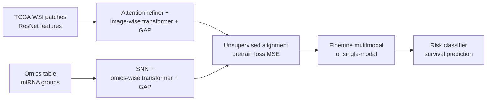
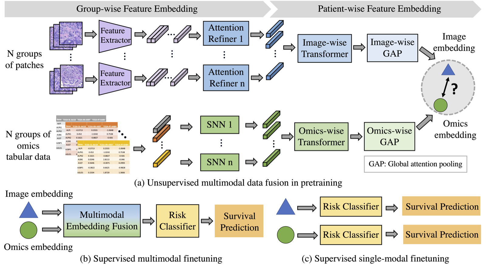

# Cassie07/PathOmics

> **Bibkey** `Ding2023_PathOmics` · **Venue** GitHub (2023) · **Category** pathology · **Relevance** medium · **Access** open
> **Link** <https://github.com/Cassie07/PathOmics>
> `status: complete` — 基于 GitHub README(2026-10-27 读取)和 README 中的流程图;未读 MICCAI 2023 论文正文,所以下面不含论文中的数值结果。

---

## 一句话 / One-liner
<!-- ZH --> PathOmics 是 MICCAI 2023(Oral,README 称 top 9%)论文 "Pathology-and-genomics Multimodal Transformer for Survival Outcome Prediction" 的官方代码:先用无监督预训练把病理切片和基因组学(示例用 miRNA)的嵌入融合对齐,再有监督微调做癌症生存预测,微调时可以用双模态,也可以只用单一模态。
<!-- EN --> PathOmics is the official code of the MICCAI 2023 paper (Oral; "top 9%" per the README) "Pathology-and-genomics Multimodal Transformer for Survival Outcome Prediction": unsupervised pretraining fuses pathology-slide and genomics (miRNA in the example) embeddings, then supervised finetuning predicts cancer survival with either both modalities or a single one.

## 要点 / Takeaways
- <!-- ZH --> 两阶段:(a) 无监督多模态预训练得到图像嵌入和组学嵌入;(b) 多模态微调或 (c) 单模态微调,接风险分类器做生存预测(README Figure 1)。 <!-- EN --> Two stages: (a) unsupervised multimodal pretraining yields image and omics embeddings; (b) multimodal or (c) single-modal finetuning with a risk classifier for survival (README Figure 1).
- <!-- ZH --> 数据只涉及 TCGA-COAD 和 TCGA-READ(结肠癌、直肠癌);组学来自 cBioPortal 的 `coadread_tcga_pan_can_atlas_2018`,示例命令用 `--omic_modal 'miRNA'`(README "Usage")。 <!-- EN --> Data: TCGA-COAD and TCGA-READ only; omics from cBioPortal `coadread_tcga_pan_can_atlas_2018`, with `--omic_modal 'miRNA'` in the example commands (README "Usage").
- <!-- ZH --> 图像特征由用户自行提取:切前景 patch,用 ImageNet 预训练 ResNet50/101 等提特征,每张切片存一个 .npz(README "Data preprocessing")。 <!-- EN --> Image features are extracted by the user: foreground patches, ImageNet-pretrained ResNet50/101 etc., one .npz per slide (README "Data preprocessing").
- <!-- ZH --> README 不含任何数值结果,也不提供预训练权重;数值需看论文(https://rdcu.be/dnwKf)。 <!-- EN --> The README has no numeric results and no released weights; numbers are in the paper (https://rdcu.be/dnwKf).
- <!-- ZH --> 额外价值:README 末尾维护了一张病理–基因组多模态方法文献表(读取时 48 条,2019–2025.12),带论文和代码链接。 <!-- EN --> Extra value: the README keeps a table of pathology–genomics multimodal methods (48 entries, 2019–2025.12 at reading time) with paper and code links.

## 研究问题 / Problem
<!-- ZH --> README 只简要说明:要把病理图像和基因组数据融合来做预后(生存)预测,并让微调阶段"灵活处理多种数据",即有多模态预训练 backbone 后,多模态或单模态数据都能用于微调(README "Workflow overview")。我们的理解:后者对应临床上常见的缺模态情况(只有切片、没有测序)。
<!-- EN --> The README states briefly that the goal is to fuse pathology images and genomics for prognostic (survival) prediction, with a finetuning scheme that "flexibly handles multiple types of data": given the multimodal pretrained backbones, either multi- or single-modal data can be used for finetuning (README "Workflow overview"). Our reading: the latter addresses the common missing-modality case (slides without sequencing).

## 方法 / Method
<!-- ZH --> (根据 README 文字、命令行参数和 Figure 1;论文正文未读)
<!-- ZH --> 1. **图像预处理**:从 TCGA 下载 WSI,切成 patch 并只保留前景,用 ImageNet 预训练 ResNet50 / ResNet101 等提 patch 特征,每张切片一个 .npz(README;细节见 Issue 1 与 `split_tiles_utils/helper.py`)。
<!-- ZH --> 2. **组学数据**:从 cBioPortal 下载 `coadread_tcga_pan_can_atlas_2018` 文件夹;示例用 miRNA。
<!-- ZH --> 3. **预训练(Figure 1a)**:patch 分成 N 组,每组经 Feature Extractor → Attention Refiner → Image-wise Transformer → Image-wise GAP 得到图像嵌入;组学表格数据分成 N 组,每组经 SNN → Omics-wise Transformer → Omics-wise GAP 得到组学嵌入;两个嵌入在预训练中对齐融合。图中 GAP 指 Global attention pooling。示例命令的预训练损失为 `--pretrain_loss 'MSE'`,融合方式 `concat`。
<!-- ZH --> 4. **微调(Figure 1b–c)**:多模态时,图像嵌入 + 组学嵌入 → Multimodal Embedding Fusion → Risk Classifier → 生存预测;单模态时,只用一个嵌入 → Risk Classifier → 生存预测。
<!-- ZH --> 5. **实验设置**:TCGA-COAD 上 4 折交叉验证预训练和微调,在 COAD 留出集评估;或在 COAD 上预训练(5 折),在 TCGA-READ 上微调、验证和评估;`--less_data` + `--finetune_test_ratio` 做少数据微调;示例中预训练和微调各 25 epoch。
<!-- EN --> (From README text, command-line flags and Figure 1; the paper itself was not read.)
<!-- EN --> 1. **Image preprocessing**: download TCGA WSIs, tile into foreground patches, extract features with ImageNet-pretrained ResNet50 / ResNet101 etc., one .npz per slide (README; see Issue 1 and `split_tiles_utils/helper.py`).
<!-- EN --> 2. **Omics**: download `coadread_tcga_pan_can_atlas_2018` from cBioPortal; miRNA in the example.
<!-- EN --> 3. **Pretraining (Figure 1a)**: N patch groups → Feature Extractor → Attention Refiner → Image-wise Transformer → Image-wise GAP → image embedding; N groups of omics tabular data → SNN → Omics-wise Transformer → Omics-wise GAP → omics embedding; the two embeddings are aligned/fused. GAP = Global attention pooling in the figure. Example flags: `--pretrain_loss 'MSE'`, fusion `concat`.
<!-- EN --> 4. **Finetuning (Figure 1b–c)**: multimodal — image + omics embeddings → Multimodal Embedding Fusion → Risk Classifier → survival; single-modal — one embedding → Risk Classifier → survival.
<!-- EN --> 5. **Settings**: TCGA-COAD with 4-fold CV and evaluation on a COAD hold-out set; or pretrain on COAD (5-fold) and finetune/validate/evaluate on TCGA-READ; `--less_data` + `--finetune_test_ratio` for data-efficient finetuning; 25 pretraining and 25 finetuning epochs in the examples.

## 方法图 / Method diagram


## 数据 / Data
<!-- ZH --> TCGA-COAD(结肠腺癌)和 TCGA-READ(直肠腺癌)的 WSI(用户自行下载);组学来自 cBioPortal `coadread_tcga_pan_can_atlas_2018`,示例用 miRNA。仓库不含原始数据或提取好的特征。README 没有给出病例数。
<!-- EN --> TCGA-COAD and TCGA-READ WSIs (downloaded by the user); omics from cBioPortal `coadread_tcga_pan_can_atlas_2018`, miRNA in the example. No raw data or features are shipped, and the README gives no case counts.

## 主要结果 / Key results
<!-- ZH --> README 没有列出任何数值结果(无 C-index、无对比表)。README 中能确认的只有:论文被 MICCAI 2023 接收为 Oral,并标注 "top 9%"(仓库描述与 README 开头)。具体指标需读论文(https://rdcu.be/dnwKf,MICCAI 2023,pp. 622–631)。
<!-- EN --> The README lists no numeric results (no C-index, no comparison table). It only states that the paper was accepted to MICCAI 2023 as an Oral, "top 9%" (repo description and README header). Metrics are in the paper (https://rdcu.be/dnwKf, MICCAI 2023, pp. 622–631).

## 创新点 / Contributions
- <!-- ZH --> (按 README)用无监督预训练融合病理和基因组嵌入,得到可复用的多模态 backbone。 <!-- EN --> (Per README) Unsupervised pretraining fuses pathology and genomics embeddings into a reusable multimodal backbone.
- <!-- ZH --> (按 README)微调阶段可用双模态或单模态,支持缺模态。 <!-- EN --> (Per README) Finetuning works with multi- or single-modal data, supporting missing modalities.
- <!-- ZH --> (按 README)提供跨数据集(COAD 预训练 → READ 微调)和少数据微调选项。 <!-- EN --> (Per README) Cross-dataset (COAD pretrain → READ finetune) and data-efficient finetuning options.
- <!-- ZH --> 持续更新的病理–基因组多模态方法文献表(48 条)。 <!-- EN --> A maintained literature table of pathology–genomics multimodal methods (48 entries).

## 局限 / Limitations
- <!-- ZH --> 我们的理解:README 只覆盖 TCGA 结直肠癌 + miRNA,无其他癌种或组学的示例。 <!-- EN --> Our reading: the README covers only TCGA colorectal cancer + miRNA, with no other cancers or omics.
- <!-- ZH --> 我们的理解:推荐用 ImageNet 预训练的 ResNet 提特征,而不是病理基础模型(如 UNI、CONCH);换成更强的编码器可能有提升,但未经验证。 <!-- EN --> Our reading: it suggests ImageNet-pretrained ResNets rather than pathology foundation models (e.g. UNI, CONCH); stronger encoders might help but this is untested.
- <!-- ZH --> 我们的理解:README 无数值结果、无预训练权重(`--load_model_finetune` 需要你自己先训好保存),复现要从下载 TCGA、切片、提特征开始。 <!-- EN --> Our reading: no numeric results and no released weights (`--load_model_finetune` assumes your own saved weights), so reproduction starts from downloading TCGA, tiling and feature extraction.
- <!-- ZH --> 我们的理解:任务是 slide/患者级生存预测,不做空间定位,也不做异常检测或扰动。 <!-- EN --> Our reading: the task is slide/patient-level survival prediction, with no spatial localisation, anomaly detection or perturbation.

## 与本研究方向的关系 / Relation to our direction
<!-- ZH --> 处在"组织表征 / 多模态建模"这一环,与检测和回复环关系不大。
- 我们的理解:它提供了"病理图像嵌入 ⟷ 组学嵌入"预训练对齐、再允许单模态推理的工程范式。肾脏 Topic 1 有 H&E、snRNA、snATAC、Xenium 多种模态,但并非每个样本都有全部模态;这种"多模态预训练 + 单模态可用"的思路可以借来,让只有 H&E 的样本也能用上多模态学到的表示。
- 我们的理解:如果要用于"模态之间不一致即异常"的检测思路,需要把它从 slide 级生存预测改成空间分辨(spot / 细胞级)的对齐,并设计不一致分数——仓库本身不提供这些。
- 我们的理解:README 的文献表是快速了解病理–基因组融合方法(PORPOISE、MCAT、SurvPath、TANGLE、POMP 等)的入口。
- 相关性 medium:结直肠癌 TCGA,不涉及肾脏和空间组学。
<!-- EN --> It sits at the tissue-representation / multimodal-modelling stage, with little bearing on detect or revert.
- Our reading: it gives an engineering template for pretraining-time alignment of pathology and omics embeddings that still allows single-modal inference. Kidney Topic 1 has H&E, snRNA, snATAC and Xenium, but not every sample has every modality; "multimodal pretraining, single-modal use" could let H&E-only samples benefit from multimodal representations.
- Our reading: to support "cross-modal disagreement = anomaly", it would have to move from slide-level survival to spatially resolved (spot / cell-level) alignment with a disagreement score — none of which the repo provides.
- Our reading: the README literature table is a quick entry point to pathology–genomics fusion methods (PORPOISE, MCAT, SurvPath, TANGLE, POMP, …).
- Relevance medium: TCGA colorectal cancer; no kidney, no spatial omics.

## 可复用资产 / Reusable assets
- <!-- ZH --> **代码**:`bash_main.py`(TCGA-COAD)、`bash_main_read.py`(COAD → READ)、`split_tiles_utils/helper.py`(切 patch 与提特征);环境 Python 3.8.18、PyTorch 2.0.1、scikit-survival 0.21.0 等。 <!-- EN --> **Code**: `bash_main.py` (TCGA-COAD), `bash_main_read.py` (COAD → READ), `split_tiles_utils/helper.py` (tiling and features); Python 3.8.18, PyTorch 2.0.1, scikit-survival 0.21.0, etc.
<!-- ZH/EN --> <https://github.com/Cassie07/PathOmics>
- <!-- ZH --> **数据**:TCGA-COAD / READ WSI;cBioPortal `coadread_tcga_pan_can_atlas_2018`。 <!-- EN --> **Data**: TCGA-COAD / READ WSIs; cBioPortal `coadread_tcga_pan_can_atlas_2018`.
<!-- ZH/EN --> <https://www.cbioportal.org/>
- <!-- ZH --> **权重**:README 未提供。 <!-- EN --> **Weights**: none provided in the README.
- <!-- ZH --> **文献表**:README 末尾 48 条病理–基因组多模态方法,带论文和代码链接。 <!-- EN --> **Literature table**: 48 pathology–genomics multimodal methods at the end of the README, with paper and code links.

## 待读 / Follow-ups
- <!-- ZH --> 读 MICCAI 2023 论文正文,拿到 C-index 和消融(单模态 vs 多模态、融合方式、少数据)。 <!-- EN --> Read the MICCAI 2023 paper for C-index and ablations (single vs multimodal, fusion type, data-efficient).
- <!-- ZH --> 从文献表挑 SurvPath、TANGLE(均 CVPR 2024,mahmoodlab)对照,看通路/转录组引导的表示是否更适合与空间组学对接。 <!-- EN --> From the table, compare SurvPath and TANGLE (both CVPR 2024, mahmoodlab) to see whether pathway/transcriptome-guided representations suit spatial omics better.

## 图表 / Figures & tables


<!-- ZH --> **图1.** PathOmics 两阶段流程总览。(a) 无监督多模态预训练:WSI 切成 N 组 patch → Feature Extractor 提特征 → Attention Refiner + Image-wise Transformer + GAP 得到图像嵌入(蓝色三角);基因组学 omics 表格数据分组经 SNN + Omics-wise Transformer + GAP 得到组学嵌入(绿色圆),两嵌入在预训练中对齐融合(GAP = Global attention pooling)。(b) 有监督多模态微调:图像+组学嵌入经 Multimodal Embedding Fusion → Risk Classifier → 生存预测。(c) 有监督单模态微调:仅图像或仅组学嵌入 → Risk Classifier → 生存预测,支持推断时缺模态。
<!-- EN --> **Fig 1.** Overview of the two-stage PathOmics pipeline. (a) Unsupervised multimodal pretraining: WSIs are tiled into N groups of patches → Feature Extractor → Attention Refiner + Image-wise Transformer + GAP yields the image embedding (blue triangle); grouped omics tabular data pass through SNN + Omics-wise Transformer + GAP to yield the omics embedding (green circle); the two are aligned/fused during pretraining (GAP = Global attention pooling). (b) Supervised multimodal finetuning: fused image+omics embeddings → Multimodal Embedding Fusion → Risk Classifier → survival prediction. (c) Supervised single-modal finetuning: image-only or omics-only embedding → Risk Classifier → survival prediction, enabling missing-modality inference.
<!-- ZH/EN --> _Source: https://github.com/Cassie07/PathOmics/raw/main/Figures/Figure1.png  ·  License: GitHub README figure (MICCAI 2023, Ding et al.)_

### 结果表 / Results

<!-- ZH --> **表1.** README 未提供任何数值结果表(无 C-index / AUC 数字)。具体生存预测指标(TCGA-COAD 4 折 CV + hold-out、COAD→READ 迁移、单模态 vs 多模态、data-efficient 消融)见 MICCAI 2023 论文,不在此仓库内——不臆造数值。
<!-- EN --> **Table 1.** The README contains no numeric results table (no C-index / AUC figures). The actual survival-prediction metrics (TCGA-COAD 4-fold CV + hold-out, COAD→READ transfer, single- vs multimodal, data-efficient ablations) live in the MICCAI 2023 paper, not in this repo — numbers are not invented here.

<!-- ZH/EN --> _C-index results: see the paper → https://rdcu.be/dnwKf (Ding et al., MICCAI 2023, pp. 622–631)._

## 引用 / Cite
```bibtex
@inproceedings{ding2023pathology,
  title={Pathology-and-genomics multimodal transformer for survival outcome prediction},
  author={Ding, Kexin and Zhou, Mu and Metaxas, Dimitris N and Zhang, Shaoting},
  booktitle={International Conference on Medical Image Computing and Computer-Assisted Intervention},
  pages={622--631},
  year={2023},
  organization={Springer}
}
```
