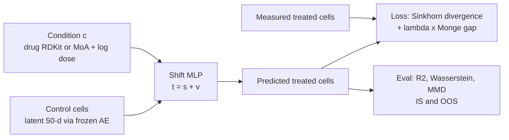
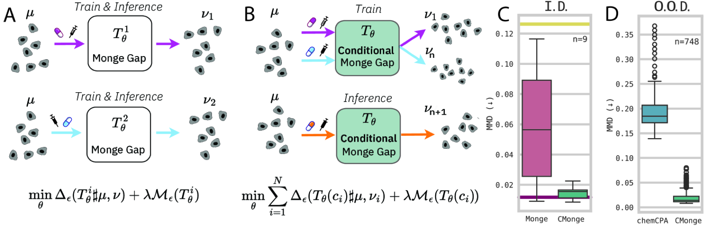
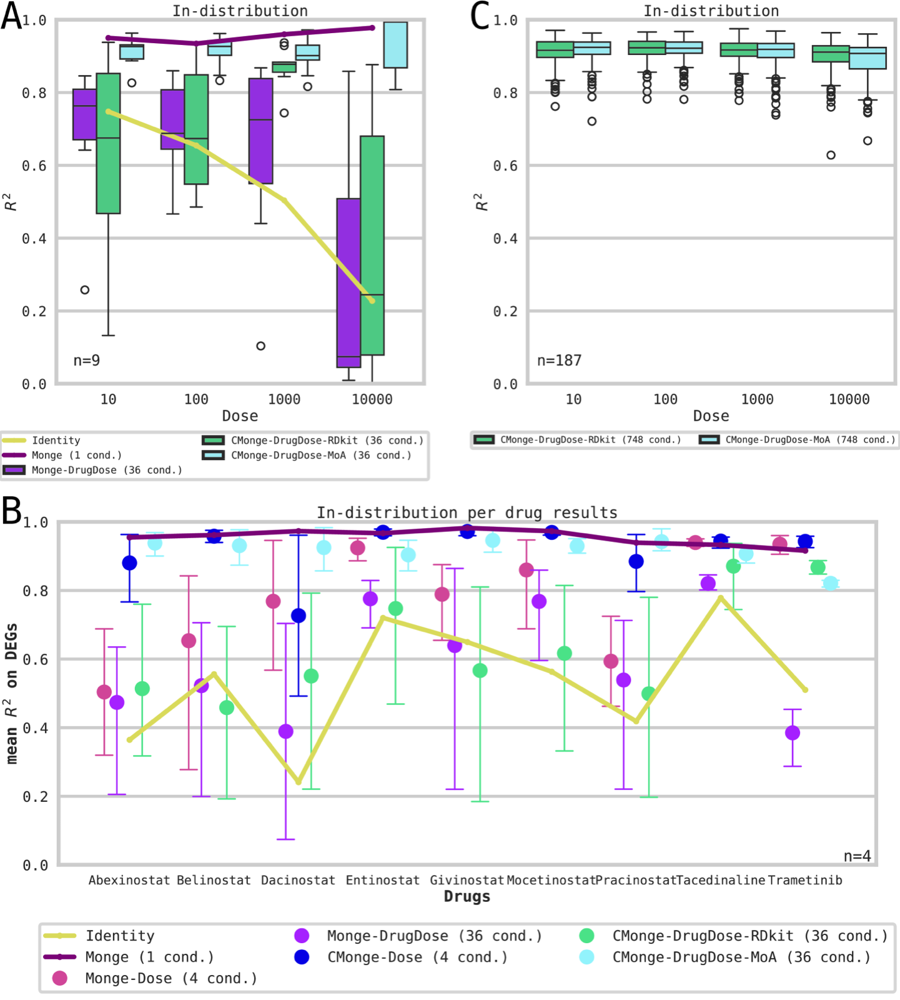
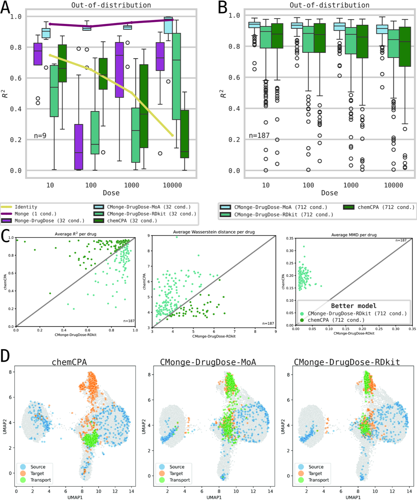

# Conditional Monge Gap enables generalizable single-cell perturbation modelling

> **Bibkey** `Driessen_2026` · **Venue** Nature Machine Intelligence (2026) · **Category** single-cell · **Relevance** medium · **Access** open
> **Link** <https://doi.org/10.1038/s42256-026-01242-8>
> `status: complete` — 若为 abstract-only,把 PDF 放到本文件夹的 `source.pdf` 后可补全全文精读。

---

## 一句话 / One-liner
<!-- ZH --> CMonge(Conditional Monge Gap)用**一个**神经最优传输(OT)模型,在药物、剂量或药物组合等条件下,把"未处理细胞的分布"搬运成"处理后细胞的分布";它可以只凭药物分子结构去预测没见过的药物的单细胞响应。
<!-- EN --> CMonge (Conditional Monge Gap) uses **one** neural optimal-transport (OT) model, conditioned on drug, dose or drug combination, to map the distribution of untreated cells onto the distribution of treated cells; it can predict single-cell responses to unseen drugs from their molecular structure alone.

## 要点 / Takeaways
- <!-- ZH --> 测序会破坏细胞,无法观测同一个细胞处理前后,所以扰动预测是"分布到分布"的问题,OT 天然适合。 <!-- EN --> Sequencing destroys cells, so the same cell is never seen before and after treatment; perturbation prediction is distribution-to-distribution, which suits OT.
- <!-- ZH --> 损失 = Sinkhorn divergence(让搬运后的分布贴近真实处理后分布)+ λ·Monge gap(让搬运"走最短路",保证代价最优);条件向量拼接到输入,网络输出位移向量,预测 = 原细胞 + 位移(Methods 式 8)。 <!-- EN --> Loss = Sinkhorn divergence (pushed-forward vs real treated distribution) + λ·Monge gap (keeps the map cost-optimal); the condition vector is concatenated to the input, the network outputs a shift, prediction = cell + shift (Methods Eq. 8).
- <!-- ZH --> 只用剂量做条件时,9 个按药物的 CMonge 模型与 36 个逐条件模型表现相当(Table 1);用药物 + 剂量时,一个 MoA 嵌入模型就与 36 个逐条件模型持平(Fig. 2a)。 <!-- EN --> With dose as the only condition, nine per-drug CMonge models match 36 per-condition models (Table 1); with drug + dose, a single MoA-embedded model is on par with the 36 (Fig. 2a).
- <!-- ZH --> 未见药物(留出 9 种,训练 712 个条件):最高剂量 R² 0.900(MoA)/ 0.781(RDKit)vs chemCPA 0.760,MMD 0.013 / 0.020 vs 0.195(Table 2)。 <!-- EN --> Unseen drugs (nine held out, 712 training conditions): highest-dose R² 0.900 (MoA) / 0.781 (RDKit) vs chemCPA 0.760; MMD 0.013 / 0.020 vs 0.195 (Table 2).
- <!-- ZH --> 结构型嵌入(RDKit)需要更多训练药物和更大模型才能接近效应型嵌入(MoA);而 MoA 需要先测到该药的一小群处理细胞。 <!-- EN --> Structure-based embeddings (RDKit) need more training drugs and a bigger model to approach effect-based ones (MoA); MoA needs a measured population of treated cells for that drug.
- <!-- ZH --> 模型很小(23,000 参数;大模型 560,000–580,000),chemCPA 约 1.37M(Methods)。 <!-- EN --> The model is small (23,000 parameters; 560,000–580,000 for the large version) vs ~1.37M for chemCPA (Methods).

## 研究问题 / Problem
<!-- ZH --> 想预测细胞对药物的反应,但可测的药物、剂量、组合远多于实验能做的。已有神经 OT 方法(CellOT、scPRAM)是"无条件"的:每个条件单独训一个模型,因此 (1) 新条件无法推断;(2) 训练成本高;(3) 没有利用协变量的归纳偏置;(4) 相似条件之间无法互相借力(Introduction)。作者要做一个能以任意协变量为条件、在见过和没见过的条件上都能预测的全局 OT 模型。
<!-- EN --> We want to predict cellular responses to drugs, but the space of drugs, doses and combinations far exceeds what experiments can cover. Existing neural OT methods (CellOT, scPRAM) are unconditional: one model per condition, so (1) no inference for a new condition, (2) high training cost, (3) no inductive bias from covariates, (4) no cross-task sharing between similar conditions (Introduction). The authors want one global OT model, conditioned on arbitrary covariates, that predicts both seen and unseen conditions.

## 方法 / Method
<!-- ZH --> 术语:扰动(perturbation)= 对细胞施加药物或基因编辑;对照细胞(control)= 未处理细胞;MoA(mode of action)= 药物作用机制。

1. **输入表示**:SciPlex 的 scRNA-seq 先取 1,000 个高变基因,用普通自编码器(MLP,两层隐藏层 512)压到 50 维潜空间(大模型用 100 维),自编码器预训练后冻结;OT 在潜空间里做,指标在解码回的基因空间里算。4i 数据直接用 48 维蛋白 + 形态特征。
2. **条件编码**:剂量取 log;药物嵌入二选一——RDKit(由 SMILES 得到的 194 维分子描述符,基于结构)或 MoA(各药处理后细胞群两两 Wasserstein 距离,用 SMACOF 做多维缩放得到 10 维,基于效应)。药物编码器与药物-剂量编码器各一层全连接,输出拼接为条件向量 c(Methods 式 9)。组合用药用 DeepSets 平均池化(Methods "Encoding the condition",式 9 之后一段)。
3. **传输网络**:MLP(4 层 × 64,GELU;大模型 [256, 256, 512, 512])输入"细胞 + 条件",输出位移 v,预测 t = s + v(Methods "Architecture")。
4. **目标函数**:对 K 个条件求和 Σ Δε(Tθ(c_i)♯μ, ν_i) + λ·Mε(Tθ(c_i)),其中 Δε 是去偏的熵正则 Sinkhorn divergence,Mε 是 Monge gap = 平均位移代价 − 熵 OT 代价(式 5–8),λ = 10⁻²。代价函数论文前后说法不一:Hyperparameters 一节写"欧氏距离",Monge gap 一节写"平方欧氏距离 c(x,y)=‖x−y‖²"。每个 batch 256 个样本、只来自一个随机条件;AdamW,lr 1e-4;用 OTT-JAX 实现。
5. **评测设置**:IS(in-sample,条件在训练中见过,每个条件 80/20 划分)与 OOS(out-of-sample,留出某剂量、某药全部剂量,或在 187 药上 21 折各留 9 药)。指标:预测与真实特征均值之间的 R²(SciPlex 上:Methods "Datasets" 写 top-50 差异表达标志基因,Benchmarking 一节写 50 个高变基因,论文两处说法不一)、Wasserstein 距离、MMD;每个条件 9 次随机抽对照细胞求平均。
6. **基线**:identity(直接把对照当预测,下界)、within-condition(从真实分布再抽样,上界)、逐条件 Monge(36 个模型)、不带条件的 Monge、chemCPA。
<!-- EN --> Terms: perturbation = treating cells with a drug or gene edit; control = untreated cells; MoA = mode of action.

1. **Input representation**: SciPlex scRNA-seq is reduced to 1,000 highly variable genes and encoded by a plain MLP autoencoder (two hidden layers of 512) into a 50-d latent (100-d for the large model); the autoencoder is pretrained and frozen. OT runs in latent space; metrics are computed in decoded gene space. 4i uses its 48 protein + morphology features directly.
2. **Condition encoding**: log dose; drug embedding is either RDKit (194 structure descriptors from SMILES) or MoA (10-d SMACOF multidimensional scaling of pairwise Wasserstein distances between treated populations, effect-based). One dense drug encoder and one drug–dose encoder; outputs concatenated into c (Methods Eq. 9). Combinations use DeepSets average pooling (Methods "Encoding the condition", the paragraph after Eq. 9).
3. **Transport network**: an MLP (4 × 64, GELU; large model [256, 256, 512, 512]) takes cell + condition and outputs a shift v; prediction t = s + v (Methods "Architecture").
4. **Objective**: Σ over K conditions of Δε(Tθ(c_i)♯μ, ν_i) + λ·Mε(Tθ(c_i)), where Δε is the debiased entropic Sinkhorn divergence and Mε the Monge gap = mean displacement cost − entropic OT cost (Eqs. 5–8); λ = 10⁻². The paper states the cost two ways: Hyperparameters says "Euclidean distance", the Monge-gap paragraph says "squared Euclidean distance c(x,y)=‖x−y‖²". Batches of 256 from one uniformly sampled condition; AdamW, lr 1e-4; built on OTT-JAX.
5. **Evaluation**: IS (condition seen in training; 80/20 split per condition) and OOS (held-out dose, all doses of a held-out drug, or 21-fold CV holding out 9 of 187 drugs). Metrics: R² between predicted and true feature means (on SciPlex: Methods "Datasets" says the top 50 differentially expressed marker genes, the Benchmarking section says the 50 highly variable genes; the paper is inconsistent), Wasserstein distance, MMD; nine random control samples per condition, averaged.
6. **Baselines**: identity (control as prediction, lower bound), within-condition (resampling the true target, upper bound), per-condition Monge (36 models), unconditional Monge, chemCPA.

## 方法图 / Method diagram


## 数据 / Data
<!-- ZH --> (1) **SciPlex3**(scRNA-seq):A549、K562、MCF7 三个人癌细胞系,188 种化合物 = 187 种药(各 4 个剂量 10/100/1,000/10,000 nM)+ 对照溶液;共 762,039 个细胞,其中对照 17,565,每个药物-剂量条件平均约 4,032 个细胞;共 748 个药物-剂量条件。使用 Lotfollahi 等预处理版本。实验分两档:9 种药(36 个条件)和全部 187 种药(Methods "Datasets")。(2) **4i**(迭代间接免疫荧光多重蛋白成像):两株黑色素瘤细胞,40 种蛋白,97,748 个细胞(对照 10,995),35 种疗法,每种约 2,500 个细胞;预处理后 48 个特征(标志物表达 + 细胞形态)。条件实验中用 27 种单药 + 6 种组合 = 33 个处理(两种组合因缺单药测量被排除)。
<!-- EN --> (1) **SciPlex3** (scRNA-seq): three human cancer lines (A549, K562, MCF7), 188 compounds = 187 drugs (4 doses each, 10/100/1,000/10,000 nM) + the control solution; 762,039 cells, 17,565 controls, ~4,032 cells per drug–dose condition on average; 748 drug–dose conditions. Lotfollahi et al. preprocessing. Two scales: 9 drugs (36 conditions) and all 187 drugs (Methods "Datasets"). (2) **4i** (iterative indirect immunofluorescence protein imaging): two melanoma lines, 40 proteins, 97,748 cells (10,995 controls), 35 therapies at ~2,500 cells each; 48 features after preprocessing (marker expression + cell shape). Conditional experiments use 27 single drugs + 6 combinations = 33 treatments (two combinations dropped for lack of single-drug measurements).

## 主要结果 / Key results
- <!-- ZH --> **剂量条件(SciPlex 9 药,R²)**:最高剂量 10,000 nM 下 identity 0.227、无条件 Monge-Dose-IS 0.694、CMonge-Dose-IS 0.974、逐条件 Monge 0.978(Table 1);9 个 CMonge-Dose 模型以 1/4 的模型数追平 36 个逐条件模型。 <!-- EN --> **Dose conditioning (SciPlex 9 drugs, R²)**: at 10,000 nM identity 0.227, unconditional Monge-Dose-IS 0.694, CMonge-Dose-IS 0.974, per-condition Monge 0.978 (Table 1); nine CMonge-Dose models match 36 per-condition models with 4× fewer models.
- <!-- ZH --> **未见剂量**:CMonge-Dose-OOS 在所有剂量上优于 identity 和无条件模型;最高剂量最难(0.527 vs Monge-Dose-OOS 0.322,Table 1)。 <!-- EN --> **Unseen dose**: CMonge-Dose-OOS beats identity and the unconditional model at every dose; the highest dose is hardest (0.527 vs Monge-Dose-OOS 0.322, Table 1).
- <!-- ZH --> **药物 + 剂量(IS)**:单个 CMonge-DrugDose-MoA 模型与 36 个逐条件模型持平,RDKit 版在低剂量几乎无提升(Fig. 2a、Supp. Table 3);但在汇总比较里(Supp. Fig. 1),这个单一 MoA 模型对差异基因均值的 R² 虽好,但总体低于 36 个逐条件模型(ICNN 与 Monge),而对细胞异质性的刻画更好(作者也说这是不公平比较);扩到 187 种药(748 条件)后两种嵌入平均 R² 都 >0.8,每种药都 >0.6(Fig. 2b)。 <!-- EN --> **Drug + dose (IS)**: one CMonge-DrugDose-MoA model is on par with 36 per-condition models, while RDKit barely helps at low doses (Fig. 2a, Supp. Table 3); in the aggregated comparison (Supp. Fig. 1), however, this single MoA model has a good but overall lower R² on DEG means than the 36 per-condition models (ICNN and Monge) but captures heterogeneity better (the authors call this an unfair comparison); at 187 drugs (748 conditions) both embeddings reach mean R² >0.8 and >0.6 for every drug (Fig. 2b).
- <!-- ZH --> **通路层面**:曲美替尼(trametinib,MEK 抑制剂)预测结果的富集通路与真值高度重合(top-10 Jaccard 0.429,超几何 P = 1.0×10⁻⁴⁵,653 条通路)(Fig. 2d–e);9 药均 P < 1e-13(Extended Data Fig. 3)。 <!-- EN --> **Pathways**: for trametinib (a MEK inhibitor), enriched pathways in predictions overlap the ground truth (top-10 Jaccard 0.429, hypergeometric P = 1.0×10⁻⁴⁵ over 653 pathways) (Fig. 2d–e); P < 1e-13 for all nine drugs (Extended Data Fig. 3).
- <!-- ZH --> **未见药物(9 药留一)**:CMonge-MoA 在所有设置下大幅优于 chemCPA,接近逐条件上界;只有 trametinib 比按药物模型差(它是 9 药里唯一不作用于表观调控的)(Fig. 4a、Extended Data Fig. 5a)。 <!-- EN --> **Unseen drug (leave one of 9 out)**: CMonge-MoA beats chemCPA widely in all settings and nears the per-condition upper bound; only trametinib (the one non-epigenetic drug of the nine) is worse than drug-specific models (Fig. 4a, Extended Data Fig. 5a).
- <!-- ZH --> **未见药物(187 药,21 折各留 9 药,712 训练条件,10,000 nM)**:R² MoA 0.900±0.059、RDKit 0.781±0.187、chemCPA 0.760±0.211;Wasserstein 3.873 / 4.232 / 4.767;MMD 0.013 / 0.020 / 0.195(Table 2)。 <!-- EN --> **Unseen drugs (187 drugs, 21-fold holding out 9, 712 training conditions, 10,000 nM)**: R² MoA 0.900±0.059, RDKit 0.781±0.187, chemCPA 0.760±0.211; Wasserstein 3.873 / 4.232 / 4.767; MMD 0.013 / 0.020 / 0.195 (Table 2).
- <!-- ZH --> **4i**:IS 下条件信息提高 R²(Fig. 3a);OOS 留一药时 CMonge 对单药泛化困难,组合疗法上明显优于无条件 Monge;identity 平均 R² 已 >0.6(效应小),按 Wasserstein 看 CMonge 对单药和组合都优于 identity(Fig. 3b、Extended Data Fig. 4)。 <!-- EN --> **4i**: in IS, conditioning improves R² (Fig. 3a); in leave-one-out OOS, CMonge struggles on unseen single drugs but clearly beats unconditional Monge on combinations; identity already has mean R² >0.6 (small effects), and by Wasserstein CMonge beats identity for single drugs and combinations (Fig. 3b, Extended Data Fig. 4).
- <!-- ZH --> **分布形状**:UMAP 上 CMonge 预测覆盖目标分布的散布,chemCPA 预测常塌缩到平均效应(Fig. 4d、Extended Data Fig. 7)。 <!-- EN --> **Distribution shape**: on UMAPs CMonge predictions cover the spread of the target, while chemCPA predictions often collapse to the average effect (Fig. 4d, Extended Data Fig. 7).

## 创新点 / Contributions
- <!-- ZH --> 把 Monge gap 正则推广到条件情形:一个全局 OT 映射以任意协变量(剂量、药物、组合)为条件,可推断未见条件。 <!-- EN --> Extends the Monge-gap regulariser to the conditional case: one global OT map conditioned on arbitrary covariates (dose, drug, combinations) that can infer unseen conditions.
- <!-- ZH --> 系统比较结构型(RDKit)与效应型(MoA)药物嵌入,显示条件数增多后两者差距缩小。 <!-- EN --> Systematic comparison of structure-based (RDKit) and effect-based (MoA) drug embeddings, showing the gap narrows as conditions grow.
- <!-- ZH --> 在 scRNA-seq 与蛋白成像两种模态上验证,并扩展到 187 种药;参数量远小于 chemCPA 和单细胞基础模型。 <!-- EN --> Validated on scRNA-seq and protein imaging and scaled to 187 drugs, with far fewer parameters than chemCPA or single-cell foundation models.

## 局限 / Limitations
- <!-- ZH --> (作者)对全新细胞类型、分布外条件、噪声与批次效应的泛化仍是挑战;稀疏采样或未见药物类别、高剂量可能落在观测分布支撑之外(Discussion)。 <!-- EN --> (Authors) Generalisation to new cell types, out-of-distribution conditions, noise and batch effects remains open; sparsely sampled or unseen drug classes and high doses may lie outside the observed support (Discussion).
- <!-- ZH --> (作者)组合用药的 DeepSets 平均池化较简单,可能抓不到复杂的协同/拮抗;注意力池化只在仔细正则化下有微小收益(Supp. Table 9)。 <!-- EN --> (Authors) DeepSets average pooling for combinations is simple and may miss synergy/antagonism; attention pooling gave only marginal gains with careful regularisation (Supp. Table 9).
- <!-- ZH --> (作者)MoA 嵌入需要先测到该药的处理细胞;RDKit 在训练药物少时表现不稳(Fig. 2c)。 <!-- EN --> (Authors) MoA embeddings need measured treated cells for the drug; RDKit is unstable with few training drugs (Fig. 2c).
- <!-- ZH --> 我们的理解:数据都是癌细胞系 / 肿瘤细胞系的体外药物处理,没有组织、空间结构或病人样本;"对照 → 处理"的方向与我们需要的"疾病 → 正常"方向不同。 <!-- EN --> Our reading: all data are in-vitro drug treatments of cancer lines, with no tissue, spatial structure or patient samples; the "control → treated" direction differs from the "disease → normal" direction we need.
- <!-- ZH --> 我们的理解:R² 只衡量均值(top-50 DEG),Wasserstein/MMD 在潜空间解码后计算,结论依赖冻结自编码器的质量。 <!-- EN --> Our reading: R² only measures means (top-50 DEGs), and distributional metrics depend on the frozen autoencoder's decoding quality.

## 与本研究方向的关系 / Relation to our direction
<!-- ZH --> 属于 **model / revert** 环节,不是异常检测。我们的理解:(1) 如果把"疾病细胞群"当源分布、"正常细胞群"当目标分布,CMonge 式的条件 OT 可以作为"哪个条件(药物/基因扰动)能把分布搬回正常"的打分器;但论文只训练了"对照 → 处理"方向,反向使用需要相应的配对数据,未经验证。(2) 它的 Sinkhorn / Wasserstein 距离可以作为 revert 程度的分布级度量,与课题 1 里"异常是分布偏移"的观点一致。(3) 它没有空间信息,也不处理组织切片;对肾脏数据而言,更现实的用法是在 snRNA 层面对候选扰动做初筛,再回到空间数据验证。(4) "条件数越多,结构嵌入越可用"提示:若要对未测过的化合物做 revert 预测,需要大规模扰动数据训练。
<!-- EN --> This is a **model / revert** paper, not anomaly detection. Our reading: (1) with a diseased population as source and a normal population as target, a CMonge-style conditional OT could score which condition (drug / genetic perturbation) moves cells back towards normal; but the paper only trains control → treated, so the reverse use needs suitable data and is untested. (2) Its Sinkhorn / Wasserstein distances can serve as a distribution-level revert measure, consistent with treating anomalies as distribution shift in Topic 1. (3) It has no spatial information and no tissue sections; for kidney data a realistic use is first screening candidate perturbations at the snRNA level and then checking them on spatial data. (4) "More conditions make structure embeddings usable" implies that revert prediction for unmeasured compounds needs large perturbation datasets for training.

## 可复用资产 / Reusable assets
- <!-- ZH --> **代码:** <https://github.com/AI4SCR/conditional-monge-gap>(论文写作 AI4SCR/Conditional-Monge,已重定向;MIT),PyPI 包 `cmonge` <https://pypi.org/project/cmonge/>,Zenodo <https://doi.org/10.5281/zenodo.17854338>(Code availability)。仓库 README:在 Python 3.10 和 3.11 上测试;加载旧 checkpoint(cmonge-{moa, rdkit}-ood 等)需切到 tag `cmonge_checkpoint_loading`。 <!-- EN --> **Code:** <https://github.com/AI4SCR/conditional-monge-gap> (the paper's AI4SCR/Conditional-Monge redirects here; MIT), PyPI `cmonge` <https://pypi.org/project/cmonge/>, Zenodo <https://doi.org/10.5281/zenodo.17854338> (Code availability). Repo README: tested on Python 3.10 and 3.11; loading older checkpoints (cmonge-{moa, rdkit}-ood etc.) needs the tag `cmonge_checkpoint_loading`.
- <!-- ZH --> **数据:** 预处理版 SciPlex3 与 4i,ETH Research Collection <https://doi.org/10.3929/ethz-b-000609681>(Data availability,ref. 66)。 <!-- EN --> **Data:** preprocessed SciPlex3 and 4i, ETH Research Collection <https://doi.org/10.3929/ethz-b-000609681> (Data availability, ref. 66).
- <!-- ZH --> **底层库:** 所有模型基于 OTT-JAX(Methods)。 <!-- EN --> **Library:** all models are built on OTT-JAX (Methods).
- <!-- ZH --> **预印本:** arXiv:2504.08328(下方图表来源)。 <!-- EN --> **Preprint:** arXiv:2504.08328 (source of the figures below).

## 待读 / Follow-ups
- <!-- ZH --> Uscidda & Cuturi 的 Monge Gap 原文(ref. 32);CellOT(ref. 30);chemCPA(ref. 11)。 <!-- EN --> Uscidda & Cuturi's Monge Gap (ref. 32); CellOT (ref. 30); chemCPA (ref. 11).
- <!-- ZH --> 作者的 CAR-T 平行工作(ref. 39):用蛋白语言模型嵌入作为条件。 <!-- EN --> The authors' parallel CAR-T work (ref. 39): protein-language-model embeddings as conditions.
- <!-- ZH --> 我们的理解:找带基因扰动的肾脏细胞数据(如 Perturb-seq),测试"疾病 → 正常"方向的条件 OT 是否可行。 <!-- EN --> Our reading: look for kidney-cell perturbation data (e.g. Perturb-seq) to test conditional OT in the disease → normal direction.

## 图表 / Figures & tables

> <!-- ZH --> 正式版在 Nature Machine Intelligence 开放获取(CC BY-NC-ND 4.0,不允许演绎)。以下图片取自**预印本** arXiv:2504.08328 v1,其中模型名用 ID/OOD,正式版改称 IS/OOS(in-sample / out-of-sample);两张表的数字已与正式版 Table 1、Table 2 核对;Within condition 一行只在正式版中出现(预印本 v1 的 Table 1 没有这一行)。正式版 Table 1 把逐条件 Monge 一行加粗(尽管 Within condition 在 100、1,000、10,000 nM 上更高);下表不加粗。
> <!-- EN --> The version of record is open access in Nature Machine Intelligence (CC BY-NC-ND 4.0, no derivatives). The images below come from the **preprint** arXiv:2504.08328 v1, which names models ID/OOD; the published version uses IS/OOS (in-sample / out-of-sample). The numbers in the two tables were checked against published Table 1 and Table 2; the Within-condition row exists only in the published version (arXiv v1 Table 1 has no such row). Published Table 1 bolds the per-condition Monge row (although Within condition is higher at 100, 1,000 and 10,000 nM); no bold is used below.


<!-- ZH --> **图1.** 方法总览。A) 既有方法(Monge Gap)为每个扰动单独学一个局部映射 T_θ^i;B) CMonge 用单一模型 T_θ(c_i),以条件 c_i(药物/剂量)条件化,训练目标为 Sinkhorn 拟合项 Δ_ε + λ·Monge-gap 正则项 M_ε,可推理到未见条件 ν_{n+1};C) SciPlex 9 药、最高剂量、见过的条件(预印本标 I.D.):9 个按药物的 Monge 模型 vs 9 个以剂量为条件的 CMonge 模型的 MMD(越低越好;黄线 = identity,性能下界;紫线 = 36 个逐条件 Monge,性能上界);D) 未见药物(预印本标 O.O.D.,n=748):CMonge 的 MMD 远低于 chemCPA。
<!-- EN --> **Fig 1.** Method overview. A) Prior methods (Monge Gap) learn a separate local map T_θ^i per perturbation; B) CMonge uses a single model T_θ(c_i) conditioned on covariate c_i (drug/dose), trained with a Sinkhorn fitting term Δ_ε plus λ·Monge-gap regularizer M_ε, and infers on unseen conditions ν_{n+1}; C) SciPlex, nine drugs, highest dose, seen conditions (labelled I.D. in the preprint): MMD of nine drug-specific Monge models vs nine dose-conditioned CMonge models (lower is better; yellow line = identity, the performance lower bound; purple = 36 per-condition Monge models, the upper bound); D) unseen drugs (O.O.D. in the preprint, n=748): CMonge's MMD is far below chemCPA.
<!-- ZH/EN --> _Source: https://arxiv.org/html/2504.08328v1/x1.png (Fig 1) · License: arXiv preprint (arXiv:2504.08328)_


<!-- ZH --> **图3.** In-distribution 设定下条件/非条件 Monge 方法的 R² 对比。A) 9 药:单一 CMonge-DrugDose-MoA 模型接近 36 个逐条件 Monge 模型(上界),RDKit 版在低剂量几乎没有提升;B) 按药物分列;C) 全部 187 药(748 条件)、更大模型:RDKit 版追平 MoA 版,两者平均 R² 都 >0.8。
<!-- EN --> **Fig 3.** In-distribution R² of conditional vs unconditional Monge methods. A) Nine drugs: a single CMonge-DrugDose-MoA model approaches the 36 per-condition Monge models (upper bound), while the RDKit version barely helps at low doses; B) results per drug; C) all 187 drugs (748 conditions) with larger models: the RDKit version catches up with MoA, and both reach mean R² >0.8.
<!-- ZH/EN --> _Source: https://arxiv.org/html/2504.08328v1/x3.png (Fig 3) · License: arXiv preprint (arXiv:2504.08328)_


<!-- ZH --> **图5.** SciPlex 上未见药物/剂量的 OOD 结果(R²、Wasserstein、MMD)。9 药设置下,CMonge-MoA 在各剂量上都优于条件基线 chemCPA;CMonge-RDKit 只在最难的最高剂量上优于 chemCPA,在较低剂量上不如 chemCPA,作者归因于训练药物少(8 种)、参数少(正式版第 989 页)。RDKit 版只有在 187 药设置下才在所有指标上优于 chemCPA(Table 2)。
<!-- EN --> **Fig 5.** Out-of-distribution results on SciPlex for unseen dose and drug-dose contexts (R², Wasserstein, MMD). With nine drugs, CMonge-MoA beats the conditional baseline chemCPA at every dose; CMonge-RDKit beats chemCPA only at the hardest, highest dose and is below it at the lower doses, which the authors attribute to few training drugs (eight) and few parameters (published p. 989). RDKit beats chemCPA on all metrics only in the 187-drug setting (Table 2).
<!-- ZH/EN --> _Source: https://arxiv.org/html/2504.08328v1/x5.png (Fig 5) · License: arXiv preprint (arXiv:2504.08328)_

### 结果表 / Results

<!-- ZH --> **表1.** SciPlex 9 药剂量实验的 R²(预测与真实特征均值之间,越高越好),按剂量分列;括号内为标准差(正式版 Table 1)。Within condition 与逐条件 Monge(36 个模型)为上界,identity 为下界。
<!-- EN --> **Table 1.** SciPlex nine-drug dose experiments, R² between predicted and true feature means (higher is better) by dose; SD in parentheses (published Table 1). Within-condition and per-condition Monge (36 models) are upper bounds, identity the lower bound.

| Model | Cond. seen | 10 nM | 100 nM | 1000 nM | 10000 nM |
|---|---|---|---|---|---|
| Within condition | — | 0.950 (±0.034) | 0.960 (±0.023) | 0.967 (±0.018) | 0.982 (±0.018) |
| Identity | — | 0.748 (±0.127) | 0.655 (±0.261) | 0.504 (±0.332) | 0.227 (±0.212) |
| Monge (per-condition) | 1 | 0.950 (±0.020) | 0.935 (±0.042) | 0.960 (±0.025) | 0.978 (±0.029) |
| Monge-Dose-IS | 4 | 0.750 (±0.254) | 0.767 (±0.231) | 0.885 (±0.099) | 0.694 (±0.272) |
| CMonge-Dose-IS | 4 | 0.882 (±0.185) | 0.905 (±0.124) | 0.905 (±0.093) | 0.974 (±0.026) |
| Monge-Dose-OOS | 3 | 0.614 (±0.349) | 0.726 (±0.219) | 0.856 (±0.112) | 0.322 (±0.348) |
| CMonge-Dose-OOS | 3 | 0.864 (±0.197) | 0.931 (±0.058) | 0.878 (±0.118) | 0.527 (±0.311) |

<!-- ZH --> **表2.** SciPlex 全量药物-剂量 OOS(最高剂量 10,000 nM,712 个训练条件,21 折、每折留出 9 种药;正式版 Table 2)。CMonge-MoA 在 R²、Wasserstein、MMD 三项上均优于 chemCPA。↑ 越高越好,↓ 越低越好。
<!-- EN --> **Table 2.** SciPlex full drug–dose OOS (highest dose 10,000 nM, 712 training conditions, 21-fold CV holding out 9 drugs; published Table 2). CMonge-MoA beats chemCPA on R², Wasserstein and MMD. ↑ higher is better, ↓ lower is better.

| Model | Cond. seen | R² ↑ | Wasserstein ↓ | MMD ↓ |
|---|---|---|---|---|
| CMonge-DrugDose-MoA-OOS | 712 | **0.900 (±0.059)** | **3.873 (±0.643)** | **0.013 (±0.005)** |
| CMonge-DrugDose-RDKit-OOS | 712 | 0.781 (±0.187) | 4.232 (±0.896) | 0.020 (±0.012) |
| chemCPA-DrugDoseCellLine-OOS | 712 | 0.760 (±0.211) | 4.767 (±0.976) | 0.195 (±0.035) |

<!-- ZH/EN --> _Source: Table 1 and Table 2 of the published article, https://doi.org/10.1038/s42256-026-01242-8 (all other values also appear in arXiv:2504.08328v1; the Within-condition row is published-only) · License: CC BY-NC-ND 4.0_

## 引用 / Cite
```bibtex
@article{Driessen_2026, title={Conditional Monge Gap enables generalizable single-cell perturbation modelling}, volume={8}, ISSN={2522-5839}, url={http://dx.doi.org/10.1038/s42256-026-01242-8}, DOI={10.1038/s42256-026-01242-8}, number={6}, journal={Nature Machine Intelligence}, publisher={Springer Science and Business Media LLC}, author={Driessen, Alice and Rajwade, Dhruva Abhijit and Harsanyi, Benedek and Rapsomaniki, Marianna and Born, Jannis}, year={2026}, month=jun, pages={984–996} }
```
