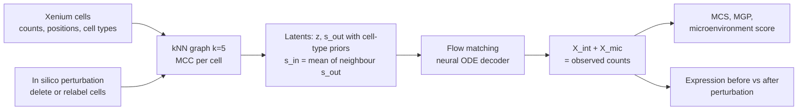

# Mapping and reprogramming human tissue microenvironments with MintFlow

> **Bibkey** `Akbarnejad_2025` · **Venue** bioRxiv (2025) · **Category** spatial · **Relevance** high · **Access** open
> **Link** <https://doi.org/10.1101/2025.06.24.661094>
> `status: complete` — 基于 bioRxiv v3 全文 PDF(posted 2025-07-24);补充材料未读。 / Based on the full bioRxiv v3 PDF (posted 2025-07-24); supplement not read.

---

## 一句话 / One-liner
<!-- ZH --> MintFlow 是一个基于 flow matching 的生成模型:在单细胞分辨率空间转录组(Xenium)上,把每个细胞的表达拆成"细胞本身(intrinsic)"和"由周围微环境诱导(microenvironment-induced)"两部分,并能在电脑里删除或替换某类细胞,预测邻近细胞表达如何变化。
<!-- EN --> MintFlow is a flow-matching generative model for single-cell-resolution spatial transcriptomics (Xenium): it splits each cell's expression into an intrinsic part and a microenvironment-induced part, and can delete or replace a cell type in silico to predict how neighbouring cells' expression would change.

## 要点 / Takeaways
- <!-- ZH --> 核心输出是两个计数矩阵:X_int(本征)和 X_mic(微环境诱导),两者相加重建原始表达;"微环境评分"= 细胞总计数中被归为微环境诱导的比例(Methods)。 <!-- EN --> The core output is two count matrices, X_int (intrinsic) and X_mic (microenvironment-induced), which sum to the observed expression; the microenvironment score is the share of a cell's counts assigned to X_mic (Methods).
- <!-- ZH --> 不需要配体-受体先验或预定义空间域。分解按"可识别"来设计:iVAE 式条件先验让 [z, s_in] 在理论上可识别(至多差一个维度置换),最优传输目标(Proposition 1)在其最优解处使分解唯一;但作者说明训练不保证达到该最优解,且在细胞类型单一的区域分离会变弱(Methods "Notes on identifiability"、Supplementary Note 2)。 <!-- EN --> No ligand-receptor priors or predefined domains. The split is designed to be identifiable: iVAE-style conditional priors make [z, s_in] identifiable up to permutation in theory, and an optimal-transport objective (Proposition 1) makes the split unique at its optimum; the authors note that training is not guaranteed to reach that optimum and that separation weakens in cell-type-homogeneous regions (Methods "Notes on identifiability", Supplementary Note 2).
- <!-- ZH --> in silico 扰动 = 改细胞类型标签或删除一群细胞 → 按空间位置重建邻接图 → 重新生成表达,比较扰动前后。 <!-- EN --> In silico perturbation = relabel or remove a cell population → rebuild the neighbour graph from positions → regenerate expression and compare before vs after.
- <!-- ZH --> 应用于特应性皮炎、黑色素瘤和透明细胞肾癌(ccRCC);ccRCC 中模拟删除三级淋巴结构(TLS)相关巨噬细胞,使 TLS T 细胞的共抑制 / 耗竭标记下调。 <!-- EN --> Applied to atopic dermatitis, melanoma and clear-cell renal cell carcinoma (ccRCC); in ccRCC, simulated deletion of tertiary-lymphoid-structure (TLS) macrophages lowers co-inhibition / exhaustion markers in TLS T cells.
- <!-- ZH --> 把 in silico 重编程结果连到 TCGA 606 例 ccRCC 生存:TLS Border T 细胞程序高表达与更差生存相关(p = 0.0073),重编程后的状态高表达与生存获益相关(p = 0.0034)(Fig. 7g)。 <!-- EN --> In-silico reprogramming is linked to survival in 606 TCGA ccRCC tumours: high TLS Border T-cell programme expression goes with worse survival (p = 0.0073), high expression of the reprogrammed state with a survival advantage (p = 0.0034) (Fig. 7g).
- <!-- ZH --> 我们的理解:这是我们读到的最接近"model → revert"的空间组学方法,而且有肾脏(ccRCC)应用。 <!-- EN --> Our reading: the closest spatial-omics method to "model → revert" that we have read, with a kidney (ccRCC) application.

## 研究问题 / Problem
<!-- ZH --> 组织微环境会在疾病中重编程局部细胞状态,但现有空间计算方法仍是描述性的,不能模拟组织扰动(Abstract)。作者指出,已有对微环境效应建模的方法要么不能把本征与微环境诱导的变化分开,要么缺乏机制可解释性、需要事后解释嵌入,要么受线性假设限制、扩展性差,或需要基因-基因相互作用(如配体-受体)先验;它们也难以提出新的生物学假设并用 in silico 扰动检验(Introduction)。作者想要一个能学习"微环境如何改变细胞状态"、可扩展到多张切片、并能做 in silico 扰动的生成模型。
<!-- EN --> Tissue microenvironments reprogram local cell states in disease, yet current spatial computational methods remain descriptive and do not simulate tissue perturbation (Abstract). The authors note that existing methods for microenvironment effects either fail to separate intrinsic from microenvironment-induced variation, lack mechanistic interpretability and need post-hoc interpretation of embeddings, are limited by linear assumptions, scale poorly, or require prior knowledge of gene-gene interactions (e.g. ligand-receptor); they also fall short at generating new hypotheses and testing them by in silico perturbation (Introduction). The authors want a generative model that learns how the microenvironment changes cell states, scales to many sections and supports in silico perturbation.

## 方法 / Method
<!-- ZH --> 术语:Xenium = 10x 的单细胞分辨率原位转录组平台(本文用 5k-plex,约 5000 基因 panel);微环境 = 一个细胞在近邻图中的邻居;MCC = 微环境中各细胞类型的比例。

1. **输入**:单细胞分辨率空间转录组的计数、坐标和细胞类型标签。按坐标建 k=5 的近邻图,一个细胞的邻居即其微环境,算每个细胞的 MCC(Methods "Model overview")。
2. **三个隐变量**:z_n(本征变化,先验以细胞类型为条件)、s_out(细胞向外发出的信号,先验以细胞类型为条件)、s_in(邻居 s_out 的平均,因此间接依赖 MCC)(Fig. 1b、Methods)。
3. **生成过程**:在隐空间做 flow matching,用神经 ODE 解码器得到本征与微环境诱导的低维表示,再由解码器生成 X_int 和 X_mic,两者相加等于观测计数。
4. **可识别性**:非线性解码器的模型一般不可识别。作者模仿 iVAE,把 z 和 s_in 分别以细胞类型(CT)和 MCC 为条件,并加目标"CT 可由 z 预测、MCC 可由 s_in 预测"等;理论上 [z, s_in] 可识别至多差一个维度置换,但在细胞类型单一的区域 CT 与 MCC 相同,分离会变弱。为使 X = X_int + X_mic 的分解唯一,加入与最优传输相关的目标(Proposition 1,证明见 Supplementary Note 2);作者说明方法不保证找到该目标的最优解。另用 Wasserstein 分布匹配**鼓励** z 和 x_int 不含邻居细胞类型信息(Objectives 7–8)(Methods "Notes on identifiability")。
5. **扩展性**:用 PyTorch Geometric 邻居采样做子图训练;自定义采样器以组织上的随机方块作为中心节点,可以在多张、合计数百万细胞的切片上训练(Methods "Scalability")。
6. **下游**:聚类微环境诱导嵌入得到微环境诱导细胞状态(MCS)和微环境域;对微环境诱导表达做差异表达得到微环境诱导基因程序(MGP);微环境评分高且聚集的细胞是候选信号热点。
7. **in silico 扰动**:训练后模型只需细胞类型标签和近邻图即可生成表达。实验中从真实数据取一块组织,改细胞类型标签或删除某类细胞,按空间位置重建近邻图,再比较扰动前后生成的表达(Methods "In silico tissue perturbation")。
8. **基准**:用 NicheCompass 模拟框架生成带已知微环境效应的模拟数据(10,000 个细胞、2,000 个基因、8 个空间区域),指标 MAE、EMD、MSE;真实数据上看已知信号基因(来自配体-受体数据库合集)的计数是否更多被归入 X_mic;对比 SIMVI、MEFISTO 和随机基线;与基线比较时 MintFlow 嵌入维度从默认 100 降到 10(Methods "Benchmarking"、"Metrics")。
<!-- EN --> Terms: Xenium = 10x's single-cell in-situ transcriptomics platform (5k-plex here, ≈5,000-gene panel); microenvironment = a cell's neighbours in the neighbour graph; MCC = cell-type proportions in that microenvironment.

1. **Input**: counts, coordinates and cell-type labels from single-cell-resolution spatial transcriptomics. A k=5 nearest-neighbour graph from coordinates defines each cell's microenvironment and its MCC (Methods "Model overview").
2. **Three latents**: z_n (intrinsic variation, prior conditioned on cell type), s_out (outgoing signal, prior conditioned on cell type), s_in (the average of the neighbours' s_out, so indirectly dependent on MCC) (Fig. 1b, Methods).
3. **Generation**: flow matching in latent space with a neural-ODE decoder yields low-dimensional intrinsic and microenvironment-induced representations, which decoders turn into X_int and X_mic; these sum to the observed counts.
4. **Identifiability**: models with non-linear decoders are generally unidentifiable. The authors mimic iVAE by conditioning z on cell type (CT) and s_in on MCC, with objectives such as "CT predictable from z" and "MCC predictable from s_in"; in theory [z, s_in] is identifiable up to permutation, but in cell-type-homogeneous regions CT and MCC coincide and separation weakens. To make the split X = X_int + X_mic unique they add optimal-transport-related objectives (Proposition 1, proof in Supplementary Note 2); the authors state the method is not guaranteed to find the optimum. Wasserstein distribution-matching terms **encourage** z and x_int to carry no information about neighbours' cell types (Objectives 7–8) (Methods "Notes on identifiability").
5. **Scale**: subgraph training with PyTorch Geometric neighbour sampling; a custom sampler takes random tissue crops as central nodes, allowing several sections with millions of cells (Methods "Scalability").
6. **Downstream**: clustering microenvironment-induced embeddings gives microenvironment-induced cell states (MCS) and microenvironment domains; differential expression on microenvironment-induced expression gives microenvironment-induced gene programmes (MGPs); co-located cells with high microenvironment scores are candidate signalling hotspots.
7. **In silico perturbation**: after training, the model generates expression from cell-type labels and the neighbour graph alone. In the experiments a real tissue crop is taken, cell-type labels are changed or a cell type is removed, the neighbour graph is rebuilt from positions, and generated expression is compared before vs after (Methods "In silico tissue perturbation").
8. **Benchmark**: simulated data with known microenvironment effects from the NicheCompass simulation framework (10,000 cells, 2,000 genes, eight spatial regions), scored by MAE, EMD, MSE; on real data, whether known signalling genes (from combined ligand-receptor databases) get more counts in X_mic; baselines SIMVI, MEFISTO and random; when compared with baselines MintFlow's embedding size is reduced from the default 100 to 10 (Methods "Benchmarking", "Metrics").

## 方法图 / Method diagram


## 数据 / Data
<!-- ZH --> (1) **特应性皮炎**:8 名患者的 10 张皮肤切片(5 张皮损、5 张非皮损;其中 8 张为新生成),Xenium 5k,QC 后 197,487 个细胞,识别 10 个微环境域;外部验证包括 4 名患者的特应性皮炎 scRNA-seq、一个覆盖 6 种组织 23 种疾病的整合数据集、同一队列 10 名患者 dupilumab 治疗第 12 周的样本。(2) **皮肤黑色素瘤**:10x 公开的 5000-plex Xenium 数据,QC 后 98,749 个细胞,8 个微环境簇。(3) **ccRCC**:训练和主要分析用 1 名患者(PD43284)的肾切除标本,肿瘤核心 3 个肉眼可区分的区域 + 肿瘤-正常交界,337,116 个细胞,24 种细胞类型;另 2 名患者(PD45814、PD45816)的 Xenium 数据只用于验证(Supplementary Fig. 10)。外部数据:Li et al. 2022 的 ccRCC scRNA-seq(10 名患者、147,917 个肿瘤浸润细胞,含提供 Xenium 样本的那名患者;ref. 50);Bi et al. 2021 的 ICB 治疗前后 ccRCC scRNA-seq(提供 ICB 后 T 细胞和巨噬细胞签名;ref. 58);TCGA 606 例 ccRCC bulk RNA-seq;一个 Kaede 转基因小鼠模型(皮下注射结直肠肿瘤上皮细胞,抗 PD-L1 或同型对照治疗;ref. 57)。(4) **模拟数据**:NicheCompass 框架生成,带真值,用于基准。数据可用性:模拟数据和公开黑色素瘤数据可下载,其余数据"will be made available soon"。
<!-- EN --> (1) **Atopic dermatitis**: 10 skin sections from 8 patients (5 lesional, 5 non-lesional; 8 newly generated), Xenium 5k, 197,487 cells after QC, 10 microenvironment domains; external validation includes atopic-dermatitis scRNA-seq from 4 patients, an integrated dataset of 23 diseases across 6 tissues, and week-12 post-dupilumab samples from 10 patients of the same cohort. (2) **Cutaneous melanoma**: public 10x 5000-plex Xenium, 98,749 cells after QC, 8 microenvironment clusters. (3) **ccRCC**: training and main analyses use one patient's nephrectomy (PD43284), three macroscopically distinct tumour-core regions plus the tumour–normal interface, 337,116 cells, 24 cell types; Xenium data from 2 more patients (PD45814, PD45816) are used only for validation (Supplementary Fig. 10). External data: Li et al. 2022 ccRCC scRNA-seq (147,917 tumour-infiltrating cells from 10 patients, including the Xenium donor; ref. 50); Bi et al. 2021 ccRCC scRNA-seq before and after ICB (source of the post-ICB T-cell and macrophage signatures; ref. 58); 606 TCGA ccRCC bulk RNA-seq tumours; a Kaede transgenic mouse model (subcutaneous colorectal tumour epithelial cells, anti-PD-L1 or isotype control; ref. 57). (4) **Simulated data**: NicheCompass framework, with ground truth, for benchmarking. Data availability: simulated data and the public melanoma data can be downloaded; all other data "will be made available soon".

## 主要结果 / Key results
- <!-- ZH --> **基准(图中每个箱线图上方印出的数值;Fig. 1g 纵轴标注 "averaged")**:模拟数据上,EMD(log 尺度、取负,越高越好)MintFlow 7.08,SIMVI −0.37,MEFISTO −4.36,random −3.79,random binary 2.45;MAE、MSE 趋势相同(Fig. 1g)。真实数据上,已知信号基因的计数被归入 X_mic 的比例:皮炎单切片 MintFlow 0.247 vs SIMVI 0.053、MEFISTO 0.001;黑色素瘤 0.62 vs 0.037、0.001;皮炎 10 张切片上只有 MintFlow 能运行,已知信号基因 0.66 vs 非信号基因 0.317(Fig. 1h,计数 < 20 被过滤)。 <!-- EN --> **Benchmark (numbers printed above each box; the Fig. 1g axis is labelled "averaged")**: on simulated data, EMD (log scale, negated, higher is better) is 7.08 for MintFlow vs −0.37 SIMVI, −4.36 MEFISTO, −3.79 random, 2.45 random binary; MAE and MSE follow the same pattern (Fig. 1g). On real data, the share of known-signalling-gene counts assigned to X_mic: eczema single section MintFlow 0.247 vs SIMVI 0.053, MEFISTO 0.001; melanoma 0.62 vs 0.037, 0.001; on all 10 eczema sections only MintFlow ran, 0.66 for known signalling genes vs 0.317 for other genes (Fig. 1h; counts < 20 filtered).
- <!-- ZH --> **特应性皮炎**:T_DC 域(以 T 细胞为主,另有 MigDC、cDC2)在炎症皮肤中扩大,其 MGP 提示 CCL19/CCR7 和 CCL22/CCL17–CCR4 信号轴,作者称之为 T 细胞活化枢纽;drug2cell 找回了已知有效药(upadacitinib、prednisolone)(Fig. 2)。另发现微环境诱导的 CD8A+ ITGAE+ GZMB+ T 细胞簇(IL13、IL22、GZMB 表达升高),位于浅表皮肤,作者认为是表皮 2 型组织驻留记忆 T 细胞(Fig. 2h–i)。 <!-- EN --> **Atopic dermatitis**: the T_DC domain (mostly T cells, plus MigDCs and cDC2) is expanded in inflamed skin; its MGP points to CCL19/CCR7 and CCL22/CCL17–CCR4 signalling axes, and the authors call it a T-cell activation hub; drug2cell recovered drugs with known efficacy (upadacitinib, prednisolone) (Fig. 2). A microenvironment-induced CD8A+ ITGAE+ GZMB+ T-cell cluster (increased IL13, IL22, GZMB) located in superficial skin, which the authors read as epidermal type-2 tissue-resident memory T cells (Fig. 2h–i).
- <!-- ZH --> **皮炎 in silico 扰动**:模拟删除 Treg 后,MigDC 和 Tconv 上调炎症反应、T 细胞活化等通路,提示炎症增强;把所有 Tconv 替换成 Treg 后,MigDC 中炎症通路不富集,DC 活化 / 迁移相关基因(CCL17、CCL22、CCR7、LAMP3 等)下调(Fig. 3b–g)。dupilumab 治疗队列中,应答者(改善 >50%)的 Treg 通常从基线到第 12 周增加;2 名无应答者(改善 <10%)无显著变化,且基线 Treg 通常更高(Fig. 3j)。 <!-- EN --> **Atopic-dermatitis in silico perturbation**: simulated Treg depletion makes MigDCs and Tconv cells upregulate inflammatory-response and T-cell-activation pathways, suggesting more inflammation; replacing all Tconv cells with Tregs gives no enrichment of inflammatory pathways in MigDCs and downregulates DC activation / migration genes (CCL17, CCL22, CCR7, LAMP3 and others) (Fig. 3b–g). In the dupilumab cohort, Tregs in responders (>50% improvement) typically increased from baseline to week 12; in the 2 non-responders (<10% improvement) there was no significant change, and baseline Tregs were typically higher (Fig. 3j).
- <!-- ZH --> **黑色素瘤**:Stroma 域(以 CAF 和 T 细胞为主)的 MGP 含 CXCL12、胶原(COL4A2、COL5A1、COL5A2、COL11A1)和胶原交联酶(LOX、LOXL1、LOXL2),作者认为指向对 T 细胞的趋化和物理排除;在 23 种皮肤病的成纤维细胞数据中,该 MGP 在皮肤黑色素瘤中最高,在瘢痕疙瘩中也高(Fig. 4)。 <!-- EN --> **Melanoma**: the Stroma domain (mostly CAFs and T cells) has an MGP with CXCL12, collagens (COL4A2, COL5A1, COL5A2, COL11A1) and collagen cross-linking enzymes (LOX, LOXL1, LOXL2), which the authors link to chemotactic and physical exclusion of T cells; in fibroblasts from 23 skin diseases the MGP is highest in cutaneous melanoma and also high in keloid scars (Fig. 4).
- <!-- ZH --> **ccRCC**:核心 2 中的信号热点是一个致密淋巴细胞聚集,作者用 TLS 基因评分确认其为 TLS;T 细胞有六种微环境诱导状态,其中三种位于 TLS(TLS Core 1、Core 2、Border),这些状态用本征嵌入或原始数据细聚类都找不到(Fig. 5)。在 Li et al. scRNA-seq 上做配体-受体分析,TLS T 细胞与髓系细胞(尤其是巨噬细胞)的预测相互作用最多,作者据此认为巨噬细胞是对 TLS T 细胞施加抑制的主要细胞;Xenium 中 TLS 相关巨噬细胞高表达 TREM2 和 CCR1(Fig. 6)。模拟删除这些巨噬细胞后,TLS T 细胞的共抑制 / 耗竭分子(PD-L2、TIM3、VSIR、CD276、LILRB1、LAIR1)下调,TCR 信号(PLCG1、STIM1、TRAF6)和白介素受体(IL4R、IL6ST、IL15RA)上调(Fig. 7f)。 <!-- EN --> **ccRCC**: the signalling hotspot in core 2 is a dense lymphocytic aggregate that the authors confirm as a TLS with a TLS gene-signature score; T cells fall into six microenvironment-induced states, three in the TLS (TLS Core 1, Core 2, Border), which neither intrinsic embeddings nor fine reclustering of the original data recover (Fig. 5). Ligand-receptor analysis on the Li et al. scRNA-seq gives TLS T cells the most predicted interactions with myeloid populations, particularly macrophages, from which the authors infer macrophages are the main cell type inhibiting TLS T cells; in Xenium, TLS-associated macrophages express high TREM2 and CCR1 (Fig. 6). Simulated deletion of these macrophages lowers co-inhibition / exhaustion molecules in TLS T cells (PD-L2, TIM3, VSIR, CD276, LILRB1, LAIR1) and raises TCR signalling (PLCG1, STIM1, TRAF6) and interleukin receptors (IL4R, IL6ST, IL15RA) (Fig. 7f).
- <!-- ZH --> **小鼠验证**:Kaede 小鼠模型中,TLS Border 程序在记忆和耗竭 CD8+ T 细胞亚群中富集;抗 PD-L1 治疗后,Border 程序高的耗竭 CD8+ T 细胞上调 Il2rb、Stat1、Ltb(Supplementary Fig. 11)。 <!-- EN --> **Mouse check**: in the Kaede mouse model the TLS Border programme is enriched in memory and exhausted CD8+ T-cell subsets; after anti-PD-L1, Border-high exhausted CD8+ T cells upregulate Il2rb, Stat1 and Ltb (Supplementary Fig. 11).
- <!-- ZH --> **有效性检查**:从 Bi et al. 2021 的 ICB 前后 scRNA-seq 取 ICB 后 T 细胞签名,在 Xenium 中找到对应 T 细胞(签名富集前 5%),虚拟替换 TLS 内的 T 细胞;以该研究中 ICB 后巨噬细胞上调的基因为"真值",在 Xenium 5K panel 内且在 >10% 巨噬细胞中表达的 12 个基因里 11 个被预测上调(含 CXCL9、CXCL10)(Fig. 7a–c)。 <!-- EN --> **Validity check**: a post-ICB T-cell signature from the Bi et al. 2021 pre/post-ICB scRNA-seq identifies matching T cells in Xenium (top 5% for the signature), which virtually replace the T cells in the TLS; with the macrophage genes upregulated after ICB in that study as "ground truth", 11 of the 12 such genes that are in the Xenium 5K panel and expressed in >10% of macrophages are predicted to go up (including CXCL9 and CXCL10) (Fig. 7a–c).
- <!-- ZH --> **临床关联**:TCGA 606 例 ccRCC,按程序评分中位数分高低组;TLS Core 1、Core 2 和 TLS 巨噬细胞程序与生存无显著关联(Supplementary Fig. 15);TLS Border T 细胞程序高表达与更差总生存相关(p = 0.0073);巨噬细胞删除后的重编程程序高表达与生存优势相关(p = 0.0034)(Fig. 7g)。 <!-- EN --> **Clinical link**: in 606 TCGA ccRCC tumours split at the median programme score, TLS Core 1, Core 2 and TLS-macrophage programmes are not significantly associated with outcome (Supplementary Fig. 15); high TLS Border T-cell programme expression is associated with worse overall survival (p = 0.0073); high expression of the post-macrophage-removal reprogrammed programme with a survival advantage (p = 0.0034) (Fig. 7g).

## 创新点 / Contributions
- <!-- ZH --> 把空间转录组表达分解为本征与微环境诱导两个可直接分析的计数矩阵,以可识别为设计目标(条件先验 + 最优传输目标),不依赖配体-受体先验或预定义空间域。 <!-- EN --> A split of spatial expression into intrinsic and microenvironment-induced count matrices that can be analysed directly, designed for identifiability (conditional priors + optimal-transport objective), without ligand-receptor priors or predefined domains.
- <!-- ZH --> 组织层面的 in silico 扰动:删除 / 替换任意细胞类型并预测邻居反应。 <!-- EN --> Tissue-level in silico perturbation: delete / replace any cell type and predict the neighbours' response.
- <!-- ZH --> 子图采样训练,可扩展到多张切片、数百万细胞。 <!-- EN --> Subgraph-sampled training that scales to many sections and millions of cells.
- <!-- ZH --> 在三种疾病上给出生物学发现,并用外部 scRNA-seq、治疗队列、小鼠模型和 TCGA 生存做验证。 <!-- EN --> Biological findings in three diseases, checked against external scRNA-seq, a treatment cohort, a mouse model and TCGA survival.

## 局限 / Limitations
- <!-- ZH --> (作者)对低读数敏感(Supplementary Figs. 2–3);需要各切片基因 panel 一致。 <!-- EN --> (Authors) Sensitive to low read counts (Supplementary Figs. 2–3); needs consistent gene panels across sections.
- <!-- ZH --> (作者)受当前细胞分割误差影响;训练困难、需针对数据集调超参;flow matching 训练计算量大(用邻居采样缓解)。 <!-- EN --> (Authors) Susceptible to segmentation errors; hard to train, with dataset-specific hyperparameter tuning; flow-matching training is compute-intensive (mitigated by neighbour sampling).
- <!-- ZH --> (作者)目前限于多张切片,未来可扩展到多组织图谱级训练。 <!-- EN --> (Authors) Currently limited to multiple tissue sections; future work could extend to multi-tissue atlases.
- <!-- ZH --> (作者,Methods)方法不保证找到最优传输目标的最优解;细胞类型单一的区域中本征 / 微环境部分难以分开。 <!-- EN --> (Authors, Methods) The method is not guaranteed to find the optimum of the optimal-transport objective; in cell-type-homogeneous regions the intrinsic / microenvironment parts are hard to separate.
- <!-- ZH --> 我们的理解:ccRCC 的训练和主要扰动分析只用 1 名患者(另 2 名只做验证);in silico 扰动是模型预测,验证主要是与外部签名的一致性、小鼠数据和 TCGA 生存关联,不是在同一组织上的直接扰动实验。 <!-- EN --> Our reading: ccRCC training and the main perturbation analyses use one patient (2 more only for validation); in silico perturbations are model predictions, validated by agreement with external signatures, mouse data and TCGA survival associations rather than direct perturbation of the same tissue.
- <!-- ZH --> 我们的理解:扰动只能改变"细胞组成 / 邻居",不能直接模拟"敲低某个基因";依赖输入的细胞类型标签质量。除模拟数据和黑色素瘤外,数据尚未公开。 <!-- EN --> Our reading: perturbations change cell composition / neighbours, not individual genes; results depend on the quality of input cell-type labels. Apart from the simulated and melanoma data, the data are not yet public.

## 与本研究方向的关系 / Relation to our direction
<!-- ZH --> 主要对应 **model → revert** 环节,并且有肾脏(ccRCC)应用。我们的理解:(1) X_mic / 微环境评分本身不是异常检测,但"哪些细胞的表达被微环境显著改变"可作为 detect 环节的一种补充证据,例如与正常参考对比后的异常区域再用 MintFlow 解释是哪类邻居造成的;(2) in silico 删除 / 替换细胞类型是"revert"的一种形式——它预测的是"改变组织组成能否让邻近细胞回到另一种状态",比 CMonge 的单细胞药物扰动更接近组织层面;(3) 对待测试的肾脏单细胞分辨率空间数据(如 Xenium),MintFlow 可作为模型层候选,但要注意它需要细胞类型标签和一致的基因 panel;(4) 它的验证方式(外部签名一致性 + 生存关联)可借鉴,但不能代替湿实验。
<!-- EN --> Mainly a **model → revert** paper, with a kidney (ccRCC) application. Our reading: (1) X_mic / the microenvironment score is not anomaly detection, but "which cells are strongly changed by their neighbours" can be supplementary evidence for detect, e.g. explaining which neighbours drive an anomalous region found against a normal reference; (2) in silico deletion / replacement of cell types is a form of revert — it predicts whether changing tissue composition moves neighbouring cells to another state, closer to the tissue level than CMonge's single-cell drug perturbations; (3) for the kidney samples to be tested, if they are single-cell-resolution spatial data such as Xenium, MintFlow is a candidate for the model layer, but it needs cell-type labels and consistent gene panels; (4) its validation style (agreement with external signatures + survival association) is useful but does not replace wet-lab experiments.

## 可复用资产 / Reusable assets
- <!-- ZH --> **代码:** <https://github.com/Lotfollahi-lab/mintflow>(Python 包;论文 Code availability);文档与教程:<https://mintflow.readthedocs.io>。 <!-- EN --> **Code:** <https://github.com/Lotfollahi-lab/mintflow> (Python package; paper's Code availability); docs and tutorials: <https://mintflow.readthedocs.io>.
- <!-- ZH --> **复现与模拟数据:** <https://github.com/Lotfollahi-lab/mintflow-reproducibility>(论文 Code / Data availability:复现代码、MintFlow CLI 配置文件、模拟数据下载说明)。 <!-- EN --> **Reproducibility and simulated data:** <https://github.com/Lotfollahi-lab/mintflow-reproducibility> (paper's Code / Data availability: reproduction code, MintFlow CLI configs, simulated-data download).
- <!-- ZH --> **评测设计:** 带真值的模拟基准(MAE / EMD / MSE)、信号基因计数归属检验、用外部 ICB 签名检验虚拟替换、扰动强度递增的敏感性分析(Supplementary Fig. 16)、扰动程序 → TCGA 生存。 <!-- EN --> **Evaluation designs:** ground-truth simulation benchmark (MAE / EMD / MSE), signalling-gene attribution test, virtual-replacement check against external ICB signatures, sensitivity to the number of perturbed cells (Supplementary Fig. 16), perturbation programme → TCGA survival.

## 待读 / Follow-ups
- <!-- ZH --> Supplementary Note 2(Proposition 1 证明)、Notes 3–5(编码器 / 解码器与 ELBO 细节)、Supplementary Fig. 10(另 2 名 ccRCC 患者验证)。 <!-- EN --> Supplementary Note 2 (proof of Proposition 1), Notes 3–5 (encoder / decoder and ELBO details), Supplementary Fig. 10 (validation in 2 more ccRCC patients).
- <!-- ZH --> 对照方法 SIMVI、MEFISTO 原文。 <!-- EN --> The SIMVI and MEFISTO papers (baselines).
- <!-- ZH --> Li et al. 2022(ccRCC scRNA-seq 图谱)和 Bi et al. 2021(ccRCC ICB 前后 scRNA-seq,虚拟替换的真值来源)。 <!-- EN --> Li et al. 2022 (ccRCC scRNA-seq atlas) and Bi et al. 2021 (ccRCC pre/post-ICB scRNA-seq, ground truth for the virtual replacement).
- <!-- ZH --> 我们的理解:在肾脏 Xenium 上试跑,检查需要多少细胞、panel 是否一致、细胞类型标签如何来。 <!-- EN --> Our reading: trial run on kidney Xenium to check cell numbers, panel consistency and the source of cell-type labels.

## 图表 / Figures & tables


<!-- ZH --> **图1.** MintFlow 总览与基准评测:(a) 以单细胞分辨率空间转录组为输入,依空间坐标确定每个细胞的微环境,细胞类型标签与微环境细胞类型组成(MCC)作为监督信号;(b) 模型推断内在信号(z_n)、传入/传出空间信号三类嵌入向量,经 flow matching 变换为内在与微环境诱导嵌入,再解码重建读数;(d–f) 聚类微环境诱导嵌入识别细粒度微环境诱导细胞态(MCS)、微环境诱导基因程序(MGP),并支持微环境的 in silico 扰动;(g) 在模拟数据上 MintFlow 在读数解耦上优于其它方法(MAE/EMD/MSE,指标取负使越高越好);(h) 在真实数据上,MintFlow 将更高比例的已知信号基因读数归入微环境诱导成分。
<!-- EN --> **Fig 1.** Overview and benchmarking of MintFlow: (a) single-cell-resolution spatial transcriptomics input; each cell's microenvironment is derived from spatial coordinates, with cell-type labels and microenvironment cell-type composition (MCC) as supervision; (b) three embedding vectors encode intrinsic (z_n), incoming and outgoing spatial signals, transformed via flow matching into intrinsic and microenvironment-induced embeddings and decoded to reconstruct read counts; (d–f) clustering the microenvironment-induced embeddings yields fine-grained microenvironment-induced cell states (MCS) and gene programs (MGP), and supports in silico microenvironment perturbation; (g) on simulated data MintFlow outperforms alternatives at read-count disentanglement (MAE/EMD/MSE, negated so higher is better); (h) on real data MintFlow assigns a greater fraction of known signaling-gene counts to the microenvironment-induced component.
<!-- ZH/EN --> _Source: https://www.biorxiv.org/content/10.1101/2025.06.24.661094v3.full  ·  License: bioRxiv preprint (CC BY-NC-ND 4.0)_


<!-- ZH --> **图2.** MintFlow 在特应性皮炎(AD)中识别出微环境诱导的 T_RM 细胞态与 T 细胞活化枢纽:(a) 微环境评分与同一 Xenium 5k 切片对应的 H&E 组织病理注释;(b) 微环境域与微环境诱导嵌入的 UMAP;(c) 炎症与非炎症皮肤中各微环境域的组织组成;(d) T_DC 域的微环境诱导基因程序(MGP)及其在跨组织图谱中的模块评分。
<!-- EN --> **Fig 2.** MintFlow identifies a microenvironment-induced T_RM cell state and a T-cell activation hub in atopic dermatitis: (a) tissue colored by microenvironment score with matched H&E histopathology of the same Xenium 5k section; (b) microenvironment domains and a UMAP of the microenvironment-induced embedding; (c) tissue composition per domain in inflamed vs non-inflamed skin; (d) the T_DC-domain MGP and its gene-module scores in a cross-tissue atlas.
<!-- ZH/EN --> _Source: https://www.biorxiv.org/content/10.1101/2025.06.24.661094v3.full  ·  License: bioRxiv preprint (CC BY-NC-ND 4.0)_


<!-- ZH --> **图4.** 用 MintFlow 解析黑色素瘤肿瘤微环境的免疫细胞分隔:(a) 微环境评分;(b) 按细胞类型着色(黑色素瘤 vs 其它、T 细胞 vs 其它);(c) 皮肤黑色素瘤微环境诱导嵌入的 UMAP;(d) 各微环境域的细胞组成;(e) 各域的微环境诱导基因程序(MGP);(f) H&E 图像与对应按微环境域着色的 Xenium 切片。
<!-- EN --> **Fig 4.** Deciphering tumor-microenvironment immune-cell segregation in melanoma with MintFlow: (a) microenvironment score; (b) tissue by cell type (melanoma vs other, T cell vs other); (c) UMAP of the microenvironment-induced embedding for cutaneous melanoma; (d) cellular composition of microenvironment domains; (e) microenvironment-induced gene programs (MGPs) per domain; (f) H&E image and matched Xenium section colored by microenvironment domain.
<!-- ZH/EN --> _Source: https://www.biorxiv.org/content/10.1101/2025.06.24.661094v3.full  ·  License: bioRxiv preprint (CC BY-NC-ND 4.0)_

### 结果表 / Results

<!-- ZH --> **表1.** MintFlow 基准评测总结(源自图 1g/1h)。论文以箱线图报告结果、未给出数值表;下表数值为图中每个箱线图上方印出的数(Fig. 1g 纵轴标注 "averaged";论文未说明 1h 中数值的含义)。
<!-- EN --> **Table 1.** Summary of MintFlow benchmarks (from Fig 1g/1h). The paper reports results as box plots with no numeric table; numbers below are those printed above each box (the Fig. 1g axis says "averaged"; the paper does not say what the Fig. 1h numbers are).

| Benchmark | Data | Metric(s) | Result vs alternatives |
|---|---|---|---|
| Read-count disentanglement / 读数解耦 | Simulated data with known microenvironment-induced effects (ground truth) / 带真值的模拟数据 | MAE, EMD, MSE (negated → higher is better) / 取负,越高越好 | MintFlow EMD 7.08 vs SIMVI −0.37, MEFISTO −4.36, random −3.79, random binary 2.45 (printed in Fig 1g; log scale, negated) |
| Signaling-gene attribution / 信号基因归属 | Real Xenium (AD single-sample, melanoma single-sample) / 真实 Xenium 单切片 | Proportion of known signaling-gene counts assigned to the microenvironment-induced component (counts < 20 filtered) / 已知信号基因计数归入 X_mic 的比例 | Known signaling genes: MintFlow 0.247 vs SIMVI 0.053, MEFISTO 0.001 (AD); 0.62 vs 0.037, 0.001 (melanoma) (Fig 1h) |
| Scalability / 可扩展性 | Multi-sample Xenium (10 atopic-dermatitis sections) / 10 张皮炎切片 | Applicable to all 10 sections / 能否运行 | Only MintFlow was scalable enough to run on all 10 tissue sections (0.66 signalling vs 0.317 other genes) |

## 引用 / Cite
```bibtex
@article{Akbarnejad_2025, title={Mapping and reprogramming human tissue microenvironments with MintFlow}, url={http://dx.doi.org/10.1101/2025.06.24.661094}, DOI={10.1101/2025.06.24.661094}, publisher={openRxiv}, author={Akbarnejad, Amir and Steele, Lloyd and Jafree, Daniyal J. and Birk, Sebastian and Sallese, Marta Rosa and Rademaker, Koen and Boxall, Adam and Rumney, Benjamin and Tudor, Catherine and Patel, Minal and Prete, Martin and Makarchuk, Stanislaw and Lee, Colin Y.C. and Maaskola, Jonas and Li, Tong and Stanley, Heather and Foster, April Rose and Roberts, Kenny and Trinh, Andrew L. and Villa, Carlo Emanuele and Testa, Giuseppe and Mahil, Satveer and Mehrjou, Arash and Smith, Catherine and Vakili, Sattar and Clatworthy, Menna R. and Bayraktar, Omer Ali and Mitchell, Thomas and Haniffa, Muzlifah and Lotfollahi, Mohammad}, year={2025}, month=jun }
```
