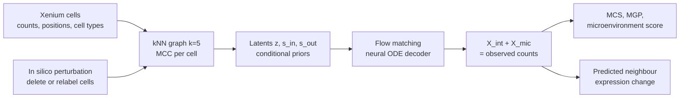
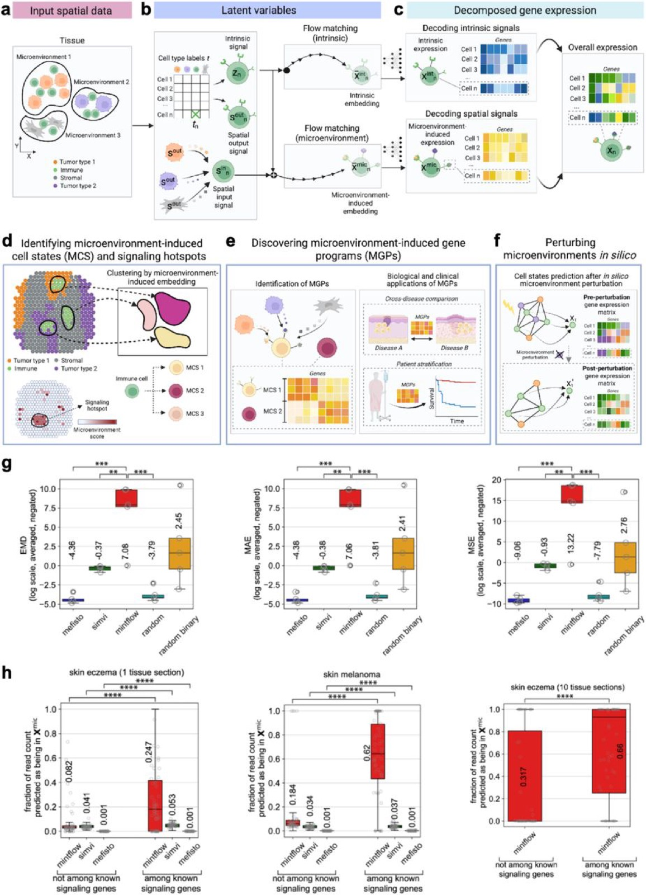
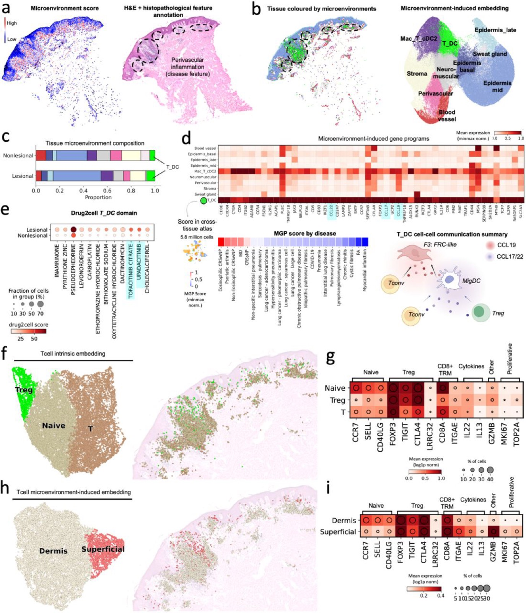

# Mapping and reprogramming human tissue microenvironments with MintFlow

> **Bibkey** `Akbarnejad_2025` · **Venue** bioRxiv (2025) · **Category** spatial · **Relevance** high · **Access** open
> **Link** <https://doi.org/10.1101/2025.06.24.661094>
> `status: complete` — 若为 abstract-only,把 PDF 放到本文件夹的 `source.pdf` 后可补全全文精读。

---

## 一句话 / One-liner
<!-- ZH --> MintFlow 是一个基于 flow matching 的生成模型:在单细胞分辨率空间转录组(Xenium)上,把每个细胞的表达拆成"细胞本身(intrinsic)"和"由周围微环境诱导(microenvironment-induced)"两部分,并能在电脑里删除或替换某类细胞,预测邻近细胞表达如何变化。
<!-- EN --> MintFlow is a flow-matching generative model for single-cell-resolution spatial transcriptomics (Xenium): it splits each cell's expression into an intrinsic part and a microenvironment-induced part, and can delete or replace a cell type in silico to predict how neighbouring cells' expression would change.

## 要点 / Takeaways
- <!-- ZH --> 核心输出是两个计数矩阵:X_int(本征)和 X_mic(微环境诱导),两者相加重建原始表达;"微环境评分"= 细胞总计数中被归为微环境诱导的比例。 <!-- EN --> The core output is two count matrices, X_int (intrinsic) and X_mic (microenvironment-induced), which sum to the observed expression; the microenvironment score is the share of a cell's counts assigned to X_mic.
- <!-- ZH --> 不需要配体-受体先验或预定义空间域;用 iVAE 式条件先验 + 最优传输条件让分解可识别、唯一(Methods、Supplementary Note 2)。 <!-- EN --> No ligand-receptor priors or predefined domains; iVAE-style conditional priors plus optimal-transport conditions make the decomposition identifiable and unique (Methods, Supplementary Note 2).
- <!-- ZH --> in silico 扰动 = 改细胞类型标签或删除一群细胞 → 重建邻接图 → 重新预测邻居的 X_mic。 <!-- EN --> In silico perturbation = relabel or remove a cell population → rebuild the neighbour graph → re-predict neighbours' X_mic.
- <!-- ZH --> 应用于特应性皮炎、黑色素瘤和透明细胞肾癌(ccRCC);ccRCC 中模拟删除三级淋巴结构(TLS)相关巨噬细胞,使 T 细胞的共抑制 / 耗竭标记下调。 <!-- EN --> Applied to atopic dermatitis, melanoma and clear-cell renal cell carcinoma (ccRCC); in ccRCC, simulated deletion of tertiary-lymphoid-structure (TLS) macrophages lowers T-cell co-inhibition / exhaustion markers.
- <!-- ZH --> 把 in silico 重编程结果连到 TCGA 606 例 ccRCC 生存:TLS Border T 细胞程序高表达与更差生存相关(p = 0.0073),重编程后的状态高表达与生存获益相关(p = 0.0034)。 <!-- EN --> In-silico reprogramming is linked to survival in 606 TCGA ccRCC tumours: high TLS Border T-cell programme expression goes with worse survival (p = 0.0073), high expression of the reprogrammed state with a survival advantage (p = 0.0034).
- <!-- ZH --> 这是我们读到的最接近"model → revert"的空间组学方法,而且有肾脏(ccRCC)应用。 <!-- EN --> The closest spatial-omics method to "model → revert" that we have read, with a kidney (ccRCC) application.

## 研究问题 / Problem
<!-- ZH --> 组织微环境会在疾病中重编程局部细胞状态,但现有空间计算方法大多是描述性的,不能模拟组织扰动(Abstract)。已有对微环境效应建模的方法要么不能把本征与微环境诱导的变化分开,要么依赖线性假设或配体-受体等先验,扩展性差,也难以做假设检验。作者想要一个能学习"微环境如何改变细胞状态"、可扩展到多张切片、并能做 in silico 扰动的生成模型。
<!-- EN --> Tissue microenvironments reprogram local cell states in disease, but current spatial methods are mostly descriptive and do not simulate tissue perturbation (Abstract). Methods modelling microenvironment effects either fail to separate intrinsic from microenvironment-induced variation, or rely on linear assumptions or ligand-receptor priors, scale poorly and do not support hypothesis testing. The authors want a generative model that learns how the microenvironment changes cell states, scales to many sections and supports in silico perturbation.

## 方法 / Method
<!-- ZH --> 术语:Xenium = 10x 的单细胞分辨率原位转录组平台(5k = 约 5000 基因 panel);微环境 = 一个细胞的空间近邻;MCC = 微环境中各细胞类型的比例。

1. **输入**:单细胞分辨率空间转录组的计数、坐标和细胞类型标签。按坐标建 k=5 的近邻图,算每个细胞的 MCC(Methods)。
2. **三个隐变量**:z_n(本征变化,先验以细胞类型为条件)、s_out(细胞向外发出的信号,先验以细胞类型为条件)、s_in(由邻居的 s_out 聚合得到的传入信号,间接依赖 MCC)(Fig. 1b、Methods)。
3. **生成过程**:在隐空间做 flow matching,用神经 ODE 作解码器,得到本征嵌入与微环境诱导嵌入,再解码成 X_int 和 X_mic,两者相加重建观测表达。
4. **可识别性**:非线性解码器的模型一般不可识别;作者模仿 iVAE,用细胞类型 / MCC 条件先验,再加上与最优传输相关的条件使分解唯一(Methods、Supplementary Note 2)。另用 Wasserstein 分布匹配项保证"本征状态不含邻居细胞类型信息"。
5. **扩展性**:自定义采样器按块取子图训练,可以在多张、合计数百万细胞的切片上训练。
6. **下游**:聚类微环境诱导嵌入得到微环境诱导细胞状态(MCS)和空间域;从 X_mic 得到微环境诱导基因程序(MGP);微环境评分定位信号热点。
7. **in silico 扰动**:修改细胞类型标签或删除某一亚群,按空间位置重建邻接图,再预测扰动后邻居的表达。
8. **基准**:带已知微环境效应的模拟数据(MAE、EMD、MSE);真实数据上看已知信号基因的计数是否更多被归入 X_mic;对比方法包括 SIMVI 和 MEFISTO 等。
<!-- EN --> Terms: Xenium = 10x's single-cell in-situ transcriptomics platform (5k ≈ 5,000-gene panel); microenvironment = a cell's spatial neighbours; MCC = cell-type proportions in that microenvironment.

1. **Input**: counts, coordinates and cell-type labels from single-cell-resolution spatial transcriptomics. A k=5 nearest-neighbour graph from coordinates gives each cell's MCC (Methods).
2. **Three latents**: z_n (intrinsic variation, prior conditioned on cell type), s_out (outgoing signal, prior conditioned on cell type), s_in (incoming signal aggregated from neighbours' s_out, indirectly dependent on MCC) (Fig. 1b, Methods).
3. **Generation**: flow matching in latent space with a neural-ODE decoder yields intrinsic and microenvironment-induced embeddings, decoded to X_int and X_mic, which sum to the observed expression.
4. **Identifiability**: models with non-linear decoders are generally unidentifiable; the authors mimic iVAE with cell-type / MCC-conditioned priors and add optimal-transport conditions to make the split unique (Methods, Supplementary Note 2). Wasserstein distribution-matching terms ensure the intrinsic state carries no information about neighbours' cell types.
5. **Scale**: a custom sampler trains on crops/subgraphs, allowing several sections with millions of cells.
6. **Downstream**: clustering microenvironment-induced embeddings gives microenvironment-induced cell states (MCS) and domains; X_mic gives microenvironment-induced gene programmes (MGPs); the microenvironment score locates signalling hotspots.
7. **In silico perturbation**: change cell-type labels or remove a subpopulation, rebuild the neighbour graph from positions, and predict neighbours' post-perturbation expression.
8. **Benchmark**: simulated data with known microenvironment effects (MAE, EMD, MSE); on real data, whether known signalling genes get more counts in X_mic; compared methods include SIMVI and MEFISTO.

## 方法图 / Method diagram


## 数据 / Data
<!-- ZH --> (1) **特应性皮炎**:8 名患者的 10 张皮肤切片(其中 8 张为新生成),Xenium 5k,QC 后 197,487 个细胞,识别 10 个微环境域;外部验证包括 4 名患者的 scRNA-seq、一个覆盖 6 种组织 23 种疾病的图谱、10 名 dupilumab 治疗 12 周的患者。(2) **皮肤黑色素瘤**:公开的 5000-plex Xenium 数据,98,749 个细胞,8 个微环境簇。(3) **ccRCC**:1 名患者,肿瘤核心 3 个肉眼可区分的区域 + 肿瘤-正常交界,337,116 个细胞,24 种细胞类型;外部数据包括 10 名患者 147,917 个肿瘤浸润细胞的 ccRCC scRNA-seq(含 ICB 治疗样本,Bi et al.)、TCGA 606 例 ccRCC bulk RNA-seq,以及一个 Kaede 转基因小鼠抗 PD-L1 肿瘤模型。另有带真值的模拟数据用于基准。
<!-- EN --> (1) **Atopic dermatitis**: 10 skin sections from 8 patients (8 newly generated), Xenium 5k, 197,487 cells after QC, 10 microenvironment domains; external validation includes scRNA-seq from 4 patients, an atlas of 23 diseases across 6 tissues, and 10 patients 12 weeks after dupilumab. (2) **Cutaneous melanoma**: public 5000-plex Xenium, 98,749 cells, 8 microenvironment clusters. (3) **ccRCC**: one patient, three macroscopically distinct tumour-core regions plus the tumour–normal interface, 337,116 cells, 24 cell types; external data include ccRCC scRNA-seq of 147,917 tumour-infiltrating cells from 10 patients (with ICB-treated samples, Bi et al.), 606 TCGA ccRCC bulk RNA-seq tumours, and a Kaede transgenic mouse tumour model treated with anti-PD-L1. Simulated data with ground truth are used for benchmarking.

## 主要结果 / Key results
- <!-- ZH --> **基准(图中标注的均值)**:模拟数据上,EMD(log 尺度、取负,越高越好)MintFlow 7.08,SIMVI −0.37,MEFISTO −4.36,random −3.79,random binary 2.45;MAE、MSE 趋势相同(Fig. 1g)。真实数据上,已知信号基因的计数被归入 X_mic 的比例:皮炎单切片 MintFlow 0.247 vs SIMVI 0.053、MEFISTO 0.001;黑色素瘤 0.62 vs 0.037、0.001;皮炎 10 张切片上只有 MintFlow 能运行,已知信号基因 0.66 vs 非信号基因 0.317(Fig. 1h)。 <!-- EN --> **Benchmark (means printed in the figure)**: on simulated data, EMD (log scale, negated, higher is better) is 7.08 for MintFlow vs −0.37 SIMVI, −4.36 MEFISTO, −3.79 random, 2.45 random binary; MAE and MSE follow the same pattern (Fig. 1g). On real data, the share of known-signalling-gene counts assigned to X_mic: eczema single section MintFlow 0.247 vs SIMVI 0.053, MEFISTO 0.001; melanoma 0.62 vs 0.037, 0.001; on all 10 eczema sections only MintFlow ran, 0.66 for known signalling genes vs 0.317 for other genes (Fig. 1h).
- <!-- ZH --> **特应性皮炎**:发现微环境诱导的表皮 2 型组织驻留记忆 T 细胞(CD8A+ ITGAE+ GZMB+,表达 IL13)和一个 T 细胞活化枢纽(T_DC 域)(Figs. 2–3);模拟删除 Treg 提示炎症状态增强,而增补 Treg 与促炎通路无关;在 10 名 dupilumab 治疗患者中,Treg 通常从基线到第 12 周增加。 <!-- EN --> **Atopic dermatitis**: a microenvironment-induced epidermal type-2 tissue-resident memory T-cell state (CD8A+ ITGAE+ GZMB+, IL13-expressing) and a T-cell activation hub (T_DC domain) (Figs. 2–3); simulated Treg depletion suggests a more inflammatory state, while Treg augmentation is not associated with pro-inflammatory pathways; in 10 dupilumab-treated patients Tregs typically increased from baseline to week 12.
- <!-- ZH --> **黑色素瘤**:找到表达 CXCL12、胶原交联酶(LOX、LOXL1、LOXL2)高的基质,与 T 细胞排除相关;该基质 MGP 在瘢痕疙瘩中高表达(Fig. 4)。 <!-- EN --> **Melanoma**: a CXCL12-expressing stroma with high collagen cross-linking enzymes (LOX, LOXL1, LOXL2), linked to T-cell exclusion; its MGP is high in keloid scars (Fig. 4).
- <!-- ZH --> **ccRCC**:TLS 内有三种微环境诱导 T 细胞状态(TLS Core 1、Core 2、Border);TLS 相关巨噬细胞高表达 TREM2 和 CCR1。模拟删除这些巨噬细胞后,T 细胞共抑制 / 耗竭分子(PD-L2、TIM3、VSIR、CD276、LILRB1)下调,TCR 信号和白介素受体相关标记上调(Figs. 5–7)。 <!-- EN --> **ccRCC**: three microenvironment-induced T-cell states in TLS (TLS Core 1, Core 2, Border); TLS-associated macrophages express high TREM2 and CCR1. Simulated deletion of these macrophages lowers T-cell co-inhibition / exhaustion molecules (PD-L2, TIM3, VSIR, CD276, LILRB1) and raises TCR-signalling and interleukin-receptor markers (Figs. 5–7).
- <!-- ZH --> **有效性检查**:用公开 ccRCC scRNA-seq(含 ICB 治疗)给出的巨噬细胞基因签名作"真值",模拟把 T 细胞替换为 ICB 后状态,12 个在 Xenium 5K panel 内的真值基因中 11 个被上调。 <!-- EN --> **Validity check**: using macrophage signatures from public ccRCC scRNA-seq with ICB-treated samples as ground truth, virtual replacement of T cells with post-ICB-like states upregulated 11 of the 12 ground-truth genes in the Xenium 5K panel.
- <!-- ZH --> **临床关联**:TCGA 606 例 ccRCC 中,TLS Border T 细胞程序高表达与更差总生存相关(p = 0.0073);重编程状态高表达与生存优势相关(p = 0.0034)。 <!-- EN --> **Clinical link**: in 606 TCGA ccRCC tumours, high TLS Border T-cell programme expression is associated with worse overall survival (p = 0.0073); high expression of the reprogrammed state with a survival advantage (p = 0.0034).

## 创新点 / Contributions
- <!-- ZH --> 把空间转录组表达可识别地分解为本征与微环境诱导两个可解释的计数矩阵,不依赖配体-受体先验或预定义空间域。 <!-- EN --> An identifiable split of spatial expression into intrinsic and microenvironment-induced count matrices, without ligand-receptor priors or predefined domains.
- <!-- ZH --> 组织层面的 in silico 扰动:删除 / 替换任意细胞类型并预测邻居反应。 <!-- EN --> Tissue-level in silico perturbation: delete / replace any cell type and predict the neighbours' response.
- <!-- ZH --> 子图采样训练,可扩展到多张切片、数百万细胞。 <!-- EN --> Subgraph-sampled training that scales to many sections and millions of cells.
- <!-- ZH --> 在三种疾病上给出生物学发现,并用外部 scRNA-seq、治疗队列和 TCGA 生存做验证。 <!-- EN --> Biological findings in three diseases, checked against external scRNA-seq, a treatment cohort and TCGA survival.

## 局限 / Limitations
- <!-- ZH --> (作者)对低读数敏感;需要各切片基因 panel 一致。 <!-- EN --> (Authors) Sensitive to low read counts; needs consistent gene panels across sections.
- <!-- ZH --> (作者)受当前细胞分割误差影响;训练困难、需针对数据集调超参;flow matching 训练计算量大。 <!-- EN --> (Authors) Susceptible to segmentation errors; hard to train with dataset-specific hyperparameter tuning; flow-matching training is compute-intensive.
- <!-- ZH --> (作者)目前限于多张切片,未来可扩展到更大框架(例如图谱级)。 <!-- EN --> (Authors) Currently limited to multiple tissue sections; future work could go beyond that (e.g. atlas scale).
- <!-- ZH --> 我们的理解:ccRCC 空间数据只来自 1 名患者;in silico 扰动是模型预测,验证主要是与外部签名的一致性和 TCGA 生存关联,不是直接的扰动实验。 <!-- EN --> Our reading: the ccRCC spatial data come from one patient; in silico perturbations are model predictions, validated by agreement with external signatures and TCGA survival associations rather than direct perturbation experiments.
- <!-- ZH --> 我们的理解:扰动只能改变"细胞组成 / 邻居",不能直接模拟"敲低某个基因";依赖输入的细胞类型标签质量。 <!-- EN --> Our reading: perturbations change cell composition / neighbours, not individual genes; results depend on the quality of input cell-type labels.

## 与本研究方向的关系 / Relation to our direction
<!-- ZH --> 主要对应 **model → revert** 环节,并且有肾脏(ccRCC)应用。我们的理解:(1) X_mic / 微环境评分本身不是异常检测,但"哪些细胞的表达被微环境显著改变"可作为 detect 环节的一种补充证据,例如与正常参考对比后的异常区域再用 MintFlow 解释是哪类邻居造成的;(2) in silico 删除 / 替换细胞类型是"revert"的一种形式——它预测的是"改变组织组成能否让邻近细胞回到另一种状态",比 CMonge 的单细胞药物扰动更接近组织层面;(3) 对 Topic 1 的肾脏 Xenium 数据,MintFlow 可直接作为模型层候选,但要注意它需要细胞类型标签和一致的基因 panel;(4) 它的验证方式(外部签名一致性 + 生存关联)可借鉴,但不能代替湿实验。
<!-- EN --> Mainly a **model → revert** paper, with a kidney (ccRCC) application. Our reading: (1) X_mic / the microenvironment score is not anomaly detection, but "which cells are strongly changed by their neighbours" can be supplementary evidence for detect, e.g. explaining which neighbours drive an anomalous region found against a normal reference; (2) in silico deletion / replacement of cell types is a form of revert — it predicts whether changing tissue composition moves neighbouring cells to another state, closer to the tissue level than CMonge's single-cell drug perturbations; (3) for kidney Xenium data in Topic 1, MintFlow is a direct candidate for the model layer, but it needs cell-type labels and consistent gene panels; (4) its validation style (agreement with external signatures + survival association) is useful but does not replace wet-lab experiments.

## 可复用资产 / Reusable assets
- <!-- ZH --> **代码:** <https://github.com/Lotfollahi-lab/mintflow>(Python 包;论文 Code availability)。 <!-- EN --> **Code:** <https://github.com/Lotfollahi-lab/mintflow> (Python package; paper's Code availability).
- <!-- ZH --> **复现与模拟数据:** <https://github.com/Lotfollahi-lab/mintflow-reproducibility>(论文 Data availability:模拟数据下载说明)。 <!-- EN --> **Reproducibility and simulated data:** <https://github.com/Lotfollahi-lab/mintflow-reproducibility> (paper's Data availability: simulated-data download).
- <!-- ZH --> **评测设计:** 带真值的模拟基准(MAE / EMD / MSE)、信号基因计数归属检验、用外部 ICB 签名检验虚拟替换、扰动程序 → TCGA 生存。 <!-- EN --> **Evaluation designs:** ground-truth simulation benchmark (MAE / EMD / MSE), signalling-gene attribution test, virtual-replacement check against external ICB signatures, perturbation programme → TCGA survival.

## 待读 / Follow-ups
- <!-- ZH --> Supplementary Note 2(可识别性证明)和 Methods 中的目标函数细节。 <!-- EN --> Supplementary Note 2 (identifiability proof) and the objective details in Methods.
- <!-- ZH --> 对照方法 SIMVI、MEFISTO 原文。 <!-- EN --> The SIMVI and MEFISTO papers (baselines).
- <!-- ZH --> Bi et al. ccRCC ICB scRNA-seq(虚拟替换的真值来源)。 <!-- EN --> Bi et al. ccRCC ICB scRNA-seq (ground truth for the virtual replacement).
- <!-- ZH --> 我们的理解:在肾脏 Xenium 上试跑,检查需要多少细胞、panel 是否一致、细胞类型标签如何来。 <!-- EN --> Our reading: trial run on kidney Xenium to check cell numbers, panel consistency and the source of cell-type labels.

## 图表 / Figures & tables


<!-- ZH --> **图1.** MintFlow 总览与基准评测:(a) 以单细胞分辨率空间转录组为输入,依空间坐标确定每个细胞的微环境,细胞类型标签与微环境细胞类型组成(MCC)作为监督信号;(b) 模型推断内在信号(z_n)、传入/传出空间信号三类嵌入向量,经 flow matching 变换为内在与微环境诱导嵌入,再解码重建读数;(d–f) 聚类微环境诱导嵌入识别细粒度微环境诱导细胞态(MCS)、微环境诱导基因程序(MGP),并支持微环境的 in silico 扰动;(g) 在模拟数据上 MintFlow 在读数解耦上优于其它方法(MAE/EMD/MSE,指标取负使越高越好);(h) 在真实数据上,MintFlow 将更高比例的已知信号基因读数归入微环境诱导成分。
<!-- EN --> **Fig 1.** Overview and benchmarking of MintFlow: (a) single-cell-resolution spatial transcriptomics input; each cell's microenvironment is derived from spatial coordinates, with cell-type labels and microenvironment cell-type composition (MCC) as supervision; (b) three embedding vectors encode intrinsic (z_n), incoming and outgoing spatial signals, transformed via flow matching into intrinsic and microenvironment-induced embeddings and decoded to reconstruct read counts; (d–f) clustering the microenvironment-induced embeddings yields fine-grained microenvironment-induced cell states (MCS) and gene programs (MGP), and supports in silico microenvironment perturbation; (g) on simulated data MintFlow outperforms alternatives at read-count disentanglement (MAE/EMD/MSE, negated so higher is better); (h) on real data MintFlow assigns a greater fraction of known signaling-gene counts to the microenvironment-induced component.
<!-- ZH/EN --> _Source: https://www.biorxiv.org/content/10.1101/2025.06.24.661094v3.full  ·  License: bioRxiv preprint (CC BY-NC-ND 4.0)_


<!-- ZH --> **图2.** MintFlow 在特应性皮炎(AD)中识别出微环境诱导的 T_RM 细胞态与 T 细胞活化枢纽:(a) 微环境评分与对应 H&E 组织病理注释;(b) 微环境域与微环境诱导嵌入的 UMAP;(c) 炎症与非炎症皮肤中各微环境域的组织组成;(d) T_DC 域的微环境诱导基因程序(MGP)及其在跨组织图谱中的模块评分。
<!-- EN --> **Fig 2.** MintFlow identifies a microenvironment-induced T_RM cell state and a T-cell activation hub in atopic dermatitis: (a) tissue colored by microenvironment score with matched H&E histopathology (Xenium 5k); (b) microenvironment domains and a UMAP of the microenvironment-induced embedding; (c) tissue composition per domain in inflamed vs non-inflamed skin; (d) the T_DC-domain MGP and its gene-module scores in a cross-tissue atlas.
<!-- ZH/EN --> _Source: https://www.biorxiv.org/content/10.1101/2025.06.24.661094v3.full  ·  License: bioRxiv preprint (CC BY-NC-ND 4.0)_


<!-- ZH --> **图4.** 用 MintFlow 解析黑色素瘤肿瘤微环境的免疫细胞分隔:(a) 微环境评分;(b) 按细胞类型着色(黑色素瘤 vs 其它、T 细胞 vs 其它);(c) 皮肤黑色素瘤微环境诱导嵌入的 UMAP;(d) 各微环境域的细胞组成;(e) 各域的微环境诱导基因程序(MGP);(f) H&E 图像与对应按微环境域着色的 Xenium 切片。
<!-- EN --> **Fig 4.** Deciphering tumor-microenvironment immune-cell segregation in melanoma with MintFlow: (a) microenvironment score; (b) tissue by cell type (melanoma vs other, T cell vs other); (c) UMAP of the microenvironment-induced embedding for cutaneous melanoma; (d) cellular composition of microenvironment domains; (e) microenvironment-induced gene programs (MGPs) per domain; (f) H&E image and matched Xenium section colored by microenvironment domain.
<!-- ZH/EN --> _Source: https://www.biorxiv.org/content/10.1101/2025.06.24.661094v3.full  ·  License: bioRxiv preprint (CC BY-NC-ND 4.0)_

### 结果表 / Results

<!-- ZH --> **表1.** MintFlow 基准评测总结(源自图 1g/1h)。论文以箱线图报告结果、未给出数值表;下表数值为图中印出的均值。
<!-- EN --> **Table 1.** Summary of MintFlow benchmarks (from Fig 1g/1h). The paper reports results as box plots with no numeric table; numbers below are the means printed in the figure.

| Benchmark | Data | Metric(s) | Result vs alternatives |
|---|---|---|---|
| Read-count disentanglement | Simulated data with known microenvironment-induced effects (ground truth) | MAE, EMD, MSE (negated → higher is better) | MintFlow EMD 7.08 vs SIMVI −0.37, MEFISTO −4.36, random −3.79, random binary 2.45 (means printed in Fig 1g; log scale, negated) |
| Signaling-gene attribution | Real Xenium (AD single-sample, melanoma single-sample) | Proportion of known signaling-gene counts assigned to the microenvironment-induced component (counts < 20 filtered) | Known signaling genes: MintFlow 0.247 vs SIMVI 0.053, MEFISTO 0.001 (AD); 0.62 vs 0.037, 0.001 (melanoma) (Fig 1h) |
| Scalability | Multi-sample Xenium (10 atopic-dermatitis sections) | Applicable to all 10 sections | Only MintFlow was scalable enough to run on all 10 tissue sections |

## 引用 / Cite
```bibtex
@article{Akbarnejad_2025, title={Mapping and reprogramming human tissue microenvironments with MintFlow}, url={http://dx.doi.org/10.1101/2025.06.24.661094}, DOI={10.1101/2025.06.24.661094}, publisher={openRxiv}, author={Akbarnejad, Amir and Steele, Lloyd and Jafree, Daniyal J. and Birk, Sebastian and Sallese, Marta Rosa and Rademaker, Koen and Boxall, Adam and Rumney, Benjamin and Tudor, Catherine and Patel, Minal and Prete, Martin and Makarchuk, Stanislaw and Lee, Colin Y.C. and Maaskola, Jonas and Li, Tong and Stanley, Heather and Foster, April Rose and Roberts, Kenny and Trinh, Andrew L. and Villa, Carlo Emanuele and Testa, Giuseppe and Mahil, Satveer and Mehrjou, Arash and Smith, Catherine and Vakili, Sattar and Clatworthy, Menna R. and Bayraktar, Omer Ali and Mitchell, Thomas and Haniffa, Muzlifah and Lotfollahi, Mohammad}, year={2025}, month=June }
```
