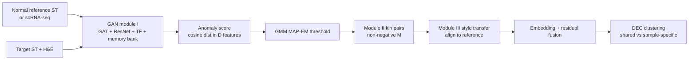
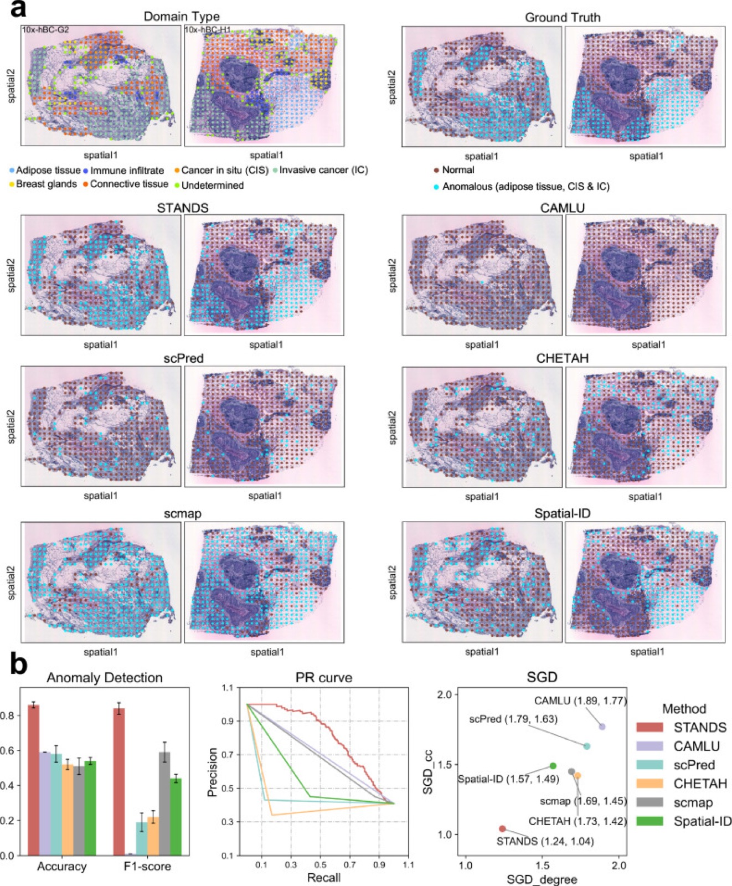

# Detecting anomalous anatomic regions in spatial transcriptomics with STANDS

> **Bibkey** `Xu_2024` · **Venue** Nature Communications (2024) · **Category** spatial · **Relevance** medium · **Access** open
> **Link** <https://doi.org/10.1038/s41467-024-52445-9>
> `status: complete` — 若为 abstract-only,把 PDF 放到本文件夹的 `source.pdf` 后可补全全文精读。

---

## 一句话 / One-liner
<!-- ZH --> STANDS 是一套基于 GAN 的多样本空间转录组(ST)框架:先在"正常"参考切片上学会重建正常 spot,把重建得差的 spot 标为异常组织域(ATD);再把多个样本对齐到参考空间;最后把异常聚成"跨样本共享 / 样本特有"的亚型——全程不需要预先给出异常 marker 基因。
<!-- EN --> STANDS is a GAN-based multi-sample spatial-transcriptomics (ST) framework: it learns to reconstruct normal spots from a "normal" reference section, flags poorly reconstructed spots in target sections as anomalous tissue domains (ATDs), aligns several samples into the reference space, and clusters the anomalies into subtypes that are shared across samples or sample-specific — without any predefined anomaly marker genes.

## 要点 / Takeaways
- <!-- ZH --> 异常检测 = "只在正常参考上训练的重建 GAN" + 异常分数;分数是判别器特征空间里原 spot 与重建 spot 的余弦距离(Methods 式 8),再用带先验的两分量 GMM 自动定阈值。 <!-- EN --> Detection = a reconstruction GAN trained only on a normal reference; the anomaly score is the cosine distance between discriminator features of the real and reconstructed spot (Methods Eq. 8), thresholded automatically by a two-component GMM with priors.
- <!-- ZH --> 每个 spot 同时用基因表达(GAT 图编码)和 H&E 图块(ResNet-34 + GAT)两种模态,用 Transformer fusion 融合;消融显示去掉组织学图像会降低检测精度并增加假阳性(Supp. Fig. 16)。 <!-- EN --> Each spot uses both gene expression (GAT graph encoder) and its H&E patch (ResNet-34 + GAT), fused by a transformer block; removing histology lowers detection accuracy and adds false positives (Supp. Fig. 16).
- <!-- ZH --> 没有正常 ST 时可以用正常 scRNA-seq 当参考(编码器换成 MLP,把 spot 当单细胞);在胰腺癌 Visium 上仍取得最低 SGD(0.97, 0.53;Fig. 2g)。 <!-- EN --> When no normal ST exists, normal scRNA-seq can serve as reference (MLP encoder, spots treated as cells); on pancreatic-cancer Visium it still gets the lowest SGD (0.97, 0.53; Fig. 2g).
- <!-- ZH --> 参考集的"量"和"多样性"直接决定假阳性:缺少某类正常组织,该类组织在目标里就会被误报(乳腺腺体约 3.30 倍,Fig. 9f)。 <!-- EN --> Reference size and diversity drive false positives: a normal tissue type missing from the reference gets flagged in the target (breast glands ~3.30-fold, Fig. 9f).
- <!-- ZH --> 一些"假阳性"贴着肿瘤边缘、H&E 上看不出、但癌 marker 升高,作者解读为正在形成的癌区(Fig. 2c–e)——异常分数可能比人工标注更早报警。 <!-- EN --> Some "false positives" sit next to tumour, look normal on H&E but have raised cancer-marker expression; the authors read them as emerging cancer (Fig. 2c–e) — the score may flag change before the annotation does.
- <!-- ZH --> 评测中的"异常"多数是人为指定的组织域(例如从参考里剔除某类域、在目标里把它当异常),不全是疾病本身。 <!-- EN --> Many benchmark "anomalies" are curated domain labels (e.g. a domain type held out of the reference and designated anomalous in the target), not always disease per se.

## 研究问题 / Problem
<!-- ZH --> 作者把"从多样本 ST 中检测并拆解异常组织域"称为 DDATD,分三步:检测 ATD、跨样本对齐(去批次效应)、把 ATD 分成共享或样本特有的亚型(Fig. 1a)。现有空间聚类方法(SpaGCN、GraphST)不区分异常簇;iStar、TESLA、cell2location 依赖专家给的异常 marker;唯一无 marker 的 Spatial-ID 又需要目标组织的带注释 scRNA-seq 参考、假阳性高,且因缺少跨样本对齐机制而难以处理多个目标样本(Introduction)。作者还列出六个难点:批次效应干扰检测、异常本身干扰对齐、现有对齐方法不能保持数据原始尺度与语义、正常参考 ST 稀缺、组织学图像没被充分利用、三个任务需要统一框架而不是简单拼接各自的方法(Introduction)。
<!-- EN --> The authors call this task DDATD (Detection and Dissection of Anomalous Tissue Domains) with three steps: detect ATDs, align them across samples (remove batch effects), and split them into shared vs sample-specific subtypes (Fig. 1a). Spatial clustering methods (SpaGCN, GraphST) do not separate anomalous clusters; iStar, TESLA and cell2location need expert-defined anomaly markers; the only marker-free method, Spatial-ID, needs an annotated scRNA-seq reference of the target tissue, has a high false-positive rate, and struggles with multiple target datasets because it lacks cross-sample alignment (Introduction). The authors list six further challenges: batch effects hurt detection, anomalies hurt alignment, existing aligners do not keep the data's original scale and semantics, normal reference ST is scarce, histology images are under-used, and the three tasks need one coherent framework rather than chained single-task methods (Introduction).

## 方法 / Method
<!-- ZH --> 术语:spot = ST 的一个测量点(10x Visium 一个 spot 覆盖若干细胞),带一条基因表达向量和一个坐标;H&E = 常规染色的组织切片图像。

1. **预处理**:去线粒体和 ERCC spike-in 基因,去掉在 <10 个 spot 中检出的基因,按文库大小归一化 + log,用 SpatialDE 选 3000 个空间可变基因作输入(Methods "Data preprocessing")。每个 spot 截取 112×112 像素 H&E 图块,用预训练 ResNet-34 得到 256 维特征。spot 坐标建 k=6 的近邻图。
2. **C1 检测(GAN module I)**:生成器 = 编码器 + memory bank + 解码器。表达用两层 GATv2(3000-512-256),图像特征用同结构的另一个 GAT,两个 256 维嵌入经 3 层 Transformer fusion 得到 512 维嵌入。memory bank 是 512×512 的嵌入队列,用注意力从记忆里"拼回"当前嵌入(式 4),用于防止 mode collapse。解码器:表达用 MLP(256-512-3000),图像用对称的 ResNet-34 反卷积。损失 = L1 重建(表达与图像按 γ 加权)+ 对抗损失,判别器带梯度惩罚项以保证 Lipschitz 连续(式 5–6)。**只在正常参考上训练**(batch 128,Adam,lr 3e-4)。
3. **异常分数与阈值**:目标 spot 的分数 d = 1 − cos(D(x), D(x̂)),即判别器 16 维输出空间中原始与重建的余弦距离(式 8)。对 d 拟合两分量一维 GMM(异常比例 π 加 Beta(1,10) 先验,均值方差加 NIX 先验,先验参数由参考集分数估计),MAP-EM 推断后按后验归类(式 9–14)。
4. **跨模态参考**:没有正常 ST 时,用正常 scRNA-seq 训练,编码器换成两层 MLP,把目标 spot 当成单细胞来打分。
5. **C2 对齐(module II + III)**:先剔除 C1 判出的异常。module II 学一个非负映射矩阵 M(N_T×N_R),用参考嵌入重建目标嵌入(式 22–25);M 每行最大值给出与该目标 spot "同类"(kin)的参考 spot。module III 学一个"风格差异"矩阵 S(批次数 × 256),把目标 spot 的嵌入减去其批次的风格向量,再解码去重建其 kin 参考 spot(式 26–29)。训练好后把所有目标 spot(包括异常)送进去,得到对齐到参考空间、保持原始尺度的表达。
6. **C3 亚型**:对齐后的异常 spot,用冻结的 module I 得到嵌入 z 和重建残差 r = x − x̂;r 再编码成 ζ,z 与 ζ 用 Transformer 融合为 128 维,然后用 DEC(Student-t 软分配 + KL 自训练,式 34–36)聚类,直到分配变化 <0.001 或 2e4 次迭代。簇数假设已知或按 Supp. Note 1.5 自动推断。
7. **评测**:检测用 accuracy、F1、PR 曲线和作者新提出的 SGD(把异常 spot 连成 kNN 图,比较预测与真值在度和聚类系数上的分布差异,越低越好);对齐用 iLISI、BatchKL、ASW_batch、ASW_type 和 GraphST 联合聚类的 ARI;亚型用 Macro-F1、NMI、multi-SGD。

<!-- EN --> Terms: a spot is one ST measurement location (a 10x Visium spot covers several cells) with an expression vector and coordinates; H&E is the standard stained tissue image.

1. **Preprocessing**: drop mitochondrial and ERCC spike-in genes and genes seen in <10 spots; library-size normalise + log; keep 3,000 spatially variable genes from SpatialDE (Methods "Data preprocessing"). Each spot gets a 112×112-pixel H&E patch, embedded to 256-d by a pretrained ResNet-34. Spot coordinates form a k=6 neighbour graph.
2. **C1 detection (GAN module I)**: generator = encoder + memory bank + decoder. Expression goes through a two-layer GATv2 (3000-512-256); image features through a second GAT of the same shape; the two 256-d embeddings are fused by a 3-layer transformer into 512-d. The memory bank is a 512×512 embedding queue; the current embedding is re-expressed as an attention-weighted mix of memory items (Eq. 4), which counters mode collapse. Decoders: MLP (256-512-3000) for expression, a mirrored ResNet-34 deconvolution for the patch. Loss = L1 reconstruction (expression and image weighted by γ) + adversarial loss, with a gradient penalty on the discriminator to keep it Lipschitz-continuous (Eqs. 5–6). **Trained on the normal reference only** (batch 128, Adam, lr 3e-4).
3. **Score and threshold**: for a target spot, d = 1 − cos(D(x), D(x̂)), the cosine distance between real and reconstructed spot in the discriminator's 16-d output space (Eq. 8). A two-component 1-D GMM on d (Beta(1,10) prior on the anomaly fraction, NIX priors on means/variances, set from reference scores) is fitted by MAP-EM and spots are assigned by posterior (Eqs. 9–14).
4. **Cross-modal reference**: with no normal ST, train on normal scRNA-seq with a two-layer MLP encoder and score target spots as if they were cells.
5. **C2 alignment (modules II + III)**: first remove C1 anomalies. Module II learns a non-negative N_T×N_R matrix M that reconstructs target embeddings from reference embeddings (Eqs. 22–25); the arg-max of each row gives the target spot's "kin" reference spot. Module III learns a style matrix S (batches × 256); each target embedding minus its batch's style vector is decoded to reconstruct its kin reference spot (Eqs. 26–29). At test time all target spots, anomalies included, pass through it and land in the reference space at the original data scale.
6. **C3 subtyping**: for aligned anomalous spots, the frozen module I gives embedding z and residual r = x − x̂; r is encoded to ζ, z and ζ are fused by a transformer into 128-d and clustered with DEC (Student-t soft assignment + KL self-training, Eqs. 34–36) until assignment change <0.001 or 2e4 iterations. The cluster number is given or inferred (Supp. Note 1.5).
7. **Evaluation**: detection by accuracy, F1, PR curve and the new SGD (anomalous spots form a kNN graph; compare degree and clustering-coefficient distributions of prediction vs truth, lower is better); alignment by iLISI, BatchKL, ASW_batch, ASW_type and ARI of joint GraphST clustering; subtyping by Macro-F1, NMI and multi-SGD.

## 方法图 / Method diagram


## 数据 / Data
<!-- ZH --> 26 组实验(Table 1),跨 10x Visium、Slide-seqV2、Stereo-seq 三个平台,人和小鼠。主要数据:健康人乳腺 10x-hNB-v05/v06/v07(GSE195665)作参考;人乳腺癌 10x-hBC-G2、H1 及纵向切片 A1–A6(her2st GitHub 仓库);健康胰腺导管 scRNA-seq(sc-hPD)作跨模态参考,目标为胰腺导管腺癌 10x-hPDAC(GSE111672);人肝尾状叶 10x-hLCL-C73-C1 作参考(正文未说明是否健康)、原发性硬化性胆管炎 10x-hPSC-A1/C1/D1(GSE243977);人肾细胞癌 10x-hRCC-C2/C3/C4(GSE175540):参考是同为肾癌切片的 C2,目标是 C3、C4,异常类型是 5 种三级淋巴结构(TLS)相关细胞域(TLS T 细胞、树突细胞、上皮细胞、肥大细胞、系膜细胞;Table 1 Exp 8)——不是正常肾 vs 疾病的比较;小鼠胚胎 Slide-seqV2(ssq-mEmb-32/33/34,GSE197353)和 Stereo-seq(Stereo-mEmb-S1/S2/S3,CNP0001543)。评测用各数据集的真值组织域注释(ground truth domain annotations;正文未说明注释来源);在部分实验中某个域被"策划"为异常(例如小鼠胚胎中把心瓣膜细胞、神经外胚层细胞域从参考中排除,在目标中当异常)。
<!-- EN --> 26 experiments (Table 1) over three platforms (10x Visium, Slide-seqV2, Stereo-seq), human and mouse. Main data: healthy human breast 10x-hNB-v05/v06/v07 (GSE195665) as reference; human breast cancer 10x-hBC-G2, H1 and vertical slices A1–A6 (her2st GitHub repo); a healthy pancreatic-duct scRNA-seq set (sc-hPD) as cross-modal reference for pancreatic ductal adenocarcinoma 10x-hPDAC (GSE111672); liver caudate-lobe 10x-hLCL-C73-C1 as reference (the main text does not say it is healthy) for primary sclerosing cholangitis 10x-hPSC-A1/C1/D1 (GSE243977); human renal cell carcinoma 10x-hRCC-C2/C3/C4 (GSE175540): the reference is C2, itself an RCC section, the targets are C3 and C4, and the anomaly types are five tertiary-lymphoid-structure (TLS) cell domains (TLS T cell, dendritic, epithelial, mast and mesangial cell; Table 1 Exp 8) — not a normal-kidney vs disease comparison; mouse embryo Slide-seqV2 (ssq-mEmb-32/33/34, GSE197353) and Stereo-seq (Stereo-mEmb-S1/S2/S3, CNP0001543). Evaluation uses each dataset's ground-truth domain annotations (the main text does not say who made them); in several experiments a domain is curated to be anomalous (e.g. in mouse embryo, cardiac-valve and neuroectodermal domains are removed from the reference and treated as anomalies in the target).

## 主要结果 / Key results
- <!-- ZH --> **单样本检测(乳腺癌 10x-hBC-G2,参考 10x-hNB-v05)**:accuracy、F1、PR 曲线和 SGD 均优于 Spatial-ID、CAMLU、scPred、CHETAH、scmap;STANDS 的 SGD 为 (0.78, 0.21),其余方法均 ≥ (1.31, 0.95)(Fig. 2b 图中标注)。 <!-- EN --> **Single-target detection (breast cancer 10x-hBC-G2, reference 10x-hNB-v05)**: better accuracy, F1, PR curve and SGD than Spatial-ID, CAMLU, scPred, CHETAH, scmap; STANDS SGD (0.78, 0.21) vs ≥ (1.31, 0.95) for the others (Fig. 2b labels).
- <!-- ZH --> **"假阳性"即早期癌**:离癌区越近的正常 spot 分数越高;被误报的相邻 spot 在 H&E 上看不出异常,但 ACTB、TMSB10 表达介于正常(n=238)与已知癌(n=160)之间(emerging cancer n=69)(Fig. 2c–e)。 <!-- EN --> **"False positives" as emerging cancer**: normal spots closer to cancer score higher; flagged neighbours look normal on H&E but their ACTB and TMSB10 levels sit between normal (n=238) and known cancer (n=160) (emerging, n=69) (Fig. 2c–e).
- <!-- ZH --> **跨模态检测(scRNA-seq 参考 → 10x-hPDAC)**:accuracy 和 F1 最高、SGD 最低 (0.97, 0.53);对照还包括无监督肿瘤细胞检测方法 SCEVAN、CopyKAT(Fig. 2f–g)。 <!-- EN --> **Cross-modal detection (scRNA-seq reference → 10x-hPDAC)**: highest accuracy and F1, lowest SGD (0.97, 0.53); baselines also include the unsupervised tumour-cell callers SCEVAN and CopyKAT (Fig. 2f–g).
- <!-- ZH --> **多样本检测(10x-hBC-G2 + H1)**:只有 STANDS 在两张切片上都勾勒出 ATD;SGD (1.24, 1.04);SGD_degree 上次优为 Spatial-ID 1.57,SGD_cc 上次优为 CHETAH 1.42(Fig. 3b)。在 Slide-seqV2、Stereo-seq、PSC、RCC 数据上结论一致(Supp. Figs 1–5)。 <!-- EN --> **Multi-target detection (10x-hBC-G2 + H1)**: only STANDS delineates ATDs on both sections; SGD (1.24, 1.04); next best on SGD_degree is Spatial-ID 1.57 and on SGD_cc CHETAH 1.42 (Fig. 3b). Same conclusion on Slide-seqV2, Stereo-seq, PSC and RCC data (Supp. Figs 1–5).
- <!-- ZH --> **对齐**:在 PSC 纵向切片和非相邻乳腺切片上,iLISI/BatchKL/ASW 及 GraphST 联合聚类 ARI 综合领先 Harmony、ComBat、GraphST、STAligner(Fig. 4、Supp. Fig. 6);在乳腺癌纵向切片上 STANDS ASW_type 0.52 vs Harmony 0.50,ARI 0.24 vs 0.23(Supp. Fig. 7)——优势很小。存在样本特有域时,STANDS 是唯一性能不受影响的方法(Fig. 5b)。 <!-- EN --> **Alignment**: on PSC vertical slices and non-adjacent breast sections, STANDS leads Harmony, ComBat, GraphST and STAligner on iLISI/BatchKL/ASW and joint-GraphST ARI (Fig. 4, Supp. Fig. 6); on breast-cancer vertical slices ASW_type is 0.52 vs Harmony 0.50 and ARI 0.24 vs 0.23 (Supp. Fig. 7) — a small margin. With sample-specific domains present, STANDS is the only method whose performance holds (Fig. 5b).
- <!-- ZH --> **亚型**:单样本和多样本(共享 CIS + 各自特有 IC / AT)场景下 Macro-F1、NMI、multi-SGD 均最好(Supp. Figs 10–12、Fig. 7);Stereo-seq 胚胎上同样(Fig. 8)。 <!-- EN --> **Subtyping**: best Macro-F1, NMI and multi-SGD in single- and multi-target settings (shared CIS plus sample-specific IC / AT) (Supp. Figs 10–12, Fig. 7) and on Stereo-seq embryo (Fig. 8).
- <!-- ZH --> **参考集规模与多样性**:逐步从参考中去掉 1/3、2/3 结缔组织 spot(每次约 415 个),正文称目标中结缔组织的假阳性从 14 → 20 → 35 个,但 Fig. 9c 最右一组柱子标的是 32 → 35 → 39(图注称其为假阳性总数),论文正文与图不一致;AUC 0.83 → 0.81 → 0.79,F1 0.80 → 0.77 → 0.75(Fig. 9c);从参考中去掉乳腺腺体使该类假阳性约增 3.30 倍,去掉免疫浸润约增 2.94 倍(Fig. 9f)。 <!-- EN --> **Reference size and diversity**: removing 1/3 and 2/3 of connective-tissue spots (~415 each) from the reference raises target connective-tissue false positives 14 → 20 → 35 according to the main text, but the rightmost bar group in Fig. 9c (captioned as total false positives) reads 32 → 35 → 39, so the paper's text and figure disagree; AUC goes 0.83 → 0.81 → 0.79 and F1 0.80 → 0.77 → 0.75 (Fig. 9c); removing breast glands raises their false positives ~3.30-fold vs ~2.94-fold for immune infiltrates (Fig. 9f).
- <!-- ZH --> **消融**:去掉 memory bank、组织学图像、TF 融合块,或把非负映射换成 MNN,各自都会降低相应任务的指标;去掉 memory bank 时损失曲线呈 mode collapse 迹象(Supp. Fig. 16)。 <!-- EN --> **Ablation**: removing the memory bank, histology, or TF blocks, or swapping the non-negative mapping for MNN, each lowers the matching task's metrics; without the memory bank the loss curves show signs of mode collapse (Supp. Fig. 16).

## 创新点 / Contributions
- <!-- ZH --> 作者称 STANDS 是"第一个专门从 ST 数据检测 ATD 的方法"(Discussion);Introduction 指出此前没有方法能从 ST 数据做 de novo、无需注释参考的 DDATD,多样本场景尤其如此。 <!-- EN --> Claimed as "the first dedicated method for detecting ATDs from ST data" (Discussion); the Introduction states that no existing method could do de novo, annotated-reference-free DDATD from ST, especially for multiple samples.
- <!-- ZH --> 检测、对齐、亚型三步统一在一组 GAN 模块中:后续模块沿用 module I 的结构和权重(作初始化或冻结使用),C3 用 module I 的嵌入和重建残差。 <!-- EN --> Detection, alignment and subtyping unified in one set of GAN modules: later modules reuse module I's architecture and weights (as initialisation or frozen), and C3 uses module I's embeddings and reconstruction residuals.
- <!-- ZH --> 表达 + H&E 的多模态重建(GAT + ResNet + Transformer fusion),并可用 scRNA-seq 替代正常 ST 参考。 <!-- EN --> Multimodal reconstruction of expression + H&E (GAT + ResNet + transformer fusion), with scRNA-seq usable in place of a normal ST reference.
- <!-- ZH --> 基于 kin 配对 + 风格向量相减的对齐:保留原始数据尺度,对样本特有域稳健。 <!-- EN --> Alignment via kin pairs + subtraction of a per-batch style vector: keeps the original data scale and is robust to sample-specific domains.
- <!-- ZH --> 新指标 SGD / multi-SGD,把空间邻接结构纳入检测与聚类评测。 <!-- EN --> New SGD / multi-SGD metrics that bring spatial neighbourhood structure into detection and clustering evaluation.

## 局限 / Limitations
- <!-- ZH --> (作者)GAN 可换成去噪扩散模型,以更准地重建正常样本、减少假阳性(Discussion)。 <!-- EN --> (Authors) The GAN could be replaced by a denoising diffusion model to reconstruct normal data more accurately and cut false positives (Discussion).
- <!-- ZH --> (作者实验)对参考集的规模和多样性敏感:参考里缺的正常组织类型会被误报(Fig. 9)。 <!-- EN --> (Authors' experiments) Sensitive to reference size and diversity: normal tissue types missing from the reference get flagged (Fig. 9).
- <!-- ZH --> 我们的理解:很多"异常"是从参考里剔除某个已知域后人为指定的,更像"新类别检测";对真实疾病变化(如纤维化程度渐变)的效果没有直接检验。 <!-- EN --> Our reading: many "anomalies" are curated by removing a known domain from the reference, closer to novel-class detection; graded disease change (e.g. fibrosis severity) is not tested directly.
- <!-- ZH --> 我们的理解:accuracy / F1 在阈值化后计算,且 5 次重复只报均值±SD;阈值无关的结果只以 PR 曲线给出(没有 AUPRC 数值),AUC 数值只在 Fig. 9 出现。 <!-- EN --> Our reading: accuracy / F1 are computed after thresholding (mean ± SD over 5 runs); threshold-free results are shown only as PR curves (no AUPRC numbers), and AUC numbers appear only in Fig. 9.
- <!-- ZH --> 我们的理解:簇数假设已知或另行推断;组件多(3 个 GAN + DEC),调参与训练成本较高。 <!-- EN --> Our reading: the cluster number is assumed known or inferred separately; with three GANs plus DEC the pipeline is heavy to tune and train.

## 与本研究方向的关系 / Relation to our direction
<!-- ZH --> 它对应 detect → model → revert 的 **detect** 一环,而且就是空间转录组上的"正常参考 → 重建 → 异常分数"范式,和肾脏组学异常检测基准(伪影注入课题)直接相关。我们的理解:(1) STANDS 可作为空间组学检测的重建类基线,论文含一个肾细胞癌 Visium 实验(GSE175540),但参考本身是癌切片 C2,"异常"是 C3/C4 中 5 种 TLS 相关域,不是正常肾 → 疾病的比较,只能用来跑通流程,不能直接当肾脏正常 vs 疾病基准;(2) 它的"参考规模/多样性"实验(Fig. 9)提示我们的基准应显式报告参考集覆盖了哪些正常组织类型,否则假阳性无法解释;(3) "假阳性=早期病变"(Fig. 2c–e)正说明需要专家复核的标注流程——这与我们"专家验证标记"的设计一致;(4) 跨模态参考(scRNA-seq → ST)对应「snRNA 与 Xenium 互为证据」的思路;(5) 它没有 revert 环节:重建残差 r = x − x̂ 只告诉"哪里、哪些基因偏离",但不是因果扰动预测,要接到 revert 还需要扰动模型。
<!-- EN --> It covers the **detect** step of detect → model → revert, using exactly the "normal reference → reconstruct → anomaly score" recipe on spatial transcriptomics, which is directly relevant to the kidney-omics anomaly benchmark (the artifact-injection topic). Our reading: (1) STANDS is a natural reconstruction baseline for spatial detection, the paper includes an RCC Visium experiment (GSE175540), but the reference is itself an RCC section (C2) and the "anomalies" are five TLS-related domains in C3/C4, so it is not a normal-kidney → disease comparison; it can test the pipeline but is not a kidney normal-vs-disease benchmark; (2) the reference size/diversity study (Fig. 9) says our benchmark should report which normal tissue types the reference covers, or false positives cannot be interpreted; (3) "false positive = emerging lesion" (Fig. 2c–e) is an argument for expert review of flags, as in our expert-validated design; (4) the cross-modal reference (scRNA-seq → ST) matches the idea of using snRNA and Xenium as orthogonal evidence; (5) there is no revert step: the residual r = x − x̂ says where and in which genes a spot deviates, but it is not a causal perturbation prediction; a perturbation model is still needed for revert.

## 可复用资产 / Reusable assets
- <!-- ZH --> **代码:** <https://github.com/Catchxu/STANDS>;Zenodo 存档 <https://doi.org/10.5281/zenodo.13375297>(Code availability)。据 GitHub 仓库:许可证 GPL-3.0,README 推荐 Python 3.9,提供 6 个教程,并建议先在大规模公开 ST 数据上预训练;README 未提到发布预训练权重。 <!-- EN --> **Code:** <https://github.com/Catchxu/STANDS>; Zenodo archive <https://doi.org/10.5281/zenodo.13375297> (Code availability). From the GitHub repo: GPL-3.0 licence; the README recommends Python 3.9, lists 6 tutorials and recommends pretraining on large public ST data; it does not mention released pretrained weights.
- <!-- ZH --> **数据登录号(Data availability):** GSE195665(健康乳腺)、her2st GitHub <https://github.com/almaan/her2st>(乳腺癌)、GSE243977(PSC)、GSE175540(肾细胞癌)、GSE111672(PDAC)、GSE197353(Slide-seqV2 胚胎)、CNP0001543(Stereo-seq 胚胎)。 <!-- EN --> **Data accessions (Data availability):** GSE195665 (healthy breast), her2st GitHub <https://github.com/almaan/her2st> (breast cancer), GSE243977 (PSC), GSE175540 (renal cell carcinoma), GSE111672 (PDAC), GSE197353 (Slide-seqV2 embryo), CNP0001543 (Stereo-seq embryo).
- <!-- ZH --> **评测:** SGD / multi-SGD 定义见 Methods "Evaluation metrics";26 组实验设计见 Table 1。 <!-- EN --> **Evaluation:** SGD / multi-SGD definitions in Methods "Evaluation metrics"; the 26-experiment design in Table 1.

## 待读 / Follow-ups
- <!-- ZH --> Supp. Note 1.1–1.2 / Supp. Fig. 5、Supp. Fig. 15:肾细胞癌 TLS 实验(Table 1 Exp 8、24)的具体设置与结果。 <!-- EN --> Supp. Notes 1.1–1.2 / Supp. Figs 5 and 15: setup and results of the renal-cell-carcinoma TLS experiments (Table 1 Exps 8, 24).
- <!-- ZH --> Supp. Note 1.4–1.5:GMM 推断细节与簇数自动推断。 <!-- EN --> Supp. Notes 1.4–1.5: GMM inference and automatic cluster-number choice.
- <!-- ZH --> Spatial-ID 和 CAMLU 原文(主要对照方法)。 <!-- EN --> The Spatial-ID and CAMLU papers (main baselines).
- <!-- ZH --> 我们的理解:可在肾脏 Visium / Xenium 上把 STANDS 与特征类(如 kNN on foundation embeddings)基线对比。 <!-- EN --> Our reading: compare STANDS with feature-based baselines (e.g. kNN on foundation-model embeddings) on kidney Visium / Xenium.

## 图表 / Figures & tables


<!-- ZH --> **图1.** STANDS 与多样本 DDATD 总览。(a) 从患病样本出发:异常识别 → 对齐做批次校正 → 拆成"共享 / 样本特异"亚型的整体工作流;(b) STANDS 三组件框架(C1 检测、C2 对齐、C3 亚型),含 GAT 网络、GAN 模块与 Transformer Fusion 融合块。
<!-- EN --> **Fig 1.** Overview of STANDS and multi-sample DDATD. (a) End-to-end workflow from affected samples through anomaly identification → alignment for batch correction → dissection into shared vs. sample-specific subtypes; (b) the three-component framework (C1 detection, C2 alignment, C3 subtyping) with GAT networks, GAN modules and a Transformer Fusion block.
<!-- ZH/EN --> _Source: https://pmc.ncbi.nlm.nih.gov/articles/PMC11413068/  ·  License: CC BY 4.0_


<!-- ZH --> **图2.** 单 10x Visium 数据集的同模态 / 跨模态 ATD 检测。人乳腺癌(10x-hBC-G2)与胰腺癌(10x-hPDAC)的检测空间图、accuracy / F1 / PR 曲线 / SGD 散点、异常分数分布(阈值 0.81)、marker 基因(ACTB、TMSB10)表达,以及用 scRNA-seq 作参考的跨模态检测。STANDS 的 SGD 在所有基线中最低(最好)。
<!-- EN --> **Fig 2.** Intra- and cross-modality ATD detection in single 10x Visium datasets. Spatial maps, accuracy / F1 / PR curves / SGD scatter, anomaly-score distributions (threshold 0.81), marker genes (ACTB, TMSB10), and cross-modality detection using an scRNA-seq reference, for human breast (10x-hBC-G2) and pancreatic (10x-hPDAC) cancer. STANDS has the lowest (best) SGD among all baselines.
<!-- ZH/EN --> _Source: https://pmc.ncbi.nlm.nih.gov/articles/PMC11413068/  ·  License: CC BY 4.0_


<!-- ZH --> **图3.** 跨多个人乳腺癌 10x Visium 数据集(10x-hBC-G2、10x-hBC-H1)的 ATD 检测,同时含共享域(浸润性癌 IC)与各自特有域(原位癌 CIS、脂肪组织)。STANDS 对比五个基线(CAMLU、scPred、CHETAH、scmap、Spatial-ID)在 accuracy、F1、PR 曲线、SGD 上全面领先。
<!-- EN --> **Fig 3.** ATD detection across multiple human breast-cancer 10x Visium datasets (10x-hBC-G2, 10x-hBC-H1) containing both shared (invasive cancer, IC) and dataset-unique (cancer in situ CIS, adipose) domains. STANDS leads five baselines (CAMLU, scPred, CHETAH, scmap, Spatial-ID) on accuracy, F1, PR curves and SGD.
<!-- ZH/EN --> _Source: https://pmc.ncbi.nlm.nih.gov/articles/PMC11413068/  ·  License: CC BY 4.0_


<!-- ZH --> **图7.** 跨两个人乳腺癌数据集的异常亚型划分,含重叠亚型(CIS)与各自特有亚型(IC、脂肪组织):空间图、Sankey 标签对应图、Macro-F1 vs NMI 与 multi-SGD 散点,以及指示最优空间匹配的热图。
<!-- EN --> **Fig 7.** Subtyping ATDs across two breast-cancer datasets with overlapping (CIS) and dataset-specific (IC, adipose) subtypes: spatial maps, Sankey label-correspondence diagrams, Macro-F1 vs NMI and multi-SGD scatterplots, and heatmaps of optimal spatial matching.
<!-- ZH/EN --> _Source: https://pmc.ncbi.nlm.nih.gov/articles/PMC11413068/  ·  License: CC BY 4.0_

### 结果表 / Results

<!-- ZH --> **表1.** 多样本乳腺癌检测的 Spatial Grouping Discrepancy(数值取自图3b 散点标注;SGD_degree、SGD_cc 越低越好,即与真值的空间一致性越高)。STANDS 在两项上均最低。
<!-- EN --> **Table 1.** Spatial Grouping Discrepancy for multi-sample breast-cancer detection (values read from the Fig 3b scatter labels; lower SGD_degree / SGD_cc = better, i.e. higher spatial agreement with ground truth). STANDS is lowest on both.

| Method | SGD_degree ↓ | SGD_cc ↓ |
|---|---|---|
| **STANDS** | **1.24** | **1.04** |
| CHETAH | 1.73 | 1.42 |
| scmap | 1.69 | 1.45 |
| Spatial-ID | 1.57 | 1.49 |
| scPred | 1.79 | 1.63 |
| CAMLU | 1.89 | 1.77 |

<!-- ZH --> **表2.** 跨模态检测(scRNA-seq 参考 → 10x-hPDAC 胰腺癌目标)的 SGD(数值取自图2g 散点标注;越低越好)。STANDS 在两项上均最低。
<!-- EN --> **Table 2.** SGD for cross-modality detection (scRNA-seq reference → 10x-hPDAC pancreatic-cancer target; values from the Fig 2g scatter labels, lower is better). STANDS is lowest on both.

| Method | SGD_degree ↓ | SGD_cc ↓ |
|---|---|---|
| **STANDS** | **0.97** | **0.53** |
| SCEVAN | 1.32 | 0.99 |
| CAMLU | 1.37 | 1.08 |
| scPred | 1.52 | 1.31 |
| scmap | 1.52 | 1.31 |
| Spatial-ID | 1.55 | 1.35 |
| CopyKAT | 1.73 | 1.47 |
| CHETAH | 1.99 | 1.65 |

<!-- ZH --> _Source: https://pmc.ncbi.nlm.nih.gov/articles/PMC11413068/  ·  License: CC BY 4.0. accuracy / F1 / ARI 等以柱状图形式呈现于原文图2、图3、图4,未提供文本数值表。_
<!-- EN --> _Source: https://pmc.ncbi.nlm.nih.gov/articles/PMC11413068/  ·  License: CC BY 4.0. accuracy / F1 / ARI and similar metrics are presented as bar charts in the original Figs 2, 3 and 4; no text value tables are provided._

## 引用 / Cite
```bibtex
@article{Xu_2024, title={Detecting anomalous anatomic regions in spatial transcriptomics with STANDS}, volume={15}, ISSN={2041-1723}, url={http://dx.doi.org/10.1038/s41467-024-52445-9}, DOI={10.1038/s41467-024-52445-9}, number={1}, journal={Nature Communications}, publisher={Springer Science and Business Media LLC}, author={Xu, Kaichen and Lu, Yan and Hou, Suyang and Liu, Kainan and Du, Yihang and Huang, Mengqian and Feng, Hao and Wu, Hao and Sun, Xiaobo}, year={2024}, month=sep }
```
