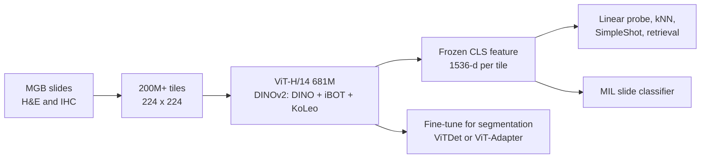

# MahmoodLab/UNI2-h

> **Bibkey** `MahmoodLab_UNI2h` · **Venue** Hugging Face model card · **Category** foundation · **Relevance** medium · **Access** open (gated download)
> **Link** <https://huggingface.co/MahmoodLab/UNI2-h>
> `status: complete` — 依据公开的 Hugging Face 模型卡全文(2026-10-27 抓取;权重文件需申请)。模型卡没有论文、没有基准数字;下文的定量结果只来自本库已读的 PathBench 论文。

---

## 一句话 / One-liner
<!-- ZH --> UNI2-h 是 Mahmood Lab(Harvard / BWH)发布的病理视觉基础模型:一个 681M 参数的定制 ViT-H/14,用 DINOv2 配方在 Mass General Brigham 的 2 亿+ 个 H&E 与 IHC 图块上自监督训练,把 224×224 组织图块编码为 1,536 维特征,供下游冻结使用(model card §"Model Description"、§"Training Details")。
<!-- EN --> UNI2-h is a pathology vision foundation model from the Mahmood Lab (Harvard / BWH): a 681M-parameter custom ViT-H/14 trained with the DINOv2 recipe on 200M+ H&E and IHC tiles from Mass General Brigham, mapping a 224×224 tissue tile to a 1,536-dim feature for frozen downstream use (model card §"Model Description", §"Training Details").

## 要点 / Takeaways
- <!-- ZH --> 这是一个模型卡,不是论文:卡上没有任何基准数字;它把读者引向 UNI 论文(Chen et al., Nature Medicine 2024),而该论文描述的是前代 UNI,不是 UNI2-h(README §"BibTeX")。我们未读 UNI 论文。 <!-- EN --> This is a model card, not a paper: it contains no benchmark numbers and points to the UNI paper (Chen et al., Nature Medicine 2024), which describes the earlier UNI, not UNI2-h (README §"BibTeX"). We did not read the UNI paper.
- <!-- ZH --> 训练数据:"2 亿+ 图块,来自 30 万+ 张 H&E 和 IHC 切片"(Training Details);同一张卡在 Model Description 中写"35 万+ 张"——卡内自相矛盾。 <!-- EN --> Training data: "over 200 million tiles from over 300k H&E and IHC slides" (Training Details); the same card says "over 350k" in Model Description — an internal inconsistency.
- <!-- ZH --> 架构:depth 24、24 头、embed_dim 1,536、SwiGLU FFN、8 个 register token、681M 参数;目标 = DINO 自蒸馏(multi-crop)+ iBOT masked image modeling + KoLeo 正则(Training Details;timm_kwargs)。 <!-- EN --> Architecture: depth 24, 24 heads, embed_dim 1,536, SwiGLU FFN, 8 register tokens, 681M params; objective = DINO self-distillation (multi-crop) + iBOT masked image modelling + KoLeo regularisation (Training Details; timm_kwargs).
- <!-- ZH --> 用法:冻结 CLS 特征做 linear probe / kNN / SimpleShot 分类、最近邻检索、MIL slide 分类;分割建议微调(ViTDet 或 ViT-Adapter)(Direct / Downstream Use)。官方提供 TCGA、CPTAC、PANDA 的预提取特征。 <!-- EN --> Usage: frozen CLS features for linear-probe / kNN / SimpleShot classification, nearest-neighbour retrieval and MIL slide classification; fine-tuning recommended for segmentation (ViTDet or ViT-Adapter) (Direct / Downstream Use). Pre-extracted features are provided for TCGA, CPTAC and PANDA.
- <!-- ZH --> 许可很严:CC-BY-NC-ND 4.0,仅限非商业学术研究;禁止再分发;个人邮箱(@gmail 等)申请会被拒,需机构邮箱(License; Requesting Access)。 <!-- EN --> Strict licence: CC-BY-NC-ND 4.0, non-commercial academic research only; no redistribution; personal e-mail (@gmail etc.) requests are denied, an institutional e-mail is required (License; Requesting Access).
- <!-- ZH --> 独立评测(PathBench,本库 `pathbench-natcommun-2026`):UNI2 在 TCGA 任务平均 AUROC 0.824,与 Virchow2、Prov-GigaPath、H-optimus-0、UNI 无显著差异(PathBench Fig. 1b;Results)。 <!-- EN --> Independent evaluation (PathBench, `pathbench-natcommun-2026` in this library): UNI2 has mean TCGA AUROC 0.824, not significantly different from Virchow2, Prov-GigaPath, H-optimus-0 and UNI (PathBench Fig. 1b; Results).

## 研究问题 / Problem
<!-- ZH --> 模型卡本身不陈述研究问题,只定位为"用于组织病理图像多用途评估的预训练视觉 backbone"(Model Description)。我们的理解:它要解决的是计算病理中每个任务都从头训练、标注昂贵的问题——提供一个通用的 tile 级 encoder,下游只需轻量的线性头或 MIL 头。
<!-- EN --> The card states no research question; it positions the model as a "pretrained vision backbone for multi-purpose evaluation on histopathology images" (Model Description). Our reading: the target problem is that each pathology task is otherwise trained from scratch with costly labels — a general tile-level encoder lets downstream work use only light linear or MIL heads.

## 方法 / Method
<!-- ZH --> 1) **输入**:组织病理 ROI / tile,预处理为 resize 到 224、ImageNet 均值方差归一化(How To Use)。
<!-- ZH --> 2) **架构**:定制 ViT-H/14——patch 14、img 224、depth 24、num_heads 24、embed_dim 1,536、mlp_ratio 2.66667×2 的 SwiGLUPacked FFN(SiLU 激活)、init_values 1e-5(LayerScale)、8 个 register token(额外的可学习 token,不对应图像 patch)、no_embed_class、dynamic_img_size;共 681M 参数(timm_kwargs;Training Details)。本地加载代码里的 timm 基础名为 `vit_giant_patch14_224`。
<!-- ZH --> 3) **自监督目标**:DINOv2 配方——DINO 自蒸馏损失(multi-crop:学生看小裁剪图,匹配教师在大裁剪图上的输出)+ iBOT 掩码图像建模损失(学生预测被遮挡 patch 的教师表征)+ CLS token 上的 KoLeo 正则(鼓励特征在空间中均匀分布)(Training Details)。
<!-- ZH --> 4) **训练设置**:bf16 + PyTorch-FSDP 混合精度;"大量 A100 80GB、大量 GPU 小时";MGB ERIS 计算平台(Training Details)。卡上没有给出 batch size、步数、倍率或器官分布。
<!-- ZH --> 5) **输出与下游**:每个 tile 输出 [1, 1536] 的特征;可直接用于 linear probe、kNN、SimpleShot(最近类中心)、最近邻检索,以及在一张 WSI 的一袋 CLS token 上训练 MIL 分类器;分割任务推荐微调(Direct / Downstream Use)。
<!-- EN --> 1) **Input**: histopathology ROIs / tiles, resized to 224 and normalised with ImageNet mean and std (How To Use).
<!-- EN --> 2) **Architecture**: custom ViT-H/14 — patch 14, img 224, depth 24, num_heads 24, embed_dim 1,536, SwiGLUPacked FFN with mlp_ratio 2.66667×2 and SiLU, init_values 1e-5 (LayerScale), 8 register tokens (extra learnable tokens not tied to image patches), no_embed_class, dynamic_img_size; 681M parameters (timm_kwargs; Training Details). The local-loading code uses the timm base name `vit_giant_patch14_224`.
<!-- EN --> 3) **Self-supervised objective**: the DINOv2 recipe — DINO self-distillation with multi-crop (the student sees small crops and matches the teacher on large crops) + iBOT masked image modelling (the student predicts the teacher's features of masked patches) + KoLeo regularisation on [CLS] (spreads features evenly) (Training Details).
<!-- EN --> 4) **Training setup**: bf16 with PyTorch-FSDP mixed precision; "lots of Nvidia A100 80GB for lots of GPU hours"; MGB ERIS research computing (Training Details). No batch size, steps, magnification or organ mix is given.
<!-- EN --> 5) **Output and downstream**: a [1, 1536] feature per tile, used for linear probing, kNN, SimpleShot (nearest centroid), nearest-neighbour retrieval, and MIL classifiers on a bag of CLS tokens per WSI; fine-tuning is recommended for segmentation (Direct / Downstream Use).

## 方法图 / Method diagram


## 数据 / Data
<!-- ZH --> **预训练**:2 亿+ 图块,采样自 Mass General Brigham 的 H&E 与 IHC 切片——Training Details 写"30 万+ 张",Model Description 写"35 万+ 张 diverse"(卡内不一致;PathBench Table 2 记为 0.35M WSI、200M patch)。卡上没有染色比例、倍率、器官或疾病分布。**预提取特征**:官方在 `MahmoodLab/UNI2-h-features` 提供 TCGA、CPTAC、PANDA 的 UNI2-h 嵌入(Pre-Extracted Embeddings)。
<!-- EN --> **Pretraining**: 200M+ tiles sampled from Mass General Brigham H&E and IHC slides — "over 300k" in Training Details, "over 350k diverse" in Model Description (inconsistent within the card; PathBench Table 2 lists 0.35M WSIs and 200M patches). No stain ratio, magnification, organ or disease breakdown is given. **Pre-extracted features**: UNI2-h embeddings for TCGA, CPTAC and PANDA at `MahmoodLab/UNI2-h-features` (Pre-Extracted Embeddings).

## 主要结果 / Key results
- <!-- ZH --> 模型卡:**没有定量结果**,只说冻结特征"在 ROI 分类、检索和 slide 分类上可获得有竞争力的结果"(Direct Use)。 <!-- EN --> Model card: **no quantitative results**; it only says frozen features give "competitive results" on ROI classification, retrieval and slide classification (Direct Use).
- <!-- ZH --> PathBench(独立第三方,linear probe + mean pooling):TCGA 19 个任务平均 AUROC 0.824(95% CI 0.779–0.868),位列前五;非 TCGA 22 个任务 0.824(95% CI 0.751–0.897)(PathBench Fig. 1b–c)。 <!-- EN --> PathBench (independent, linear probe + mean pooling): mean AUROC 0.824 (95% CI 0.779–0.868) on 19 TCGA tasks, in the top five; 0.824 (95% CI 0.751–0.897) on 22 non-TCGA tasks (PathBench Fig. 1b–c).
- <!-- ZH --> PathBench:非 TCGA patch 级任务平均 AUROC 0.953(仅次于 Virchow2 的 0.962);按累计 balanced accuracy,UNI2 从 TCGA 第 6 降到非 TCGA 第 9(PathBench Fig. 2b;Fig. 5a–b)。 <!-- EN --> PathBench: mean AUROC 0.953 on non-TCGA patch-level tasks (second to Virchow2 at 0.962); by cumulative balanced accuracy UNI2 drops from 6th on TCGA to 9th on non-TCGA tasks (PathBench Fig. 2b; Fig. 5a–b).

## 创新点 / Contributions
- <!-- ZH --> 相对卡上未定量对比的前代 UNI:更大的 ViT-H 架构(681M、SwiGLU、8 个 register token),训练数据加入 IHC(model card)。我们没有读 UNI 论文,无法核实 UNI 的规模。 <!-- EN --> Compared with the earlier UNI (not quantified on the card): a larger ViT-H (681M, SwiGLU, 8 register tokens) and IHC in the training data (model card). We did not read the UNI paper, so UNI's own scale is not verified here.
- <!-- ZH --> 工程上即插即用:timm 一行加载,附预提取的 TCGA / CPTAC / PANDA 特征和 CLAM、LGSSL 等配套仓库(Software Dependencies)。 <!-- EN --> Plug-and-play engineering: one-line timm loading, pre-extracted TCGA / CPTAC / PANDA features, companion repos such as CLAM and LGSSL (Software Dependencies).

## 局限 / Limitations
- <!-- ZH --> 卡上:CC-BY-NC-ND 4.0,禁止商用、禁止再分发,用 UNI2 输出训练的模型或构建的数据集也算衍生物(License)。 <!-- EN --> On the card: CC-BY-NC-ND 4.0, no commercial use, no redistribution; models trained on UNI2 outputs and datasets built from it count as derivatives (License).
- <!-- ZH --> 我们的理解:没有技术报告或论文,训练数据组成、预处理、倍率都不透明;切片数在卡内前后不一致(30 万+ vs 35 万+)。 <!-- EN --> Our reading: there is no technical report or paper, so data composition, preprocessing and magnification are opaque; the slide count is inconsistent within the card (300k+ vs 350k+).
- <!-- ZH --> 我们的理解:单一机构(MGB)数据,扫描仪/染色域偏移需要在我们的数据上检查;PathBench 中 UNI2 在非 TCGA 任务的排名下降,提示存在一定的域依赖。 <!-- EN --> Our reading: single-institution (MGB) data, so scanner/stain shift must be checked on our data; its drop in PathBench's non-TCGA ranking suggests some domain dependence.
- <!-- ZH --> 我们的理解:tile 级形态特征,不涉及转录组或空间组学;非专为异常检测设计。 <!-- EN --> Our reading: tile-level morphology only, no transcriptomics or spatial omics; not designed for anomaly detection.

## 与本研究方向的关系 / Relation to our direction
<!-- ZH --> 我们的理解:UNI2-h 是 **detect** 环节 H&E 模态的候选冻结 encoder。具体用法:把肾活检 WSI 切成 224 px tile → 提 1,536 维 CLS 特征 → 在健康参考组织 tile 上建 kNN / 密度 / 单类模型 → 用到最近健康特征的距离作为 tile 级异常分数,再聚合到区域或活检级。它也可以作为 H&E 侧的嵌入,与 Xenium / snRNA 特征做跨模态对齐(H&E 与分子模态是否一致)。PathBench 显示它与 Virchow2 等属于同一梯队、差异多不显著,所以选型时可同时提 UNI2-h 和 Virchow2 两套特征作对照。许可 NC-ND 意味着不能再分发由其衍生的特征数据集,发布 benchmark 时要注意。
<!-- EN --> Our reading: UNI2-h is a candidate frozen encoder for the H&E modality in the **detect** stage. Concretely: tile kidney-biopsy WSIs at 224 px → extract 1,536-dim CLS features → fit kNN / density / one-class models on healthy reference tiles → use the distance to the nearest healthy features as a tile-level anomaly score, aggregated to region or biopsy level. It can also be the H&E-side embedding for cross-modal alignment with Xenium / snRNA features (does H&E agree with the molecular modality?). PathBench places it in the same tier as Virchow2 with mostly non-significant differences, so extracting both feature sets for comparison is sensible. The NC-ND licence means derived feature datasets cannot be redistributed — relevant when releasing a benchmark.

## 可复用资产 / Reusable assets
- <!-- ZH --> 权重(gated,需机构邮箱):`hf-hub:MahmoodLab/UNI2-h`;加载代码与 timm_kwargs 见 `ai-ready.md`。 <!-- EN --> Weights (gated, institutional e-mail): `hf-hub:MahmoodLab/UNI2-h`; loading code and timm_kwargs in `ai-ready.md`.
<!-- ZH/EN --> <https://huggingface.co/MahmoodLab/UNI2-h>
- <!-- ZH --> 预提取特征(TCGA、CPTAC、PANDA): <!-- EN --> Pre-extracted features (TCGA, CPTAC, PANDA):
<!-- ZH/EN --> <https://huggingface.co/datasets/MahmoodLab/UNI2-h-features>
- <!-- ZH --> 代码仓库(卡上 Repository 链接): <!-- EN --> Code repository (the card's Repository link):
<!-- ZH/EN --> <https://github.com/mahmoodlab/UNI>
- <!-- ZH --> 配套工具(卡上列出):CLAM(slide 分类)、LGSSL(linear probe 与 few-shot 评测)、ViT-Adapter / Mask2Former(分割)。 <!-- EN --> Companion tools listed on the card: CLAM (slide classification), LGSSL (linear-probe and few-shot evaluation), ViT-Adapter / Mask2Former (segmentation).

## 待读 / Follow-ups
- <!-- ZH --> UNI 论文 Chen et al., Nature Medicine 2024(doi:10.1038/s41591-024-02857-3)——前代 UNI 的方法与基准(卡要求引用它)。 <!-- EN --> The UNI paper, Chen et al., Nature Medicine 2024 (doi:10.1038/s41591-024-02857-3) — method and benchmarks of the earlier UNI (the card asks to cite it).
- <!-- ZH --> PathBench 的 Supplementary Tables 3–8:各模型预训练数据的组织组成(UNI2 未公开)。 <!-- EN --> PathBench Supplementary Tables 3–8: tissue composition of each model's pretraining data (not disclosed for UNI2).
- <!-- ZH --> 试验:在肾活检 tile 上对比 UNI2-h 与 Virchow2 特征的 kNN 异常评分。 <!-- EN --> Experiment: compare kNN anomaly scores from UNI2-h vs Virchow2 features on kidney-biopsy tiles.

## 图表 / Figures & tables
<!-- ZH --> 这是一个 **Hugging Face 模型卡片**,内容以说明文字与代码为主,**没有方法图/结果图,也没有定量基准表**。页面上唯一的图片是申请访问的操作截图(`requesting_access.png`),不属于可复用的方法/结果图,故不收录。加载与使用见 `ai-ready.md` 中的 `timm.create_model(...)` 代码片段;定量基准请见 UNI 原论文(Chen et al., Nature Medicine 2024, doi:10.1038/s41591-024-02857-3,描述的是前代 UNI)与本库的 PathBench 条目。原始模型卡片:<https://huggingface.co/MahmoodLab/UNI2-h>。
<!-- EN --> This is a **Hugging Face model card**, dominated by descriptive text and code, with **no method/result figures and no quantitative benchmark table**. The only image on the page is an access-request screenshot (`requesting_access.png`), which is not a reusable method/result figure and is therefore omitted. For loading/usage see the `timm.create_model(...)` snippet in `ai-ready.md`; for quantitative benchmarks see the UNI paper (Chen et al., Nature Medicine 2024, doi:10.1038/s41591-024-02857-3, which describes the earlier UNI) and this library's PathBench entry. Model card: <https://huggingface.co/MahmoodLab/UNI2-h>.

## 引用 / Cite
```bibtex
% no BibTeX fetched
```
