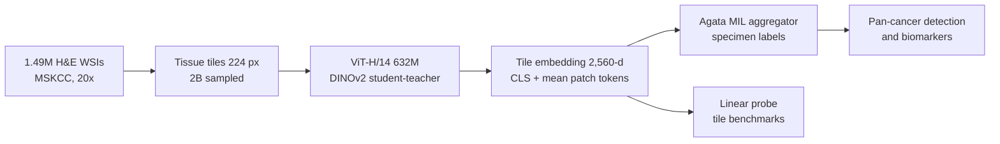

# A foundation model for clinical-grade computational pathology and rare cancers detection

> **Bibkey** `Vorontsov_2024` · **Venue** Nature Medicine (2024) · **Category** foundation · **Relevance** medium · **Access** open (CC BY 4.0)
> **Link** <https://doi.org/10.1038/s41591-024-03141-0>
> `status: complete` — 全文精读,依据 Nature Medicine 出版版 PDF(`source.pdf`,CC BY 4.0 开放获取);架构细节另核对了 Hugging Face 模型卡。

---

## 一句话 / One-liner
<!-- ZH --> Virchow 是 Paige 与 Microsoft Research 用 DINOv2 自监督在 MSKCC 约 150 万张 H&E 全切片(WSI)上训练的 632M 参数 ViT-H/14 病理基础模型;在它的冻结 tile 嵌入上训练一个聚合器,就能做跨 16 种癌的"泛癌检测",标本级 AUC 0.950,其中 7 种罕见癌 AUC 0.937(Abstract;Fig. 2b–c)。
<!-- EN --> Virchow is a 632M-parameter ViT-H/14 pathology foundation model trained by Paige and Microsoft Research with DINOv2 self-supervision on ~1.5M H&E whole-slide images (WSIs) from MSKCC; an aggregator trained on its frozen tile embeddings performs pan-cancer detection across 16 cancer types with specimen-level AUC 0.950, and 0.937 on the 7 rare cancers (Abstract; Fig. 2b–c).

## 要点 / Takeaways
- <!-- ZH --> 训练数据:1,488,550 张 H&E WSI、119,629 名患者、17 个组织大类,全部来自 MSKCC、Leica 扫描仪、20×(0.5 µm/px);从约 130 亿个 tile 中有放回地采样 20 亿个用于训练(Fig. 1a;Methods §"Million-scale training dataset")。 <!-- EN --> Training data: 1,488,550 H&E WSIs from 119,629 patients, 17 tissue groups, all from MSKCC on Leica scanners at 20× (0.5 µm/px); 2 billion tiles sampled with replacement from ~13 billion (Fig. 1a; Methods §"Million-scale training dataset").
- <!-- ZH --> 泛癌检测:Virchow 0.950 > UNI 0.940 > Phikon 0.932 > CTransPath 0.907(两两 P < 0.0001);95% 灵敏度下特异度 72.5% vs 68.9% / 62.9% / 52.3%(Fig. 2b)。 <!-- EN --> Pan-cancer detection: Virchow 0.950 > UNI 0.940 > Phikon 0.932 > CTransPath 0.907 (all pairwise P < 0.0001); specificity at 95% sensitivity 72.5% vs 68.9% / 62.9% / 52.3% (Fig. 2b).
- <!-- ZH --> 和商用专科模型比:泛癌模型训练样本更少,AUC 只落后 0.001–0.007(前列腺 0.980 vs Paige Prostate 0.995;乳腺 0.985 vs 0.992),淋巴结大转移反超(0.999 vs 0.994),部分罕见变体更好(Fig. 3;Discussion)。 <!-- EN --> Versus commercial specialist models: with fewer training specimens the pan-cancer model is 0.001–0.007 AUC behind (prostate 0.980 vs Paige Prostate 0.995; breast 0.985 vs 0.992), better on lymph-node macrometastases (0.999 vs 0.994) and on some rare variants (Fig. 3; Discussion).
- <!-- ZH --> 失败分析对异常检测很有参考价值:假阳性中 53.2% 是癌前病变,17.0% 是组织伪影(挤压、折叠、失焦);假阴性中 45.2% 是肿瘤灶很小(Results §"Toward clinical-grade performance";Fig. 3d)。 <!-- EN --> The failure analysis is directly useful for anomaly detection: 53.2% of false positives are precursor lesions and 17.0% tissue artefacts (crush, folds, out-of-focus); 45.2% of false negatives contain only small tumour foci (Results §"Toward clinical-grade performance"; Fig. 3d).
- <!-- ZH --> 性能随模型参数量约呈对数增长,随训练 tile 数增长但回报递减(Fig. 2g)。 <!-- EN --> Performance grows roughly log-linearly with parameters and with training tiles, with diminishing returns for the latter (Fig. 2g).
- <!-- ZH --> 我们的理解:Virchow 是"疾病 vs 正常"的强特征器,但它是在监督标签(癌/非癌)上评估的;用于肾脏非肿瘤异常检测,需要我们自己在其嵌入上建正常参考分布并验证。 <!-- EN --> Our reading: Virchow is a strong disease-vs-normal feature extractor, but it is evaluated with supervised cancer labels; for non-tumour kidney anomaly detection we would need to build a normal reference distribution on its embeddings and validate it ourselves.

## 研究问题 / Problem
<!-- ZH --> 计算病理的临床应用依赖于对极其多样的组织形态建模;针对单一癌种训练的诊断模型只覆盖部分图像,难以泛化,对罕见癌、少见的基因变异预测等数据少的任务更难建模(Introduction)。此前的病理基础模型用 3 万到 40 万张 WSI、2,800 万到 3.07 亿参数(Introduction)。作者问:把训练数据扩到百万张 WSI、模型扩到 6 亿参数级别,能否用一个通用嵌入支撑泛癌检测(含罕见癌)、生物标志物预测等任务,并在标注更少时接近商用临床级模型。
<!-- EN --> Clinical computational pathology depends on modelling very diverse tissue morphology; diagnosis-specific models see only a subset of images, generalise poorly, and struggle on data-poor tasks such as rare cancers or uncommon genomic alterations (Introduction). Earlier pathology foundation models used 30,000–400,000 WSIs and 28M–307M parameters (Introduction). The question: with a million-WSI dataset and a ~600M-parameter model, can one general embedding support pan-cancer detection (including rare cancers) and biomarker prediction, and approach commercial clinical-grade models with fewer labels?

## 方法 / Method
<!-- ZH --> 1) **切 tile**:WSI 16× 下采样后用 HSV 阈值找组织前景,收集所有不重叠、组织面积 ≥ 25% 的 224 px tile(Methods)。
<!-- ZH --> 2) **自监督预训练**:ViT-H/14(632M 参数)用 DINOv2 训练——学生/教师网络结构相同,教师是学生的 EMA;每个 tile 生成 2 个全局视图和 8 个局部视图,学生在被遮挡的输入上匹配教师的 class token(全局)和被遮挡 patch token(局部,即 iBOT 式 masked image modeling)(Methods;Extended Data Fig. 2)。超参改动:教师温度 0.04–0.07、warmup 495,000 次迭代、131,072 个 prototype;AdamW,fp16;每个 GPU 每批 1 张 WSI 的 256 个 tile。
<!-- ZH --> 3) **嵌入**:每个 224×224 tile 输出 class token 与其余 256 个 token 的均值拼接,得 2,560 维(1,280 × 2)向量(Methods §"Embedding generation")。模型卡给出:32 层、embedding 1,280、16 头、SwiGLU、LayerScale,输出 257 × 1,280 token。
<!-- ZH --> 4) **标本级聚合**:Agata 聚合器(弱监督 multiple-instance learning,MIL:一袋 tile 只有一个标本级标签)。它用一个可学习的 query 对所有 tile 做 cross-attention,内存随 tile 数线性增长;训练时每个标本只对预测癌概率最高的那张切片反传(Methods;Extended Data Fig. 1)。交叉熵、AdamW、lr 3e-4、25 epoch,所有 baseline 嵌入用同一流程。
<!-- ZH --> 5) **标签**:用规则型 NLP 从病理报告抽取标本级"有无癌"标签;生物标志物标签来自 MSK-IMPACT 测序(Methods)。
<!-- ZH --> 6) **评测**:泛癌检测(AUC、95% 灵敏度下特异度,DeLong 检验 + Holm 校正);与 Paige Prostate / Breast / BLN 商用模型对比;9 个生物标志物;8 个 tile 级 linear probe 基准(SGD、12,500 次迭代,加权 F1)。
<!-- EN --> 1) **Tiling**: WSIs are downsampled 16×, tissue foreground is found with HSV thresholds, and all non-overlapping 224 px tiles with ≥25% tissue are collected (Methods).
<!-- EN --> 2) **Self-supervised pretraining**: a ViT-H/14 (632M params) trained with DINOv2 — student and teacher share the architecture, the teacher is an EMA of the student; each tile yields 2 global and 8 local crops, and the student, on masked inputs, matches the teacher's class token (global) and the masked patch tokens (local, iBOT-style masked image modelling) (Methods; Extended Data Fig. 2). Changed hyperparameters: teacher temperature 0.04–0.07, 495,000-iteration warmup, 131,072 prototypes; AdamW, fp16; each GPU batch = 256 tiles from one WSI.
<!-- EN --> 3) **Embedding**: for each 224×224 tile, the class token concatenated with the mean of the other 256 tokens gives a 2,560-dim vector (1,280 × 2) (Methods §"Embedding generation"). The model card adds: 32 layers, embedding 1,280, 16 heads, SwiGLU, LayerScale, output 257 × 1,280 tokens.
<!-- EN --> 4) **Specimen-level aggregation**: the Agata aggregator (weakly supervised multiple-instance learning, MIL: a bag of tiles with one specimen label). A learned query cross-attends over all tiles with memory linear in tile count; during training only the slide with the highest predicted cancer probability per specimen is back-propagated (Methods; Extended Data Fig. 1). Cross-entropy, AdamW, lr 3e-4, 25 epochs, same protocol for all baseline embeddings.
<!-- EN --> 5) **Labels**: a rule-based NLP system extracts specimen-level cancer labels from pathology reports; biomarker labels come from MSK-IMPACT sequencing (Methods).
<!-- EN --> 6) **Evaluation**: pan-cancer detection (AUC, specificity at 95% sensitivity; DeLong + Holm); comparison with commercial Paige Prostate / Breast / BLN models; 9 biomarkers; 8 tile-level linear-probe benchmarks (SGD, 12,500 iterations, weighted F1).

## 方法图 / Method diagram


## 数据 / Data
<!-- ZH --> **预训练**:MSKCC 去标识数据,119,629 名患者、208,815 个病例、392,268 个标本、1,207,837 个蜡块、1,488,550 张 H&E 切片;活检 63%、切除 37%;17 个组织大类(Fig. 1a–d)。**泛癌检测测试集**:22,932 张切片、6,142 个标本、16 种癌;常见癌 3,547 个标本(乳腺、前列腺、肺、结肠、皮肤、膀胱、子宫、胰腺、头颈),罕见癌 2,595 个标本(肝、胃、脑、卵巢、宫颈、睾丸、骨;罕见癌定义为美国年发病 < 15/10 万);内部 MSKCC 3,033 个标本、外部机构 3,109 个标本(Methods §"Testing dataset")。聚合器训练 + 验证:89,417 张切片、40,402 个标本。**生物标志物**:9 个 MSK-IMPACT 任务(如 Colon-MSI 2,698 例、Breast-CDH1 1,077 例、Bladder-FGFR 1,038 例)(Fig. 4b;Methods)。**tile 基准**:PanMSK、CRC(NCT-CRC-HE-100K)、Camelyon17-WILDS、PCam、MHIST、TCGA TIL、MIDOG、TCGA CRC-MSI(Methods)。
<!-- EN --> **Pretraining**: de-identified MSKCC data: 119,629 patients, 208,815 cases, 392,268 specimens, 1,207,837 blocks, 1,488,550 H&E slides; 63% biopsy, 37% resection; 17 tissue groups (Fig. 1a–d). **Pan-cancer test set**: 22,932 slides from 6,142 specimens over 16 cancer types; common cancers 3,547 specimens (breast, prostate, lung, colon, skin, bladder, uterus, pancreas, head and neck), rare cancers 2,595 specimens (liver, stomach, brain, ovary, cervix, testis, bone; rare = US incidence < 15 per 100,000 per year); 3,033 internal MSKCC and 3,109 external specimens (Methods §"Testing dataset"). Aggregator train + validation: 89,417 slides from 40,402 specimens. **Biomarkers**: 9 MSK-IMPACT tasks (e.g. Colon-MSI 2,698 samples, Breast-CDH1 1,077, Bladder-FGFR 1,038) (Fig. 4b; Methods). **Tile benchmarks**: PanMSK, CRC (NCT-CRC-HE-100K), Camelyon17-WILDS, PCam, MHIST, TCGA TIL, MIDOG, TCGA CRC-MSI (Methods).

## 主要结果 / Key results
- <!-- ZH --> **泛癌检测**:标本级 AUC Virchow 0.950、UNI 0.940、Phikon 0.932、CTransPath 0.907(两两 P < 0.0001);95% 灵敏度下特异度 72.5% / 68.9% / 62.9% / 52.3%(Fig. 2b)。 <!-- EN --> **Pan-cancer detection**: specimen-level AUC Virchow 0.950, UNI 0.940, Phikon 0.932, CTransPath 0.907 (pairwise P < 0.0001); specificity at 95% sensitivity 72.5% / 68.9% / 62.9% / 52.3% (Fig. 2b).
- <!-- ZH --> **罕见癌**:AUC 0.937(UNI 0.925);宫颈 0.875(UNI 0.830)、骨 0.841(UNI 0.813)仍是最难的两类(Fig. 2a,c)。Virchow 在 16 种癌上都是最佳或并列最佳(Fig. 2a)。 <!-- EN --> **Rare cancers**: AUC 0.937 (UNI 0.925); cervix 0.875 (UNI 0.830) and bone 0.841 (UNI 0.813) remain hardest (Fig. 2a,c). Virchow is best or tied-best on all 16 cancer types (Fig. 2a).
- <!-- ZH --> **外部机构**:内部 AUC 0.938、外部 0.934(UNI 0.927 / 0.925)(Fig. 2e);约 19.5% 测试标本含训练中没见过的组织(如宫颈、睾丸、头颈),Virchow 仍领先(Fig. 2f)。 <!-- EN --> **External sites**: internal AUC 0.938, external 0.934 (UNI 0.927 / 0.925) (Fig. 2e); ~19.5% of test specimens contain tissues unseen in training (e.g. cervix, testis, head and neck), and Virchow still leads (Fig. 2f).
- <!-- ZH --> **对比商用模型**:泛癌模型共用 35,387 个训练组(前列腺 2,829、乳腺 1,626、淋巴结 1,441),而 Paige Prostate 用 66,713 个蜡块、Paige Breast 44,588 个标本、BLN 8,150 个标本;AUC 前列腺 0.980 vs 0.995(P < 0.05)、乳腺 0.985 vs 0.992(P < 0.01)、淋巴结大转移 0.999 vs 0.994(P < 0.05)(Results §"Toward clinical-grade performance";Fig. 3)。 <!-- EN --> **Versus commercial models**: the pan-cancer model used 35,387 training groups (2,829 prostate, 1,626 breast, 1,441 lymph node) vs 66,713 blocks for Paige Prostate, 44,588 specimens for Paige Breast and 8,150 for BLN; AUC prostate 0.980 vs 0.995 (P < 0.05), breast 0.985 vs 0.992 (P < 0.01), lymph-node macrometastases 0.999 vs 0.994 (P < 0.05) (Results §"Toward clinical-grade performance"; Fig. 3).
- <!-- ZH --> **失败模式**(病理医生复核):假阴性 45.2% 为肿瘤灶很小、11.9% 为交界性肿瘤、9.5% 恶性特征很细微、26.2%(11 例)无法解释;假阳性 53.2% 为癌前病变、17.0% 为组织伪影、14.9% 间质/淋巴反应性改变、11.7% 上皮反应性改变、3.2% 良性肿瘤(Results;Fig. 3d)。 <!-- EN --> **Failure modes** (pathologist review): false negatives — 45.2% small tumour foci, 11.9% borderline malignancy, 9.5% very subtle malignant features, 26.2% (11 cases) unexplained; false positives — 53.2% precursor lesions, 17.0% tissue artefacts, 14.9% reactive stromal/lymphoid changes, 11.7% reactive epithelial changes, 3.2% benign neoplasms (Results; Fig. 3d).
- <!-- ZH --> **生物标志物**:9 个任务中 7 个 Virchow AUC 最高(Fig. 4c);未拿第一的 Prostate-AR 0.849、Ovarian-FGA 0.847。作者说明样本量不足以做显著性检验,学习率按测试集最佳报告(Methods)。 <!-- EN --> **Biomarkers**: Virchow has the top AUC on 7 of 9 tasks (Fig. 4c); where it is not first, Prostate-AR 0.849 and Ovarian-FGA 0.847. The authors note insufficient power for significance tests and report the best test AUC over learning rates (Methods).
- <!-- ZH --> **tile 级 linear probe**:8 个任务中 7 个最佳或并列最佳(Fig. 5b);CRC 不做染色归一化时加权 F1 只降 0.005(Results §"Tile-level benchmarks")。 <!-- EN --> **Tile-level linear probe**: best or tied-best on 7 of 8 tasks (Fig. 5b); on CRC without stain normalisation weighted F1 drops by only 0.005 (Results §"Tile-level benchmarks").
- <!-- ZH --> **缩放**:检测性能随参数量约对数线性增长,随训练 tile 数增长但回报递减(Fig. 2g;Discussion)。 <!-- EN --> **Scaling**: detection improves roughly log-linearly with parameters and with training tiles, with diminishing returns for data (Fig. 2g; Discussion).

## 创新点 / Contributions
- <!-- ZH --> 当时最大的病理基础模型:150 万 WSI(作者称比以往训练集多 4–10 倍)、632M 参数(Introduction)。 <!-- EN --> The largest pathology foundation model at the time: 1.5M WSIs (4–10× prior datasets, per the authors) and 632M parameters (Introduction).
- <!-- ZH --> 证明一个基于基础模型嵌入的"泛癌"检测器,在训练标本更少时接近商用专科模型,并在罕见癌和未见组织上泛化(Fig. 2–3)。 <!-- EN --> Shows that a pan-cancer detector on foundation-model embeddings approaches commercial specialist models with fewer training specimens, and generalises to rare cancers and unseen tissues (Figs. 2–3).
- <!-- ZH --> 系统的失败模式分析(癌前病变、伪影、反应性改变),给出临床 AI 常见误报来源(Fig. 3d)。 <!-- EN --> A systematic failure-mode analysis (precursors, artefacts, reactive changes) showing typical sources of clinical-AI errors (Fig. 3d).
- <!-- ZH --> 线性可扩展的 Agata 聚合器,可处理一个标本内成千上万个 tile(Extended Data Fig. 1)。 <!-- EN --> The linear-memory Agata aggregator for tens of thousands of tiles per specimen (Extended Data Fig. 1).

## 局限 / Limitations
- <!-- ZH --> 作者:训练数据来自单一中心、扫描仪类型有限(Discussion)。 <!-- EN --> Authors: training data come from one centre with limited scanner types (Discussion).
- <!-- ZH --> 作者:嵌入是 20× tile 级,需要额外训练聚合模型;对生物标志物、疗效等低数据任务可能需要扩展到 slide 级模型(Discussion)。 <!-- EN --> Authors: embeddings are tile-level at 20×, so an aggregator must be trained; low-data tasks such as biomarkers or treatment response may need slide-level models (Discussion).
- <!-- ZH --> 作者:模型很大,部署需考虑硬件,可能需要蒸馏;数据平衡与蒸馏策略未充分探索(Discussion)。 <!-- EN --> Authors: model size needs deployment hardware and may call for distillation; data balancing and distillation were not fully explored (Discussion).
- <!-- ZH --> 作者:生物标志物结果统计功效不足,学习率按测试集最佳报告,代表"最佳可能"表现(Methods)。 <!-- EN --> Authors: biomarker results lack statistical power, and the reported AUC is the best over learning rates on the test set, i.e. an upper estimate (Methods).
- <!-- ZH --> 我们的理解:多数作者是 Paige 员工并持股,MSK 对 Paige 有经济利益(Competing interests);对比的商用模型也来自 Paige。训练数据不公开。 <!-- EN --> Our reading: most authors are Paige employees and equity holders, and MSK has financial interests in Paige (Competing interests); the commercial comparators are also Paige products. Training data are not public.
- <!-- ZH --> 我们的理解:评测只涉及癌症;肾脏在测试集"未见组织"中只占 0.1%(Fig. 2f),没有非肿瘤肾病任务。 <!-- EN --> Our reading: evaluation is cancer-only; kidney is just 0.1% of the "unobserved tissue" test specimens (Fig. 2f), and there is no non-tumour kidney task.

## 与本研究方向的关系 / Relation to our direction
<!-- ZH --> 我们的理解:Virchow 属于 **detect** 环节的上游特征器(H&E 模态)。(1) 可以作为冻结 encoder,把肾脏 H&E 切成 224 px tile 提 2,560 维嵌入,再在健康参考组织的嵌入上做 kNN / 密度 / 单类模型来给 tile 打异常分数(矩阵中的 feature 行);论文本身没有做无监督异常检测,只做了监督的癌/非癌分类。(2) 失败分析很有用:假阳性大多来自癌前病变、伪影、反应性改变——在异常检测里,这些正是"不正常但不是目标疾病"的干扰项,我们的 benchmark 需要专门标注和区分它们(比如把伪影作为单独的类别或用 QC 过滤)。(3) 单中心 Leica 数据训练,我们用于 Aachen 肾活检 H&E 时要检查扫描仪/染色域偏移。(4) PathBench(本库 `pathbench-natcommun-2026`)显示后续的 Virchow2 在多数任务上更强,Virchow 本身按累计 balanced accuracy 在非 TCGA 任务中排第 10(PathBench Fig. 5b)。
<!-- EN --> Our reading: Virchow is an upstream feature extractor for the **detect** stage (H&E modality). (1) As a frozen encoder, tile kidney H&E into 224 px tiles, extract 2,560-dim embeddings, and score tiles by kNN / density / one-class models fitted on healthy reference tissue (the feature row of the matrix); the paper itself does no unsupervised anomaly detection, only supervised cancer-vs-benign classification. (2) The failure analysis matters: most false positives are precursors, artefacts and reactive changes — exactly the "abnormal but not the target disease" confounders that an anomaly benchmark must label and separate (e.g. artefacts as their own class or removed by QC). (3) Training is single-centre Leica data, so scanner/stain shift must be checked on Aachen kidney biopsies. (4) PathBench (`pathbench-natcommun-2026` in this library) finds the successor Virchow2 stronger on most tasks, with Virchow itself 10th on non-TCGA tasks by cumulative balanced accuracy (PathBench Fig. 5b).

## 可复用资产 / Reusable assets
- <!-- ZH --> 权重:Hugging Face `paige-ai/Virchow`(需登录并同意条款,机构邮箱审核)。论文 Code availability 写"可用于非商业研究";HF 模型卡 license 标为 Apache 2.0,另附"不得用于临床诊断"等附加条款——两者表述不同,使用前以 HF 页面为准。 <!-- EN --> Weights: Hugging Face `paige-ai/Virchow` (login, terms, institutional email). The paper's Code availability says "for non-commercial research"; the HF model card lists Apache 2.0 with additional terms (e.g. not for clinical diagnosis) — the two differ, so check the HF page before use.
<!-- ZH/EN --> <https://huggingface.co/paige-ai/Virchow>
- <!-- ZH --> 下游 SDK(用嵌入开发 WSI 应用): <!-- EN --> Downstream SDK (building WSI applications on embeddings):
<!-- ZH/EN --> <https://github.com/Paige-AI/paige-ml-sdk>
- <!-- ZH --> 加载方式(模型卡):`timm.create_model("hf-hub:paige-ai/Virchow", pretrained=True, mlp_layer=SwiGLUPacked, act_layer=torch.nn.SiLU)`,输出 1 × 257 × 1,280,拼接得 2,560 维嵌入。 <!-- EN --> Loading (model card): `timm.create_model("hf-hub:paige-ai/Virchow", pretrained=True, mlp_layer=SwiGLUPacked, act_layer=torch.nn.SiLU)`; output 1 × 257 × 1,280, concatenated to a 2,560-dim embedding.
- <!-- ZH --> 公开 tile 基准(Data availability):NCT-CRC-HE-100K、Camelyon17-WILDS、PCam、MHIST、TCGA TIL、MIDOG、TCGA CRC-MSI。MSKCC 训练数据不公开,需向 Paige 申请。 <!-- EN --> Public tile benchmarks (Data availability): NCT-CRC-HE-100K, Camelyon17-WILDS, PCam, MHIST, TCGA TIL, MIDOG, TCGA CRC-MSI. MSKCC training data are proprietary (requests to Paige).
- <!-- ZH --> 可复用的协议:linear probe(SGD、batch 4,096、cosine lr 0.01→0、12,500 次迭代、Z-score 归一化);失败模式分类表。 <!-- EN --> Reusable protocols: linear probe (SGD, batch 4,096, cosine lr 0.01→0, 12,500 iterations, z-scored embeddings); the failure-mode taxonomy.

## 待读 / Follow-ups
- <!-- ZH --> Virchow2(Zimmermann et al. 2024,arXiv:2408.00738,多倍率、310 万 WSI)——PathBench 中最强的单模型。 <!-- EN --> Virchow2 (Zimmermann et al. 2024, arXiv:2408.00738; mixed magnification, 3.1M WSIs) — the strongest single model in PathBench.
- <!-- ZH --> UNI(Chen et al., Nat Med 2024)——本文最强 baseline,也是 `uni2-h-model` 的论文。 <!-- EN --> UNI (Chen et al., Nat Med 2024) — the strongest baseline here and the paper behind `uni2-h-model`.
- <!-- ZH --> Extended Data Fig. 3–4 与 Supplementary Tables:逐癌种特异度与测试集组成。 <!-- EN --> Extended Data Figs. 3–4 and Supplementary Tables: per-cancer specificity and test-set composition.
- <!-- ZH --> 试验:在冻结 Virchow / Virchow2 嵌入上对肾活检 tile 做 kNN 异常评分,并检查伪影与反应性改变带来的假阳性。 <!-- EN --> Experiment: kNN anomaly scores on frozen Virchow / Virchow2 embeddings of kidney-biopsy tiles, checking false positives from artefacts and reactive changes.

## 图表 / Figures & tables

<!-- ZH --> _注:论文为 CC BY 4.0 开放获取;此处未嵌入图像,只给出出版社图页链接。_
<!-- EN --> _Note: the paper is open access under CC BY 4.0; figures are not embedded here, only linked to the publisher's figure pages._

<!-- ZH --> **图1**:训练数据集、训练算法与 Virchow 的应用(训练数据的患者/病例/标本/蜡块/切片数,按癌症状态、手术方式、组织类型的分布;DINOv2 训练数据流;在 tile 嵌入上训练聚合器的下游应用)——见 <https://www.nature.com/articles/s41591-024-03141-0/figures/1>
<!-- EN --> **Fig 1**: The training dataset, training algorithm and application of Virchow (patient/case/specimen/block/slide counts and distribution by cancer status, surgery and tissue type; DINOv2 data flow; aggregator trained on tile embeddings for downstream tasks) — see <https://www.nature.com/articles/s41591-024-03141-0/figures/1>

<!-- ZH --> **图2**:泛癌检测结果(按癌种的 AUC、全部癌与罕见癌汇总、罕见癌 95% 特异度下灵敏度、内部/外部数据泛化、未见组织比例、随模型与数据规模的缩放)——见 <https://www.nature.com/articles/s41591-024-03141-0/figures/2>
<!-- EN --> **Fig 2**: Pan-cancer detection results (AUC per cancer type, all vs rare cancers, sensitivity at 95% specificity for rare cancers, internal vs external generalisation, unobserved tissues, scaling with model and data size) — see <https://www.nature.com/articles/s41591-024-03141-0/figures/2>

<!-- ZH --> **图3**:泛癌模型与三款 Paige 临床产品的对比(罕见变体、产品测试集、训练集规模)以及失败模式分类——见 <https://www.nature.com/articles/s41591-024-03141-0/figures/3>
<!-- EN --> **Fig 3**: Pan-cancer model vs three Paige clinical products (rare variants, product test sets, training-set sizes) and failure-mode categories — see <https://www.nature.com/articles/s41591-024-03141-0/figures/3>

### 结果表 / Results

<!-- ZH --> **表1.** 论文中的头条数字(出版版全文)。
<!-- EN --> **Table 1.** Headline numbers from the paper (published full text).

| Item | Value | Source |
|---|---|---|
| Pan-cancer detection, specimen-level AUC (16 cancers) | 0.950 (UNI 0.940, Phikon 0.932, CTransPath 0.907) | Fig. 2b |
| Rare-cancer AUC (7 cancers) | 0.937 (UNI 0.925) | Fig. 2c |
| Specificity at 95% sensitivity | 72.5% (UNI 68.9%) | Fig. 2b |
| Internal / external AUC | 0.938 / 0.934 | Fig. 2e |
| Prostate / breast / BLN AUC (pan-cancer vs Paige product) | 0.980 vs 0.995; 0.985 vs 0.992; macrometastases 0.999 vs 0.994 | Results; Fig. 3 |
| Biomarker tasks where Virchow is top-1 | 7 / 9 | Fig. 4c |
| Tile benchmarks where Virchow is top-1 (incl. ties) | 7 / 8 | Fig. 5b |
| Pretraining WSIs / patients | 1,488,550 / 119,629 | Methods; Fig. 1a |
| Backbone / parameters | ViT-H/14 / 632M | Methods |
| Tile embedding dimension | 2,560 (CLS + mean of 256 patch tokens) | Methods |

<!-- ZH --> _Source: Vorontsov et al., Nat Med 30, 2924–2935 (2024), CC BY 4.0 — <https://doi.org/10.1038/s41591-024-03141-0>;模型卡 <https://huggingface.co/paige-ai/Virchow>。_
<!-- EN --> _Source: Vorontsov et al., Nat Med 30, 2924–2935 (2024), CC BY 4.0 — <https://doi.org/10.1038/s41591-024-03141-0>; model card <https://huggingface.co/paige-ai/Virchow>._

## 引用 / Cite
```bibtex
@article{Vorontsov_2024, title={A foundation model for clinical-grade computational pathology and rare cancers detection}, volume={30}, ISSN={1546-170X}, url={http://dx.doi.org/10.1038/s41591-024-03141-0}, DOI={10.1038/s41591-024-03141-0}, number={10}, journal={Nature Medicine}, publisher={Springer Science and Business Media LLC}, author={Vorontsov, Eugene and Bozkurt, Alican and Casson, Adam and Shaikovski, George and Zelechowski, Michal and Severson, Kristen and Zimmermann, Eric and Hall, James and Tenenholtz, Neil and Fusi, Nicolo and Yang, Ellen and Mathieu, Philippe and van Eck, Alexander and Lee, Donghun and Viret, Julian and Robert, Eric and Wang, Yi Kan and Kunz, Jeremy D. and Lee, Matthew C. H. and Bernhard, Jan H. and Godrich, Ran A. and Oakley, Gerard and Millar, Ewan and Hanna, Matthew and Wen, Hannah and Retamero, Juan A. and Moye, William A. and Yousfi, Razik and Kanan, Christopher and Klimstra, David S. and Rothrock, Brandon and Liu, Siqi and Fuchs, Thomas J.}, year={2024}, month=July, pages={2924–2935} }
```
