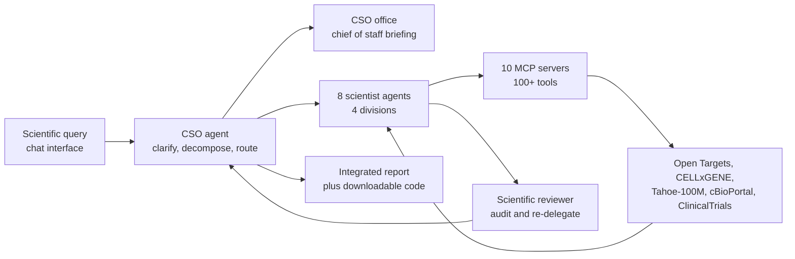

# The Virtual Biotech: A Multi-Agent AI Framework for Therapeutic Discovery and Development

> **Bibkey** `Zhang_2026` · **Venue** bioRxiv (2026) · **Category** agents · **Relevance** medium · **Access** open
> **Link** <https://doi.org/10.64898/2026.02.23.707551>
> `status: complete` — 精读基于 bioRxiv 全文 PDF("this version posted February 23, 2026",45 页,含 Extended Methods、Figs. S1–S5 与 Supplementary Notes I–II;pdftotext 提取并逐条核对)。CC-BY-ND 4.0。/ Based on the full bioRxiv PDF (version posted 23 Feb 2026, 45 pages including Extended Methods, Figs. S1–S5 and Supplementary Notes I–II), extracted with pdftotext and checked claim by claim. CC-BY-ND 4.0.
> Bilingual convention (drives the site's EN⇄中文 switcher): put `<!-- ZH -->` 中文 and `<!-- EN -->` English on their own lines (or inline `- <!-- ZH --> 中文 <!-- EN --> English`). Use `<!-- ZH/EN -->` ONLY for a purely language-neutral line (a bare URL or code token) — never for bilingual prose or labels.

---

## 一句话 / One-liner
<!-- ZH --> 把一家生物技术公司的组织架构照搬成 LLM agent 团队:一个"首席科学官"(CSO)agent 接收科学问题、拆解并分派给四个科研部门下的八个专科 scientist agent,后者通过 MCP server 调用 100 多个工具与公共数据库做真实计算,再由 CSO 汇总;作者用它做了三个转化医学案例(5.6 万条临床试验的大规模标注分析、B7-H3 肺癌靶点评估、一个失败的溃疡性结肠炎试验的复盘)。
<!-- EN --> A biotech company's org chart rebuilt as a team of LLM agents: a Chief Scientific Officer agent takes a scientific question, decomposes it and delegates to eight specialist scientist agents across four research divisions, which call 100-plus tools and public databases through MCP servers to run real computation, with the CSO integrating the results; the authors demonstrate it on three translational case studies — large-scale annotation of 55,984 clinical trials, a B7-H3 lung-cancer target assessment, and a post-mortem of a failed ulcerative-colitis trial.

## 要点 / Takeaways
- <!-- ZH --> 架构的核心不是"更强的模型",而是**组织结构**:四个部门(Target Identification and Prioritization、Target Safety、Modality Selection、Clinical Officers)+ CSO 办公室(Chief of Staff 做领域简报、Scientific Reviewer 审查并可要求重新分派);Introduction 自述"四个科研部门、十一个 agent、100 多个工具"。 <!-- EN --> The contribution is organisational rather than a stronger model: four divisions (Target Identification and Prioritization, Target Safety, Modality Selection, Clinical Officers) plus a CSO office (a Chief of Staff producing field briefings and a Scientific Reviewer that audits outputs and can force re-delegation); the Introduction states "four scientific divisions, eleven total agents, and over 100 tools".
- <!-- ZH --> agent 不是只会聊天:数据访问经 10 个 MCP server 接到 Open Targets (v25.09)、CELLxGENE Census、Tabula Sapiens v2、Tahoe-100M、cBioPortal、ClinicalTrials.gov、PubMed、OpenFDA、ChEMBL,实际跑 Scanpy / Harmony / PyDESeq2 / LIANA / Cell2Location / PROGENy 等真实分析。 <!-- EN --> The agents are not just chatting: data access runs through ten MCP servers onto Open Targets (v25.09), CELLxGENE Census, Tabula Sapiens v2, Tahoe-100M, cBioPortal, ClinicalTrials.gov, PubMed, OpenFDA and ChEMBL, and they actually run Scanpy, Harmony, PyDESeq2, LIANA, Cell2Location, PROGENy and similar analyses.
- <!-- ZH --> 并行化是实打实的工程结果:37,075 个 clinical-trialist agent 并行处理 37,075 条 Phase II/III 试验(每条一个 agent),约 6 小时完成,单 agent 顺序执行估计需 1,839 小时(约 184 倍);Phase I 的成败不由 agent 标注,而按"是否进入 Phase II"用规则定义(Results;Extended Methods)。 <!-- EN --> The parallelism is a real engineering result: 37,075 clinical-trialist agents, one per Phase II/III trial, finish in about 6 hours versus an estimated 1,839 hours for a single sequential agent (~184x); Phase I success is not agent-annotated but defined by rule as progression to Phase II (Results; Extended Methods).
- <!-- ZH --> 作者**做了抽取质量验证**:人工复核 100 条随机试验,主要终点一致 89.7%(78/87)、次要终点 83.9%(73/87)、不良事件率 92.4%(61/66);与 TDC 在 7,278 条试验上一致率 85.3%。 <!-- EN --> Extraction quality is validated: manual review of 100 randomly sampled trials gives 89.7% agreement on primary endpoints (78/87), 83.9% on secondary (73/87) and 92.4% on adverse-event rates (61/66), plus 85.3% agreement with TDC across 7,278 trials.
- <!-- ZH --> 科学结论:靶向**细胞类型特异**基因的药物更可能推进(摘要:Phase I→II 概率高 40%、到 Phase IV 高 48%、不良事件率低 32%)。正文给出的 Phase I→II odds ratio 是 1.27 (95% CI 1.22–1.33),这是标准化连续 tau 特征的 OR;48% 那句明确写在"把 tau 按 K-means 二分为细胞类型特异 / 广泛表达之后"的前提下;40% 与 32% 两句用的是同一个二分类别名,但论文没有重复这一交代(Results;Extended Methods)。我们的理解:三个百分比应都来自二分后的类别比较,与连续特征的 OR 不能直接对照;论文也没有给这几个百分比的 CI 或检验。 <!-- EN --> The science: drugs against cell-type-specific genes progress more often (abstract: 40% more likely Phase I→II, 48% more likely to reach Phase IV, 32% lower adverse-event rates). The Results' Phase I→II odds ratio of 1.27 (95% CI 1.22–1.33) is for the standardised continuous tau feature, while the 48% sentence is explicitly prefaced by "following binarization of targets based on their tau metric into cell-type-specific versus broadly expressed classes"; the 40% and 32% sentences use the same binarised class label but the paper does not repeat that attribution (Results; Extended Methods). Our reading: all three percentages come from the binarised comparison, so they are not directly comparable with the continuous-feature OR; the paper gives no CI or test for the percentages either.
- <!-- ZH --> 两个 case study 的成本被明确报出:B7-H3 案例 $46.00、OSMRβ 案例 $54.00 —— 对"agent 能不能便宜地替代一次文献+数据分析"这个问题,这是难得的具体数字。 <!-- EN --> Both case studies report their cost: $46.00 for B7-H3 and $54.00 for OSMRβ — a rare concrete number for whether an agent run can cheaply replace a literature-plus-data analysis.
- <!-- ZH --> 可复现性是明显短板:正文与附录里**没有**代码可用性声明或项目仓库链接(Data availability 只列公共数据源),界面虽声称可下载"reproducible code",但未给出获取位置。 <!-- EN --> Reproducibility is the clear weak point: there is no code-availability statement or project repository link anywhere in the text (Data availability lists only public sources), and although the interface is said to let users download "reproducible code", no location is given.

## 研究问题 / Problem
<!-- ZH --> 药物发现需要把跨尺度、跨模态的证据(人群遗传学、功能基因组学、单细胞/空间图谱、通路与蛋白互作、化学信息学、临床数据)整合起来,但数据、工具和专业知识分散在不同团队与机构之间,整合本身就是瓶颈(Abstract)。单个 LLM agent 面对这种任务会受上下文长度、工具数量和专业深度的限制。作者的问题是:能否用**模仿人类研发组织的多 agent 分工**来做端到端的计算发现,同时保持人类科学家在环?
<!-- EN --> Drug discovery requires integrating evidence across biological scales and modalities — population genetics, functional genomics, single-cell and spatial atlases, pathways and protein interactions, chemoinformatics, clinical data — yet the data, tools and expertise are fragmented across teams and organisations, making integration itself the bottleneck (Abstract). A single LLM agent hits limits of context length, tool count and domain depth. The question is whether a multi-agent division of labour that mirrors a human therapeutics organisation can support end-to-end computational discovery while keeping human scientists in the loop.

## 方法 / Method
<!-- ZH --> **1. 组织结构即架构。** 用户在 chat 界面向 CSO agent 提问(Fig. S1)。CSO 负责:澄清意图 → 拆解问题 → 路由子任务 → 综合结果;它**自己不跑分析**。CSO 办公室里还有 Chief of Staff(生成领域简报,给下游 agent 提供背景)与 Scientific Reviewer(审查 scientist agent 的输出,可触发重新分派)。
<!-- EN --> **1. The org chart is the architecture.** The user asks the CSO agent in a chat interface (Fig. S1). The CSO clarifies intent, decomposes the query, routes sub-tasks and synthesises results; it runs no analysis itself. Its office also holds a Chief of Staff (field briefings that give downstream agents background) and a Scientific Reviewer (audits scientist outputs and can trigger re-delegation).

<!-- ZH --> **2. 八个专科 scientist agent,分在四个部门**(Extended Methods: AI Scientist Agents):Target Identification and Prioritization —— statistical genetics agent、functional genomics and perturbation agent、single cell atlas agent;Target Safety —— bio-pathways and protein-protein interaction agent、FDA safety officer agent(single cell atlas agent 也在此部门列出);Modality Selection —— target biologist agent、pharmacologist agent;Clinical Officers —— clinical trialist agent。
<!-- EN --> **2. Eight specialist scientist agents in four divisions** (Extended Methods, "AI Scientist Agents"): Target Identification and Prioritization — statistical genetics, functional genomics and perturbation, single-cell atlas; Target Safety — bio-pathways and protein–protein interaction, FDA safety officer (the single-cell atlas agent is listed here too); Modality Selection — target biologist, pharmacologist; Clinical Officers — clinical trialist.

<!-- ZH --> **3. 工具层。** Results(Overview)称开发了"100 多个定制 MCP 与分析工具";Extended Methods(Data and Virtual Biotech Tool Infrastructure)称每个 agent 的数据访问经由**10 个 MCP server** 中介。数据源包括 Open Targets v25.09、CELLxGENE Census、Tabula Sapiens v2、Tahoe-100M(大规模扰动转录组)、cBioPortal、ClinicalTrials.gov、PubMed、OpenFDA、ChEMBL。
<!-- EN --> **3. The tool layer.** The Results (Overview) say the authors "developed more than 100 customized MCPs and analytical tools"; the Extended Methods ("Data and Virtual Biotech Tool Infrastructure") say each agent's data access is "mediated through ten MCP servers". Sources include Open Targets v25.09, CELLxGENE Census, Tabula Sapiens v2, Tahoe-100M (large-scale perturbation transcriptomics), cBioPortal, ClinicalTrials.gov, PubMed, OpenFDA and ChEMBL.

<!-- ZH --> **4. 模型与实现。** 所有 agent 用 Claude Sonnet 4.5,Chief of Staff 与 Scientific Reviewer 用 Claude Haiku 4.5(更便宜的小模型做审查与简报);系统建在 Claude Agent SDK 上(Extended Methods: Implementation and Language Model Configuration)。模型知识截止为 2025 年 1 月,作者据此挑选 readout 在截止之后的案例以降低预训练泄漏风险。
<!-- EN --> **4. Models and implementation.** All agents run on Claude Sonnet 4.5, with the Chief of Staff and Scientific Reviewer on Claude Haiku 4.5 (a cheaper small model for review and briefings); the system is built on the Claude Agent SDK (Extended Methods, "Implementation and Language Model Configuration"). The model knowledge cutoff is January 2025, and the authors deliberately pick case studies whose readouts fall after that cutoff to limit pretraining leakage.

<!-- ZH --> **5. 应用一:大规模并行标注(临床试验)。** 起点是 Open Targets 的临床试验数据集,共 **55,984** 条试验(I 期 14,237、II 期 22,164、III 期 14,911、IV 期 4,672)。其中 Phase II 与 III 共 **37,075** 条,每条交给一个 clinical-trialist agent,**37,075** 个 agent 并行,约 **6 小时**完成,顺序执行估计需 **1,839 小时**(约 76.6 天);每个 agent 按"ClinicalTrials.gov → PubMed → 新闻稿/监管公告"三级证据顺序,把试验结果整理成结构化的终点成败与不良事件率,并记录来源。Phase I 不由 agent 标注:若存在测试同一药物、同一适应症的 Phase 2 试验,就算"进入 Phase II"。细胞类型特异性(tau)与双峰性特征由 single cell agent 从 Tabula Sapiens v2 计算,再与试验链接(Results;Extended Methods)。
<!-- EN --> **5. Application 1: massively parallel annotation of clinical trials.** The starting point is the Open Targets clinical-trial dataset of 55,984 trials (Phase I 14,237, II 22,164, III 14,911, IV 4,672). Its 37,075 Phase II and III trials each go to their own clinical-trialist agent; the 37,075 agents run in parallel and finish in about 6 hours versus an estimated 1,839 hours (76.6 days) sequentially. Each agent follows a three-tier evidence cascade (ClinicalTrials.gov → PubMed → press releases and regulatory announcements) to produce structured endpoint outcomes and adverse-event rates with recorded sources. Phase I trials are not agent-annotated: success is defined as having a Phase 2 trial of the same drugs for the same indication. The cell-type-specificity (tau) and bimodality features are computed by the single-cell agent from Tabula Sapiens v2 and then linked to the trials (Results; Extended Methods).

<!-- ZH --> **6. 抽取质量验证与统计。** 人工抽样 100 条试验(Open Targets 数据集中 Phase II、Phase III 各随机 50 条;未抽 Phase I)做复核;另与 TDC(Therapeutics Data Commons)在 7,278 条试验上比对。统计端:对 z-score 化的单细胞特征做单变量 logistic 与 beta 回归,配 1,000 次置换检验、以药物类型与治疗领域为交叉随机截距的混合效应模型、以遗传证据为协变量的双变量模型,以及一个"无任何遗传证据"的子集(占 74.6%),FDR 用 Benjamini–Hochberg 控制在 5%。
<!-- EN --> **6. Extraction validation and statistics.** 100 trials are manually reviewed (50 random Phase II and 50 random Phase III from the Open Targets dataset; Phase I was not sampled), and the output is compared with TDC (Therapeutics Data Commons) across 7,278 trials. Statistically: univariate logistic and beta regressions on z-scored single-cell features, with 1,000-iteration permutation tests, mixed-effects models with crossed random intercepts for drug type and therapeutic area, bivariate models adjusting for genetic evidence, and a subset (74.6%) of trials with no genetic evidence; FDR is controlled at 5% by Benjamini–Hochberg.

<!-- ZH --> **7. 应用二:B7-H3 肺癌靶点评估(一次端到端查询)。** 多个 agent 依次给出:人群遗传学(无显著 GWAS 信号,但 agent 认为肺组织中的调控活性相关)、单细胞(成纤维细胞中上调,SCLC log2FC 1.94、LUAD 1.46;LIANA 配体–受体分析提示免疫抑制信号)、空间(12 个 LUAD Visium 样本,用 Cell2Location 解卷积 + kNN 免疫邻域模型,发现 B7-H3 高表达 spot 周围邻近免疫细胞被耗竭)、临床基因组(TCGA LUAD 566 例 Cox 模型,高 B7-H3 对应更差总生存 HR 1.62、疾病特异生存 HR 1.82),最后由 modality 侧判断:小分子与 PROTAC 因缺乏可成药口袋被降级,建议走**抗体偶联药物(ADC)**路线。
<!-- EN --> **7. Application 2: B7-H3 as a lung-cancer target (one end-to-end query).** Agents report in turn: population genetics (no significant GWAS signal, but the agent judges regulatory activity in lung tissue relevant); single cell (upregulated in fibroblasts, SCLC log2FC 1.94, LUAD 1.46; LIANA ligand–receptor analysis suggesting immunosuppressive signalling); spatial (12 LUAD Visium samples, Cell2Location deconvolution plus a k-nearest-neighbour immune-neighbourhood model, showing depletion of neighbouring immune cells around B7-H3-high spots); clinicogenomics (Cox models on 566 TCGA LUAD patients: higher B7-H3 means worse overall survival, HR 1.62, and disease-specific survival, HR 1.82). On modality, small molecules and PROTACs are deprioritised for lack of druggable pockets and an antibody–drug conjugate is proposed.

<!-- ZH --> **8. 应用三:失败试验复盘(OSMRβ / 溃疡性结肠炎)。** 对象是 MOONGLOW(NCT06137183),vixarelimab 的 II 期试验,入组 79 人后因无效(futility)终止。agent 整合:遗传学支持靶点(rs395157,OR 1.06,p = 2.68 × 10⁻¹⁰;OSMR 的 L2G score 0.970);但所分析图谱中 UC 与健康组织的 OSMR 无显著差异;五个生物制剂队列里**无应答者**的基线 OSMR 高于应答者;TAURUS 纵向数据(22 位患者、485,868 个细胞)显示抗 TNF 治疗后无应答者的成纤维细胞 OSMR 升高且 JAK-STAT 活性升高(PROGENy + decoupler + lme4)。由此批评试验方案:未做 OSMR 富集入组,且主要终点可能对通路参与不敏感;建议改为**生物标志物指导入组**(选 OSMR 高的患者)并预设 target-engagement 终点。
<!-- EN --> **8. Application 3: post-mortem of a failed trial (OSMRβ in ulcerative colitis).** The subject is MOONGLOW (NCT06137183), the Phase II vixarelimab trial terminated for futility after 79 participants. The agents integrate: genetic support for the target (rs395157, OR 1.06, p = 2.68 × 10⁻¹⁰; OSMR locus-to-gene score 0.970); no significant OSMR difference between UC and healthy tissue in the atlas analysed; higher baseline OSMR in non-responders than responders across five biologic trial cohorts; and TAURUS longitudinal data (22 patients, 485,868 cells) where OSMR rises in non-responder fibroblasts after anti-TNF therapy with elevated JAK-STAT activity (PROGENy with decoupler and lme4). The protocol critique follows: no OSMR-based enrichment, and a primary endpoint possibly insensitive to pathway engagement; the proposed redesign is biomarker-guided enrolment of OSMR-high patients plus a prespecified target-engagement endpoint.

## 方法图 / Method diagram


## 数据 / Data
<!-- ZH --> **临床试验:** Open Targets 临床试验数据集的 55,984 条试验(Phase I 14,237 / II 22,164 / III 14,911 / IV 4,672),其中 37,075 条 Phase II/III 由 agent 标注;与 TDC 在 7,278 条上交叉比对。**组学:** Open Targets v25.09、CELLxGENE Census、Tabula Sapiens v2、Tahoe-100M 扰动转录组、cBioPortal/TCGA。**案例专用:** 12 个 LUAD Visium 空间样本(Data availability 引 PubMed 38782901)、TCGA LUAD 566 例、五个 UC 生物制剂队列 GEO GSE12251 / GSE16879 / GSE92415 / GSE206285 / GSE73661、TAURUS 纵向单细胞 22 位患者 485,868 细胞(PubMed 39438660)。**知识源:** PubMed、OpenFDA、ChEMBL。
<!-- EN --> **Clinical trials:** the 55,984 trials of the Open Targets clinical-trial dataset (Phase I 14,237 / II 22,164 / III 14,911 / IV 4,672), of which the 37,075 Phase II/III trials are agent-annotated; cross-checked against TDC on 7,278. **Omics:** Open Targets v25.09, CELLxGENE Census, Tabula Sapiens v2, Tahoe-100M perturbation transcriptomics, cBioPortal/TCGA. **Case-specific:** 12 LUAD Visium spatial samples (Data availability cites PubMed 38782901), 566 TCGA LUAD patients, five UC biologic cohorts GEO GSE12251 / GSE16879 / GSE92415 / GSE206285 / GSE73661, and TAURUS longitudinal single cell with 22 patients and 485,868 cells (PubMed 39438660). **Knowledge sources:** PubMed, OpenFDA, ChEMBL.

## 主要结果 / Key results
- <!-- ZH --> 并行吞吐:37,075 个 clinical-trialist agent 约 6 小时处理完 37,075 条 Phase II/III 试验,顺序执行估计 1,839 小时,约 184 倍加速(Extended Methods §"Benefits of multi-agent architecture")。 <!-- EN --> Throughput: 37,075 clinical-trialist agents process the 37,075 Phase II/III trials in about 6 hours against an estimated 1,839 hours sequentially, roughly a 184-fold speedup (Extended Methods, "Benefits of multi-agent architecture").
- <!-- ZH --> 抽取准确性(人工复核 100 条随机试验):主要终点 89.7%(78/87)、次要终点 83.9%(73/87)、不良事件率 92.4%(61/66);与 TDC 在 7,278 条试验上的一致率 85.3%(Results §"Massively parallel extraction";Methods §"Clinical trial manual validation")。 <!-- EN --> Extraction accuracy on 100 manually reviewed random trials: 89.7% (78/87) for primary endpoints, 83.9% (73/87) for secondary, 92.4% (61/66) for adverse-event rates; 85.3% agreement with TDC across 7,278 trials (Results, "Massively parallel extraction"; Methods, "Clinical trial manual validation").
- <!-- ZH --> 主要科学发现(摘要):靶向细胞类型特异基因的药物,Phase I→II 推进概率高 **40%**、达到 Phase IV(上市)概率高 **48%**、不良事件率低 **32%**(Fig. 3A–B)。 <!-- EN --> Headline finding (Abstract): drugs targeting cell-type-specific genes are 40% more likely to progress from Phase I to Phase II, 48% more likely to reach Phase IV (market), and show 32% lower adverse-event rates (Fig. 3A–B).
- <!-- ZH --> 同一段 Results 给出的 Phase I→II odds ratio 为 **1.27 (95% CI 1.22–1.33)**;这是标准化连续特征的 OR(Fig. 3A 图注:standardized odds ratio),而 "40%" 用的是二分后的类别名 —— 论文把 K-means(k = 2)二分步骤写在 48% 那句前,40% 那句没有重复交代(我们的理解:两者同源),也没有给出该百分比的 CI 或检验(Results;Extended Methods)。Fig. 3B 图注说明展示的是 beta 回归系数与 95% CI。 <!-- EN --> The same Results paragraph gives an odds ratio of 1.27 (95% CI 1.22–1.33) for Phase I→II; that OR is for the standardised continuous feature (Fig. 3A legend: standardized odds ratio), whereas the "40%" uses the binarised class label — the paper states the K-means (k = 2) binarisation before the 48% sentence and does not repeat it for the 40% one (our reading: same source), and gives no CI or test for the percentage (Results; Extended Methods). The Fig. 3B legend states it shows beta-regression coefficients with 95% CIs.
- <!-- ZH --> 稳健性:1,000 次置换检验、混合效应模型(药物类型与治疗领域作交叉随机截距)、以遗传证据为协变量的调整,以及在"无遗传证据"的 74.6% 子集中重复,结论保持(Fig. S2–S4)。 <!-- EN --> Robustness: 1,000-iteration permutations, mixed-effects models with crossed random intercepts for drug type and therapeutic area, adjustment for genetic evidence, and repetition in the 74.6% subset without genetic evidence all preserve the conclusion (Figs. S2–S4).
- <!-- ZH --> Tahoe-100M 的 hallmark 扰动评分也与终点成败相关,例如 DNA damage response 与 Phase I→II 推进相关(Results)。 <!-- EN --> Tahoe-100M hallmark perturbation scores are also associated with endpoint success, for example DNA damage response with Phase I→II progression (Results).
- <!-- ZH --> B7-H3 案例:成纤维细胞中上调(SCLC log2FC 1.94、LUAD 1.46);12 个 LUAD Visium 样本中 B7-H3 高 spot 周围免疫细胞被耗竭;TCGA LUAD 566 例中高表达对应总生存 HR 1.62、疾病特异生存 HR 1.82;结论建议 ADC 路线,并指出 liabilities 与差异化机会。单次查询成本 $46.00(Results §B7-H3;Fig. 4C、4E、4F)。 <!-- EN --> B7-H3 case: upregulated in fibroblasts (SCLC log2FC 1.94, LUAD 1.46); immune cells depleted around B7-H3-high spots in 12 LUAD Visium samples; in 566 TCGA LUAD patients high expression gives HR 1.62 for overall and 1.82 for disease-specific survival; the recommendation is an ADC, with liabilities and differentiation opportunities flagged. Cost of the query: $46.00 (Results, B7-H3; Fig. 4C, 4E, 4F).
- <!-- ZH --> B7-H3 案例的外部印证:论文指出 ifinatamab deruxtecan(一个 B7-H3 ADC)于 2025 年 8 月获得突破性疗法认定,晚于模型 2025 年 1 月的知识截止,作者以此作为"结论并非来自记忆"的证据(Results/Discussion)。 <!-- EN --> External support for that case: the paper notes that ifinatamab deruxtecan, a B7-H3 ADC, received Breakthrough Therapy Designation in August 2025 — after the model's January 2025 knowledge cutoff — which the authors offer as evidence the conclusion was not recalled (Results/Discussion).
- <!-- ZH --> OSMRβ 案例:遗传学支持靶点(rs395157 OR 1.06,p = 2.68 × 10⁻¹⁰;L2G 0.970),但图谱中 UC 与健康的 OSMR 无显著差异;五个队列中无应答者基线 OSMR 更高;TAURUS(22 患者、485,868 细胞)中抗 TNF 后无应答者成纤维细胞 OSMR 与 JAK-STAT 活性升高。agent 指出 MOONGLOW(NCT06137183,入组 79 人后因无效终止)未做 OSMR 富集入组,建议生物标志物指导入组 + 预设 target-engagement 终点。成本 $54.00。 <!-- EN --> OSMRβ case: genetics support the target (rs395157 OR 1.06, p = 2.68 × 10⁻¹⁰; locus-to-gene 0.970) yet the atlas shows no significant UC-versus-healthy OSMR difference; non-responders have higher baseline OSMR across five cohorts; in TAURUS (22 patients, 485,868 cells) OSMR and JAK-STAT activity rise in non-responder fibroblasts after anti-TNF. The agents note that MOONGLOW (NCT06137183, terminated for futility after 79 participants) used no OSMR enrichment, and propose biomarker-guided enrolment plus a prespecified target-engagement endpoint. Cost: $54.00.

## 创新点 / Contributions
- <!-- ZH --> 把**人类研发组织的分工**(部门、委派、审查、简报)当作 agent 系统的设计原语,而不是只堆工具或加长 prompt;Scientific Reviewer 可以要求重新分派,是一个显式的质量闭环。 <!-- EN --> It treats the division of labour in a human R&D organisation — divisions, delegation, review, briefings — as the design primitive of the agent system, rather than piling on tools or lengthening prompts; the Scientific Reviewer's ability to force re-delegation is an explicit quality loop.
- <!-- ZH --> 证明 agent 可以**规模化地**做结构化数据生产:37,075 个 agent 并行把 37,075 条 Phase II/III 试验的自由文本结果转成带来源的结构化记录,并给出与人工及 TDC 的一致率。 <!-- EN --> It shows agents can produce structured data at scale: 37,075 parallel agents convert the free-text results of 37,075 Phase II/III trials into source-tracked structured records, with agreement rates against both human review and TDC reported.
- <!-- ZH --> 把"单细胞层面的细胞类型特异性"作为药物靶点成功的预测因子,并用置换、混合效应、遗传证据调整做稳健性检验 —— 这是一条可独立引用的科学结论,不只是系统演示。 <!-- EN --> It puts single-cell-level cell-type specificity forward as a predictor of drug-target success, tested by permutation, mixed-effects models and adjustment for genetic evidence — a citable scientific claim, not only a system demo.
- <!-- ZH --> 三个案例覆盖三种不同任务形态:大规模标注(数据生产)、前瞻靶点评估(假设生成)、失败试验复盘(反事实诊断),并给出每次查询的美元成本。 <!-- EN --> The three applications cover three task shapes — large-scale annotation (data production), prospective target assessment (hypothesis generation) and failed-trial post-mortem (counterfactual diagnosis) — each with a dollar cost per query.
- <!-- ZH --> 用"readout 晚于模型知识截止"的案例选择策略来对抗预训练泄漏,这是 agent 评测里值得学的设计。 <!-- EN --> Choosing case studies whose readouts postdate the model's knowledge cutoff is a leakage-control design worth borrowing for agent evaluation.

## 局限 / Limitations
- <!-- ZH --> 作者自述:AI 的分析或解释错误会沿链条传播,因此人类专家必须留在环中。 <!-- EN --> Authors' own: analysis or interpretation errors made by the AI can propagate down the chain, so human experts must stay in the loop.
- <!-- ZH --> 作者自述:试验层面的分析是观察性的,可能被适应证混杂、终点定义差异与申办方效应干扰。 <!-- EN --> Authors' own: the trial-level analyses are observational, with possible confounding by indication, endpoint definitions and sponsor effects.
- <!-- ZH --> 作者自述:只纳入在 ClinicalTrials.gov 注册且靶点可映射的试验。 <!-- EN --> Authors' own: only trials registered on ClinicalTrials.gov with mappable targets are included.
- <!-- ZH --> 作者自述:存在预训练泄漏的可能,作者以"挑选 readout 在知识截止之后的案例 + 检索是否已有先前报道"来缓解。 <!-- EN --> Authors' own: pretraining leakage is possible, mitigated by choosing case studies with readouts after the cutoff and checking for prior reports.
- <!-- ZH --> 作者自述:案例输出是**假设**,需要实验与临床验证。 <!-- EN --> Authors' own: the case-study outputs are hypotheses requiring experimental and clinical validation.
- <!-- ZH --> 我们的理解:**没有代码可用性声明、没有仓库链接**(Data availability 只列公共数据源),界面所称可下载的 "reproducible code" 未给出位置;对一篇以系统为贡献的论文,这使独立复现几乎不可能,也使"agent 真的跑了这些分析"只能被信任而非被核查。 <!-- EN --> Our reading: there is no code-availability statement and no repository link (Data availability lists only public sources), and the "reproducible code" the interface is said to offer has no stated location; for a paper whose contribution is a system, this makes independent reproduction essentially impossible and leaves "the agents really ran these analyses" a matter of trust rather than audit.
- <!-- ZH --> 我们的理解:几处数字需要小心读 —— ① 摘要的 40% / 48% / 32% 来自二分后的 tau,而正文 OR 1.27 (1.22–1.33) 是连续特征的 OR,两者不能直接对照;论文交代了二分方法,但没给这几个百分比的 CI 或检验;② 工具数的说法从 Introduction 的 "over 100 tools"、Results 的 "more than 100 customized MCPs and analytical tools" 到 Extended Methods 的 "on the scale of hundreds of tools" 不完全一致("10 个 MCP server" 是服务器数,每个 server 暴露多个工具,本身不矛盾)。 <!-- EN --> Our reading: a few numbers need care — (i) the abstract's 40% / 48% / 32% come from binarised tau, while the Results' OR 1.27 (1.22–1.33) is for the continuous feature, so they are not directly comparable; the paper describes the binarisation but gives no CI or test for the percentages; (ii) the tool count varies from "over 100 tools" (Introduction) and "more than 100 customized MCPs and analytical tools" (Results) to "on the scale of hundreds of tools" (Extended Methods) (the "ten MCP servers" count servers, each exposing several tools, and is not itself a conflict).
- <!-- ZH --> 我们的理解:**没有与非 agent 基线的对比**。没有"单 agent"、"无部门结构的 agent 池"、或"纯脚本 + 固定 pipeline"的对照,所以"组织结构带来了什么"无法量化;抽取一致率(89.7% / 85.3%)衡量的是 LLM 抽取能力,与多 agent 架构无关。 <!-- EN --> Our reading: there is no non-agent baseline. Without a single-agent, a flat agent-pool, or a plain scripted-pipeline control, the benefit of the organisational structure cannot be quantified; the agreement rates (89.7%, 85.3%) measure LLM extraction ability, not the multi-agent architecture.
- <!-- ZH --> 我们的理解:验证只覆盖**抽取**,不覆盖**推理**。三个案例的"正确性"分别靠一个事后的监管里程碑(ifinatamab deruxtecan)和一个合理但未检验的试验重设计方案来支撑,都是 n=1 的轶事性证据;Scientific Reviewer 的拦截率/漏报率没有报告。 <!-- EN --> Our reading: validation covers extraction, not reasoning. The three case studies' correctness rests on one post-hoc regulatory milestone (ifinatamab deruxtecan) and one plausible but untested trial redesign — anecdotal, n = 1 evidence; no catch rate or miss rate is reported for the Scientific Reviewer.
- <!-- ZH --> 我们的理解:CC-BY-**ND** 许可意味着不能发布改编版本,对想在其基础上改造架构的后续工作是实际障碍。 <!-- EN --> Our reading: the CC-BY-ND licence forbids distributing adapted versions, a practical obstacle for follow-up work wanting to modify the architecture.

## 与本研究方向的关系 / Relation to our direction
<!-- ZH --> 这篇正对课题 2(验证生物医学分析 agent 的声明),同时也是 detect → model → **revert** 里 revert 端"选靶点"的一个最大自由度版本:GPNMB 那篇把 LLM 关在"给 7 个特征配权重 + 从 100 个基因里选"的笼子里,这篇则让 agent 自己决定调用哪些数据库、跑哪些分析、如何综合。
<!-- EN --> This paper is squarely Topic 2 material (verifying the claims of biomedical analysis agents) and is also the maximum-autonomy version of the revert end's target-picking: where the GPNMB paper cages the LLM into weighting 7 features and choosing from 100 genes, here the agents decide for themselves which databases to query, which analyses to run and how to integrate.

<!-- ZH --> 我们的理解:它给课题 2 送上了一份现成的"待验证声明清单"。按证据强度分层:① **可机械核查的**——试验抽取结果(有金标准:人工复核与 TDC),这是 agent 幻觉检测最容易做基准的部分;② **可统计复核的**——细胞类型特异性与试验成功的关联(但引用时要分清二分后的 40% / 48% / 32% 与连续特征的 OR 1.27,且前者没有 CI;这种"同一结论用两种口径报告"本身就是一个很好的论文内部数字核查案例);③ **只能定性评估的**——两个 case study 的推理链。我们的课题 2 可以直接把这三层做成三个难度梯度的评测任务。
<!-- EN --> Our reading: it hands Topic 2 a ready-made list of claims to verify, stratified by how checkable they are. (1) Mechanically checkable: the trial extractions, which have a gold standard (human review, TDC) — the easiest place to benchmark agent hallucination. (2) Statistically re-checkable: the association between cell-type specificity and trial success — though one must keep the binarised 40% / 48% / 32% (no CI given) apart from the continuous-feature OR 1.27, and that two-scale reporting is itself a good test case for checking a paper's internal numbers. (3) Only qualitatively assessable: the reasoning chains of the two case studies. Those three layers map onto three difficulty tiers of an evaluation suite.

<!-- ZH --> 我们的理解:对课题 1(肾脏组学异常检测基准)有两点直接可借:① **"细胞类型特异性 → 可干预性"这个先验**值得搬到肾脏:如果我们的异常检测在肾脏单细胞 / 空间组学数据上标出一批变化区域与基因,那么"它在细胞类型层面有多特异"既是异常分数的一个正交证据维度,也是下游 revert 候选排序的一个先验;② **用 agent 做大规模结构化标注**的工程模式(每个单元一个实例、并行、再用人工抽样复核一致率)正好适用于我们要做的"专家验证 flag":可以让 agent 先批量产生候选 flag 与理由,再按这篇的做法抽样人工复核并报一致率,把标注成本与质量都变成可报告的数字。
<!-- EN --> Our reading: two things transfer directly to Topic 1 (the kidney-omics anomaly-detection benchmark). (1) The cell-type-specificity-implies-tractability prior is worth porting to kidney: if our detector flags regions and genes in kidney single-cell or spatial-omics data, how cell-type-specific each is serves both as an orthogonal evidence dimension for the anomaly score and as a prior for ranking revert candidates. (2) The engineering pattern of agent-driven large-scale structured annotation — one instance per unit, run in parallel, then a human-reviewed sample with a reported agreement rate — fits our expert-validated flags: let agents mass-produce candidate flags with reasons, then sample-review them exactly as here, turning annotation cost and quality into reportable numbers.

<!-- ZH --> 我们的理解:架构层面最值得抄的两个细节是**用便宜小模型(Haiku 4.5)做审查与简报**、以及**让 reviewer 有权要求重新分派**。我们如果要做"异常检测结果的自动复核 agent",这是一个低成本的质量闭环范式;而本文没报 reviewer 的拦截率,正好是我们可以补的空白。
<!-- EN --> Our reading: the two architectural details most worth copying are using a cheap small model (Haiku 4.5) for review and briefing, and giving the reviewer authority to force re-delegation. If we build an automatic re-check agent for anomaly-detection output, that is a low-cost quality loop — and the fact that this paper never reports the reviewer's catch rate is exactly the gap we could fill.

## 可复用资产 / Reusable assets
- <!-- ZH --> **代码:** 未找到。全文(含 Data availability)没有代码可用性声明或仓库链接;界面声称可下载 "reproducible code",但未给出获取位置。架构建在公开的 Claude Agent SDK 上。 <!-- EN --> **Code:** none found. The full text, including Data availability, carries no code-availability statement or repository link; the interface is said to offer downloadable "reproducible code" but no location is given. The architecture is built on the publicly available Claude Agent SDK.
- <!-- ZH --> **数据:** 作者称"release the resulting dataset"(5.6 万条试验的结构化标注),但正文未给链接 —— 需要联系作者或等正式发表。所用公共源:Open Targets v25.09、CELLxGENE Census、Tabula Sapiens v2、Tahoe-100M、cBioPortal/TCGA、ClinicalTrials.gov、PubMed、OpenFDA、ChEMBL;案例数据 GEO GSE12251 / GSE16879 / GSE92415 / GSE206285 / GSE73661,LUAD Visium 见 PubMed 38782901,TAURUS 见 PubMed 39438660。 <!-- EN --> **Data:** the authors say they "release the resulting dataset" (structured annotations for ~56k trials) but give no link in the text — it needs a request to the authors or the journal version. Public sources used: Open Targets v25.09, CELLxGENE Census, Tabula Sapiens v2, Tahoe-100M, cBioPortal/TCGA, ClinicalTrials.gov, PubMed, OpenFDA, ChEMBL; case data at GEO GSE12251 / GSE16879 / GSE92415 / GSE206285 / GSE73661, LUAD Visium via PubMed 38782901, TAURUS via PubMed 39438660.
- <!-- ZH --> **提示 / 设计:** Supplementary Note I 给出 clinical trialist agent 的 system prompt,Note II 给出 Scientific Reviewer 的样例反馈 —— 这两份是最直接可复用的资产,都在 bioRxiv 全文 PDF 的末尾(Supplementary Notes)。 <!-- EN --> **Prompts / design:** Supplementary Note I prints the clinical trialist agent's system prompt and Note II a sample of Scientific Reviewer feedback — the most directly reusable assets, both printed at the end of the bioRxiv full-text PDF (Supplementary Notes).
- <!-- ZH --> **许可:** CC-BY-ND —— 可引用、可重分发原文,但不可发布改编版本。 <!-- EN --> **Licence:** CC-BY-ND — citable and redistributable as-is, but adapted versions may not be distributed.

## 待读 / Follow-ups
- <!-- ZH --> 细读 PDF 末尾的 Supplementary Note I(clinical trialist agent 的完整 system prompt)与 Note II(Scientific Reviewer 反馈样例,结论为 "CONDITIONAL APPROVAL – Revisions Required")。 <!-- EN --> Read Supplementary Note I (the clinical trialist agent's full system prompt) and Note II (sample Scientific Reviewer feedback, verdict "CONDITIONAL APPROVAL – Revisions Required") at the end of the PDF.
- <!-- ZH --> 引用 40% / 48% / 32% 前,确认它们的计算方式:论文把 K-means 二分写在 48% 那句前,40% 与 32% 用同一类别名(我们的理解:都来自二分后的 tau;连续特征的 OR 为 1.27,1.22–1.33),但没写明 "更可能" 是相对风险还是别的度量,也没有 CI。 <!-- EN --> Before citing 40% / 48% / 32%, pin down how they are computed: the paper states the K-means binarisation before the 48% sentence, and the 40% and 32% use the same class label (our reading: all from binarised tau; the continuous-feature OR is 1.27, 1.22–1.33), but it does not state whether "more likely" is a relative risk or another measure, and gives no CI.
- <!-- ZH --> 查 Tahoe-100M(大规模扰动转录组)原文 —— 它在本文里作为"扰动响应"证据来源,正好是我们 revert 端需要的数据类型。 <!-- EN --> Read the Tahoe-100M paper (large-scale perturbation transcriptomics) — used here as the perturbation-response evidence source, exactly the data type our revert end needs.
- <!-- ZH --> 与 `biomni-biorxiv-2025` 做架构级对比(工具数、是否分部门、是否有 reviewer、如何验证),再加上 `gpnmb-cart-cell-2026` 的最受约束版本,构成课题 2 的"自主度谱"。 <!-- EN --> Compare architecturally with `biomni-biorxiv-2025` (tool count, divisions or not, reviewer or not, how validated) and add the most-constrained `gpnmb-cart-cell-2026` to form Topic 2's autonomy spectrum.
- <!-- ZH --> 跟踪:正式发表版本是否补上代码与数据链接;另查 ifinatamab deruxtecan 的 B7-H3 ADC 进展,作为对 case study 的持续外部检验。 <!-- EN --> Track whether the published version adds code and data links; and follow ifinatamab deruxtecan's B7-H3 ADC progress as continuing external validation of the case study.

## 引用 / Cite
```bibtex
@article{Zhang_2026, title={The Virtual Biotech: A Multi-Agent AI Framework for Therapeutic Discovery and Development}, url={http://dx.doi.org/10.64898/2026.02.23.707551}, DOI={10.64898/2026.02.23.707551}, publisher={openRxiv}, author={Zhang, Harrison G. and Eckmann, Peter and Miao, Jiacheng and Mahon, Andrew B. and Zou, James}, year={2026}, month=Feb }
```
