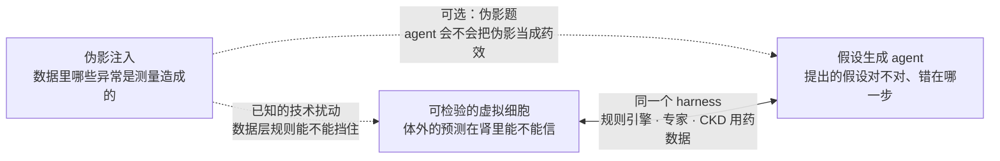
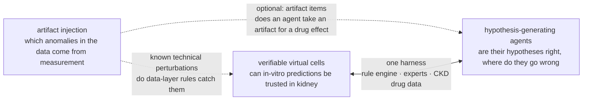

# 研究课题 / Research topics

<!-- ZH -->
组里的研究课题都放在这里，每个课题一页，用同一个模板：要回答什么、做出什么、现在到哪一步。目前的课题都用肾脏单细胞组学数据，背景知识在 **[入门](../onboarding/index.md)** 里，每份数据的信息在 **[数据集](../datasets/index.md)** 里。以后有新课题，按同样的模板加一页。
<!-- EN -->
The group's research topics live here, one page each with the same template: what it asks, what it will produce, and where it stands. The current topics all use kidney single-cell omics data; the background is in **[Onboarding](../onboarding/index.md)** and the facts about each dataset in **[Datasets](../datasets/index.md)**. New topics get a page in the same format.

<!-- ZH/EN --> 

<!-- ZH -->
-   __可检验的 CKD 科研 agent：规则引擎驱动、专家参与、不断进步的 harness__

    ---

    能分析慢性肾病（CKD）数据的 agent 已经很多，但它们的结论没法系统地检验。我们做一套包在任何 agent 外面的 harness：规则引擎从领域知识、数据和分析代码三层检查每个结论；系统主动挑出最值得看的论断请专家判定；专家的判断变成新规则，越用越好。最后用独立的 CKD 病人队列检验，通过检查的结论是不是更容易成立。

    **现状：**2026-11-03 定下方向；文献和数据调研做完，代码还没开始。

    [:octicons-arrow-right-24: 课题页](hypothesis-agents.md)

-   __用伪影注入增强肾脏单细胞异常检测__

    ---

    肾脏单细胞数据里，一个看起来异常的细胞，是真的病了，还是测量造成的？我们做一条 pipeline，往任意单细胞数据里注入已知的伪影，用它增强现有模型（包括开源基础模型），再用公开数据里的真实答案检验模型分不分得清两者、误报控不控得住。

    **现状：**2026-10-28 方向调整为 pipeline + 模型；设计细节在讨论中，代码还没开始。

    [:octicons-arrow-right-24: 课题页](anomaly-benchmark.md)

-   __可检验的虚拟细胞：体外的药物预测什么时候能用到肾组织__

    ---

    虚拟细胞模型主要在体外的癌细胞系上训练，而 CKD 几类主要药物的靶点在这些细胞系里基本不表达。我们不比谁的模型更好，而是判断一个体外到体内的预测什么时候能信：规则引擎检查机制、数据和代码，拿不准的交给肾脏专家，专家的判断变成新规则；再用 CKD 动物和人类的体内用药数据检验，被判为可信的预测是不是真的更准。和 agent 课题共用同一个 harness。

    **现状：**2026-11-04 重新整理成独立课题，待讨论；数据核对做完，代码还没开始。

    [:octicons-arrow-right-24: 课题页](perturbation-benchmark.md)
<!-- EN -->
-   __Verifiable Research Agents for Chronic Kidney Disease: A Rule-Engine Harness with Experts in the Loop__

    ---

    Many agents can already analyse chronic kidney disease (CKD) data, but their conclusions cannot be checked systematically. We build a harness that wraps any agent: a rule engine checks every conclusion on three layers (domain knowledge, data and analysis code); the system selects the most informative claims for experts; and expert verdicts become new rules, so it improves with use. Independent CKD patient cohorts then test whether checked conclusions hold more often.

    **Status:** direction set on 2026-11-03; literature and data surveys done; no code yet.

    [:octicons-arrow-right-24: Topic page](hypothesis-agents.md)

-   __Artifact Injection to Boost Anomaly Detection in Kidney Single-Cell Omics__

    ---

    In kidney single-cell data, is an abnormal-looking cell diseased, or is its abnormality caused by measurement? We build a pipeline that injects known artifacts into any single-cell dataset, use it to boost current models (open foundation models included), and test on real answers from public data whether they can tell the two apart and keep false alarms under control.

    **Status:** on 2026-10-28 the direction changed to pipeline + models; design details under discussion, code not started.

    [:octicons-arrow-right-24: Topic page](anomaly-benchmark.md)

-   __Verifiable Virtual Cells: When Can In-Vitro Drug Predictions Be Trusted in Kidney Tissue?__

    ---

    Virtual-cell models are trained mainly on cancer cell lines in vitro, and the targets of the main CKD drug classes are essentially not expressed in those lines. We do not compete on whose model is better; we judge when an in-vitro-to-in-vivo prediction can be trusted. A rule engine checks mechanism, data and code; unsettled cases go to kidney experts, whose verdicts become new rules; CKD animal and human in-vivo drug data then test whether predictions judged trustworthy are actually more accurate. It shares one harness with the agent topic.

    **Status:** restored as its own topic on 2026-11-04, for discussion; data checks done, code not started.

    [:octicons-arrow-right-24: Topic page](perturbation-benchmark.md)

<!-- ZH/EN --> 

## 课题之间的联系 / How the topics connect

<!-- ZH -->
三个课题围绕同一个问题：**在肾组织数据上，模型和 agent 报告的"变化"，哪些是真的？**

<!-- ZH -->

<!-- ZH -->
- **伪影注入**回答"这个细胞的异常是不是测量造成的"，对应本站总方向"检测 → 建模 → 逆转"里的"检测"。
- **agent 课题**回答"agent 对 CKD 的结论能不能被检验"：规则引擎、专家和独立数据层层把关，对应"建模 / 逆转"，最终通向药物发现。
- **可检验的虚拟细胞**回答"虚拟细胞在体外的用药预测，到肾组织里能不能信"，对应"建模"。它和 agent 课题共用同一个 harness：同一个规则引擎、同一套专家流程、同一批 CKD 用药数据；那边检验 agent 的结论，这边检验模型的预测。
- 伪影注入和另外两个课题的接口是"伪影题"：往一个处理组里注入已知伪影，看 agent 或模型会不会把它当成药效。

知识图谱里的 **[桥](../knowledge-map.md)** 视图列出了两个课题都要读的论文。
<!-- EN -->
All three topics share one question: **in kidney tissue data, which of the "changes" reported by models and agents are real?**

<!-- EN -->

<!-- EN -->
- **Artifact injection** asks whether a cell's abnormality comes from measurement: the "detect" step of this site's overall direction, "detect → model → revert".
- **The agent topic** asks whether an agent's conclusions about CKD can be verified: a rule engine, experts and independent data check them in turn; the "model / revert" steps, leading towards drug discovery.
- **Verifiable virtual cells** asks whether virtual-cell drug predictions made in vitro can be trusted in kidney tissue: the "model" step. It shares one harness with the agent topic: the same rule engine, expert process and CKD drug data; there it checks an agent's conclusions, here a model's predictions.
- Artifact injection meets the other two in the "artifact items": known artifacts injected into one treated group, to see whether an agent or a model takes them for a drug effect.

The **[Bridge](../knowledge-map.md)** view of the knowledge map lists the papers both topics need.
