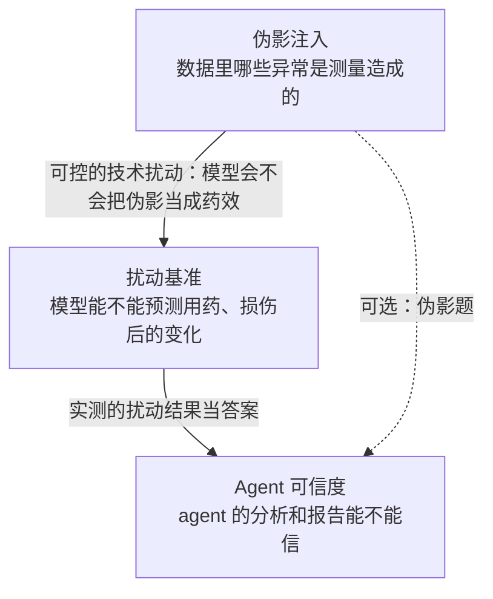
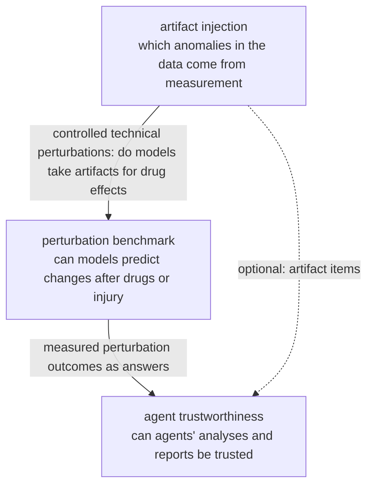

# 研究课题 / Research topics

<!-- ZH -->
组里的研究课题都放在这里，每个课题一页，用同一个模板：要回答什么、做出什么、现在到哪一步。目前的课题都用肾脏单细胞组学数据，背景知识在 **[入门](../onboarding/index.md)** 里，每份数据的信息在 **[数据集](../datasets/index.md)** 里。以后有新课题，按同样的模板加一页。
<!-- EN -->
The group's research topics live here, one page each with the same template: what it asks, what it will produce, and where it stands. The current topics all use kidney single-cell omics data; the background is in **[Onboarding](../onboarding/index.md)** and the facts about each dataset in **[Datasets](../datasets/index.md)**. New topics get a page in the same format.

<!-- ZH/EN --> 

<!-- ZH -->
-   __肾脏扰动预测的诚实基准__

    ---

    给肾组织用药或造成损伤之后，模型能不能预测细胞会怎么变，而且比简单方法预测得更好？我们用公开的肾脏扰动数据（药物处理、损伤时间序列，以小鼠为主）建第一个肾脏扰动预测基准：先把简单 baseline 做强，控制已知的评测陷阱，再用空间数据做正交证据。

    **现状：**2026-10-31 定下方向，数据调研做完，代码还没开始。

    [:octicons-arrow-right-24: 课题页](perturbation-benchmark.md)

-   __用伪影注入增强肾脏单细胞异常检测__

    ---

    肾脏单细胞数据里，一个看起来异常的细胞，是真的病了，还是测量造成的？我们做一条 pipeline，往任意单细胞数据里注入已知的伪影，用它增强现有模型（包括开源基础模型），再用公开数据里的真实答案检验模型分不分得清两者、误报控不控得住。

    **现状：**2026-10-28 方向调整为 pipeline + 模型；设计细节在讨论中，代码还没开始。

    [:octicons-arrow-right-24: 课题页](anomaly-benchmark.md)

-   __肾脏扰动数据上 agent 分析的可信度__

    ---

    问 agent 一些答案已经实测过的肾脏扰动问题，检查它的分析对不对、稳不稳，报告里的数字是不是它自己算出来的，数据回答不了时会不会说"测不了"；再看这些自动检查和专家判断是否一致。

    **现状：**2026-10-31 重新定了方向，代码还没开始。

    [:octicons-arrow-right-24: 课题页](agent-claims.md)
<!-- EN -->
-   __An Honest Benchmark for Perturbation Prediction in Kidney__

    ---

    After a drug or an injury, can a model predict how kidney cells change, and do it better than simple methods? We use public kidney perturbation data (drug treatments and injury time courses, mostly mouse) to build the first kidney perturbation-prediction benchmark: strong simple baselines first, known evaluation pitfalls controlled, spatial data as orthogonal evidence.

    **Status:** direction set on 2026-10-31; data survey done; no code yet.

    [:octicons-arrow-right-24: Topic page](perturbation-benchmark.md)

-   __Artifact Injection to Boost Anomaly Detection in Kidney Single-Cell Omics__

    ---

    In kidney single-cell data, is an abnormal-looking cell diseased, or is its abnormality caused by measurement? We build a pipeline that injects known artifacts into any single-cell dataset, use it to boost current models (open foundation models included), and test on real answers from public data whether they can tell the two apart and keep false alarms under control.

    **Status:** on 2026-10-28 the direction changed to pipeline + models; design details under discussion, code not started.

    [:octicons-arrow-right-24: Topic page](anomaly-benchmark.md)

-   __Trustworthiness of Agent Analyses on Kidney Perturbation Data__

    ---

    Ask agents kidney perturbation questions whose answers were measured, and check whether their analyses are right and stable, whether the numbers in their reports were actually computed, and whether they say "cannot be tested" when the data cannot answer; then check these automatic checks against expert judgement.

    **Status:** direction reset on 2026-10-31; no code yet.

    [:octicons-arrow-right-24: Topic page](agent-claims.md)

<!-- ZH/EN --> 

## 课题之间的联系 / How the topics connect

<!-- ZH -->
三个课题围绕同一个问题：**在肾组织上，模型和 agent 给出的"变化"，哪些是真的？**

<!-- ZH -->

<!-- ZH -->
- **扰动基准**是中心：它提供数据、划分和简单 baseline。
- **伪影注入**给它提供技术对照：Systema 指出，扰动评测最大的陷阱是把非扰动造成的差异算成扰动效应，技术伪影就是这种差异的来源之一。
- **Agent 可信度**用扰动基准里留出的实测结果出题，检查 agent 做分析、写报告这两步。

对应本站的总方向"检测 → 建模 → 逆转"：伪影注入在"检测"，扰动基准在"建模 / 逆转"，Agent 可信度检查 agent 使用这些数据和工具时的判断。知识图谱里的 **[桥](../knowledge-map.md)** 视图列出了不止一个课题要读的论文；扰动基准课题还没有自己的图谱视图。
<!-- EN -->
The three topics share one question: **in kidney tissue, which of the "changes" reported by models and agents are real?**

<!-- EN -->

<!-- EN -->
- **The perturbation benchmark** is the centre: it supplies the data, splits and simple baselines.
- **Artifact injection** supplies technical controls: Systema shows that the biggest pitfall in perturbation evaluation is counting differences not caused by the perturbation as its effect, and technical artifacts are one source of them.
- **Agent trustworthiness** turns the benchmark's held-out measured outcomes into questions and checks the analysis and report steps of agents.

In this site's overall direction, "detect → model → revert", artifact injection sits in "detect", the perturbation benchmark in "model / revert", and agent trustworthiness checks the judgement of agents using these data and tools. The **[Bridge](../knowledge-map.md)** view of the knowledge map lists the papers more than one topic needs; the perturbation-benchmark topic does not yet have its own map view.
