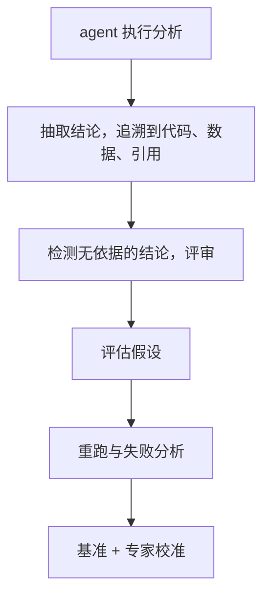
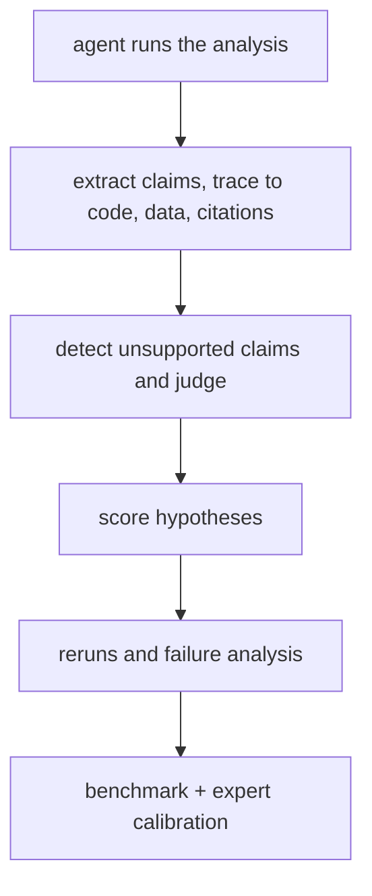

# 生物医学分析 agent 的结论核查 / Verifying the Claims of Biomedical Analysis Agents

> <!-- ZH --> 课题 2 · 现状：方向已定，具体设计还没开始。下面写的是方向和阅读路线，任务和指标等讨论后再定。
> <!-- EN --> Topic 2 · Status: direction decided; detailed design not started. This page gives the direction and a reading path; tasks and metrics will be set after discussion.

## 研究问题 / The question

<!-- ZH -->
**AI agent 分析生物数据后给出的结论，哪些真的有证据？**

现在已经有能自己写代码、跑单细胞分析、读文献并给出结论的 agent。它们的报告读起来很像样，但其中一条结论可能来自它真的跑出的结果，也可能来自文献里的常识、甚至是编出来的。只看最终报告，分不出来。我们想做的是：把 agent 的每条结论**追溯到它自己的代码、数据或引用的文献**，判断有没有证据支撑，并用专家标注来校准这个判断。
<!-- EN -->
**Which conclusions an AI agent reports after analysing biological data are actually backed by evidence?**

Agents now write their own code, run single-cell analyses, read the literature and report conclusions. Their reports read well, but a given claim may come from a result the agent actually computed, from textbook knowledge, or from nothing at all, and the final report alone does not show which. We want to **trace every claim back to the agent's own code, data or cited papers**, decide whether it is supported, and calibrate that decision against expert labels.

## 和课题 1 的关系 / How it connects to Topic 1

<!-- ZH -->
本课题和 [课题 1](anomaly-benchmark.md) 用同一类数据。课题 1  建立的已知答案（哪些细胞是病、哪些是伪影）正好可以用来检查 agent：比如 agent 分析一份肾脏数据后报告"发现了一个新的损伤细胞群"，我们可以核对它是不是把 doublet 或低质量细胞说成了疾病。理解这些数据需要的背景都在 [入门](../onboarding/index.md) 里。
<!-- EN -->
This topic uses the same kind of data as [Topic 1](anomaly-benchmark.md). The known answers built in Topic 1 (which cells are diseased, which are artifacts) can be used to check agents: if an agent analyses a kidney dataset and reports "a new injured cell population", we can check whether it is describing doublets or low-quality cells as disease. The background for this data is in [Onboarding](../onboarding/index.md).

## 大致流程 / Rough pipeline

<!-- ZH -->
这是知识图谱里这个课题的流程，具体每一步做到什么程度还没定：
<!-- EN -->
This is the pipeline in the knowledge map; how far each step goes is not decided yet:

<!-- ZH -->

<!-- EN -->

## 还没定的 / Open questions

<!-- ZH -->
- 用哪些 agent、哪些分析任务（单细胞分析、文献问答，还是两者都要）？
- "有证据"怎么定义：代码跑出来的数字、数据里能复现的结果、被引用文献里确实写了的话，各算几级？
- 专家标注怎么组织，需要多少条？
- 和课题 1 的已知答案怎么接：哪些检查可以自动做？
- 失败类型怎么分。一个参考（我们自己的观察，没有发表）：我们用 LLM 写本站论文笔记，再做了三轮独立核对。笔记出错的原因主要是只读了摘要、用错了论文版本、照抄新闻稿里的数字、从文件名或参数名猜含义，以及没有标明的"首次""唯一"这类说法。第一轮约 200 处修改里，又有约 5 处改出了新错，所以核查器自己的改动也需要再核查。
<!-- EN -->
- Which agents and which analysis tasks (single-cell analysis, literature questions, or both)?
- How to define "supported": a number the code produced, a result reproducible from the data, a statement the cited paper really makes — and how to grade them?
- How to organise expert labelling, and how many labels are needed?
- How to connect to Topic 1's known answers: which checks can be automatic?
- How to classify failures. One reference point (our own observation, not published): we used an LLM to write this site's paper notes, then ran three independent fact-check rounds. The notes went wrong mainly by reading only the abstract, using the wrong version of a paper, copying numbers from press releases, guessing meaning from file or flag names, and unlabelled "first" or "only" claims. About 5 of roughly 200 first-round fixes introduced new errors, so a verifier's own corrections need checking too.

## 阅读路线 / Reading path

<!-- ZH -->
先读完 [入门](../onboarding/index.md)，然后：

1. [BixBench](../papers/bixbench-arxiv-2025/index.md)：生物信息学 agent 的基准
2. [CellVoyager](../papers/cellvoyager-natmethods-2026/index.md)：自动分析单细胞数据的 agent
3. [PaperQA2](../papers/paperqa2-arxiv-2024/index.md)：基于文献回答问题并给出引用
4. [引用忠实度](../papers/citation-faithfulness-arxiv-2026/index.md)：自动检查"引用是否支撑结论"的工具本身有多可靠
5. [临床 agent 重跑](../papers/clinical-agent-reruns-arxiv-2026/index.md)：同一任务重跑时结果稳不稳
6. [DeepEvidence](../papers/deepevidence-natmachintell-2026/index.md)：边查文献边建带出处的证据图，是"结论 → 证据"追溯在文献一侧的原型
7. [Biomni](../papers/biomni-biorxiv-2025/index.md)：通用生物医学 agent，典型的被核查对象：结论没有置信度，也没做重跑一致性
8. [BiomniBench](../papers/biomnibench-biorxiv-2026/index.md)：按专家 rubric 给 agent 的整个分析过程打分，但不检查每条结论有没有证据

再往后，看 [知识图谱](../knowledge-map.md) 里"课题 2"视图的必读论文，以及"桥"视图里和其他课题共用的论文。
<!-- EN -->
Finish [Onboarding](../onboarding/index.md) first, then:

1. [BixBench](../papers/bixbench-arxiv-2025/index.md): a benchmark for bioinformatics agents
2. [CellVoyager](../papers/cellvoyager-natmethods-2026/index.md): an agent that analyses single-cell data on its own
3. [PaperQA2](../papers/paperqa2-arxiv-2024/index.md): answering questions from the literature with citations
4. [Citation faithfulness](../papers/citation-faithfulness-arxiv-2026/index.md): how reliable automatic checks of citation support are
5. [Clinical agent reruns](../papers/clinical-agent-reruns-arxiv-2026/index.md): how stable results are when the same task is rerun
6. [DeepEvidence](../papers/deepevidence-natmachintell-2026/index.md): builds an evidence graph with provenance while searching the literature, a prototype of claim-to-evidence tracing on the literature side
7. [Biomni](../papers/biomni-biorxiv-2025/index.md): a general biomedical agent and a typical system to verify: its conclusions carry no confidence and no rerun-consistency check
8. [BiomniBench](../papers/biomnibench-biorxiv-2026/index.md): scores an agent's whole analysis process against expert rubrics, but does not check whether each claim is supported

After that, see the must-reads in the "Topic 2" view of the [knowledge map](../knowledge-map.md), and the "Bridge" view for papers shared with other topics.
