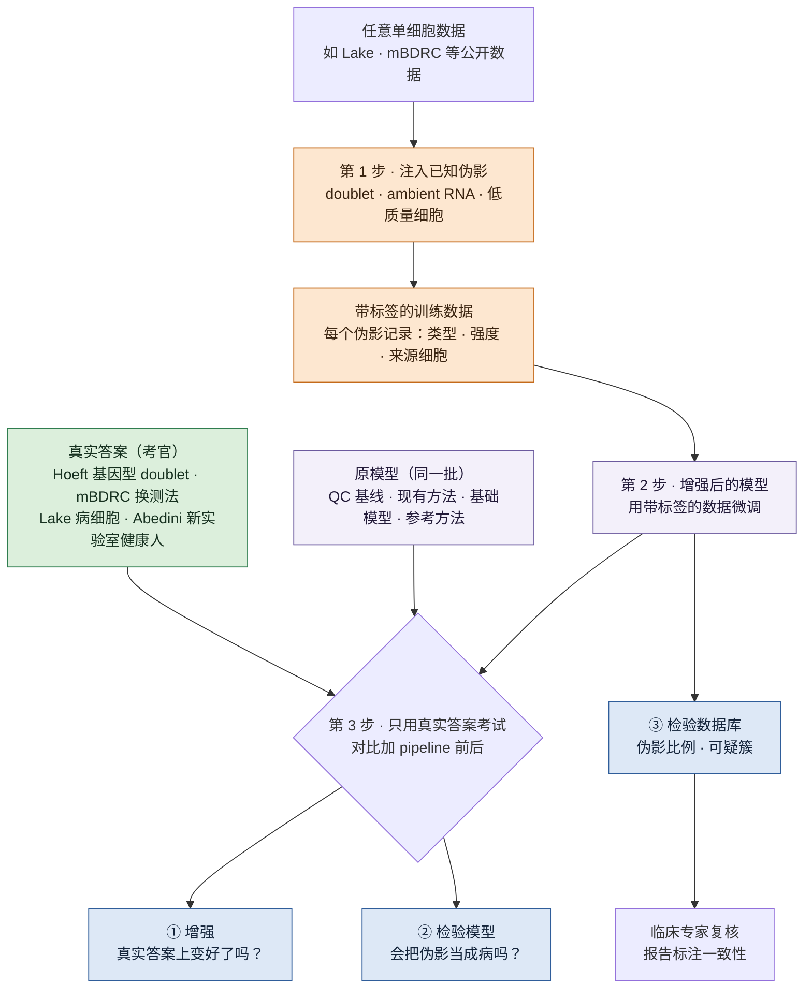
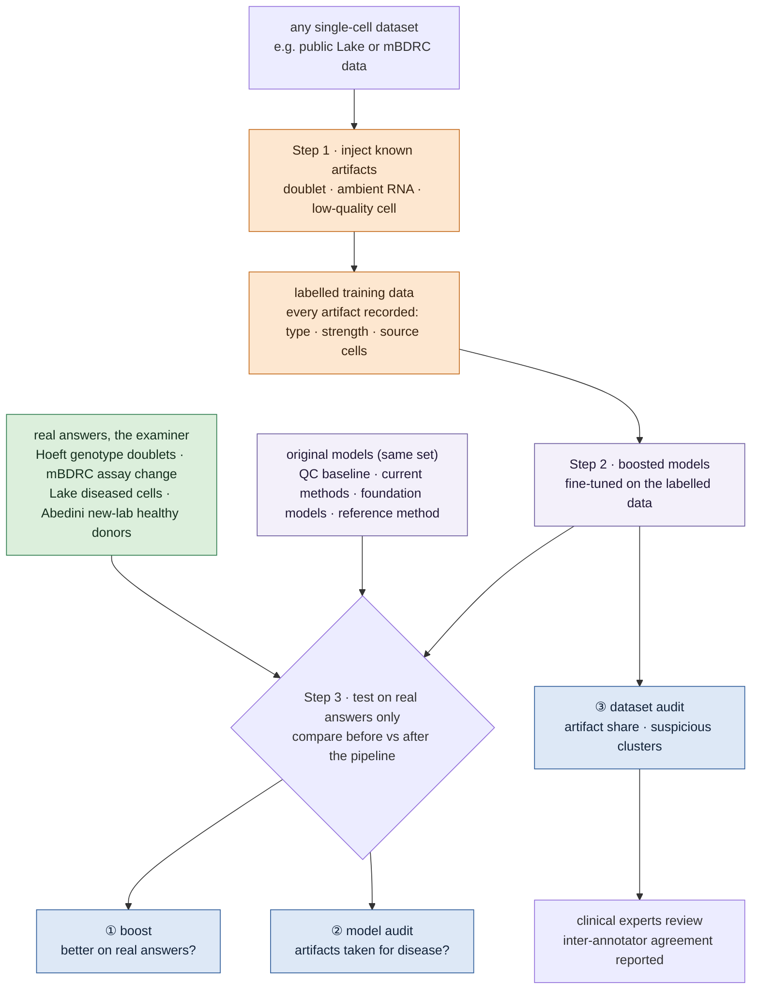

# 用伪影注入增强肾脏单细胞异常检测 / Artifact Injection to Boost Anomaly Detection in Kidney Single-Cell Omics

## 一页看懂 / At a glance

<!-- ZH -->
!!! abstract "这个课题要做什么"
    **做一条 pipeline：任何一份单细胞数据放进去，都能自动注入已知的伪影，变成一份带答案的异常检测数据；再用它增强现有模型，并检验模型和数据库的质量。**

    - **问题：**一个看起来异常的细胞，是病了，还是测量造成的？现有方法分不清，也没人系统测过。
    - **思路：**图像异常检测里，在正常图片上造假缺陷来训练模型已经很成功（如 DRAEM）。我们把同样的思路搬到单细胞上：按真实成因造出 doublet、ambient RNA、低质量细胞。
    - **三个用途：**① 增强模型（主线）；② 检验模型会不会把伪影当成病；③ 检验一份数据里混了多少伪影。
    - **怎么证明有用：**造出来的伪影只用于训练；考试只用**真实答案**（多人混样的基因型 doublet、同一人换测法、专家标注的病细胞、另一个实验室的健康人）。
    - **约束：**没有湿实验，只用公开数据；临床专家（肾内科、肾脏病理）可以参与标注。
<!-- EN -->
!!! abstract "What this topic does"
    **Build a pipeline that turns any single-cell dataset into a labelled anomaly-detection dataset by injecting known artifacts, then use it to boost current models and to check the quality of models and datasets.**

    - **Question:** is an abnormal-looking cell diseased, or caused by measurement? Current methods cannot tell, and nobody has tested this systematically.
    - **Idea:** in image anomaly detection, training on fake defects pasted onto normal images works well (e.g. DRAEM). We carry the idea over to single cells and create doublets, ambient RNA and low-quality cells following how they really arise.
    - **Three uses:** ① boost models (the main line); ② check whether a model mistakes artifacts for disease; ③ estimate how many artifacts a dataset contains.
    - **How we show it works:** injected artifacts are for training only; testing uses **real answers** only (genotype doublets from pooled donors, the same donor across assays, expert-labelled diseased cells, healthy donors from another lab).
    - **Constraint:** no wet lab, public data only; clinical experts (nephrologists, renal pathologists) can annotate.

<!-- ZH -->

<!-- EN -->

## 研究问题 / The question

<!-- ZH -->
**一个看起来异常的细胞，是病造成的，还是测量造成的？**

肾脏单细胞和单核数据里，有些细胞和健康组织对不上。它可能真的病了，也可能是测量过程造成的（doublet、ambient RNA、低质量细胞、取样或消化时的应激），而这两种情况看起来很像。我们的理解（截至 2026 年 10 月）：现有方法会把两者都标成"异常"，而我们没找到一个带已知答案的数据集，能检验它们分不分得清、误报有多少。所以，建立在这些"异常细胞"之上的发现到底有多可信，现在说不清。
<!-- EN -->
**Is an abnormal-looking cell caused by disease, or by measurement?**

In kidney single-cell and single-nucleus data, some cells do not match healthy tissue. They may be diseased, or their abnormality may come from how they were measured (doublets, ambient RNA, low-quality cells, stress during procurement or dissociation), and the two look alike. Our reading (as of 2026-10): current methods flag both as "anomalous", and we found no dataset with known answers to test whether they can tell the two apart, or how many false alarms they raise. So we cannot say how far findings built on these anomalous cells can be trusted.

<!-- ZH -->
本课题进一步问：**能不能用造出来的伪影，教会模型分清这两种情况？**
<!-- EN -->
This topic goes one step further: **can artifacts we create teach models to tell the two apart?**

## 为什么重要 / Why it matters

<!-- ZH -->
- **测量问题造出过假的生物学结论。**在人脑单核数据里，以前被注释为"未成熟少突胶质细胞"的核，后来发现是被神经元 ambient RNA 污染的胶质细胞（[Caglayan et al., Neuron 2022](https://doi.org/10.1016/j.neuron.2022.09.010)）。
- **肾脏单核数据的背景污染可以很高。**小鼠肾的混合品系实验里，用冷冻组织做的单核样本，背景污染明显高于来自同一批样本的单细胞样本（[Janssen 2023](../papers/janssen-ambient-noise-genomebiol-2023/index.md)：35% 对 11%、17% 对 3%）。冷冻的肾活检只能做单核（[Hoeft 2024](../papers/hoeft-genotype-multiplexing-natcommun-2024/index.md)："snRNA, but not scRNA, can be performed from frozen tissue"）。
- **病和测量的信号本来就重叠。**Lake 2023 挑候选损伤状态时，部分依据是"基因少、线粒体转录多"，这也是低质量细胞的典型特征（我们的解读）；健康参考组织里也有 altered 状态，作者认为可能来自取样缺血或正常衰老（[Lake 2023](../papers/lake-kidney-atlas-nature-2023/index.md)）。我们自己从 GEO 标签表里也数到：单核数据里健康人有 26% 的核是 altered（88,460 个健康人核里的 22,774 个）。
<!-- EN -->
- **Measurement effects have produced false biology.** In human brain single-nucleus data, nuclei previously annotated as "immature oligodendrocytes" turned out to be glia contaminated with neuronal ambient RNA ([Caglayan et al., Neuron 2022](https://doi.org/10.1016/j.neuron.2022.09.010)).
- **Background contamination in kidney single-nucleus data can be high.** In mixed-strain mouse kidney, single-nucleus samples made from frozen tissue had clearly more background contamination than single-cell samples from the same material ([Janssen 2023](../papers/janssen-ambient-noise-genomebiol-2023/index.md): 35% vs 11%, 17% vs 3%). Frozen kidney biopsies can only be profiled by single-nucleus ([Hoeft 2024](../papers/hoeft-genotype-multiplexing-natcommun-2024/index.md): "snRNA, but not scRNA, can be performed from frozen tissue").
- **Disease and measurement signals overlap.** Lake 2023 picked candidate injury states partly by few genes detected and many mitochondrial transcripts, which are also the usual signs of a low-quality cell (our reading); altered states also occur in healthy reference tissue, which the authors attribute possibly to ischaemia during acquisition or normal ageing ([Lake 2023](../papers/lake-kidney-atlas-nature-2023/index.md)). From the GEO label table we counted that 26% of nuclei from healthy donors are altered (22,774 of 88,460).

## 为什么还没解决 / Why it is unsolved

<!-- ZH -->
- **伪影基准没有"病"这一维。**我们的理解（截至 2026 年 10 月）：doublet 和 ambient 各有自己的基准，我们找到的每个只管一种伪影，不含疾病状态。例如 [ambient 去除基准](../papers/ambient-rna-bench-biorxiv-2026/index.md) 用的是模拟数据、物种混合和基因型混合实验。
- **找疾病状态的方法不区分伪影。**用健康参考找"改变的细胞状态"的方法（如 [Dann 2023](../papers/healthy-ref-natgenet-2023/index.md)）目标是找疾病状态；我们的理解：方法本身不判断报出来的细胞是不是伪影。doublet 和低质量细胞只在预处理时去掉（去掉一个疑似 doublet 的簇、只保留至少 1,000 个分子的细胞），没有 ambient 的处理；作者提醒的技术性误报来源是残余批次效应（Extended Data Fig. 7b,c）。
- **没有误报控制。**现有注释流程里，带"拒判"选项的那些通常也只靠人为设定的条件，不给统计保证（[单细胞 conformal](../papers/conformal-scrna-bioinformatics-2025/index.md)："do not provide statistical guarantees"）；conformal 方法能界定误报率（[Bates 2023](../papers/conformal-outliers-annstat-2023/index.md)），但前提是参考和查询数据可交换：单细胞 conformal 那篇里，查询来自肺肿瘤病人时，误报率保证就不成立了。我们的理解（截至 2026 年 10 月）：还没有人在肾脏数据上系统检验过。
- **没有测试平台。**我们的理解（截至 2026 年 10 月）：我们看过的通用异常检测基准里没有单细胞表达数据，也没找到肾脏组学的异常检测基准。
<!-- EN -->
- **Artifact benchmarks have no disease axis.** Our reading (as of 2026-10): doublets and ambient RNA have their own benchmarks, and each one we found covers one artifact and no disease states. For example, the [ambient-removal benchmark](../papers/ambient-rna-bench-biorxiv-2026/index.md) uses simulated data, species-mixing and genotype-mixing experiments.
- **Disease-state detection does not separate artifacts.** Methods that find altered cell states against a healthy reference (for example [Dann 2023](../papers/healthy-ref-natgenet-2023/index.md)) aim at disease states. Our reading: the method itself does not judge whether a flagged cell is an artifact. Doublets and low-quality cells are only removed in preprocessing (one suspected doublet cluster dropped, only cells with at least 1,000 molecules kept), with no ambient-RNA step; the technical source of false positives the authors warn about is residual batch effects (Extended Data Fig. 7b,c).
- **There is no error control.** Annotation pipelines that offer a reject option usually rely on arbitrary assumptions and give no statistical guarantee ([conformal for single-cell](../papers/conformal-scrna-bioinformatics-2025/index.md): they "do not provide statistical guarantees"). Conformal methods can bound the false-alarm rate ([Bates 2023](../papers/conformal-outliers-annstat-2023/index.md)), but only when reference and query are exchangeable: in the single-cell conformal paper, the false-alarm guarantee failed when the query came from lung-tumour patients. Our reading (as of 2026-10): this has not been tested systematically on kidney data.
- **There is no test bed.** Our reading (as of 2026-10): the general anomaly-detection benchmarks we looked at contain no single-cell expression data, and we found no anomaly-detection benchmark for kidney omics.

### 我们的方向有没有人做过 / Has our direction been done?

<!-- ZH -->
检索截至 2026 年 10 月，不可能穷尽，所以论文里写"据我们所知"。

- **零件都有，但每个只管一种伪影。**造 doublet 再训练检测器是标准做法（[Scrublet](https://doi.org/10.1016/j.cels.2018.11.005)、[DoubletFinder](https://doi.org/10.1016/j.cels.2019.03.003)、[scDblFinder](https://doi.org/10.12688/f1000research.73600.2)）；造"破损细胞"有一个 R 包（[DamageDetective](https://doi.org/10.32614/CRAN.package.DamageDetective)，没有配套论文）；ambient 有读段层面的模拟器 ambisim（[Li 2025](https://doi.org/10.1101/2025.02.06.636969)，用来评测多人混样的拆分方法）。
- **问题有人提过，但没人用注入去解决。**mapQC 指出映射不好会"falsely reporting technical artifacts as disease"（[Sikkema 2025](https://doi.org/10.1101/2025.05.23.655749)），但它处理的是批次和映射质量。
- **基础模型没被拿伪影测过。**零样本评测发现 scGPT、Geneformer 的嵌入常不如简单方法（[Kedzierska 2025](../papers/scfm-zeroshot-genomebiol-2025/index.md)），但测的是批次效应；我们没找到拿 doublet、ambient 或低质量细胞测基础模型的研究。
- **没找到的：**一个工具往任意真实数据里同时注入多种伪影并记录答案，再用它训练模型区分"伪影还是病"。这就是本课题的新意。

**图像领域的证据和警告：**DRAEM 用造出来的缺陷训练，在 MVTec AD 上把图像级 AUROC 从此前最好的 95.5 提到 98.0，作者说造的缺陷不需要逼真（[Zavrtanik 2021](https://arxiv.org/abs/2108.07610)）。但一项跨 420 个任务的研究发现，造法和真实异常的产生机制对不上时，自监督训练反而可能变差（[Yoo 2022](https://arxiv.org/abs/2208.07734)）；单细胞里，用模拟 doublet 训练的检测器在 16 份带真实标签的数据上，最好的平均 AUPRC 只有 0.537（[Xi & Li 2021](https://doi.org/10.1016/j.cels.2020.11.008)）。所以**按成因造伪影、用真实答案考试**是本课题的两条硬规则。
<!-- EN -->
Search up to October 2026; it cannot be exhaustive, so the paper will say "to our knowledge".

- **The parts exist, each for one artifact.** Simulating doublets and training a detector on them is standard ([Scrublet](https://doi.org/10.1016/j.cels.2018.11.005), [DoubletFinder](https://doi.org/10.1016/j.cels.2019.03.003), [scDblFinder](https://doi.org/10.12688/f1000research.73600.2)); an R package simulates damaged cells ([DamageDetective](https://doi.org/10.32614/CRAN.package.DamageDetective), no accompanying paper); ambisim simulates ambient molecules at read level ([Li 2025](https://doi.org/10.1101/2025.02.06.636969), built to benchmark demultiplexing).
- **The problem has been named, not solved by injection.** mapQC warns that a poor mapping can result in "falsely reporting technical artifacts as disease" ([Sikkema 2025](https://doi.org/10.1101/2025.05.23.655749)), but it deals with batch and mapping quality.
- **Foundation models have not been tested against artifacts.** A zero-shot evaluation found scGPT and Geneformer embeddings often behind simpler methods ([Kedzierska 2025](../papers/scfm-zeroshot-genomebiol-2025/index.md)), but on batch effects; we found no study testing foundation models against doublets, ambient RNA or low-quality cells.
- **Not found:** a tool that injects several artifact types into any real dataset with recorded answers, then trains models to tell artifact from disease. That is what is new here.

**Evidence and warnings from images:** DRAEM, trained on synthetic defects, raised image-level AUROC on MVTec AD from the previous best of 95.5 to 98.0, and its authors say the defects need not look realistic ([Zavrtanik 2021](https://arxiv.org/abs/2108.07610)). But a study across 420 tasks found that when the augmentation does not match how real anomalies arise, self-supervised training can even hurt ([Yoo 2022](https://arxiv.org/abs/2208.07734)); in single cells, detectors trained on simulated doublets reach a best mean AUPRC of only 0.537 on 16 datasets with real labels ([Xi & Li 2021](https://doi.org/10.1016/j.cels.2020.11.008)). Hence two hard rules here: **inject artifacts by their cause, and test on real answers.**

## 要做出什么 / What we will produce

| # | Deliverable / 交付物 | What it is / 是什么 | How we show it is useful / 怎么证明有用 |
|---|---|---|---|
| 1 | artifact-injection pipeline (open source) / 伪影注入 pipeline（开源） | takes any single-cell dataset (AnnData), injects doublets, ambient RNA and low-quality cells, and records for every cell the artifact type, strength and source cells / 输入任意单细胞数据（AnnData），注入 doublet、ambient RNA、低质量细胞，每个细胞都记录伪影类型、强度和来源细胞 | injected artifacts compared with real ones: calibrated on Janssen, checked against Hoeft / 注入的伪影和真实伪影比：用 Janssen 校准，用 Hoeft 检验 |
| 2 | boost method / 增强方法 | a recipe to fine-tune models on injected artifacts so they separate healthy, diseased and artifact cells / 用注入的伪影微调模型，让它分出健康、病、伪影 | before-and-after comparison on real answers / 微调前后在真实答案上对比 |
| 3 | real-answer test set, the examiner / 真实答案测试集（考官） | Hoeft genotype doublets, mBDRC assay changes, Lake diseased cells, Abedini healthy donors, with fixed tasks, metrics and donor splits / Hoeft 基因型 doublet、mBDRC 换测法、Lake 病细胞、Abedini 健康人，加上固定的任务、指标和按供体的划分 | released for reuse / 公开发布，别人可以复用 |
| 4 | results table for four model groups / 四组模型的成绩表 | each model with and without the pipeline, reported per artifact type, plus leave-one-artifact-out / 每个模型跑"不加 / 加 pipeline"两遍，按伪影类型分开报，加"留一种伪影不训练" | the main result of the paper / 论文的主结果 |
| 5 | dataset audit / 数据库体检报告 | the trained detector run over Lake and Abedini: estimated artifact share and suspicious altered clusters / 用训练好的检测器扫 Lake 和 Abedini：估计伪影比例，标出可疑的 altered 簇 | suspicious clusters reviewed by clinical experts, with inter-annotator agreement / 可疑簇交给临床专家复核，报告专家之间的一致性 |
| 6 | stage 2: ATAC / 第二阶段：ATAC | the pipeline extended to RNA + ATAC / pipeline 扩展到 RNA + ATAC | depends on stage 1 / 视第一阶段进度 |

<!-- ZH -->
原始数据不再分发；发布的是代码、划分文件、注入记录和派生标签（Abedini 的派生标签要等许可确认）。
<!-- EN -->
Raw data are not redistributed; we release code, split files, injection records and derived labels (Abedini's derived labels only once its licence is confirmed).

## 伪影注入 pipeline / The artifact-injection pipeline

### 注入哪几种伪影 / Which artifacts

<!-- ZH -->
主线做三种，**先做 doublet**：它的依据最强，也有现成的真实答案，最适合先把"注入 → 训练 → 用真实答案考试 → 出表"整条流程跑通；之后加 ambient 和低质量细胞只是换注入模块。三种都要做，因为每种伪影冒充的是不同的"病"（第二列是我们的推断）：
<!-- EN -->
Three artifacts in the main line, **doublets first**: they have the strongest precedent and a ready real answer, so they are the best way to run the whole loop (inject, train, test on real answers, report) end to end; adding ambient RNA and low-quality cells then only swaps the injection module. All three are needed because each one imitates a different "disease" (the second column is our inference):

| Artifact / 伪影 | Could be taken for / 可能被当成 | Why / 依据 | Plan / 计划 |
|---|---|---|---|
| low-quality cell / 低质量细胞 | the degenerative state: few genes, high mitochondrial share / degenerative 状态：基因少、线粒体高 | Lake used these two signs when flagging altered states (Methods) / Lake 判 altered 时用了这两条（Methods） | main line, third; the closest to the core question / 主线第三个；和核心问题最相关 |
| doublet | an intermediate state expressing two cell types' genes / 同时表达两类细胞基因的"中间状态" | Scrublet: doublets "suggest the existence of intermediate cell states" ([Wolock 2019](https://doi.org/10.1016/j.cels.2018.11.005)) / Scrublet 原话：doublet 会让人以为存在"intermediate cell states" | main line, first / 主线第一个 |
| ambient RNA | marker genes in the wrong cell, e.g. PT genes elsewhere / 细胞里出现不该有的标记基因，比如别的细胞里出现 PT 基因 | empty droplets carry slightly more PT profile ([Janssen 2023](../papers/janssen-ambient-noise-genomebiol-2023/index.md)) / 空液滴里 PT 的成分略多 | main line, second / 主线第二个 |
| dissociation stress / 解离应激 | injury: FOS, JUN up / 损伤：FOS、JUN 升高 | [Denisenko 2020](../datasets/denisenko-2020.md) (mouse) / 小鼠 | not injected: no precedent, and the main data are single-nucleus / 不注入：没有先例，主数据又是单核 |
| batch or assay change / 批次、换测法 | — | not a per-cell artifact, cannot be injected / 不是单个细胞的伪影，注入不了 | tested on real data instead (T2b, T4) / 改用真实数据测（T2b、T4） |

### 每种怎么注入、依据是什么 / How each is injected, and the precedent

| Artifact / 伪影 | How / 怎么造 | Precedent / 依据 | Feasible? / 可行吗 | Limits / 局限 |
|---|---|---|---|---|
| doublet | add the raw counts of two random cells / 随机两个细胞的原始计数相加 | Scrublet ([Wolock 2019](https://doi.org/10.1016/j.cels.2018.11.005)): "Doublets are simulated by adding the unnormalized counts"; DoubletFinder ([McGinnis 2019](https://doi.org/10.1016/j.cels.2019.03.003)) averages pairs and, trained this way, found 73% and 64% of the doublets labelled by demuxlet and Cell Hashing / Scrublet（[Wolock 2019](https://doi.org/10.1016/j.cels.2018.11.005)）把随机两个细胞的原始计数相加来造 doublet；DoubletFinder（[McGinnis 2019](https://doi.org/10.1016/j.cels.2019.03.003)）用类似办法训练，能找回 demuxlet / Cell Hashing 标出的 73% / 64% 的 doublet | yes, compute only / 可以，纯计算 | same-type doublets are nearly invisible; a real doublet has fewer counts than the sum of its two cells ([Germain 2022](https://doi.org/10.12688/f1000research.73600.2)); methods score higher on simulated than on real doublets ([Xi & Li 2021](https://doi.org/10.1016/j.cels.2020.11.008)) / 同类型细胞组成的 doublet 几乎看不出来；真实 doublet 的计数比两个细胞之和少（[Germain 2022](https://doi.org/10.12688/f1000research.73600.2)）；方法在模拟 doublet 上的成绩高于真实 doublet（[Xi & Li 2021](https://doi.org/10.1016/j.cels.2020.11.008)） |
| ambient RNA | mix in a background profile estimated from empty droplets, at fractions calibrated on Janssen / 从空液滴估出背景 RNA 谱，按 Janssen 校准的比例混进去 | SoupX ([Young & Behjati 2020](https://doi.org/10.1093/gigascience/giaa151)) estimates the profile from empty droplets; [Janssen 2023](../papers/janssen-ambient-noise-genomebiol-2023/index.md) measured 3–35% background per cell in mouse kidney by genotype / SoupX（[Young & Behjati 2020](https://doi.org/10.1093/gigascience/giaa151)）从空液滴估背景谱；[Janssen 2023](../papers/janssen-ambient-noise-genomebiol-2023/index.md) 在小鼠肾里按基因型测出每个细胞 3–35% 的背景 | yes, but Lake and mBDRC have no empty droplets, so the profile comes from Janssen (mouse) or a Hoeft rerun (human kidney) / 可以，但 Lake 和 mBDRC 都没有空液滴，背景谱要从 Janssen（小鼠）或重跑 Hoeft（人肾）来 | Janssen is mouse; human calibration rests on it unless Hoeft is rerun / Janssen 是小鼠；不重跑 Hoeft 的话，人的校准要借它 |
| low-quality cell / 低质量细胞 | remove part of the cytoplasmic RNA, so the mitochondrial share rises / 去掉一部分胞质 RNA，线粒体占比随之升高 | real broken cells lose cytoplasmic transcripts while mitochondrial ones rise slightly ([Ilicic 2016](https://doi.org/10.1186/s13059-016-0888-1), microscopy-labelled); an R package simulates this ([DamageDetective](https://doi.org/10.32614/CRAN.package.DamageDetective), not peer-reviewed) / 显微镜确认的破损细胞里胞质转录本下降、线粒体略升（[Ilicic 2016](https://doi.org/10.1186/s13059-016-0888-1)）；有一个 R 包模拟这件事（[DamageDetective](https://doi.org/10.32614/CRAN.package.DamageDetective)，未经同行评审） | yes, but the precedent is weak; the paper must argue for it, e.g. compare injected cells with Lake's real low-QC cells / 可以，但先例弱；论文要多做论证，比如和 Lake 里真实的低 QC 细胞比分布 | high mitochondrial share is normal for kidney PT: a fixed 10% cut-off removes real PT cells ([Subramanian 2022](https://doi.org/10.1186/s13059-022-02820-w)) / 肾脏 PT 本来线粒体就高，固定 10% 的阈值会删掉真的 PT 细胞（[Subramanian 2022](https://doi.org/10.1186/s13059-022-02820-w)） |

### 设计规则 / Design rules

<!-- ZH -->
这几条来自上面的证据（我们的归纳）：

1. **按成因造，不追求逼真。**每种伪影对应它真实的产生过程：两个细胞进了一个液滴、背景 RNA 混入、胞质 RNA 流失。
2. **训练和考试分开。**造出来的伪影只用于训练；考试用真实答案，或者至少换一种注入配方。
3. **留一种伪影不训练。**比如用 doublet 和 ambient 训练，考低质量细胞，看模型学到的是"伪影的共性"，还是只记住了配方。
4. **按伪影类型分开报结果**，预期不同类型下方法的排名会变（ADBench 在表格数据上发现，没有哪个无监督方法在统计上整体更好，效果取决于方法的假设和异常类型对不对得上，[Han 2022](https://arxiv.org/abs/2206.09426)）。
5. **对比注入量和造法：**合成和正常的比例、一种造法还是几种混合。
<!-- EN -->
These follow from the evidence above (our synthesis):

1. **Inject by cause, not for realism.** Each artifact follows how it really arises: two cells in one droplet, background RNA mixed in, cytoplasmic RNA lost.
2. **Keep training and testing apart.** Injected artifacts are for training; testing uses real answers, or at least a different injection recipe.
3. **Leave one artifact out.** For example, train on doublets and ambient RNA and test on low-quality cells, to see whether a model learned what artifacts share or only memorised the recipe.
4. **Report per artifact type**, expecting method rankings to change between types (on tabular data, ADBench found no unsupervised method statistically better than the others overall; performance depends on whether a method's assumptions match the anomaly type, [Han 2022](https://arxiv.org/abs/2206.09426)).
5. **Vary the amount and the recipe:** the ratio of synthetic to normal cells, one recipe or a mix.

### 第二阶段：ATAC / Stage 2: ATAC

<!-- ZH -->
先做 RNA；ATAC 等第一阶段跑通再加（建议，待定）。ATAC 上也有注入先例：ArchR 造"合成 doublet"再找近邻（[Granja 2021](https://doi.org/10.1038/s41588-021-00790-6)）；AMULET 把两个核的读段计数相加来模拟 doublet（[Thibodeau 2021](https://doi.org/10.1186/s13059-021-02469-x)）；ambisim 能在 snRNA + snATAC 里控制游离分子的比例（[Li 2025](https://doi.org/10.1101/2025.02.06.636969)）；低质量的核用 TSS 富集、fragment 数等指标判断，阈值要按数据调。scDblFinder 的文档也提醒，默认参数在 scATAC 上"performs very poorly"。
<!-- EN -->
RNA first; ATAC is added once stage 1 works (suggested, not decided). ATAC has injection precedents too: ArchR generates "synthetic doublets" and finds their neighbours ([Granja 2021](https://doi.org/10.1038/s41588-021-00790-6)); AMULET simulates doublets by adding two nuclei's read counts ([Thibodeau 2021](https://doi.org/10.1186/s13059-021-02469-x)); ambisim controls ambient molecule proportions in joint snRNA/snATAC data ([Li 2025](https://doi.org/10.1101/2025.02.06.636969)); low-quality nuclei are judged by TSS enrichment, fragment counts and similar metrics, with thresholds tuned per dataset. The scDblFinder documentation also warns that with default parameters it "performs very poorly" on scATAC.

## 模型 / Models

<!-- ZH -->
模型本身可能不够好，所以要同时跑四组，**每个模型都跑两遍：不加 pipeline 一次，加 pipeline 一次**，在真实答案上比。如果所有模型都变好，pipeline 有用；只有一部分变好，说明要看模型结构；都没变好，说明合成伪影和真实伪影差太远，要回头改注入。
<!-- EN -->
The models themselves may not be good enough, so four groups run side by side, and **every model runs twice, without and with the pipeline**, compared on real answers. If all improve, the pipeline works; if only some do, it depends on the model; if none do, the injected artifacts are too far from real ones and the injection must be revised.

| Group / 组 | Models / 模型 | Answers / 回答什么 |
|---|---|---|
| 1 · QC baseline / QC 基线 | gene count, mitochondrial share / 只看基因数、线粒体比例 | does a high score only come from "few genes"? / 高分是不是只靠"基因少"？ |
| 2 · existing methods / 现有方法 | kNN, Isolation Forest, autoencoder, scVI; scDblFinder, SoupX / kNN、Isolation Forest、autoencoder、scVI；scDblFinder、SoupX | where current methods stand, and whether the pipeline helps them / 现有水平在哪，加了 pipeline 有没有变好 |
| 3 · foundation models / 基础模型 | open models, fine-tuned (candidates below) / 开源模型，微调（候选见下） | does the pipeline help large models, and do they mistake artifacts for disease? / pipeline 对大模型有没有用，它们会不会把伪影当成病？ |
| 4 · our reference method / 我们的参考方法 | healthy reference, nearest-neighbour score, false-alarm control, disease-or-artifact call / 健康参考 + 最近邻打分 + 误报控制 + "病还是伪影"的判断 | a controllable starting point if current methods all fail / 现有方法都不行时，一个我们能控制、能改的起点 |

### 基础模型：微调，不从头预训练 / Foundation models: fine-tune, do not pretrain

<!-- ZH -->
建议只微调现有开源模型（待定）。从头预训练不现实：第一个肾脏专用多模态基础模型 [Nephrobase Cell+](../papers/nephrobase-biorxiv-2025/index.md) 用了约 3,950 万个细胞、四个物种、五种测法，参数到 10 亿；截至 2026-10-28，我们没找到它公开的代码和权重。核对过的候选（2026-10-28）：
<!-- EN -->
We suggest fine-tuning existing open models only (not decided). Pretraining from scratch is unrealistic: the first kidney-specific multimodal foundation model, [Nephrobase Cell+](../papers/nephrobase-biorxiv-2025/index.md), used about 39.5 million cells, four species and five assays, with up to 1 billion parameters; as of 2026-10-28 we found no public code or weights. Candidates checked on 2026-10-28:

| Model / 模型 | Weights and licence / 权重和许可 | Modality / 模态 | Use here / 在这里怎么用 |
|---|---|---|---|
| [Geneformer V2](https://huggingface.co/ctheodoris/Geneformer) | Hugging Face, Apache-2.0; 104M and 316M parameters / Hugging Face，Apache-2.0；1.04 亿和 3.16 亿参数 | RNA | fine-tuning, first choice / 微调，首选 |
| [scGPT](https://github.com/bowang-lab/scGPT) | code MIT, weights on Google Drive (no separate weight licence stated); includes a checkpoint pretrained on 814 thousand kidney cells / 代码 MIT，权重在 Google Drive（没写单独的权重许可）；有一个用 81.4 万个肾脏细胞预训练的版本 | RNA (its multi-omic recipe trains the non-RNA parts from scratch) / RNA（多组学用法里非 RNA 部分要从头训练） | fine-tuning, second / 微调，第二个 |
| scFoundation | weights for non-commercial research only / 权重只限非商业研究 | RNA | optional / 可选 |
| UCE, CellPLM, scMulan | public weights; no fine-tuning code found for UCE / 权重公开；UCE 没找到微调代码 | RNA | frozen embeddings for the model audit only / 只做冻结嵌入，用于检验模型 |
| EpiAgent | MIT, with fine-tuning code / MIT，有微调代码 | scATAC only / 只有 scATAC | stage 2 candidate / 第二阶段候选 |

<!-- ZH -->
我们没找到一个同时在 RNA 和 ATAC 上预训练、又公开了权重的模型，所以第二阶段可能要把 RNA 模型和 ATAC 模型配对使用。基础模型必须和简单方法一起比：零样本评测里 scGPT 和 Geneformer 常不如选高变基因、Harmony、scVI（[Kedzierska 2025](../papers/scfm-zeroshot-genomebiol-2025/index.md)）。
<!-- EN -->
We found no model pretrained on RNA and ATAC together with public weights, so stage 2 may pair an RNA model with an ATAC model. Foundation models must be compared with simple methods: in a zero-shot evaluation scGPT and Geneformer were often behind HVG selection, Harmony and scVI ([Kedzierska 2025](../papers/scfm-zeroshot-genomebiol-2025/index.md)).

## 怎么检验：真实答案 / How we test: real answers

<!-- ZH -->
造出来的伪影（一级）只用于训练。考试用两类真实答案：**二级**是实验设计给定的（Hoeft 多人混样的基因型 doublet、mBDRC 同一人换测法、Janssen 小鼠混品系），**三级**是专家判断的（Lake 的 altered 状态，以及我们请临床专家补强的标注）。
<!-- EN -->
Injected artifacts (tier 1) are for training only. Testing uses two kinds of real answers: **tier 2**, fixed by experimental design (Hoeft's genotype doublets from pooled donors, mBDRC's same donor across assays, Janssen's mixed mouse strains), and **tier 3**, expert judgement (Lake's altered states, and the labels clinical experts add).

| Task / 任务 | Question / 问什么 | Real answer / 真实答案 | Metric / 指标 |
|---|---|---|---|
| T1 | find diseased cells / 找出病细胞 | Lake altered states, tier 3 / Lake 的 altered 状态，三级 | AUROC, AUPRC; against the QC baseline / AUROC、AUPRC；和 QC 基线比 |
| T2 | find real measurement artifacts / 找出真实的测量伪影 | Hoeft genotype doublets, tier 2 (a lower bound); held-out injected types as a secondary check / Hoeft 基因型 doublet，二级（只是下限）；留出的注入类型做辅助检查 | AUROC, AUPRC |
| T2b | is an assay change flagged as anomalous? / 换测法会不会被当成异常 | mBDRC same donor, tier 2 / mBDRC 同一个人，二级 | false-alarm rate ≤ α / 误报率 ≤ α |
| T3 | separate disease from artifact / 分清病和伪影 | T1 and T2 together / T1 和 T2 合起来 | macro-F1, confusion matrix / 宏平均 F1、混淆矩阵 |
| T4 | do false alarms stay controlled in a new lab? / 换实验室后误报控不控得住 | every call on an Abedini healthy donor counts as a false alarm (our design choice; healthy tissue also carries altered cells) / Abedini 健康人身上报出的都按误报算（这是我们的设定；健康组织里也有 altered 细胞） | observed rate vs α / 实际误报率 vs 设定的 α |

<!-- ZH -->
每个任务都报"不加 / 加 pipeline"两个数，以及留一种伪影的结果。
<!-- EN -->
Every task reports two numbers, without and with the pipeline, plus the leave-one-artifact-out results.

<!-- ZH -->
!!! warning "已知的坑"
    我们的理解：直接拿 Lake 的 altered 标签当"病"的答案，有一部分是循环的（作者也用了损伤标记基因和 AKI / CKD 富集，不只看 QC 特征）：单核数据里，最大的 altered 组（degenerative）基因数不到正常细胞的一半、线粒体比例约是 5 倍，一个只看 QC 指标的打分器就可能拿到高分。所以基准里必须有"只用 QC 指标"的基线，并且按状态（degenerative / adaptive）分开报结果。[入门模块 9](../onboarding/09-hands-on.md) 的教学流程初步看到了这一点：在 degenerative 核上，kNN 的 AUROC 是 0.76–0.81，只数基因的基线是 0.76–0.85，5 次划分里 kNN 有 4 次更差（只是教学结果，不是基准结果）。
<!-- EN -->
!!! warning "A known trap"
    Our reading: using Lake's altered labels directly as disease ground truth is partly circular (the authors also used injury markers and AKI / CKD enrichment, not only QC features): in the single-nucleus data the largest altered group (degenerative) has less than half the genes of normal nuclei and about five times the mitochondrial fraction, so a scorer that looks only at QC metrics could score well. The benchmark therefore needs a QC-only baseline and reports results per state (degenerative / adaptive). The teaching pipeline in [onboarding module 9](../onboarding/09-hands-on.md) already shows a first sign of this: on degenerative nuclei kNN reaches AUROC 0.76–0.81 and the gene-count baseline 0.76–0.85, with kNN worse in 4 of 5 splits (a teaching result, not a benchmark result).

### 三级答案怎么做扎实：请临床专家 / Making tier 3 solid: clinical experts

<!-- ZH -->
三级是最弱的一环。Lake 判 altered 状态时，依据之一就是"测到的基因少、线粒体转录本多"（[Lake 2023](../papers/lake-kidney-atlas-nature-2023/index.md) Methods），这也是低质量细胞的特征，所以直接拿它当"病"的答案有循环（见上面"已知的坑"）。Lake 的标注来自一个包括病理、生物、肾内科专家的联盟，但没有报告标注者之间的一致性。临床专家能帮我们在两条路上补强：
<!-- EN -->
Tier 3 is the weakest link. Lake flagged altered states partly by "low genes detected, a high number of mitochondrial transcripts" ([Lake 2023](../papers/lake-kidney-atlas-nature-2023/index.md) Methods), which are also the signs of a low-quality cell, so using these labels as disease ground truth is partly circular (see "A known trap" above). Lake's labels come from a consortium of pathologists, biologists and nephrologists, with no inter-annotator agreement reported. Clinical experts can strengthen this in two ways:

| | A · re-annotate clusters / A · 按簇重新标注 | B · annotate histology / B · 在病理切片上标注 |
|---|---|---|
| How / 怎么做 | experts see each altered cluster's marker genes (e.g. HAVCR1, LCN2), QC distributions and donor conditions, and call it likely injury, likely low quality or unsure; 2–3 independent annotators, agreement reported / 专家看每个 altered 簇的标记基因（如 HAVCR1、LCN2）、QC 分布和来自哪些病人，判"像真损伤 / 像质量差 / 说不准"；2–3 人独立标，报告一致性 | pathologists outline injured regions (e.g. acute tubular injury, fibrosis) on H&E slides paired with spatial transcriptomics; anomaly scores are then checked spot by spot / 病理医生在和空间转录组配对的 H&E 切片上圈出损伤区域（如急性小管损伤、纤维化），再逐个 spot 检查异常分 |
| Precedent / 依据 | the Human Lung Cell Atlas re-annotated per cluster with six experts; most agreed or differed only in granularity, with no κ reported ([Sikkema 2023](https://doi.org/10.1038/s41591-023-02327-2)); kidney injury states have independent anchors, e.g. Havcr1 checked by immunofluorescence ([Kirita 2020](https://doi.org/10.1073/pnas.2005477117)) and genetically labelled injured PT cells ([Gerhardt 2021](https://doi.org/10.1073/pnas.2026684118)), both mouse / 人肺图谱请六位专家按簇重新标注，多数一致或只差粒度，没报 κ（[Sikkema 2023](https://doi.org/10.1038/s41591-023-02327-2)）；肾损伤状态有独立的参照，如用免疫荧光验证的 Havcr1（[Kirita 2020](https://doi.org/10.1073/pnas.2005477117)）、遗传标记的损伤 PT 细胞（[Gerhardt 2021](https://doi.org/10.1073/pnas.2026684118)），都是小鼠 | Lake 2023 Visium on GEO ([GSE183456](https://www.ncbi.nlm.nih.gov/geo/query/acc.cgi?acc=GSE183456)): 23 sections (6 reference, 11 DKD, 6 AKI), each with a full-resolution H&E image; Abedini 2024: 13 H&E images (DKD, hypertension and controls, no AKI) / Lake 2023 的 Visium（[GSE183456](https://www.ncbi.nlm.nih.gov/geo/query/acc.cgi?acc=GSE183456)）：23 张切片（6 参考、11 DKD、6 AKI），每张都带全分辨率 H&E 图；Abedini 2024：13 张 H&E（DKD / 高血压和对照，没有 AKI） |
| Feasible? / 可行吗 | yes: a few hundred clusters, not hundreds of thousands of cells / 可以：几百个簇，不是几十万个细胞 | images yes; we found no public pathologist region annotation, so it must be made (which is itself a new resource) / 图有；没找到公开的病理区域标注，需要自己标（这本身就是新资源） |
| Limits / 局限 | clinicians do not usually read expression data and may need a short calibration set; one single-cell analyst should be among the annotators / 临床医生平时不看表达数据，可能要先给一小组校准样例；标注者里最好有一位单细胞分析的人 | a Visium spot is 55 µm wide and holds several cells, so labels are per spot, not per cell; only 3 Visium participants also appear in Lake's single-nucleus data (our count), so this is a separate spatial task, not a check on T1 / Visium 一个 spot 直径 55 µm，含好几个细胞，标签只能到 spot；Visium 里只有 3 个人也在 Lake 的单核数据里（我们数的），所以这是一个单独的空间任务，不能直接验证 T1 |

<!-- ZH -->
我们的理解：我们没找到报告"人类标注者之间 κ"的单细胞研究，所以 A 里测出的一致性本身就是结果。KPMP 有两位病理医生判读的活检级评分，但只到整块活检，不到区域；它对哪些人开放还没核实。
<!-- EN -->
Our reading: we found no single-cell study that reports κ between human annotators, so the agreement measured in A is itself a result. KPMP holds biopsy-level descriptor scores read by two pathologists, but only per biopsy, not per region; their access terms are not yet checked.

## 用到的数据 / Data

<!-- ZH -->
只用公开的肾脏数据：人为主，小鼠只用来校准。每份数据的完整信息（测了什么、多少人、怎么下载）在 [数据集](../datasets/index.md) 标签页；这一节讲**它在本课题里干什么、用哪一部分、要注意什么**。

<!-- EN -->
Public kidney data only: human first, mouse only for calibration. Full facts about each dataset (what was measured, how many people, how to download) are under [Datasets](../datasets/index.md); this section says **what each one does in this topic, which part we use, and what to watch for**.

### 每份数据负责哪一边 / Which side each dataset answers

| Dataset / 数据 | Side / 哪一边 | Role / 干什么 | Tasks / 任务 | Status / 状态 |
|---|---|---|---|---|
| [Lake 2023](../datasets/lake-2023.md) | disease / 病 | healthy reference, disease labels, base for injection / 健康参考、"病"的标签、注入伪影的底板 | T1, T3; injection base / T1、T3；注入底板 | main line / 主线 |
| [mBDRC 2026](../datasets/mbdrc-2026.md) | measurement / 测量 | same donor, several assays / 同一个人换测法 | T2b; also injection base / T2b；也做注入底板 | main line / 主线 |
| [Abedini 2024](../datasets/abedini-2024.md) | disease / 病 | second lab, false-alarm test / 换实验室，测误报 | T4 | main line / 主线 |
| [Janssen 2023](../datasets/janssen-2023.md), mouse / [Janssen 2023](../datasets/janssen-2023.md)，小鼠 | measurement / 测量 | calibrates injected ambient RNA / 校准注入的 ambient | — (not a test set) / —（不当测试集） | main line / 主线 |
| [Hoeft 2024](../datasets/hoeft-2024.md) | measurement / 测量 | real human doublets and ambient RNA, the examiner for T2 / 人肾真实的 doublet 和 ambient，T2 的考官 | T2 | main line / 主线 |
| [Lake 2019](../datasets/lake-2019.md) | measurement / 测量 | same person, different storage and processing / 同一个人，不同保存和处理 | like T2b / 类似 T2b | under discussion / 讨论中 |

<!-- ZH -->
下面这张表由 [数据集](../datasets/index.md) 的数据自动生成，用来对照前五份的基本情况：
<!-- EN -->
The table below is generated from the [Datasets](../datasets/index.md) records and puts the basics of the first five side by side:

<!-- ZH/EN --> @@DATASETS-COMPARE lake-2023 mbdrc-2026 abedini-2024 janssen-2023 hoeft-2024@@

### Lake 2023 · 健康参考和"病"的答案 / Lake 2023 · Healthy reference and the disease answer

<!-- ZH -->
- **用哪部分：**主线先用单核数据（snCv3）。要从 GEO 下载计数矩阵和标签表，因为 `state.l1/l2`（正常 / 改变）和 `percent.mt` 只在 GEO 标签表里；cellxgene 的文件里两者都没有（线粒体基因已删）。单细胞数据（scCv3）怎么用还没定。
- **提供什么：**
    - **健康参考**：健康供体身上 `reference` 状态的细胞，当"正常"的训练数据。
    - **"病"的答案（三级）**：病人身上 `altered` 状态的细胞，进 T1。
    - **注入的底板**：在健康细胞上造 doublet、ambient、低质量细胞，用于训练。
- **要注意：**
    - degenerative 状态和低质量细胞长得像（见上面"已知的坑"），所以必须有"只用 QC 指标"的基线，并按状态分开报结果。
    - 健康人身上也有 altered 细胞（单核数据里 26%，我们数的），不能当"正常"的负样本，单独报告。
    - 原始测序受控，**拿不到空液滴**，所以注入 ambient 的背景谱得从别处来（Janssen 或 Hoeft，见"伪影注入 pipeline"）。
    - 它还有 23 张带 H&E 图的 Visium 切片，是三级答案"在病理切片上标注"的候选（见上面"三级答案怎么做扎实"）。
<!-- EN -->
- **Which part:** the main line starts with the single-nucleus data (snCv3). Download the count matrix and label table from GEO, because `state.l1/l2` (reference or altered) and `percent.mt` exist only in the GEO label table; the cellxgene files have neither (mitochondrial genes were removed). How to use the single-cell data (scCv3) is not decided.
- **What it provides:**
    - **Healthy reference:** `reference`-state cells from healthy donors, the "normal" training data.
    - **Disease answer (tier 3):** `altered`-state cells from patients, for T1.
    - **Base for injection:** doublets, ambient RNA and low-quality cells made from healthy cells, for training.
- **Watch for:**
    - The degenerative state looks like low-quality cells (see "A known trap" above), so a QC-only baseline is required and results are reported per state.
    - Healthy donors carry altered cells too (26% of their nuclei in the single-nucleus data, our count); they cannot serve as normal negatives and are reported separately.
    - Raw sequencing is controlled, so **there are no empty droplets**; the background profile for injected ambient RNA must come from elsewhere (Janssen or Hoeft, see "The artifact-injection pipeline").
    - It also has 23 Visium sections with H&E images, a candidate for the tier-3 histology annotation (see "Making tier 3 solid" above).

### mBDRC 2026 · 同一个人换测法 / mBDRC 2026 · One donor, several assays

<!-- ZH -->
- **用哪部分：**cellxgene 上的整合 RNA 文件。18 名供体里有 11 人用两种或三种方法测过，这 11 人是 T2b 的核心。
- **提供什么：**
    - **测量这一边的真实答案（二级）**：同一个人的组织，只因换了测法就被报成"异常"，按误报算（这是我们的设定）。
    - 补充健康参考，也可以做注入的底板。
- **要注意：**
    - 同一名供体不能既在参考里、又在 T2b 的测试里，所以要按供体划分。
    - 测法和组织块、保存介质混在一起：换测法的同时也换了一块组织、换了保存方式，所以误报不全是"测法"造成的。
    - 只有健康人、只有皮质；原始测序在 dbGaP 要申请，所以也没有空液滴。
<!-- EN -->
- **Which part:** the integrated RNA file on cellxgene. 11 of its 18 donors were measured with two or three assays; they are the core of T2b.
- **What it provides:**
    - **A real answer on the measurement side (tier 2):** tissue from the same person flagged as anomalous only because the assay changed is counted as a false alarm (our design choice).
    - More healthy reference, and a base for injection.
- **Watch for:**
    - A donor cannot be in the reference and in the T2b test at once, so splits are by donor.
    - Assay is confounded with the tissue core and preservation medium: changing assay also changes the piece of tissue and how it was stored, so not every false alarm is due to the assay alone.
    - Healthy donors and cortex only; raw data are at dbGaP on application, so no empty droplets either.

### Abedini 2024 · 换一个实验室 / Abedini 2024 · A second lab

<!-- ZH -->
- **用哪部分：**GEO 上的处理后数据，只用健康对照（GEO 单细胞数据里 21 人）。
- **提供什么：**T4 的测试场：在一个实验室定好的阈值，拿到另一个实验室的健康人身上，误报率还守不守得住。健康人身上报出的"异常"都按误报算（这是我们的设定）。
- **要注意：**
    - 发布前已经用 SoupX 去过 ambient、用 DoubletFinder 去过 doublet，所以**测不了测量这一侧**，只用来测误报。
    - 我们的理解：这份数据比 Lake "更干净"，这本身就是一种分布偏移，结果解读时要说明。
    - 单细胞部分是 37 °C 酶解，会带解离应激。
    - 数据许可没有写明，发布派生标签前要先确认。
    - 它的 13 张 H&E 图（DKD、高血压和对照，没有 AKI）也是三级答案"切片标注"的候选。
<!-- EN -->
- **Which part:** the processed data on GEO, healthy controls only (21 people in the GEO single-cell data).
- **What it provides:** the test ground for T4: does a threshold set in one lab keep its false-alarm rate on another lab's healthy donors? Every anomaly called on a healthy donor counts as a false alarm (our design choice).
- **Watch for:**
    - Ambient RNA was corrected with SoupX and doublets removed with DoubletFinder before release, so **it cannot test the measurement side**; it is used for false alarms only.
    - Our reading: these data are "cleaner" than Lake's, which is itself a distribution shift and must be stated when reading results.
    - The single-cell part used 37 °C enzymatic digestion, so it carries dissociation stress.
    - The data licence is not stated; it must be confirmed before releasing derived labels.
    - Its 13 H&E images (DKD, hypertension and controls, no AKI) are also a candidate for tier-3 histology annotation.

### Janssen 2023 · 校准注入的 ambient / Janssen 2023 · Calibrating injected ambient RNA

<!-- ZH -->
- **用哪部分：**小鼠肾，三个品系混在一个 10x 通道里测，单细胞和单核都有；公开文件**包含空液滴**。
- **提供什么：**按基因型算出的每个细胞的真实外来 RNA 比例（3–35%）和背景谱。我们用它定"注入的 ambient 该有多强、长什么样"。
- **要注意：**是小鼠，不是人，也没有病人，所以不当测试集；拿它校准人的数据是一个假设，要在论文里说明。
<!-- EN -->
- **Which part:** mouse kidney, three strains pooled in one 10x channel, both single-cell and single-nucleus; the public files **include empty droplets**.
- **What it provides:** the real foreign-RNA fraction per cell (3–35%), computed from genotypes, and the background profile. We use it to set how strong injected ambient RNA should be and what it looks like.
- **Watch for:** it is mouse, not human, and has no patients, so it is not a test set; calibrating human data on it is an assumption the paper must state.

### Hoeft 2024 · 人肾真实的 doublet 和 ambient / Hoeft 2024 · Real human-kidney doublets and ambient RNA

<!-- ZH -->
- **用哪部分：**4 名病人的冷冻肾活检混在一个单核通道里。GEO 上的矩阵已过滤，要用公开的 FASTQ 和基因型文件重跑 CellRanger 和 souporcell。
- **提供什么：**人肾上**真实**的 doublet（按基因型）和 ambient 答案。新方向下它是主线：T2 的考官，也用来检验我们注入的伪影像不像真的。我们的理解：重跑后也能拿到空液滴，得到人肾自己的背景谱。
- **要注意：**
    - 只有 4 人，只够验证，不能当主结果。
    - 基因型只能看出跨供体的 doublet，同一个人的两个核看不出来，所以 250 个基因型 doublet 只是下限。
    - 有用的发现：按表达聚出的"Mixed/Doublets"簇有 4,488 个核，按基因型确认是 doublet 的只有 123 个（我们从 Source Data 算的）。只看表达判断异常原因很不可靠，这正是本课题的出发点。
<!-- EN -->
- **Which part:** frozen kidney biopsies from 4 patients pooled in one single-nucleus channel. The GEO matrix is filtered, so CellRanger and souporcell must be rerun on the public FASTQ with the genotype files.
- **What it provides:** **real** human-kidney doublet (by genotype) and ambient answers. Under the new direction it is main line: the examiner for T2, and a check on whether our injected artifacts look real. Our reading: the rerun also yields empty droplets, giving a background profile from human kidney itself.
- **Watch for:**
    - Only 4 people: enough for validation, not for main results.
    - Genotypes reveal only cross-donor doublets; two nuclei from the same person stay hidden, so the 250 genotype doublets are a lower bound.
    - A useful finding: the expression cluster "Mixed/Doublets" holds 4,488 nuclei, but only 123 are genotype doublets (our count from the Source Data). Judging the cause of an anomaly from expression alone is unreliable, which is exactly where this topic starts.

### Lake 2019 · 同一个人，不同保存和处理（讨论中） / Lake 2019 · One person, different storage and processing (under discussion)

<!-- ZH -->
同一个人的组织用不同方式保存和处理后再测，能小规模地回答"保存 / 处理方式变了，会不会被当成异常"，性质类似 T2b。用的是 snDrop-seq，不是 10x，规模也小，所以还没定要不要进主线。
<!-- EN -->
The same person's tissue stored and processed in different ways, then measured: a small real answer to "is a change in storage or processing flagged as anomalous?", similar in spirit to T2b. It uses snDrop-seq rather than 10x and is small, so whether it joins the main line is open.

### 暂时不用的 / Not used for now

<!-- ZH -->
- [Malone 2020](../datasets/malone-2020.md)：也有基因型，但原始数据很大；人肾伪影的真实答案先靠 Hoeft。
- [Denisenko 2020](../datasets/denisenko-2020.md)：小鼠，证明解离应激会像损伤；解离应激暂不注入，以后再用。
- [KPMP](../datasets/kpmp.md)、[cellxgene](../datasets/cellxgene.md)：数据来源和下载途径，不是单独的数据集。
<!-- EN -->
- [Malone 2020](../datasets/malone-2020.md): also has genotypes, but its raw data are large; real human-kidney artifact answers rely on Hoeft for now.
- [Denisenko 2020](../datasets/denisenko-2020.md): mouse, shows dissociation stress can look like injury; stress is not injected for now, so later.
- [KPMP](../datasets/kpmp.md), [cellxgene](../datasets/cellxgene.md): data sources and download routes, not datasets of their own.

### 划分 / Splits

<!-- ZH -->
按供体划分，不按细胞，同一个人不会同时出现在训练和测试里。Lake 和 mBDRC 的健康供体分成**参考 / 校准 / 测试**三份（参考用来打分，校准用来定阈值，测试用来算误报）；Abedini 只做测试。固定随机种子，划分文件随数据集一起发布。
<!-- EN -->
Splits are by donor, not by cell, so no person appears in both training and testing. Healthy donors in Lake and mBDRC are split three ways: **reference, calibration and test** (the reference for scoring, calibration for setting thresholds, test for measuring false alarms); Abedini is test only. Random seeds are fixed and the split files ship with the dataset.

## 还没定的 / Open questions

<!-- ZH -->
**方向（建议已写在上面，等确认）：**

- 基础模型只微调、不从头预训练？首选 Geneformer V2 和 scGPT？
- 先做 RNA，ATAC 放第二阶段？
- "增强"指用注入的伪影训练模型，还是也包括给每个实验室一个评估自己数据的工具（用途 ②③）？

**数据和答案：**

- 注入 ambient 的背景谱用 Janssen（小鼠，现成）还是重跑 Hoeft（人肾，要从 FASTQ 重跑）？Lake 和 mBDRC 都没有空液滴。
- 三级答案先走 A（按簇标）还是 B（切片标），还是两个都做？B 要不要成为一个单独的空间任务？参与标注的是肾内科、病理，还是两者都有？
- Lake 的单细胞数据（scCv3）怎么用：当第二种测法，还是先不用？
- Lake 的 altered 细胞怎么分组：有独立证据的、只靠 QC 类特征判出来的、健康人身上的，各自怎么用。
- T2b 单独成一个任务，还是并进 T4？Lake 2019 要不要进主线？
- Abedini 2024 的数据许可（我们没找到写明的许可，决定能不能发布派生标签）。健康人数已核实：GEO 上 21 名对照。

**其他：**

- 要不要把 [NIH 肾脏 AI 挑战赛](../papers/nih-kidney-ai-challenge-2026/index.md) 当作相关机会：它要在 KPMP 肾活检全切片病理图像里找新的异常，提交窗口 2026-11-05 到 2027-04-29。它考的是图像，不是本课题的单细胞组学，所以只能算图像方向的扩展；现金奖只发给美国公民、永久居民或美国机构。
<!-- EN -->
**Direction (suggestions written above, awaiting confirmation):**

- Fine-tune foundation models only, without pretraining? Geneformer V2 and scGPT first?
- RNA first, ATAC as stage 2?
- Does "boost" mean training models on injected artifacts only, or also a tool for each lab to evaluate its own data (uses ② and ③)?

**Data and answers:**

- Should the ambient background profile come from Janssen (mouse, ready to use) or a Hoeft rerun (human kidney, from FASTQ)? Lake and mBDRC have no empty droplets.
- Tier 3: start with A (clusters), B (histology) or both? Should B become a separate spatial task? Will the annotators be nephrologists, pathologists or both?
- How to use Lake's single-cell data (scCv3): as a second assay, or not for now?
- How to split Lake's altered cells: those with independent evidence, those called only from QC-like features, and those in healthy donors.
- Should T2b be its own task or part of T4? Should Lake 2019 join the main line?
- The licence of Abedini 2024 (we found no stated licence; it decides whether derived labels can be released). The number of healthy donors is checked: 21 controls on GEO.

**Other:**

- Whether to treat the [NIH Kidney AI challenge](../papers/nih-kidney-ai-challenge-2026/index.md) as a related opportunity: it asks for new anomalies in KPMP kidney-biopsy whole-slide images, with submissions open 2026-11-05 to 2027-04-29. It tests images, not this topic's single-cell omics, so it would be an extension towards images; cash prizes go only to US citizens, permanent residents or US entities.

## 阅读路线 / Reading path

<!-- ZH -->
先读完 [入门](../onboarding/index.md)，然后按这个顺序：

1. [Lake 2023](../papers/lake-kidney-atlas-nature-2023/index.md)：肾脏图谱和 altered 状态
2. [Janssen 2023](../papers/janssen-ambient-noise-genomebiol-2023/index.md)：真实 ambient 污染有多大
3. [Dann 2023](../papers/healthy-ref-natgenet-2023/index.md)：用健康参考找改变的细胞状态
4. [Bates 2023](../papers/conformal-outliers-annstat-2023/index.md)：conformal p 值和误报控制
5. [PatchCore](../papers/patchcore-cvpr-2022/index.md)：图像异常检测里的最近邻思路
6. [Kedzierska 2025](../papers/scfm-zeroshot-genomebiol-2025/index.md)：基础模型零样本时常不如简单方法
7. [Nephrobase Cell+](../papers/nephrobase-biorxiv-2025/index.md)：第一个肾脏专用多模态基础模型
8. [DRAEM](https://arxiv.org/abs/2108.07610)：用造出来的缺陷训练异常检测（不在论文库）

<!-- EN -->
Finish [Onboarding](../onboarding/index.md) first, then read in this order:

1. [Lake 2023](../papers/lake-kidney-atlas-nature-2023/index.md): the kidney atlas and its altered states
2. [Janssen 2023](../papers/janssen-ambient-noise-genomebiol-2023/index.md): how large real ambient contamination is
3. [Dann 2023](../papers/healthy-ref-natgenet-2023/index.md): finding altered states against a healthy reference
4. [Bates 2023](../papers/conformal-outliers-annstat-2023/index.md): conformal p-values and false-alarm control
5. [PatchCore](../papers/patchcore-cvpr-2022/index.md): the nearest-neighbour idea from image anomaly detection
6. [Kedzierska 2025](../papers/scfm-zeroshot-genomebiol-2025/index.md): foundation models zero-shot are often behind simple methods
7. [Nephrobase Cell+](../papers/nephrobase-biorxiv-2025/index.md): the first kidney-specific multimodal foundation model
8. [DRAEM](https://arxiv.org/abs/2108.07610): anomaly detection trained on synthetic defects (not in the library)

<!-- ZH -->
再往后，看 [知识图谱](../knowledge-map.md) 里本课题视图的必读论文，以及 [方法 × 数据矩阵](../knowledge-map.md)：虚线格是本课题打算补上的地方（有的格子里已经有论文，格子里的说明写了还缺什么）。
<!-- EN -->
After that, see the must-reads in this topic's view of the [knowledge map](../knowledge-map.md) and the [method × data matrix](../knowledge-map.md), whose dashed cells mark what this topic plans to add (some already hold papers; the note in each cell says what is still missing).
