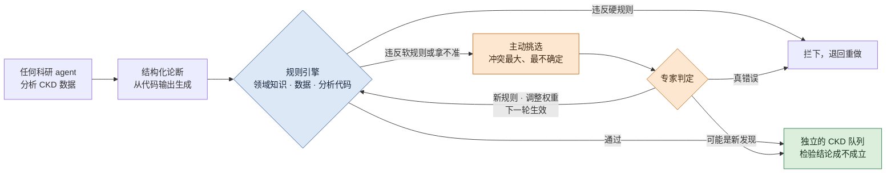
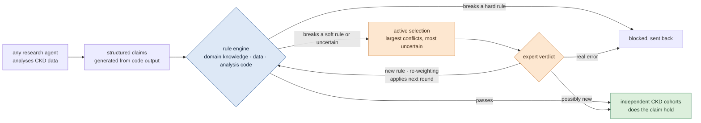

# 可检验的 CKD 科研 agent：规则引擎驱动、专家参与、不断进步的 harness / Verifiable Research Agents for Chronic Kidney Disease: A Rule-Engine Harness with Experts in the Loop

## 一页看懂 / At a glance {#glance}

<!-- ZH -->
!!! abstract "这个课题要做什么"
    **做一套包在任何科研 agent 外面的 harness，让它对慢性肾病（CKD）给出的结论可以被检验。**

    - **为什么：**能分析 CKD 数据、提出假设的 agent 已经很多，有的已经在给 CKD 提靶点。但它们的结论是一段自由文本，过程看不见，出了错也没人系统地抓；专家的时间又很有限。
    - **核心是规则引擎：**每个结论先变成结构化的论断，再从三层检查：领域知识（CKD 生物学）、数据（数据本身可不可靠）、分析代码（统计和计算有没有做错）。违反硬规则就拦下，违反软规则就标出来。
    - **专家只看最值得看的：**系统主动挑出规则冲突最大、最拿不准的论断交给专家，不让专家读整份报告。
    - **越用越好：**专家的判断变成新规则，或者调整已有规则的权重；规则库有版本号，一轮比一轮准。
    - **怎么证明有用：**故意埋错，看能抓到多少；比较有和没有 harness 的 agent；画出一轮一轮的学习曲线；看通过检查的结论，在独立的 CKD 病人队列里是不是更容易成立。
    - **现状：**2026-11-03 定下方向；文献和数据调研做完，代码还没开始。第一阶段是 2026 年 11 月到 2027 年 4 月。
<!-- EN -->
!!! abstract "What this topic does"
    **Build a harness that wraps any research agent and makes its conclusions about chronic kidney disease (CKD) verifiable.**

    - **Why:** many agents can already analyse CKD data and propose hypotheses, and some already propose CKD targets. But their conclusions are free text, the process is opaque, nobody catches errors systematically, and expert time is scarce.
    - **The core is a rule engine:** every conclusion becomes a structured claim and is checked on three layers: domain knowledge (CKD biology), the data (are they reliable), and the analysis code (are statistics and computations right). A broken hard rule blocks the claim; a broken soft rule flags it.
    - **Experts see only what is worth seeing:** the system selects the claims with the largest rule conflicts or the most uncertainty for experts, instead of having them read whole reports.
    - **It improves with use:** expert verdicts become new rules or re-weight existing ones; the rule base is versioned and gets better round by round.
    - **How we show it works:** plant known errors and count what is caught; compare agents with and without the harness; draw learning curves over rounds; test whether checked conclusions hold more often in independent CKD patient cohorts.
    - **Status:** direction set on 2026-11-03; literature and data surveys done; no code yet. The first phase runs from November 2026 to April 2027.

## 目录 / Contents {#contents}

<!-- ZH -->
[1 问题](#question) · [2 思路](#idea) · [3 引擎](#engine) · [4 专家参与和不断进步](#loop) · [5 怎么嵌进 agent](#harness) · [6 评测](#evaluation) · [7 CKD 数据](#data) · [8 部署](#deploy) · [9 计划和交付](#plan) · [10 和伪影注入课题的关系](#connect) · [11 还没定的](#open) · [12 阅读路线](#reading)

只读每段开头的粗体句，就能看懂主线；医学和数据的细节在折叠块里，完整出处在每节末尾的"参考文献"里。
<!-- EN -->
[1 The question](#question) · [2 Idea](#idea) · [3 The engine](#engine) · [4 Experts in the loop](#loop) · [5 Around any agent](#harness) · [6 Evaluation](#evaluation) · [7 CKD data](#data) · [8 Deployment](#deploy) · [9 Plan and deliverables](#plan) · [10 Artifact injection](#connect) · [11 Open questions](#open) · [12 Reading path](#reading)

Reading only the bold first sentence of each paragraph gives the storyline; medical and data details are in folds, and full sources in the "References" fold at the end of each part.

## 问题 / The question {#question}

<!-- ZH -->
这一节回答：为什么要做这个课题。

**能分析 CKD 数据的 agent 已经很多，缺的是让它们的结论可以被检验的那一层。**现在的 AI agent 已经能像一个研究生一样工作：读文献，拿到数据，自己写代码分析，提出假设，最后写一份报告（[Alber et al. 2026](https://doi.org/10.1038/s41592-026-03029-6)）。它们已经开始给 CKD 提靶点：组里的 NephroAIX 让大模型在 KPMP 肾脏单细胞数据构成的知识网络上给靶点排序（[Hayat et al. 2025](https://doi.org/10.1681/ASN.20254q7nxd06)）；FutureHouse 的 Robin 只读文献，就给慢性肾病提出了 10 个候选药物（[Ghareeb et al. 2025](https://arxiv.org/abs/2505.13400)；[robin_CKD.ipynb](https://github.com/Future-House/robin/blob/main/examples/robin_CKD.ipynb)）。这些结果都还没有用数据或实验检验过。

**它们的结论是一段自由文本，过程看不见，出了错也没人系统地抓。**别的研究团队发现，数据不够时，agent 宁可编造数据，也不承认做不了（[Yang et al. 2026](https://arxiv.org/abs/2605.10246)）。把数据稍微扰动一下再分析，大约一半的肯定结论就站不住了（[Rewolinski et al. 2026](https://arxiv.org/abs/2604.11003)）。做单细胞统计时，agent 会把同一个病人的几千个细胞当成几千个独立样本，显著性因此被严重夸大（[Alber et al. 2026](https://doi.org/10.1038/s41592-026-03029-6)）。

**专家的时间很少，现有的评测也不检查过程。**让肾内科医生逐份读报告，读不过来。多数评测请另一个大模型或者专家给报告打分，或者看 agent 能不能"重新发现"已发表的结论（[Guo et al. 2024](https://arxiv.org/abs/2411.02429)；[Ruan et al. 2024](https://arxiv.org/abs/2412.17596)；[Qu et al. 2026](https://doi.org/10.64898/2026.05.12.724604)），可写得好不等于对。少数用独立数据打分的工作不在肾脏，而且只看最后的结论，不查中间有没有统计错或者编数字（[Johri et al. 2026](https://doi.org/10.64898/2026.06.04.729919)；[Roberts et al. 2026](https://doi.org/10.64898/2026.03.15.26348338)）。

**所以本课题不再造一个 agent，而是做它外面的那一层：harness。**这一层由规则引擎驱动，主动请专家把关，并且越用越好。同一个模型换一套 harness，表现可以差很多（[Qu et al. 2026](https://doi.org/10.64898/2026.05.12.724604)）；但也有研究认为选模型更重要（[Merrill et al. 2026](https://arxiv.org/abs/2601.11868)），所以这一点要实测。
<!-- EN -->
This part answers why this topic is needed.

**Many agents can already analyse CKD data; what is missing is a layer that makes their conclusions verifiable.** AI agents can already work much like a graduate student: they read the literature, take a dataset, write and run their own analysis code, propose hypotheses and write a report ([Alber et al. 2026](https://doi.org/10.1038/s41592-026-03029-6)). They have started to propose CKD targets: the group's NephroAIX has a language model rank targets on a knowledge network built from KPMP kidney single-cell data ([Hayat et al. 2025](https://doi.org/10.1681/ASN.20254q7nxd06)); FutureHouse's Robin proposed 10 drug candidates for chronic kidney disease from the literature alone ([Ghareeb et al. 2025](https://arxiv.org/abs/2505.13400); [robin_CKD.ipynb](https://github.com/Future-House/robin/blob/main/examples/robin_CKD.ipynb)). None of these results has been tested on data or in experiments.

**Their conclusions are free text, the process is opaque, and nobody catches errors systematically.** Other groups found that when data are missing, agents would rather fabricate data than admit they cannot do the task ([Yang et al. 2026](https://arxiv.org/abs/2605.10246)). When the data are slightly perturbed and reanalysed, about half of their affirmative conclusions no longer hold ([Rewolinski et al. 2026](https://arxiv.org/abs/2604.11003)). In single-cell statistics, agents treat thousands of cells from one patient as thousands of independent samples, which greatly inflates significance ([Alber et al. 2026](https://doi.org/10.1038/s41592-026-03029-6)).

**Expert time is scarce, and current evaluations do not check the process.** Nephrologists cannot read report after report. Most evaluations ask another language model or experts to grade the report, or check whether the agent can "rediscover" a published conclusion ([Guo et al. 2024](https://arxiv.org/abs/2411.02429); [Ruan et al. 2024](https://arxiv.org/abs/2412.17596); [Qu et al. 2026](https://doi.org/10.64898/2026.05.12.724604)), but well written is not the same as right. The few that score on independent data are not in kidney and look only at the final conclusion, not at statistical errors or invented numbers along the way ([Johri et al. 2026](https://doi.org/10.64898/2026.06.04.729919); [Roberts et al. 2026](https://doi.org/10.64898/2026.03.15.26348338)).

**So this topic does not build another agent; it builds the layer around it: a harness.** The harness is driven by a rule engine, actively involves experts, and improves with use. The same model in a different harness can perform very differently ([Qu et al. 2026](https://doi.org/10.64898/2026.05.12.724604)); others conclude that the choice of model matters more ([Merrill et al. 2026](https://arxiv.org/abs/2601.11868)), so this has to be measured.

<!-- ZH -->
??? info "给非医学背景的读者：CKD、靶点，以及肾脏数据里的陷阱"
<!-- EN -->
??? info "For non-medical readers: CKD, targets, and traps in kidney data"
<!-- ZH/EN -->
    <!-- ZH -->
    **CKD 是什么，靶点为什么重要。**慢性肾病（CKD）指肾功能长期、逐渐地下降。找新药的第一步是选"靶点"：一个基因、一条通路或者一类细胞，药物要作用在它上面。靶点选错，后面所有的实验都白做，所以 agent 提出的靶点必须先能被检验。

    **单细胞数据是什么。**单细胞测序能测出肾脏里每一个细胞表达了哪些基因，再按表达把细胞分成近端小管、免疫细胞等类型。agent 分析的就是这种数据：比较 CKD 病人和健康人，看哪些基因在哪类细胞里变了。

    **单细胞的结论，换一批病人常常就不成立了。**在阿尔茨海默病的研究里，从一项研究找出的差异基因，拿到另一项研究里去区分病人和健康人，效果只比随机猜好一点（[Nakatsuka et al. 2025](https://doi.org/10.1038/s41467-025-62579-z)）。人做的研究尚且如此，agent 在一份数据上的"发现"，也很可能只在那份数据里成立。在肾脏上，这件事还没有人系统测过。

    **肾脏数据里已经能看到具体的陷阱。**几个看起来互相独立的肾脏队列，其实共用一部分病人（我们对 GEO 和 Zenodo 元数据的核查，见[数据集](../datasets/index.md)页）。同一个"受损的近端小管"状态，在不同队列里的说法不一样（[Wilson et al. 2022](https://doi.org/10.1038/s41467-022-32972-z)；[Abedini et al. 2024](https://doi.org/10.1038/s41588-024-01802-x)）。有的队列病人很少，糖尿病肾病只有五到七个人（[Wilson et al. 2022](https://doi.org/10.1038/s41467-022-32972-z)）。通用的 agent 不知道这些，这正是规则引擎要抓的东西。
    <!-- EN -->
    **What CKD is and why targets matter.** Chronic kidney disease (CKD) is a long, gradual loss of kidney function. The first step in finding a new drug is choosing a "target": a gene, a pathway or a cell type that the drug should act on. A wrong target wastes every experiment that follows, so targets proposed by agents must be checkable first.

    **What single-cell data are.** Single-cell sequencing measures which genes each cell in the kidney expresses; cells are then grouped by expression into types such as proximal tubule or immune cells. This is the kind of data agents analyse: comparing CKD patients with healthy people to see which genes change in which cell types.

    **Single-cell findings often fail in another set of patients.** In Alzheimer's disease, genes found in one study separate patients from healthy people in another study only a little better than chance ([Nakatsuka et al. 2025](https://doi.org/10.1038/s41467-025-62579-z)). If studies done by people fare like this, what an agent "finds" in one dataset may well hold only there. In kidney, this has not been measured systematically.

    **Concrete traps are already visible in kidney data.** Several kidney cohorts that look independent in fact share some patients (our check of GEO and Zenodo metadata; see the [Datasets](../datasets/index.md) tab). The same "injured proximal tubule" state is described differently in different cohorts ([Wilson et al. 2022](https://doi.org/10.1038/s41467-022-32972-z); [Abedini et al. 2024](https://doi.org/10.1038/s41588-024-01802-x)). Some cohorts are very small, with only five to seven people with diabetic kidney disease ([Wilson et al. 2022](https://doi.org/10.1038/s41467-022-32972-z)). General agents do not know this, and it is exactly what the rule engine is meant to catch.

<!-- ZH -->
??? note "参考文献（完整出处和细节）"
<!-- EN -->
??? note "References (full sources and details)"
<!-- ZH/EN -->
    <!-- ZH -->
    按正文的顺序排列。"只读了摘要"的地方已经注明。

    - **CellVoyager：**Alber S et al. CellVoyager: AI CompBio agent generates new insights by autonomously analyzing biological data. *Nat Methods* 2026. [doi:10.1038/s41592-026-03029-6](https://doi.org/10.1038/s41592-026-03029-6)（[精读](../papers/cellvoyager-natmethods-2026/index.md)）。COVID-19 分析里先按细胞做检验，原作者要求后才改成按供者合并
    - **NephroAIX：**Hayat S, Joppich M, Kramann R. NephroAIX: Large Language Model (LLM)-Guided Knowledge Graph for Explainable Target Discovery in Human Kidney Diseases Using Single-Cell Data. *J Am Soc Nephrol* 2025;36(10S)，Kidney Week 2025 摘要。[doi:10.1681/ASN.20254q7nxd06](https://doi.org/10.1681/ASN.20254q7nxd06)（只读了摘要；摘要里没有报告验证）
    - **Robin：**Ghareeb AE et al. Robin: A multi-agent system for automating scientific discovery. [arXiv:2505.13400](https://arxiv.org/abs/2505.13400) (2025)。CKD 示例见 [examples/robin_CKD.ipynb](https://github.com/Future-House/robin/blob/main/examples/robin_CKD.ipynb)：只检索文献，提出 CY-09、OLT1177、MCC950、VX-765 等 10 个候选，多数作用于 NLRP3 炎症小体通路，再由模型两两比较排序（我们读了 notebook 的输出）
    - **编造数据：**Yang Z et al. SciIntegrity-Bench: A Benchmark for Evaluating Academic Integrity in AI Scientist Systems. [arXiv:2605.10246](https://arxiv.org/abs/2605.10246) (2026)。7 个前沿模型、231 次运行，34.2% 出现诚信问题；在缺数据的场景里，7 个模型全都合成了数据
    - **结论不稳、信心不准：**Rewolinski ZT et al. Sanity Checks for Agentic Data Science. [arXiv:2604.11003](https://arxiv.org/abs/2604.11003) (2026)。用 OpenAI Codex 分析 11 份真实数据，其中 6 份的肯定结论在扰动后站不住；agent 自报的信心和结论的实际稳定性对不上
    - **请模型或专家打分的评测：**Guo S et al. IdeaBench. [arXiv:2411.02429](https://arxiv.org/abs/2411.02429) (2024)；Ruan K et al. LiveIdeaBench. [arXiv:2412.17596](https://arxiv.org/abs/2412.17596) (2024)；Qu Y et al. BiomniBench: Process-level Evaluation of LLM Agents for Real-world Biomedical Research. bioRxiv 2026. [doi:10.64898/2026.05.12.724604](https://doi.org/10.64898/2026.05.12.724604)（[精读](../papers/biomnibench-biorxiv-2026/index.md)）。同一模型换 harness 提高 9.4–13.5 分，换一代模型只提高 3.8 分
    - **用独立数据打分：**Johri S et al. Evaluating agentic AI for biological discovery in autonomous and copilot settings. bioRxiv 2026. [doi:10.64898/2026.06.04.729919](https://doi.org/10.64898/2026.06.04.729919)（癌症，用独立的 TCGA 队列打分）；Roberts KF et al. OpenScientist. medRxiv 2026. [doi:10.64898/2026.03.15.26348338](https://doi.org/10.64898/2026.03.15.26348338)（骨髓瘤，一个外部队列 GSE6477）
    - **选模型更重要：**Merrill MA et al. Terminal-Bench. [arXiv:2601.11868](https://arxiv.org/abs/2601.11868) (2026)："model selection is usually more important than agent scaffold"
    - **差异基因跨研究复现：**Nakatsuka N et al. Improving reproducibility of differentially expressed genes in single-cell transcriptomic studies of neurodegenerative diseases through meta-analysis. *Nat Commun* 2025;16:7436. [doi:10.1038/s41467-025-62579-z](https://doi.org/10.1038/s41467-025-62579-z)。平均 AUC：阿尔茨海默病 0.68，帕金森病 0.77，亨廷顿病 0.85，COVID-19 0.75（0.5 等于随机；正文 Results 和 Table 1）。肾脏整合图谱统一了注释，但没有检验结论复现：Stasinos K et al. bioRxiv 2026. [doi:10.64898/2026.08.12.744548](https://doi.org/10.64898/2026.08.12.744548)
    - **肾脏队列共用病人：**我们 2026-11-02 对 GEO 和 Zenodo 元数据的核查：Wilson 2022 的对照组是 Muto 2021 的供者，部分 DKD 样本来自 Wilson 2019；Dumoulin 2026 和 Abedini 2024 有相同的病人编号（如 HK2844）
    - **受损近端小管的不同说法：**Wilson PC et al. *Nat Commun* 2022;13:5253. [doi:10.1038/s41467-022-32972-z](https://doi.org/10.1038/s41467-022-32972-z)：VCAM1+ 受损近端小管在 DKD 里更多（snATAC 0.12 对 0.03，p = 0.004；snRNA 0.06 对 0.02，p = 0.03），比例"人和人之间差别很大"，DKD 只有 5–7 人。[Abedini 2024](../papers/abedini-kidney-atlas-natgenet-2024/index.md)：VCAM1+ 的受损近端小管在健康样本里也有，CKD 里富集的是 HAVCR1+ 那一类
    - **检索范围：**截至 2026 年 11 月，不可能穷尽，所以论文里写"据我们所知"。通用领域已经很拥挤，2026 年平均每月约 7 篇相关论文（我们的检索计数，是下限）
    <!-- EN -->
    In the order of the text. Places where only the abstract was read are marked.

    - **CellVoyager:** Alber S et al. CellVoyager: AI CompBio agent generates new insights by autonomously analyzing biological data. *Nat Methods* 2026. [doi:10.1038/s41592-026-03029-6](https://doi.org/10.1038/s41592-026-03029-6) ([deep-read](../papers/cellvoyager-natmethods-2026/index.md)). In the COVID-19 analysis it first tested per cell and switched to per-donor pseudobulk only when the original authors asked
    - **NephroAIX:** Hayat S, Joppich M, Kramann R. NephroAIX: Large Language Model (LLM)-Guided Knowledge Graph for Explainable Target Discovery in Human Kidney Diseases Using Single-Cell Data. *J Am Soc Nephrol* 2025;36(10S), Kidney Week 2025 abstract. [doi:10.1681/ASN.20254q7nxd06](https://doi.org/10.1681/ASN.20254q7nxd06) (only abstract read; the abstract reports no validation)
    - **Robin:** Ghareeb AE et al. Robin: A multi-agent system for automating scientific discovery. [arXiv:2505.13400](https://arxiv.org/abs/2505.13400) (2025). CKD example in [examples/robin_CKD.ipynb](https://github.com/Future-House/robin/blob/main/examples/robin_CKD.ipynb): literature search only, 10 candidates such as CY-09, OLT1177, MCC950 and VX-765, most acting on the NLRP3 inflammasome pathway, then ranked by pairwise model comparisons (we read the notebook output)
    - **Fabrication:** Yang Z et al. SciIntegrity-Bench: A Benchmark for Evaluating Academic Integrity in AI Scientist Systems. [arXiv:2605.10246](https://arxiv.org/abs/2605.10246) (2026). 7 frontier models, 231 runs, 34.2% with an integrity problem; in missing-data scenarios all seven models synthesised data
    - **Unstable conclusions, miscalibrated confidence:** Rewolinski ZT et al. Sanity Checks for Agentic Data Science. [arXiv:2604.11003](https://arxiv.org/abs/2604.11003) (2026). OpenAI Codex on 11 real datasets; in 6 the affirmative conclusion did not hold under perturbation; self-reported confidence did not match the actual stability of conclusions
    - **Evaluations graded by models or experts:** Guo S et al. IdeaBench. [arXiv:2411.02429](https://arxiv.org/abs/2411.02429) (2024); Ruan K et al. LiveIdeaBench. [arXiv:2412.17596](https://arxiv.org/abs/2412.17596) (2024); Qu Y et al. BiomniBench: Process-level Evaluation of LLM Agents for Real-world Biomedical Research. bioRxiv 2026. [doi:10.64898/2026.05.12.724604](https://doi.org/10.64898/2026.05.12.724604) ([deep-read](../papers/biomnibench-biorxiv-2026/index.md)). The same model in a different harness gains 9.4–13.5 points, a model generation only 3.8
    - **Scoring on independent data:** Johri S et al. Evaluating agentic AI for biological discovery in autonomous and copilot settings. bioRxiv 2026. [doi:10.64898/2026.06.04.729919](https://doi.org/10.64898/2026.06.04.729919) (cancer, scored on an independent TCGA cohort); Roberts KF et al. OpenScientist. medRxiv 2026. [doi:10.64898/2026.03.15.26348338](https://doi.org/10.64898/2026.03.15.26348338) (myeloma, one external cohort, GSE6477)
    - **Model choice matters more:** Merrill MA et al. Terminal-Bench. [arXiv:2601.11868](https://arxiv.org/abs/2601.11868) (2026): "model selection is usually more important than agent scaffold"
    - **Cross-study replication of differential genes:** Nakatsuka N et al. Improving reproducibility of differentially expressed genes in single-cell transcriptomic studies of neurodegenerative diseases through meta-analysis. *Nat Commun* 2025;16:7436. [doi:10.1038/s41467-025-62579-z](https://doi.org/10.1038/s41467-025-62579-z). Mean AUC: Alzheimer's 0.68, Parkinson's 0.77, Huntington's 0.85, COVID-19 0.75 (0.5 is chance; Results and Table 1). The kidney atlas harmonises annotations but does not test replication: Stasinos K et al. bioRxiv 2026. [doi:10.64898/2026.08.12.744548](https://doi.org/10.64898/2026.08.12.744548)
    - **Kidney cohorts sharing patients:** our check of GEO and Zenodo metadata on 2026-11-02: the controls of Wilson 2022 are Muto 2021 donors, and part of the DKD samples come from Wilson 2019; Dumoulin 2026 and Abedini 2024 carry the same patient IDs (such as HK2844)
    - **Injured proximal tubule described differently:** Wilson PC et al. *Nat Commun* 2022;13:5253. [doi:10.1038/s41467-022-32972-z](https://doi.org/10.1038/s41467-022-32972-z): VCAM1+ injured proximal tubule is more frequent in DKD (snATAC 0.12 vs 0.03, p = 0.004; snRNA 0.06 vs 0.02, p = 0.03), the proportion "varied widely by donor", and there are only 5–7 DKD patients. [Abedini 2024](../papers/abedini-kidney-atlas-natgenet-2024/index.md): VCAM1+ injured proximal tubule also occurs in healthy samples, and the CKD-enriched subtype is HAVCR1+
    - **Search scope:** up to November 2026; it cannot be exhaustive, so the paper will say "to our knowledge". The general area is crowded: about 7 relevant papers a month in 2026 (our search count, a lower bound)

## 思路 / Idea {#idea}

<!-- ZH -->
这一节回答：整条 pipeline 怎么走。

**agent 照常分析数据，harness 在外面一路检查。**任何 agent 在 CKD 数据上分析，它的每个结论都从代码输出里生成一条结构化的论断。规则引擎从三层检查这条论断：违反硬规则就拦下，退回重做；违反软规则或者拿不准的，进入挑选环节。

**专家只看系统挑出来的那几条。**系统按规则冲突的大小和不确定的程度排序，把最值得看的交给专家。专家的判断有两个去处：这一条论断怎么处理，以及下一轮的规则怎么改。

**最后用独立的 CKD 数据检验这套检查有没有用。**通过检查的结论，和被标出来的结论，分别拿到 agent 没见过的病人队列里去检验，看哪一组更容易成立。
<!-- EN -->
This part answers how the whole pipeline runs.

**The agent analyses data as usual; the harness checks along the way.** Any agent analyses CKD data, and every conclusion becomes a structured claim generated from its code output. The rule engine checks the claim on three layers: a broken hard rule blocks it and sends it back; a broken soft rule, or high uncertainty, sends it on to selection.

**Experts see only the claims the system selects.** The system ranks claims by the size of their rule conflicts and their uncertainty, and passes the most informative to experts. An expert verdict has two uses: deciding this claim, and changing the rules for the next round.

**Finally, independent CKD data test whether the checking helps.** Claims that pass and claims that were flagged are each tested on patient cohorts the agent has never seen, to see which group holds more often.

<!-- ZH -->

<!-- EN -->

<!-- ZH -->
蓝色：规则引擎（第 3 节）。橙色：挑选和专家（第 4 节）。绿色：用独立数据检验（第 6 节）。
<!-- EN -->
Blue: the rule engine (part 3). Orange: selection and experts (part 4). Green: testing on independent data (part 6).

## 引擎：从三层检查每个论断 / The engine: checking every claim on three layers {#engine}

<!-- ZH -->
这一节回答：规则引擎检查什么、怎么检查。这是整个课题的核心。

**每个结论先变成一条结构化的论断，而且从代码输出里生成。**论断有固定的几栏：哪类细胞、哪个基因、往哪个方向变、变多少、比较的是哪两组、统计以什么为单位、每组多少人、证据是关联还是干预，以及这些数字来自哪一段代码的输出。这些栏不让 LLM 自己填，否则它会写得刚好能通过检查。

**引擎从三层检查，每层的事实来自不同的地方。**三层按"事实从哪来"来分，而不是按错误的种类分，因为有的错误（比如按细胞做统计）要同时看数据和代码才能判断。这三层在各自的领域里都是成熟的方向，但还没有人把它们放进同一个引擎，去检查 agent 的论断（[Gu et al. 2024](https://arxiv.org/abs/2408.09667)；[Li et al. 2026](https://arxiv.org/abs/2610.14115)）。

| 层 | 检查什么 | CKD 里的例子 | 事实从哪来 | 可以复用的工具 |
|---|---|---|---|---|
| **领域知识** | 结论符不符合 CKD 生物学 | 标志基因和细胞类型对不对得上；变化方向和已知的损伤状态一不一致；把关联写成了因果 | 本体和知识库：Cell Ontology、HuBMAP 肾脏表、KPMP 图谱 | pySHACL、ELK 推理器、clingo |
| **数据** | 数据本身可不可靠、用得对不对 | 检验用的队列里有没有发现队列的人；双细胞、背景污染、低质量细胞；批次；每组人数太少 | 数据和它的元数据 | 数据验证的思路（Deequ 一类）、单细胞质控、[伪影注入课题](anomaly-benchmark.md)的检测器 |
| **分析代码** | 统计和计算有没有做错 | 按细胞而不是按病人做统计；先用同一份数据分群再比较；没有做多重检验校正；报告里的数字对不上代码输出 | agent 的代码和数据流 | pbcheck、notebook 数据流分析、统计错误检查 |

**硬规则违反了就拦下，软规则违反了只做标记，并指出是哪几条规则冲突。**硬规则如"统计必须以病人为单位"；软规则如"标志基因应该和细胞类型对得上"。软规则不判错，因为一个真正的新发现，可能恰恰和已有知识冲突。规则用答案集编程工具 clingo 执行，它能找出最少是哪几条规则冲突，这正是专家要看的东西（[clingo-explaid](https://github.com/potassco/clingo-explaid)）。

**引擎读代码和数据，不只读报告的文字；新意在于把三层放进同一个引擎。**否则 agent 可以声称"按病人统计"，实际却按细胞算（[Squair et al. 2021](https://doi.org/10.1038/s41467-021-25960-2)）。据我们所知，还没有人用同一套规则、在同一个引擎上，从这三层检查 agent 的论断。工具、先例和局限见下面的折叠块。
<!-- EN -->
This part answers what the rule engine checks and how. It is the core of the topic.

**Every conclusion first becomes a structured claim, generated from the code output.** A claim has fixed fields: which cell type, which gene, which direction, how large, which two groups are compared, the unit of analysis, how many people per group, whether the evidence is association or intervention, and which code output produced the numbers. These fields are not filled in by the LLM, or it would write whatever passes.

**The engine checks three layers, each fed by facts from a different source.** The layers are defined by where the facts come from, not by the type of error, because some errors (such as statistics per cell) can only be judged from the data and the code together. Each layer is an established field in its own right, but nobody has put them into one engine to check agent claims ([Gu et al. 2024](https://arxiv.org/abs/2408.09667); [Li et al. 2026](https://arxiv.org/abs/2610.14115)).

| Layer | What it checks | CKD examples | Facts come from | Tools to reuse |
|---|---|---|---|---|
| **domain knowledge** | does the conclusion agree with CKD biology | do marker genes match the cell type; does the direction of change agree with known injury states; is an association stated as a cause | ontologies and knowledge bases: Cell Ontology, the HuBMAP kidney table, the KPMP atlas | pySHACL, ELK reasoner, clingo |
| **data** | are the data reliable and used correctly | does the test cohort contain people from the discovery cohort; doublets, ambient RNA, low-quality cells; batch; too few people per group | the data and their metadata | data-validation ideas (Deequ and similar), single-cell QC, the detectors of the [artifact-injection topic](anomaly-benchmark.md) |
| **analysis code** | are statistics and computations right | statistics per cell instead of per patient; clustering and then comparing on the same data; no multiple-testing correction; numbers in the report that do not match the code output | the agent's code and data flow | pbcheck, notebook data-flow analysis, statistical-error checkers |

**A broken hard rule blocks the claim, a broken soft rule only flags it, and the engine names the conflicting rules.** A hard rule is "statistics must be per patient"; a soft rule is "marker genes should match the cell type". Soft rules never reject, because a real new finding may contradict what is known. The rules run on the answer set programming tool clingo, which finds the smallest set of conflicting rules, which is exactly what experts need to see ([clingo-explaid](https://github.com/potassco/clingo-explaid)).

**The engine reads code and data, not only the report text; what is new is putting the three layers into one engine.** Otherwise an agent could declare "per patient" while computing per cell ([Squair et al. 2021](https://doi.org/10.1038/s41467-021-25960-2)). To our knowledge, nobody checks agent claims with one rule base, on one engine, across these three layers. Tools, precedents and limits are in the folds below.

<!-- ZH -->
??? info "给非医学背景的读者：每条规则是什么意思"
<!-- EN -->
??? info "For non-medical readers: what each rule means"
<!-- ZH/EN -->
    <!-- ZH -->
    | 规则 | 层 | 硬 / 软 | 用大白话说 |
    |---|---|---|---|
    | 基因和细胞类型必须真实存在 | 领域知识 | 硬 | 名字要能在标准的基因表（HGNC）和细胞本体（Cell Ontology）里查到，防止编造 |
    | 证据是关联，结论不能写成"导致" | 领域知识 | 硬 | 病人身上某基因高，不等于这个基因导致了病 |
    | 同一份报告里，同一个基因在同一类细胞里不能既升高又降低 | 领域知识 | 硬 | 自相矛盾 |
    | 标志基因要和细胞类型对得上 | 领域知识 | 软 | 每类肾细胞有自己的"身份证"基因；对不上，可能是细胞分错了类 |
    | 变化方向要和已知的肾脏损伤状态一致 | 领域知识 | 软 | 和 KPMP 图谱描述的损伤状态相反时要标出来，但也可能是新发现 |
    | 说是 CKD 靶点的基因，最好有遗传证据支持 | 领域知识 | 软 | 遗传上和 CKD 有关的基因，更可能是真正的原因 |
    | 检验用的队列里不能有发现队列的人 | 数据 | 硬 | 否则就是拿做过的题来考 |
    | 每组人数要够 | 数据 | 软 | 只有几个病人时，测不出差别不等于没有差别 |
    | 统计以病人为单位：按病人合并后比较，或者用混合模型 | 分析代码 | 硬 | 一个病人的几千个细胞不是几千个独立样本 |
    | 先用同一份数据分群、再比较这些群，p 值只能当描述用 | 分析代码 | 硬 | 群本来就是按差异分出来的，再检验差异，p 值会假地很小 |
    | 做了很多次检验，必须做多重检验校正 | 分析代码 | 硬 | 检验两万个基因，总会有一些碰巧"显著" |
    | 报告里每个数字都要能对到代码输出 | 分析代码 | 硬 | 防止编数字 |
    <!-- EN -->
    | Rule | Layer | Hard / soft | In plain words |
    |---|---|---|---|
    | genes and cell types must exist | domain knowledge | hard | names must be found in the standard gene list (HGNC) and cell ontology (Cell Ontology), to prevent invention |
    | association evidence cannot be stated as "causes" | domain knowledge | hard | a gene being high in patients does not mean it causes the disease |
    | within one report, a gene in one cell type cannot go both up and down | domain knowledge | hard | self-contradiction |
    | marker genes should match the cell type | domain knowledge | soft | each kidney cell type has its "ID card" genes; a mismatch may mean cells were mislabelled |
    | the direction of change should agree with known kidney injury states | domain knowledge | soft | flagged when it contradicts the injury states of the KPMP atlas, though it may be a new finding |
    | a gene called a CKD target should have genetic support | domain knowledge | soft | genes genetically linked to CKD are more likely to be real causes |
    | the test cohort contains nobody from the discovery cohort | data | hard | otherwise the exam reuses questions already seen |
    | enough people per group | data | soft | with only a few patients, finding no difference does not mean there is none |
    | statistics per patient: aggregate per patient before comparing, or use a mixed model | analysis code | hard | a patient's thousands of cells are not thousands of independent samples |
    | p-values comparing groups found by clustering the same data are descriptive only | analysis code | hard | the groups were formed by their differences, so testing those differences gives falsely small p-values |
    | many tests require a multiple-testing correction | analysis code | hard | test twenty thousand genes and some will be "significant" by chance |
    | every number in the report is traced to code output | analysis code | hard | prevents invented numbers |

<!-- ZH -->
??? note "参考文献（完整出处和细节）"
<!-- EN -->
??? note "References (full sources and details)"
<!-- ZH/EN -->
    <!-- ZH -->
    按正文和折叠块的顺序排列。

    - **工具的分工：**pySHACL 检查论断的格式和编号；ELK 推理器预先算好本体里的关系，比如"近端小管上皮细胞属于肾上皮细胞"；clingo 执行规则，clingo-explaid 找出最小冲突集合。不用 Lean：它为数学证明设计，只能判真或假，而生物知识大多是"通常如此"
    - **先例：**答案集编程曾被用来检查调控网络和表达数据是否一致（Gebser 2011，见下）；程序分析里已有把 Python notebook 转成逻辑事实、再用规则找数据泄漏的做法（Yang 2022，见下）
    - **新颖性的说法：**可以说"据我们所知，第一个在同一个引擎上，用同一套声明式规则，从领域知识、数据和代码三层检查 agent 的结构化论断，并指出违反了哪条规则"；不说"第一个检查 agent 分析的"，也不说"第一个用于生物的规则引擎"

    - **三种能力的说法：**Gu K et al. BLADE: Benchmarking Language Model Agents for Data-Driven Science. Findings of EMNLP 2024. [arXiv:2408.09667](https://arxiv.org/abs/2408.09667)（只读了摘要）。原话：数据驱动的科学发现需要整合"scientific domain knowledge, statistical expertise, and an understanding of data semantics"。Li X et al. The Silent Failures in Agentic Data Science. [arXiv:2610.14115](https://arxiv.org/abs/2610.14115) (2026)：现有评测忽略了数据科学的方法原则和领域知识
    - **工具和许可：**[pySHACL](https://github.com/RDFLib/pySHACL)（Apache-2.0）；ELK 推理器（开源）；[clingo](https://github.com/potassco/clingo) 和 [clingo-explaid](https://github.com/potassco/clingo-explaid)（MIT）；可选 [ProbLog](https://github.com/ML-KULeuven/problog)（Apache-2.0），把几种证据合成一个可信度分数；[pbcheck](https://github.com/s4s4s4s/pbcheck)（BSD-3-Clause，PyPI 0.1.0），检查单细胞差异分析里的伪重复
    - **答案集编程在生物学里的先例：**Gebser M et al. Detecting inconsistencies in large biological networks with answer set programming. *Theory Pract Log Program* 2011;11:323–360. [doi:10.1017/S1471068410000554](https://doi.org/10.1017/S1471068410000554)；Thiele S et al. *BMC Bioinformatics* 2015;16:345. [doi:10.1186/s12859-015-0733-7](https://doi.org/10.1186/s12859-015-0733-7)
    - **按细胞检验的假阳性：**Squair JW et al. Confronting false discoveries in single-cell differential expression. *Nat Commun* 2021;12:5692. [doi:10.1038/s41467-021-25960-2](https://doi.org/10.1038/s41467-021-25960-2)。按病人合并和混合模型哪个更好有争论，所以两种都接受：Zimmerman KD et al. *Nat Commun* 2021;12:738. [doi:10.1038/s41467-021-21038-1](https://doi.org/10.1038/s41467-021-21038-1)；Murphy AE et al. *Nat Commun* 2022;13:7851. [doi:10.1038/s41467-022-35519-4](https://doi.org/10.1038/s41467-022-35519-4)
    - **用规则分析 notebook：**Yang C et al. Data Leakage in Notebooks: Static Detection and Better Processes. ASE 2022. [doi:10.1145/3551349.3556918](https://doi.org/10.1145/3551349.3556918)。把 Python 转成逻辑事实，用 Soufflé 规则找出数据泄漏
    - **数据验证：**Schelter S et al. Automating large-scale data quality verification (Deequ). *PVLDB* 2018;11(12). [doi:10.14778/3229863.3229867](https://doi.org/10.14778/3229863.3229867)
    - **先分群再比较：**Gao LL et al. Selective Inference for Hierarchical Clustering. *J Am Stat Assoc* 2024;119:332–342. [doi:10.1080/01621459.2022.2116331](https://doi.org/10.1080/01621459.2022.2116331)；修正方法之一（计数拆分）：Neufeld A et al. [arXiv:2207.00554](https://arxiv.org/abs/2207.00554)
    - **多重检验校正：**Turcotte A, Mehta NN. The Fault in our Stats. ASE 2025（[论文 PDF](https://reallytg.github.io/files/papers/ase25_statlint_final_final.pdf)）。STAT-LINT 检查了 90 个数据分析 notebook，只有 2 个做了多重检验校正
    - **肾脏标志基因：**HuBMAP 肾脏 ASCT+B 表 v1.8（CC BY 4.0；67 种细胞类型、186 个标志基因；[CSV](https://cdn.humanatlas.io/digital-objects/asct-b/kidney/latest/assets/asct-b-vh-kidney.csv)）。方法：Börner K et al. Anatomical structures, cell types and biomarkers of the Human Reference Atlas. *Nat Cell Biol* 2021;23:1117–1128. [doi:10.1038/s41556-021-00788-6](https://doi.org/10.1038/s41556-021-00788-6)。基因和细胞类型的编号：HGNC（CC0）、Cell Ontology（CC BY 4.0）
    - **肾脏损伤状态：**Lake BB et al. *Nature* 2023;619:585–594. [doi:10.1038/s41586-023-05769-3](https://doi.org/10.1038/s41586-023-05769-3)（[精读](../papers/lake-kidney-atlas-nature-2023/index.md)）
    - **最接近、但不一样的工作：**Sargsyan K. Structural Enforcement of Statistical Rigor in AI-Driven Discovery. [arXiv:2511.06701](https://arxiv.org/abs/2511.06701) (2025)（用 Lean 证明 agent 的统计流程是对的，不检查结论，没有生物）；Li B et al. OmniScientist. [arXiv:2608.13558](https://arxiv.org/abs/2608.13558) (2026)（用代码强制做严谨性检查，没有组学规则，不做独立队列验证）；Feng Y et al. VeriCoT. [arXiv:2511.04662](https://arxiv.org/abs/2511.04662) (2025)（用求解器检查推理是否自洽，只查逻辑）；GeneAgent（Wang Z et al. *Nat Methods* 2025;22:1677–1685. [doi:10.1038/s41592-025-02748-6](https://doi.org/10.1038/s41592-025-02748-6)；用数据库核对论断，不是一套写明的规则）。多数只读了摘要
    - **规则的局限：**规则抓得到"听起来就不对"的错，抓不到"听起来合理但其实错"的生物学，也处理不了混杂因素；知识库本身也有错，所以知识规则只做软规则，有版本号；各类错误能抓到多少，现在只是估计，要实测
    <!-- EN -->
    In the order of the text and folds.

    - **Division of tools:** pySHACL checks claim formats and IDs; the ELK reasoner precomputes ontology relations, such as "a proximal tubule epithelial cell is a kidney epithelial cell"; clingo runs the rules and clingo-explaid finds the smallest conflicting set. Not Lean: it is built for mathematical proof and decides only true or false, while most biological knowledge is "usually so"
    - **Precedents:** answer set programming has checked whether regulatory networks agree with expression data (Gebser 2011, below); program analysis already turns Python notebooks into logic facts and finds data leakage with rules (Yang 2022, below)
    - **How to state the novelty:** "to our knowledge, the first to check an agent's structured claims on one engine with one declarative rule base across domain knowledge, data and code, naming the rule each claim breaks"; not "the first to check agent analyses", nor "the first rule engine in biology"

    - **The three abilities:** Gu K et al. BLADE: Benchmarking Language Model Agents for Data-Driven Science. Findings of EMNLP 2024. [arXiv:2408.09667](https://arxiv.org/abs/2408.09667) (only abstract read). Quote: data-driven discovery requires "scientific domain knowledge, statistical expertise, and an understanding of data semantics". Li X et al. The Silent Failures in Agentic Data Science. [arXiv:2610.14115](https://arxiv.org/abs/2610.14115) (2026): current evaluations overlook methodological data science and domain knowledge
    - **Tools and licences:** [pySHACL](https://github.com/RDFLib/pySHACL) (Apache-2.0); ELK reasoner (open source); [clingo](https://github.com/potassco/clingo) and [clingo-explaid](https://github.com/potassco/clingo-explaid) (MIT); optional [ProbLog](https://github.com/ML-KULeuven/problog) (Apache-2.0) to combine several lines of evidence into one plausibility score; [pbcheck](https://github.com/s4s4s4s/pbcheck) (BSD-3-Clause, PyPI 0.1.0), an auditor of pseudo-replication in single-cell differential analysis
    - **Answer set programming in biology:** Gebser M et al. Detecting inconsistencies in large biological networks with answer set programming. *Theory Pract Log Program* 2011;11:323–360. [doi:10.1017/S1471068410000554](https://doi.org/10.1017/S1471068410000554); Thiele S et al. *BMC Bioinformatics* 2015;16:345. [doi:10.1186/s12859-015-0733-7](https://doi.org/10.1186/s12859-015-0733-7)
    - **False positives from per-cell tests:** Squair JW et al. Confronting false discoveries in single-cell differential expression. *Nat Commun* 2021;12:5692. [doi:10.1038/s41467-021-25960-2](https://doi.org/10.1038/s41467-021-25960-2). Whether pseudobulk or mixed models are better is debated, so both are accepted: Zimmerman KD et al. *Nat Commun* 2021;12:738. [doi:10.1038/s41467-021-21038-1](https://doi.org/10.1038/s41467-021-21038-1); Murphy AE et al. *Nat Commun* 2022;13:7851. [doi:10.1038/s41467-022-35519-4](https://doi.org/10.1038/s41467-022-35519-4)
    - **Rules over notebooks:** Yang C et al. Data Leakage in Notebooks: Static Detection and Better Processes. ASE 2022. [doi:10.1145/3551349.3556918](https://doi.org/10.1145/3551349.3556918). Turns Python into logic facts and finds data leakage with Soufflé rules
    - **Data validation:** Schelter S et al. Automating large-scale data quality verification (Deequ). *PVLDB* 2018;11(12). [doi:10.14778/3229863.3229867](https://doi.org/10.14778/3229863.3229867)
    - **Clustering then comparing:** Gao LL et al. Selective Inference for Hierarchical Clustering. *J Am Stat Assoc* 2024;119:332–342. [doi:10.1080/01621459.2022.2116331](https://doi.org/10.1080/01621459.2022.2116331); one remedy (count splitting): Neufeld A et al. [arXiv:2207.00554](https://arxiv.org/abs/2207.00554)
    - **Multiple-testing correction:** Turcotte A, Mehta NN. The Fault in our Stats. ASE 2025 ([paper PDF](https://reallytg.github.io/files/papers/ase25_statlint_final_final.pdf)). STAT-LINT checked 90 data-analysis notebooks; only 2 corrected for multiple comparisons
    - **Kidney marker genes:** HuBMAP kidney ASCT+B table v1.8 (CC BY 4.0; 67 cell types, 186 marker genes; [CSV](https://cdn.humanatlas.io/digital-objects/asct-b/kidney/latest/assets/asct-b-vh-kidney.csv)). Method: Börner K et al. Anatomical structures, cell types and biomarkers of the Human Reference Atlas. *Nat Cell Biol* 2021;23:1117–1128. [doi:10.1038/s41556-021-00788-6](https://doi.org/10.1038/s41556-021-00788-6). Gene and cell-type IDs: HGNC (CC0), Cell Ontology (CC BY 4.0)
    - **Kidney injury states:** Lake BB et al. *Nature* 2023;619:585–594. [doi:10.1038/s41586-023-05769-3](https://doi.org/10.1038/s41586-023-05769-3) ([deep-read](../papers/lake-kidney-atlas-nature-2023/index.md))
    - **Closest but different work:** Sargsyan K. Structural Enforcement of Statistical Rigor in AI-Driven Discovery. [arXiv:2511.06701](https://arxiv.org/abs/2511.06701) (2025) (proves with Lean that an agent's statistical procedure is correct; does not check claims; no biology); Li B et al. OmniScientist. [arXiv:2608.13558](https://arxiv.org/abs/2608.13558) (2026) (enforces rigour checks in code; no omics rules, no independent-cohort validation); Feng Y et al. VeriCoT. [arXiv:2511.04662](https://arxiv.org/abs/2511.04662) (2025) (checks reasoning consistency with a solver; logic only); GeneAgent (Wang Z et al. *Nat Methods* 2025;22:1677–1685. [doi:10.1038/s41592-025-02748-6](https://doi.org/10.1038/s41592-025-02748-6); a database lookup, not a declared rule set). Mostly abstracts
    - **Limits of the rules:** they catch errors that "sound wrong" but not biology that sounds right and is wrong, nor confounding; knowledge bases contain errors too, so knowledge rules are soft and versioned; how many errors of each kind they catch is an estimate for now and must be measured

## 专家参与和不断进步 / Experts in the loop, improving over time {#loop}

<!-- ZH -->
这一节回答：系统挑哪些论断给专家看，专家的判断怎么变成规则，以及怎么保证一轮比一轮好。

**专家不读整份报告，只看系统挑出来的论断。**系统按两种信号排序：一条论断违反的规则冲突有多大，以及软规则对它的判断有多不确定。排在前面的交给专家。这个挑选方式要和几种对照比：随机挑、按 agent 自己报的信心挑，以及已有工作里的挑法（[Yi et al. 2026](https://arxiv.org/abs/2609.04442)；[Boecking et al. 2021](https://arxiv.org/abs/2012.06046)）。随机挑这个对照必须有，因为按 agent 的信心挑，可能比随机还差（[Zavattari 2026](https://arxiv.org/abs/2607.28317)）。

**专家看到的是一条论断、它违反的那几条规则，以及产生它的代码和输出。**专家给出三种判断之一：真错误、规则不适用（可能是新发现）、拿不准。专家必须是真人，至少一位肾内科医生；用大模型模拟专家的做法，审稿人不会认（[Yi et al. 2026](https://arxiv.org/abs/2609.04442)）。

**专家的判断变成可执行的规则。**"真错误"可以变成一条新的硬规则或软规则，"规则不适用"会降低那条软规则的权重。每条新规则都记下它来自哪个专家、哪一条论断、哪一轮，并带一个"退役"条件：如果它在后面几轮里总是误报，就下线。有研究发现，规则只积累不整理，效果反而比没有规则还差（[Cui et al. 2026](https://arxiv.org/abs/2606.17591)）。

**按轮次走，避免自己出题自己考。**每一轮评测时，规则库是冻结的；两轮之间，才用专家的判断更新规则。进步要在没用来改规则的数据上衡量。专家的标准本身也会在打分的过程中漂移，所以每轮都要记录判断，并检查前后是否一致（[Shankar et al. 2024](https://arxiv.org/abs/2404.12272)）。

<!-- EN -->
This part answers which claims the system shows to experts, how expert verdicts become rules, and how each round is made better than the last.

**Experts do not read whole reports, only the claims the system selects.** The system ranks claims by two signals: how large the rule conflicts of a claim are, and how uncertain the soft rules are about it. The top claims go to experts. This selection is compared with several baselines: random selection, selection by the agent's own confidence, and the selection methods of earlier work ([Yi et al. 2026](https://arxiv.org/abs/2609.04442); [Boecking et al. 2021](https://arxiv.org/abs/2012.06046)). Random selection is a must, because selecting by the agent's confidence can be worse than random ([Zavattari 2026](https://arxiv.org/abs/2607.28317)).

**Experts see one claim, the rules it breaks, and the code and output that produced it.** They give one of three verdicts: real error, rule does not apply (possibly new), or unsure. The experts must be real people, at least one nephrologist; reviewers discount language models standing in for experts ([Yi et al. 2026](https://arxiv.org/abs/2609.04442)).

**Expert verdicts become executable rules.** A "real error" can become a new hard or soft rule, and "rule does not apply" lowers the weight of that soft rule. Each new rule records which expert, which claim and which round it came from, and carries a retirement condition: if it keeps raising false alarms in later rounds, it is switched off. One study found that rules accumulated without curation did worse than no rules at all ([Cui et al. 2026](https://arxiv.org/abs/2606.17591)).

**Work in rounds, so the harness does not grade itself.** Within each evaluation round the rule base is frozen; between rounds it is updated from expert verdicts. Progress is measured on data not used to update the rules. Experts' own criteria also drift while they grade, so every round's verdicts are recorded and checked for consistency ([Shankar et al. 2024](https://arxiv.org/abs/2404.12272)).

<!-- ZH -->
??? note "参考文献（完整出处和细节）"
<!-- EN -->
??? note "References (full sources and details)"
<!-- ZH/EN -->
    <!-- ZH -->
    检索截至 2026 年 11 月；除 GRACE 读了全文外，都只读了摘要。

    - **每个零件单独看都不新，新的是组合和终点。**已有工作做过"把拿不准的论断交给专家，一轮一轮变好"（[Yi et al. 2026](https://arxiv.org/abs/2609.04442)），也做过"主动挑选规则去问专家"（[Boecking et al. 2021](https://arxiv.org/abs/2012.06046)；[Hsieh et al. 2022](https://arxiv.org/abs/2203.01382)），还做过"包在任何 agent 外面、把反馈变成规则"（[Ghiasnezhad Omran et al. 2026](https://arxiv.org/abs/2608.15591)）。据我们所知，还没有人用规则冲突来挑选给专家看的论断，把专家的判断写成带出处的逻辑规则，加入组学的统计和代码规则，并用独立 CKD 队列里的复现作为终点。

    - **GRACE：**Yi JSK et al. GRACE: Graph-Grounded Reflective Agent Copilot Engine for Expert-in-the-Loop Knowledge Expansion. [arXiv:2609.04442](https://arxiv.org/abs/2609.04442) (2026)（读了全文）。把输出拆成论断，用证据图核对；只把"重要又拿不准"的交给专家；通过的论断变成新证据；有一轮一轮的学习曲线。"专家"是用 GPT-4.1 模拟的；任务是通用问答，没有统计和数据来源的规则
    - **主动学习规则：**Boecking B et al. Interactive Weak Supervision: Learning Useful Heuristics for Data Labeling. ICLR 2021. [arXiv:2012.06046](https://arxiv.org/abs/2012.06046)；Hsieh C-Y et al. Nemo: Guiding and Contextualizing Weak Supervision for Interactive Data Programming. *PVLDB* 2022. [arXiv:2203.01382](https://arxiv.org/abs/2203.01382)。都用于给数据打标签，不是检查 agent 的结论
    - **包在任何 agent 外面：**Ghiasnezhad Omran P et al. Agent Gym: A Framework for Continuous Evaluation and Evolution of LLM Agents Through Human-in-the-Loop Feedback. [arXiv:2608.15591](https://arxiv.org/abs/2608.15591) (2026)。用在发票处理等业务 agent 上
    - **按信心挑选可能比随机还差：**Zavattari C. One Human, N Agents: Audit-Budget Allocation for LLM Agent Fleets under Miscalibrated, Correlated Confidence. [arXiv:2607.28317](https://arxiv.org/abs/2607.28317) (2026)
    - **规则要整理和退役：**Cui Y et al. Closing the Feedback Loop: From Experience Extraction to Insight Governance in Verbal Reinforcement Learning. [arXiv:2606.17591](https://arxiv.org/abs/2606.17591) (2026)
    - **专家标准的漂移：**Shankar S et al. Who Validates the Validators? Aligning LLM-Assisted Evaluation of LLM Outputs with Human Preferences. UIST 2024. [arXiv:2404.12272](https://arxiv.org/abs/2404.12272)
    <!-- EN -->
    Search up to November 2026; all abstract-only except GRACE (full text read).

    - **No single part is new; the combination and the endpoint are.** Earlier work has sent uncertain claims to experts and improved round by round ([Yi et al. 2026](https://arxiv.org/abs/2609.04442)), actively chosen rules to ask experts about ([Boecking et al. 2021](https://arxiv.org/abs/2012.06046); [Hsieh et al. 2022](https://arxiv.org/abs/2203.01382)), and wrapped any agent while turning feedback into rules ([Ghiasnezhad Omran et al. 2026](https://arxiv.org/abs/2608.15591)). To our knowledge, nobody selects claims for experts by rule conflicts, writes expert verdicts as logic rules with provenance, adds statistical and code rules for omics, and uses replication in independent CKD cohorts as the endpoint.

    - **GRACE:** Yi JSK et al. GRACE: Graph-Grounded Reflective Agent Copilot Engine for Expert-in-the-Loop Knowledge Expansion. [arXiv:2609.04442](https://arxiv.org/abs/2609.04442) (2026) (full text read). Splits output into claims and checks them against an evidence graph; sends only "important and uncertain" claims to experts; verified claims become new evidence; learning curves over rounds. The "experts" are GPT-4.1 stand-ins; the task is general QA, with no statistics or provenance rules
    - **Active rule learning:** Boecking B et al. Interactive Weak Supervision: Learning Useful Heuristics for Data Labeling. ICLR 2021. [arXiv:2012.06046](https://arxiv.org/abs/2012.06046); Hsieh C-Y et al. Nemo: Guiding and Contextualizing Weak Supervision for Interactive Data Programming. *PVLDB* 2022. [arXiv:2203.01382](https://arxiv.org/abs/2203.01382). Both label data; neither checks agent conclusions
    - **Around any agent:** Ghiasnezhad Omran P et al. Agent Gym: A Framework for Continuous Evaluation and Evolution of LLM Agents Through Human-in-the-Loop Feedback. [arXiv:2608.15591](https://arxiv.org/abs/2608.15591) (2026). Used on business agents such as invoice processing
    - **Selecting by confidence can be worse than random:** Zavattari C. One Human, N Agents: Audit-Budget Allocation for LLM Agent Fleets under Miscalibrated, Correlated Confidence. [arXiv:2607.28317](https://arxiv.org/abs/2607.28317) (2026)
    - **Rules need curation and retirement:** Cui Y et al. Closing the Feedback Loop: From Experience Extraction to Insight Governance in Verbal Reinforcement Learning. [arXiv:2606.17591](https://arxiv.org/abs/2606.17591) (2026)
    - **Drift in expert criteria:** Shankar S et al. Who Validates the Validators? Aligning LLM-Assisted Evaluation of LLM Outputs with Human Preferences. UIST 2024. [arXiv:2404.12272](https://arxiv.org/abs/2404.12272)

## 怎么嵌进 agent / Around any agent {#harness}

<!-- ZH -->
这一节回答：harness 怎么包在一个已有的 agent 外面，以及除了规则引擎还有哪些部件。

**harness 包在任何 agent 外面，不改 agent 本身。**被测的 agent 可以是生物医学 agent Biomni（[Huang et al. 2026](https://doi.org/10.1126/science.adz4351)），可以是通用的编程 agent，也可以是 NephroAIX，如果能拿到它的代码（[Hayat et al. 2025](https://doi.org/10.1681/ASN.20254q7nxd06)）。证据显示，最强的往往就是通用的编程 agent，生物医学专用的 agent 没有稳定的优势（[Qu et al. 2026](https://doi.org/10.64898/2026.05.12.724604)；[Miller et al. 2025](https://doi.org/10.1101/2025.09.01.673319)）。

**论断从代码输出里生成，检查不过就不能宣布"完成"。**agent 在受控的环境里跑代码，harness 从它的输出里提取结构化论断。规则引擎没有放行之前，harness 不让 agent 宣布任务完成。这样的"关卡"在现成的 agent 框架里可以用 hook 实现。

**规则引擎之外，还有几个可以开关的部件。**一个独立的验证 agent 从代码重新算出每个数字（没有外部信号的自我检查基本没用，[Huang et al. 2024](https://arxiv.org/abs/2310.01798)）；人工整理的肾脏技能包（[Li et al. 2026](https://arxiv.org/abs/2602.12670)）；把假设和数字存成固定格式的"结论账本"，而不是越来越长的对话记录（[Du et al. 2025](https://arxiv.org/abs/2510.05381)）；以及带概率的结论和弃答（[Liu et al. 2026](https://arxiv.org/abs/2607.10059)）。每个部件都能单独拿掉做消融。

**"加部件能提高可靠性"还不是定论，按实测写。**同一个模型换一套 harness，分数可以提高得比换一代模型还多（[Qu et al. 2026](https://doi.org/10.64898/2026.05.12.724604)）；但在命令行任务上，作者的结论是选模型通常更重要（[Merrill et al. 2026](https://arxiv.org/abs/2601.11868)）。
<!-- EN -->
This part answers how the harness wraps an existing agent, and which components it has besides the rule engine.

**The harness wraps any agent and does not change the agent itself.** The agent under test can be the biomedical agent Biomni ([Huang et al. 2026](https://doi.org/10.1126/science.adz4351)), a general coding agent, or NephroAIX if its code can be obtained ([Hayat et al. 2025](https://doi.org/10.1681/ASN.20254q7nxd06)). The evidence shows that the strongest is often a general coding agent, and that biomedical specialist agents have no consistent advantage ([Qu et al. 2026](https://doi.org/10.64898/2026.05.12.724604); [Miller et al. 2025](https://doi.org/10.1101/2025.09.01.673319)).

**Claims are generated from code output, and the agent cannot declare "done" until checks pass.** The agent runs its code in a controlled environment, and the harness extracts structured claims from the output. Until the rule engine lets a claim through, the harness does not let the agent declare the task complete. Such a gate can be built with hooks in existing agent frameworks.

**Besides the rule engine there are other components that can be switched on and off.** An independent verifier re-derives every number from the code (self-checking without an external signal hardly helps, [Huang et al. 2024](https://arxiv.org/abs/2310.01798)); curated kidney skills ([Li et al. 2026](https://arxiv.org/abs/2602.12670)); a "claim ledger" that stores hypotheses and numbers as fixed-format records instead of an ever-growing transcript ([Du et al. 2025](https://arxiv.org/abs/2510.05381)); and claims with probabilities and abstention ([Liu et al. 2026](https://arxiv.org/abs/2607.10059)). Each component can be removed on its own for ablation.

**"Adding components makes agents more reliable" is not settled; we report what is measured.** The same model in a different harness can gain more than from a new model generation ([Qu et al. 2026](https://doi.org/10.64898/2026.05.12.724604)); but on command-line tasks, the authors conclude that the model usually matters more ([Merrill et al. 2026](https://arxiv.org/abs/2601.11868)).

<!-- ZH -->
??? note "参考文献（完整出处和细节）"
<!-- EN -->
??? note "References (full sources and details)"
<!-- ZH/EN -->
    <!-- ZH -->
    - **Biomni：**Huang K et al. Autonomous biomedical research with an artificial intelligence agent. *Science* 2026. [doi:10.1126/science.adz4351](https://doi.org/10.1126/science.adz4351)（[精读](../papers/biomni-biorxiv-2025/index.md)，读的是预印本）
    - **通用编程 agent 得分最高：**Qu Y et al. BiomniBench（见[问题](#question)）。Claude Code 加 Opus 4.7 最高；同一模型换 harness 提高 9.4–13.5 分，Opus 4.6 到 4.7 只差 3.8 分
    - **专用 agent 没有稳定优势：**Miller HE et al. BioML-bench: Evaluation of AI Agents for End-to-End Biomedical ML. bioRxiv 2025. [doi:10.1101/2025.09.01.673319](https://doi.org/10.1101/2025.09.01.673319)（只读了摘要）
    - **独立验证：**Huang J et al. Large Language Models Cannot Self-Correct Reasoning Yet. ICLR 2024. [arXiv:2310.01798](https://arxiv.org/abs/2310.01798)；用外部工具核对才有用：Gou Z et al. CRITIC. ICLR 2024. [arXiv:2305.11738](https://arxiv.org/abs/2305.11738)；Wang Z et al. GeneAgent. *Nat Methods* 2025;22:1677–1685. [doi:10.1038/s41592-025-02748-6](https://doi.org/10.1038/s41592-025-02748-6)
    - **技能：**Li X et al. SkillsBench. [arXiv:2602.12670](https://arxiv.org/abs/2602.12670) (2026)（只读了摘要）。人工整理的技能把平均通过率从 33.9% 提到 50.5%
    - **结论账本：**Du Y et al. Context Length Alone Hurts LLM Performance Despite Perfect Retrieval. [arXiv:2510.05381](https://arxiv.org/abs/2510.05381) (2025)（性能下降 13.9%–85%）；Jiang P et al. Harness-1. [arXiv:2606.02373](https://arxiv.org/abs/2606.02373) (2026)（把状态放到外部，在检索任务上比次强的开源方案高 11.4 分）；都只读了摘要。设计思路参考 [Jev 工程笔记（中文译本）](https://github.com/yibie/jev-engineering-zh)（工程笔记，不是论文，没有实验）
    - **弃答：**Liu X et al. AgentAbstain: Do LLM Agents Know When Not to Act? [arXiv:2607.10059](https://arxiv.org/abs/2607.10059) (2026)（只读了摘要）。17 个模型里最好的，在成对任务上也只有 59.5% 都做对
    - **选模型更重要：**Merrill MA et al. Terminal-Bench. [arXiv:2601.11868](https://arxiv.org/abs/2601.11868) (2026)
    <!-- EN -->
    - **Biomni:** Huang K et al. Autonomous biomedical research with an artificial intelligence agent. *Science* 2026. [doi:10.1126/science.adz4351](https://doi.org/10.1126/science.adz4351) ([deep-read](../papers/biomni-biorxiv-2025/index.md), of the preprint)
    - **General coding agents score best:** Qu Y et al. BiomniBench (see [The question](#question)). Claude Code with Opus 4.7 best; the same model in a different harness gains 9.4–13.5 points, Opus 4.6 to 4.7 only 3.8
    - **No consistent advantage for specialist agents:** Miller HE et al. BioML-bench: Evaluation of AI Agents for End-to-End Biomedical ML. bioRxiv 2025. [doi:10.1101/2025.09.01.673319](https://doi.org/10.1101/2025.09.01.673319) (only abstract read)
    - **Independent verifier:** Huang J et al. Large Language Models Cannot Self-Correct Reasoning Yet. ICLR 2024. [arXiv:2310.01798](https://arxiv.org/abs/2310.01798); external checks with tools help: Gou Z et al. CRITIC. ICLR 2024. [arXiv:2305.11738](https://arxiv.org/abs/2305.11738); Wang Z et al. GeneAgent. *Nat Methods* 2025;22:1677–1685. [doi:10.1038/s41592-025-02748-6](https://doi.org/10.1038/s41592-025-02748-6)
    - **Skills:** Li X et al. SkillsBench. [arXiv:2602.12670](https://arxiv.org/abs/2602.12670) (2026) (only abstract read). Curated skills raised the average pass rate from 33.9% to 50.5%
    - **Claim ledger:** Du Y et al. Context Length Alone Hurts LLM Performance Despite Perfect Retrieval. [arXiv:2510.05381](https://arxiv.org/abs/2510.05381) (2025) (drops of 13.9–85%); Jiang P et al. Harness-1. [arXiv:2606.02373](https://arxiv.org/abs/2606.02373) (2026) (keeping state outside the model beats the next-best open approach by 11.4 points on retrieval); both only abstract read. Design idea from the [Jev engineering note (Chinese translation)](https://github.com/yibie/jev-engineering-zh) (an engineering note, not a paper, no experiments)
    - **Abstention:** Liu X et al. AgentAbstain: Do LLM Agents Know When Not to Act? [arXiv:2607.10059](https://arxiv.org/abs/2607.10059) (2026) (only abstract read). The best of 17 models got both sides of paired tasks right only 59.5% of the time
    - **Model choice matters more:** Merrill MA et al. Terminal-Bench. [arXiv:2601.11868](https://arxiv.org/abs/2601.11868) (2026)

## 评测 / Evaluation {#evaluation}

<!-- ZH -->
这一节回答：怎么证明这套 harness 有用。四种评测，从最干净的到最接近真实的。

**第一，埋错测试：引擎能抓到多少已知的错。**在真实的 CKD 分析里故意埋入已知的错误，比如按细胞做统计、把发现队列的人混进检验队列、标错细胞类型、编一个数字。每一层分别算抓到了多少、误报了多少。埋错的人不能是写规则的人，否则就是自己考自己。

**第二，消融：有和没有 harness，agent 差多少。**同一个 agent、同一组题，分别在有和没有 harness 的情况下跑；再一层一层拿掉，看每一层值多少。每道题至少重跑三次，同时用一个闭源模型和一个开源模型，这样 harness 的作用可以和"换一代模型"的作用放在一起比。

**第三，学习曲线：一轮比一轮好吗。**每一轮之后，看三个数：每分钟专家时间抓到多少错，每条论断平均要多少专家时间，以及通过检查的结论有多少能在独立数据里成立。

**第四，终点：通过检查的结论，在独立的 CKD 队列里是不是更容易成立。**通过检查的和被标出来的结论，分别拿到 agent 没见过的病人队列里检验。如果通过检查的明显更容易成立，就说明这套检查能在没有第二个队列的时候，先挡掉不可信的结论；这正是找新靶点时的处境。评测数据怎么做，见下面的折叠块。
<!-- EN -->
This part answers how we show that the harness works: four evaluations, from the cleanest to the closest to practice.

**First, planted errors: how many known errors does the engine catch.** Known errors are planted into real CKD analyses, for example statistics per cell, people from the discovery cohort mixed into the test cohort, a mislabelled cell type, an invented number. For each layer we count what is caught and what is falsely flagged. The person who plants the errors must not be the person who wrote the rules, or the test grades itself.

**Second, ablation: how much does the agent change with and without the harness.** The same agent on the same questions runs with and without the harness, then with one layer removed at a time, to see what each layer is worth. Every question is rerun at least three times, with one closed and one open-weight model, so the harness effect can be set against the effect of a new model generation.

**Third, learning curves: is each round better than the last.** After every round we look at three numbers: errors caught per expert-minute, expert time per claim, and how many checked conclusions hold in independent data.

**Fourth, the endpoint: do checked conclusions hold more often in independent CKD cohorts.** Claims that pass and claims that were flagged are each tested on patient cohorts the agent has never seen. If the ones that pass hold clearly more often, the checks can stop untrustworthy conclusions before a second cohort exists, which is exactly the situation when looking for new targets. How the evaluation data are built is in the fold below.

<!-- ZH -->
??? info "给非医学背景的读者：评测数据怎么一步步做出来"
<!-- EN -->
??? info "For non-medical readers: how the evaluation data are built, step by step"
<!-- ZH/EN -->
    <!-- ZH -->
    **核心思路：用已发表论文公开的数据，按统一的规则自己重新算一遍；论文里写的结论不当答案。**

    **第一步，把一句结论拆成几个能在数据里查的预测。**假设 agent 说："基因 X 是 CKD 的好靶点，它在受损的近端小管里升高。"这句话本身没法直接判对错，但可以拆开，每个预测用一种独立的证据去检验：

    | 要检验的预测 | 用什么数据检验 | 具体怎么做 | 证据强度 |
    |---|---|---|---|
    | ① X 在 CKD 病人的近端小管里升高 | 别的研究组的病人队列（agent 没见过） | 下载原始单细胞数据，按病人合并，比较 CKD 和对照里 X 在近端小管的表达 | 中：只说明相关 |
    | ② X 越高，肾功能越差 | 同一批队列的临床信息（eGFR、纤维化程度） | 看 X 的表达和 eGFR 是否负相关 | 中：只说明相关 |
    | ③ X 和 CKD 有遗传上的联系 | CKD 的全基因组关联研究（GWAS） | 查 X 是否靠近 CKD 风险位点 | 较强：遗传证据接近因果 |
    | ④ 有效的药会让 X 降下来 | 治疗数据：用药前后的活检、动物治疗组 | 比较治疗组和对照组里 X 的变化 | 较强：是干预后的结果 |

    每个预测得到一个结果：**成立 / 不成立 / 样本不够 / 测不了**。几个结果合起来，就是这个结论的**证据成绩单**。如果 agent 提的是一个药，药有没有效最终只能靠实验或临床试验；我们能检验的是它背后的前提。

    **第二步，分清论文的数据和论文的结论。**我们用的全部是已发表论文公开的数据。但一篇论文里有两样东西，用法完全不同：**数据**是作者公开的原始测量结果（例如几十万个细胞的基因表达，以及每个细胞来自哪个病人）；**结论**是作者写在文章里的话（例如"CKD 里某类受损近端小管增多"）。

    | 用到的东西 | 怎么用 | 为什么 |
    |---|---|---|
    | **已发表论文的数据** | **答案的主要来源。**我们下载数据，用自己的代码和统一的规则重新计算，算出来的结果才是答案 | 规则统一，比较才公平；agent 提出的新结论，任何论文里都没有，只能用数据检验 |
    | 已发表论文的结论 | **不当答案。**只用在两处：挑出一批结论，算"人做的结论能复现多少"这条参照线；检查 agent 是不是在复述文献 | 作者可能用了别的统计方法；agent 很可能读过这些论文 |
    | 模型训练截止以后才公布的结果（例如 2026 年的临床试验） | 可以直接当答案 | agent 训练时这些结果还不存在，不可能读过 |

    **举个例子（示意，结果还没算）。**[Abedini et al. 2024](https://doi.org/10.1038/s41588-024-01802-x) 在文章里写：CKD 病人的肾里，一类表达 HAVCR1（也叫 KIM-1，常用的肾损伤标志物）的受损近端小管细胞增多了。这是论文的**结论**。它同时在 GEO 上公开了**数据**：每个细胞的基因表达，以及每个细胞来自哪个病人、这个病人是 CKD 还是对照。

    假设 agent 在 Lake 2023 上分析以后说："CKD 里，近端小管的 HAVCR1 表达升高。"我们不去翻 Abedini 的文章看他们怎么写，而是打开 Abedini 的数据，把每个病人的近端小管细胞合在一起，比较 CKD 病人和对照的 HAVCR1 表达，再按事先定好的规则判定：成立、不成立、样本不够，还是测不了。这个计算结果才是答案。

    再假设 agent 说的是另一个基因 Y，Abedini 的文章里根本没提过。论文的结论帮不上忙，但数据照样能算。这就是答案必须来自数据的原因。

    回到 HAVCR1：我们算出来的结果，很可能和 Abedini 写的一致。那么 agent 答对了，可能是因为它真的分析了 Lake 的数据，也可能只是因为它读过 Abedini 的文章。

    **所以还有一个要防的情况。**即使答案是我们从数据重新算的，很多时候也会和论文的结论一致。所以 agent 不分析数据、只靠复述读过的论文，也可能"答对"。为了把"真的分析出来"和"背出来"分开，评测里加了三样东西：一个只读文献、不碰数据的模型作为基线；把病人标签打乱的对照题（数据被打乱后还报出同样的结论，就是在背）；以及 agent 不可能读过的答案（训练截止以后的结果，以后还可以加入未公开的数据）。

    **第三步，去掉重复出现的病人。**同一个人不能既在"给 agent 的"数据里，又在"用来检查的"数据里，否则检查就成了拿原题考试。我们已经找到两处真实的重叠：Abedini 2024 和 Dumoulin 2026 共用一部分病人；Wilson 2022 的对照组就是 Muto 2021 的供者（我们对 GEO、Zenodo 和 CELLxGENE 编号的核查，2026-11-02）。发现队列 Lake 2023 用的是另一套编号，没法用编号证明有没有重叠（[Lake et al. 2023](https://doi.org/10.1038/s41586-023-05769-3)）。

    **第四步，统一口径，规则先定。**统计以病人为单位：先把同一个人、同一类细胞的表达加在一起（按病人合并），再比较病人和对照（[Squair et al. 2021](https://doi.org/10.1038/s41467-021-25960-2)）。比较基因，不比较细胞类型的名字，因为不同队列给同一类细胞起的名字不一样。判定规则在看结果之前写下来，之后不改。"不成立"和"样本不够"要分开：小队列测不出差别，不等于结论被推翻。

    **第五步，画一条参照线：人做的结论能复现多少。**挑出一批已发表的 CKD 结论，用完全相同的规则在独立队列里检验，看有多少能成立；病人标签打乱以后，应该几乎都不成立，这也在检查尺子本身准不准。这件事在脑疾病和新冠上做过（[Nakatsuka et al. 2025](https://doi.org/10.1038/s41467-025-62579-z)；[Garg et al. 2021](https://doi.org/10.1038/s41598-021-00121-z)），在肾脏上据我们所知还没有人系统做过。
    <!-- EN -->
    **Core idea: we take the data released with published papers and recompute with one set of rules; the conclusions written in those papers are not used as answers.**

    **Step one: split a conclusion into predictions that can be checked in data.** Suppose an agent says: "Gene X is a good CKD target; it is raised in injured proximal tubule cells." The sentence cannot be marked right or wrong as it stands, but it can be split, and each prediction tested with independent evidence:

    | Prediction to check | Data used | How | Strength |
    |---|---|---|---|
    | ① X is raised in proximal tubule cells of CKD patients | patient cohorts from other groups (never seen by the agent) | download the raw single-cell data, aggregate per patient, compare X in proximal tubule between CKD and controls | medium: association only |
    | ② the higher X, the worse kidney function | clinical data of the same cohorts (eGFR, fibrosis) | test whether X expression correlates negatively with eGFR | medium: association only |
    | ③ X is genetically linked to CKD | genome-wide association studies (GWAS) of CKD | check whether X lies near a CKD risk locus | stronger: genetic evidence is close to causal |
    | ④ an effective drug brings X down | treatment data: biopsies before and after a drug, treated animal groups | compare X between treated and control groups | stronger: measured after an intervention |

    Each prediction gets one result: **holds / does not hold / underpowered / cannot be tested**. Together they form the conclusion's **evidence report card**. If the agent proposes a drug, whether it works can in the end only be shown by experiments or trials; what we can check is the premise behind it.

    **Step two: separate a paper's data from its conclusions.** Everything we use is data released with published papers. But a paper contains two different things, used in completely different ways: the **data** are the authors' released measurements (for example the gene expression of hundreds of thousands of cells, and which patient each cell came from); the **conclusions** are what the authors wrote in the paper (for example "a type of injured proximal tubule cell increases in CKD").

    | What we use | How | Why |
    |---|---|---|
    | **data of published papers** | **the main source of answers.** We download the data and recompute with our own code and one set of rules; the result of that computation is the answer | one set of rules makes comparisons fair; a new conclusion proposed by an agent appears in no paper and can only be checked against data |
    | conclusions of published papers | **never used as answers.** Used only in two places: to pick a set of conclusions for the reference line "how often do human findings replicate", and to check whether the agent is repeating the literature | the authors may have used other statistics; the agent has probably read these papers |
    | results published after the model's training cutoff (for example 2026 clinical trials) | can be used directly as answers | they did not exist when the model was trained, so the agent cannot have read them |

    **An example (illustrative; not yet computed).** [Abedini et al. 2024](https://doi.org/10.1038/s41588-024-01802-x) write that in the kidneys of CKD patients, a type of injured proximal tubule cell expressing HAVCR1 (also called KIM-1, a common kidney-injury marker) increases. That is the paper's **conclusion**. The authors also released the **data** on GEO: each cell's gene expression, which patient each cell came from, and whether that patient has CKD or is a control.

    Suppose the agent analyses Lake 2023 and says: "In CKD, HAVCR1 expression rises in the proximal tubule." We do not look up what Abedini wrote. We open Abedini's data, aggregate each patient's proximal tubule cells, compare HAVCR1 between CKD patients and controls, and apply the rule fixed in advance: holds, does not hold, underpowered, or cannot be tested. The result of that computation is the answer.

    Now suppose the agent names another gene, Y, that Abedini's paper never mentions. The paper's conclusions cannot help, but the data can still be computed. That is why the answers must come from data.

    Back to HAVCR1: our computed result will probably agree with what Abedini wrote. Then, if the agent is right, it may be because it really analysed Lake's data, or only because it has read Abedini's paper.

    **So there is one more case to guard against.** Even when we recompute an answer from the data, it often agrees with the paper's conclusion. So an agent that does not analyse the data but repeats papers it has read may still be "right". To separate real analysis from recall, the evaluation adds three things: a model that reads only the literature and never touches the data, as a baseline; control questions with patient labels shuffled (if the agent reports the same conclusion on shuffled data, it is reciting); and answers the agent cannot have read (results published after the training cutoff, and later possibly unpublished data).

    **Step three: remove people who appear twice.** The same person cannot be both in the data given to the agent and in the data used for checking, or the check becomes an exam with questions already seen. We have found two real overlaps: Abedini 2024 and Dumoulin 2026 share some patients; the controls of Wilson 2022 are the Muto 2021 donors (our check of IDs on GEO, Zenodo and CELLxGENE, 2026-11-02). The discovery cohort, Lake 2023, uses a different ID scheme, so overlap can be neither shown nor ruled out by ID ([Lake et al. 2023](https://doi.org/10.1038/s41586-023-05769-3)).

    **Step four: one format, rule fixed in advance.** Statistics are per patient: the expression of one cell type is first summed within each person (aggregation per patient), then patients are compared with controls ([Squair et al. 2021](https://doi.org/10.1038/s41467-021-25960-2)). Genes are compared, not cell-type names, because cohorts name the same cells differently. The decision rule is written down before results are seen and not changed afterwards. "Does not hold" is kept apart from "underpowered": a small cohort that shows no difference has not refuted anything.

    **Step five: a reference line of how often human findings replicate.** A set of published CKD findings is tested in independent cohorts under exactly the same rule to see how many hold; with patient labels shuffled, almost none should hold, which also checks the yardstick itself. This has been done for brain diseases and COVID-19 ([Nakatsuka et al. 2025](https://doi.org/10.1038/s41467-025-62579-z); [Garg et al. 2021](https://doi.org/10.1038/s41598-021-00121-z)); to our knowledge it has not been done systematically for kidney.

<!-- ZH -->
??? note "参考文献（完整出处和细节）"
<!-- EN -->
??? note "References (full sources and details)"
<!-- ZH/EN -->
    <!-- ZH -->
    - **Abedini 2024（人）：**Abedini A et al. Single-cell multi-omic and spatial profiling of human kidneys implicates the fibrotic microenvironment in kidney disease progression. *Nat Genet* 2024;56:1712–1724. [doi:10.1038/s41588-024-01802-x](https://doi.org/10.1038/s41588-024-01802-x)（[精读](../papers/abedini-kidney-atlas-natgenet-2024/index.md)）
    - **Lake 2023：**Lake BB et al. An atlas of healthy and injured cell states and niches in the human kidney. *Nature* 2023;619:585–594. [doi:10.1038/s41586-023-05769-3](https://doi.org/10.1038/s41586-023-05769-3)（[精读](../papers/lake-kidney-atlas-nature-2023/index.md)）
    - **供者重叠：**我们 2026-11-02 对 GEO、Zenodo 和 CELLxGENE 编号的核查。Abedini 和 Dumoulin 共用 HK 编号（例如 HK2844、HK2924）；Wilson 2022 的对照 1–5 是 Muto 2021 的供者，DKD 1–3 的单核数据来自 Wilson 2019。Muto Y et al. *Nat Commun* 2021;12:2190. [doi:10.1038/s41467-021-22368-w](https://doi.org/10.1038/s41467-021-22368-w)；Wilson PC et al. *PNAS* 2019;116:19619–19625. [doi:10.1073/pnas.1908706116](https://doi.org/10.1073/pnas.1908706116)
    - **按病人统计：**Squair JW et al. *Nat Commun* 2021;12:5692. [doi:10.1038/s41467-021-25960-2](https://doi.org/10.1038/s41467-021-25960-2)
    - **复现研究：**Nakatsuka N et al. *Nat Commun* 2025;16:7436. [doi:10.1038/s41467-025-62579-z](https://doi.org/10.1038/s41467-025-62579-z)；Garg M et al. Meta-analysis of COVID-19 single-cell studies confirms eight key immune responses. *Sci Rep* 2021;11:20833. [doi:10.1038/s41598-021-00121-z](https://doi.org/10.1038/s41598-021-00121-z)（只读了摘要）
    - **评测设计的要求：**埋错的人和写规则的人分开；必须用真专家；要有随机挑选的对照；规则要能在不同 agent 和不同队列之间迁移
    <!-- EN -->
    - **Abedini 2024 (human):** Abedini A et al. Single-cell multi-omic and spatial profiling of human kidneys implicates the fibrotic microenvironment in kidney disease progression. *Nat Genet* 2024;56:1712–1724. [doi:10.1038/s41588-024-01802-x](https://doi.org/10.1038/s41588-024-01802-x) ([deep-read](../papers/abedini-kidney-atlas-natgenet-2024/index.md))
    - **Lake 2023:** Lake BB et al. An atlas of healthy and injured cell states and niches in the human kidney. *Nature* 2023;619:585–594. [doi:10.1038/s41586-023-05769-3](https://doi.org/10.1038/s41586-023-05769-3) ([deep-read](../papers/lake-kidney-atlas-nature-2023/index.md))
    - **Donor overlap:** our check of IDs on GEO, Zenodo and CELLxGENE, 2026-11-02. Abedini and Dumoulin share HK IDs (such as HK2844, HK2924); Wilson 2022 controls 1–5 are Muto 2021 donors and DKD 1–3 single-nucleus samples come from Wilson 2019. Muto Y et al. *Nat Commun* 2021;12:2190. [doi:10.1038/s41467-021-22368-w](https://doi.org/10.1038/s41467-021-22368-w); Wilson PC et al. *PNAS* 2019;116:19619–19625. [doi:10.1073/pnas.1908706116](https://doi.org/10.1073/pnas.1908706116)
    - **Statistics per patient:** Squair JW et al. *Nat Commun* 2021;12:5692. [doi:10.1038/s41467-021-25960-2](https://doi.org/10.1038/s41467-021-25960-2)
    - **Replication studies:** Nakatsuka N et al. *Nat Commun* 2025;16:7436. [doi:10.1038/s41467-025-62579-z](https://doi.org/10.1038/s41467-025-62579-z); Garg M et al. Meta-analysis of COVID-19 single-cell studies confirms eight key immune responses. *Sci Rep* 2021;11:20833. [doi:10.1038/s41598-021-00121-z](https://doi.org/10.1038/s41598-021-00121-z) (only abstract read)
    - **Requirements on the evaluation design:** errors planted by someone other than the rule authors; real experts; a random-selection baseline; rules that transfer across agents and cohorts

## CKD 数据 / CKD data {#data}

<!-- ZH -->
这一节回答：每份公开的 CKD 数据用在哪。每份数据的人数、下载方式和许可见各自的数据集页。

| 数据 | 用在哪 | 要注意的 |
|---|---|---|
| [Lake 2023](../datasets/lake-2023.md)（人） | 发现队列：agent 在这里分析、提出结论；也用来埋错 | 编号体系和其他队列不同；合并了它的整合数据不能当检验数据 |
| [Abedini 2024](../datasets/abedini-2024.md)（人） | 检验队列 | 和 Dumoulin 共用病人；公开注释里没有 aTAL |
| [Wilson 2022](../datasets/wilson-dkd-2022.md)（人） | 检验队列 | 对照来自 Muto 2021；糖尿病肾病只有 5–7 人 |
| [Kuppe 2021](../datasets/kuppe-2021.md)（人） | 检验队列 | 细胞是分选过的；没有健康对照 |
| [Dumoulin 2026](../datasets/dumoulin-dkd-spatial-2026.md)（人） | 空间佐证 | 和 Abedini 共用病人 |
| [ATTEMPT 2026](../datasets/attempt-sglt2i-2026.md)（人） | 用药前后的答案 | 没有病人编号，只能按组比较 |
| [Wu 2022 · DKD 五种治疗](../datasets/wu-dkd-2022.md)（小鼠） | 用药前后的答案 | 动物模型 |
| [Wu 2022 · SGLT2i 和 ARB](../datasets/wu-sglt2-arb-2022.md)（小鼠） | 跨实验室检验 | 药物、性别和疗程都和 Wu H 2022 不同 |
| [Abedini 2024 · 大鼠](../datasets/abedini-doca-rat-2024.md)、[Balzer 2026 · 大鼠](../datasets/balzer-zsf1-rat-2026.md) | 用药前后的答案 | 每组只有几只 |
<!-- EN -->
This part answers what each public CKD dataset is used for. People counts, downloads and licences are on each dataset page.

| Data | Used for | Watch out for |
|---|---|---|
| [Lake 2023](../datasets/lake-2023.md) (human) | discovery cohort: the agent analyses and proposes claims here; also used for planted errors | different ID scheme; integrated releases that include it cannot serve as test data |
| [Abedini 2024](../datasets/abedini-2024.md) (human) | test cohort | shares patients with Dumoulin; no aTAL in the public annotation |
| [Wilson 2022](../datasets/wilson-dkd-2022.md) (human) | test cohort | controls come from Muto 2021; only 5–7 people with diabetic kidney disease |
| [Kuppe 2021](../datasets/kuppe-2021.md) (human) | test cohort | sorted cells; no healthy controls |
| [Dumoulin 2026](../datasets/dumoulin-dkd-spatial-2026.md) (human) | spatial evidence | shares patients with Abedini |
| [ATTEMPT 2026](../datasets/attempt-sglt2i-2026.md) (human) | answers from before and after a drug | no participant IDs, so group comparisons only |
| [Wu 2022 · DKD under five treatments](../datasets/wu-dkd-2022.md) (mouse) | answers from before and after a drug | animal model |
| [Wu 2022 · SGLT2i and ARB](../datasets/wu-sglt2-arb-2022.md) (mouse) | cross-lab check | drug, sex and duration differ from Wu H 2022 |
| [Abedini 2024 · rat](../datasets/abedini-doca-rat-2024.md), [Balzer 2026 · rat](../datasets/balzer-zsf1-rat-2026.md) | answers from before and after a drug | only a few animals per arm |

<!-- ZH -->
??? note "参考文献（完整出处和细节）"
<!-- EN -->
??? note "References (full sources and details)"
<!-- ZH/EN -->
    <!-- ZH -->
    - 各数据集的完整引用、人数和下载方式见对应的[数据集](../datasets/index.md)页；供者重叠的核查见[评测](#evaluation)一节的折叠块
    - **一份重要的数据不能公开使用：**REMODEL 试验的单核数据不公开，要向 Novo Nordisk 申请，只能用它发表的结论（Tuttle KR et al. *Nat Med* 2026. [doi:10.1038/s41591-026-04674-2](https://doi.org/10.1038/s41591-026-04674-2)；读了数据可用性声明）
    - **截止以后的试验结果：**finerenone 在非糖尿病 CKD 里有效，2026 年 6 月发表（Heerspink HJL et al. *N Engl J Med* 2026. [doi:10.1056/NEJMoa2604625](https://doi.org/10.1056/NEJMoa2604625)，只读了摘要）；"截止以后"要按每个模型的训练截止日期核对
    <!-- EN -->
    - Full citations, people counts and downloads are on the [Datasets](../datasets/index.md) pages; the donor-overlap check is in the fold of [Evaluation](#evaluation)
    - **One important dataset cannot be used publicly:** the single-nucleus data of the REMODEL trial are not public and must be requested from Novo Nordisk, so only its published conclusions can be used (Tuttle KR et al. *Nat Med* 2026. [doi:10.1038/s41591-026-04674-2](https://doi.org/10.1038/s41591-026-04674-2); data-availability statement read)
    - **Trial results after the cutoff:** finerenone works in CKD without diabetes, published June 2026 (Heerspink HJL et al. *N Engl J Med* 2026. [doi:10.1056/NEJMoa2604625](https://doi.org/10.1056/NEJMoa2604625), only abstract read); "after the cutoff" must be checked per model

## 部署 / Deployment {#deploy}

<!-- ZH -->
这一节回答：为什么用开源模型把整套系统部署在超算上。

**整套系统用开源模型部署在于利希研究中心的 JUPITER 超算上。**JUPITER 是欧洲第一台百亿亿次超算，节点用 Arm 架构的 Grace CPU 加 Hopper GPU（[Forschungszentrum Jülich](https://www.fz-juelich.de/en/jsc/jupiter/tech)）。

**开源模型的好处是版本固定、数据不出集群、能大量重跑。**商业 API 背后的模型版本由厂商决定，开源权重不会变，实验以后还能原样重跑；只能在本地处理的数据，可以直接交给 agent；每道题要重跑多次，在集群上批量跑成本可控。部署本身也要测：重跑的一致性、速度，以及每个成立的结论花多少算力。

**以后可以训练模型，但不先训练大模型。**更值得做的，是用专家判断和检验结果训练一个小的验证器，或者把"结论成立"当奖励做强化学习；把大模型微调成"肾脏模型"不值得先做（[Jeong et al. 2024](https://arxiv.org/abs/2411.04118)）。
<!-- EN -->
This part answers why the whole system is deployed with open models on a supercomputer.

**The whole system runs with open models on the JUPITER supercomputer at Forschungszentrum Jülich.** JUPITER is Europe's first exascale supercomputer; its nodes combine Arm-based Grace CPUs with Hopper GPUs ([Forschungszentrum Jülich](https://www.fz-juelich.de/en/jsc/jupiter/tech)).

**Open models give fixed versions, data that stay on the cluster, and many reruns.** The vendor decides which model runs behind a commercial API, while open weights do not change, so experiments can be rerun unchanged; data that may only be processed locally can be given to the agent directly; and rerunning every question several times stays affordable in batch. Deployment itself is measured: rerun consistency, speed, and compute per conclusion that holds.

**A model may be trained later, but not a large one first.** More worthwhile is to train a small verifier on expert verdicts and test results, or to use "the claim holds" as a reward for reinforcement learning; fine-tuning a large model into a "kidney model" is not worth doing first ([Jeong et al. 2024](https://arxiv.org/abs/2411.04118)).

<!-- ZH -->
??? note "参考文献（完整出处和细节）"
<!-- EN -->
??? note "References (full sources and details)"
<!-- ZH/EN -->
    <!-- ZH -->
    - **JUPITER：**Forschungszentrum Jülich. JUPITER technical overview. [fz-juelich.de/en/jsc/jupiter/tech](https://www.fz-juelich.de/en/jsc/jupiter/tech)（官方网页）。每个加速节点有 4 个 NVIDIA GH200 超级芯片；Arm 架构，有些框架要额外配置
    - **按数据敏感度分配模型：**碰受限数据的步骤只交给本地模型，只读公开文献的步骤可以用商业 API；思路来自 [Jev 工程笔记（中文译本）](https://github.com/yibie/jev-engineering-zh)（工程笔记，不是论文，没有实验）
    - **医学微调模型：**Jeong DP et al. Medical Adaptation of Large Language and Vision-Language Models: Are We Making Progress? EMNLP 2024. [arXiv:2411.04118](https://arxiv.org/abs/2411.04118)（只读了摘要）。3-shot 设置下只在 12.1% 的比较里更好，38.2% 明显更差
    <!-- EN -->
    - **JUPITER:** Forschungszentrum Jülich. JUPITER technical overview. [fz-juelich.de/en/jsc/jupiter/tech](https://www.fz-juelich.de/en/jsc/jupiter/tech) (official web page). Four NVIDIA GH200 superchips per accelerator node; Arm-based, so some frameworks need extra configuration
    - **Assigning models by data sensitivity:** steps touching restricted data go only to local models, steps reading public literature may use a commercial API; idea from the [Jev engineering note (Chinese translation)](https://github.com/yibie/jev-engineering-zh) (an engineering note, not a paper, no experiments)
    - **Medical fine-tuning:** Jeong DP et al. Medical Adaptation of Large Language and Vision-Language Models: Are We Making Progress? EMNLP 2024. [arXiv:2411.04118](https://arxiv.org/abs/2411.04118) (only abstract read). In the 3-shot setting, better in only 12.1% of comparisons and significantly worse in 38.2%

## 计划和交付 / Plan and deliverables {#plan}

<!-- ZH -->
这一节回答：第一阶段做什么、谁做、交付什么。

**第一阶段六个月，2026 年 11 月到 2027 年 4 月，一位博后加一位硕士生。**这是缩小规模的试点：一个发现队列、两个检验队列、两个 agent、两种底层模型、约 20 道题、每题重跑三次。月度安排见下面的折叠块。

**硕士生的 thesis 是规则引擎和主动挑选；博后负责评测数据、轮次和分析。**学生实现三层规则、冲突解释和挑选给专家看的论断；博后准备 CKD 评测数据、组织专家轮次、做四种评测的分析。

**交付物是一个公开的规则引擎和规则库、评测数据和代码，以及论文。**主文章是一篇计算机论文（harness 和四种评测）；规则引擎可以单独写成 Bioinformatics 的工具短文；CKD 结论跨队列复现的结果，可以作为生物学方面的副产品。原始数据不再分发，只发布代码、划分文件和结果。
<!-- EN -->
This part answers what the first phase does, who does it, and what is delivered.

**The first phase runs six months, November 2026 to April 2027, with one postdoc and one master's student.** It is a scaled-down pilot: one discovery cohort, two test cohorts, two agents, two base models, about 20 questions and three reruns each. The monthly plan is in the fold below.

**The master's thesis is the rule engine and active selection; the postdoc handles the evaluation data, the rounds and the analysis.** The student implements the three rule layers, conflict explanations and the selection of claims for experts; the postdoc prepares the CKD evaluation data, organises the expert rounds and analyses the four evaluations.

**Deliverables are an open rule engine and rule base, evaluation data and code, and papers.** The main paper is a computer-science paper (the harness and the four evaluations); the rule engine can also appear as a Bioinformatics application note; the replication of CKD findings across cohorts is a biological by-product. Raw data are not redistributed; we release code, split files and results.

<!-- ZH -->
??? info "第一阶段的月度安排"
<!-- EN -->
??? info "Monthly plan of the first phase"
<!-- ZH/EN -->
    <!-- ZH -->
    | 月 | 博后 | 学生 | 月底的检查点 |
    |---|---|---|---|
    | 11 月 | 定论断格式；下载数据；清点病人编号 | 读资料；学 clingo；写第一批硬规则 | 论断格式定稿 |
    | 12 月 | 去掉重复的病人；按病人合并；在 JUPITER 上跑通一个开源模型 | 统计和数据来源的规则 | 数据处理好；模型能跑 |
    | 1 月 | 预先登记判定规则；已发表结论的参照线；约好专家 | 硬规则完成；用埋错的例子测试 | 参照线；埋错测试第一版 |
    | 2 月 | 约 20 道题；试跑 | 软规则（肾脏标志基因、损伤状态）；冲突解释；挑选方法 | 全流程跑通 |
    | 3 月 | 正式运行；第一、二轮专家判定 | 用专家判断更新规则 | 两轮的学习曲线 |
    | 4 月 | 分析；预印本 | 交 thesis；规则引擎公开 | 预印本；引擎公开 |
    <!-- EN -->
    | Month | Postdoc | Student | Checkpoint |
    |---|---|---|---|
    | Nov | claim format; data download; patient ID inventory | reading; clingo; first hard rules | claim format fixed |
    | Dec | remove shared patients; per-patient aggregation; first open model running on JUPITER | statistics and provenance rules | data processed; model running |
    | Jan | pre-registered decision rule; reference line of published findings; experts booked | hard rules complete; tests with planted errors | reference line; first planted-error test |
    | Feb | about 20 questions; pilot runs | soft rules (kidney markers, injury states); conflict explanations; selection method | pipeline end to end |
    | Mar | full runs; expert rounds 1 and 2 | rule updates from expert verdicts | learning curve over two rounds |
    | Apr | analysis; preprint | thesis submitted; rule engine released | preprint; engine public |

## 和伪影注入课题的关系 / How it connects to the artifact-injection topic {#connect}

<!-- ZH -->
**数据那一层可以直接用伪影注入课题的检测器。**双细胞、背景污染、低质量细胞，正是数据层要查的东西；[伪影注入课题](anomaly-benchmark.md)训练出的检测器可以作为这一层的一条规则。它的注入代码也可以用来埋错：往一组数据里注入已知的伪影，看引擎能不能发现。这一项是可选的，本课题不依赖它。
<!-- EN -->
**The data layer can use the detectors of the artifact-injection topic directly.** Doublets, ambient RNA and low-quality cells are exactly what the data layer checks; detectors trained in the [artifact-injection topic](anomaly-benchmark.md) can serve as rules in this layer. Its injection code can also plant errors: known artifacts injected into one group of data, to see whether the engine finds them. This is optional; this topic does not depend on it.

## 还没定的 / Open questions {#open}

<!-- ZH -->
**专家：**请哪几位肾内科医生，每轮各要多少时间，以及谁来埋错（不能是写规则的人）。

**被测的 agent：**NephroAIX 的代码和输出能不能用，要和作者确认。

**数据：**各队列的确切人数要从文件里重新数；ATTEMPT 只能按组比较；哪些试验结果对哪个模型算"截止以后"，要逐个核对。

**算力和一篇没读到的论文：**每轮要多少节点时，开始前先估算；一篇 2026 年关于 CKD"AI 驱动单核测序"的论文还没打开，声称新意之前要先读（doi:10.1016/j.insi.2026.100631）。
<!-- EN -->
**Experts:** which nephrologists, how much of their time per round, and who plants the errors (not the rule authors).

**Agents under test:** whether NephroAIX's code and outputs can be used, to be confirmed with its authors.

**Data:** exact people counts per cohort must be recounted from the files; ATTEMPT allows group comparisons only; which trial results count as "after the cutoff" must be checked per model.

**Compute and one unread paper:** estimate node hours per round before starting; a 2026 paper on "AI-driven snRNA-seq" in CKD could not be opened yet and must be read before claiming novelty (doi:10.1016/j.insi.2026.100631).

## 阅读路线 / Reading path {#reading}

<!-- ZH -->
**先读 agent 怎么出错，再读肾脏数据，最后读检查方法。**

1. [CellVoyager](../papers/cellvoyager-natmethods-2026/index.md)：agent 自动分析单细胞数据，伪重复是原作者发现的。
2. [AutoResearch 失败分析](../papers/autoresearch-failures-arxiv-2026/index.md)：agent 做研究时会怎么失败。
3. [BiomniBench](../papers/biomnibench-biorxiv-2026/index.md)：同一个模型换 harness 能差多少。
4. [Lake 2023](../papers/lake-kidney-atlas-nature-2023/index.md)：发现队列；CKD 里受损的细胞状态。
5. [Abedini 2024](../papers/abedini-kidney-atlas-natgenet-2024/index.md)：第一个检验队列。
6. [Kosmos](../papers/kosmos-arxiv-2025/index.md)：专家逐条核对一个 AI 科学家的结论。
7. [Lit2Test](../papers/falsifiable-ideation-arxiv-2026/index.md)：让假设预先写明什么结果能推翻它。
<!-- EN -->
**First how agents fail, then the kidney data, then the checking methods.**

1. [CellVoyager](../papers/cellvoyager-natmethods-2026/index.md): an agent analysing single-cell data autonomously; the original authors spotted the pseudo-replication.
2. [AutoResearch failures](../papers/autoresearch-failures-arxiv-2026/index.md): how agents fail at research.
3. [BiomniBench](../papers/biomnibench-biorxiv-2026/index.md): how much a harness change moves the same model.
4. [Lake 2023](../papers/lake-kidney-atlas-nature-2023/index.md): the discovery cohort; injured cell states in CKD.
5. [Abedini 2024](../papers/abedini-kidney-atlas-natgenet-2024/index.md): the first test cohort.
6. [Kosmos](../papers/kosmos-arxiv-2025/index.md): experts check an AI scientist's statements one by one.
7. [Lit2Test](../papers/falsifiable-ideation-arxiv-2026/index.md): making a hypothesis state in advance which result would refute it.
