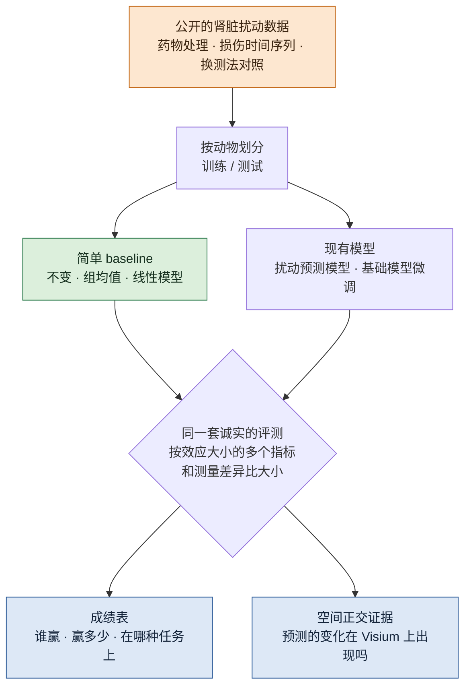
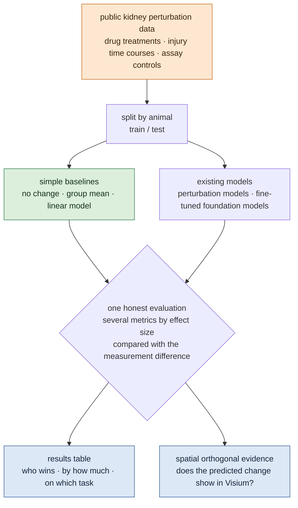

# 肾脏扰动预测的诚实基准 / An Honest Benchmark for Perturbation Prediction in Kidney

## 一页看懂 / At a glance

<!-- ZH -->
!!! abstract "这个课题要做什么"
    **在肾组织上，扰动预测模型到底有没有比简单方法更好？我们建第一个肾脏扰动预测基准：带强 baseline，控制已知的评测陷阱，用空间数据做正交证据。**

    - **问题：**扰动预测模型（"virtual cell"）想回答"给细胞用药或敲掉一个基因，它会变成什么样"。但最近几篇大规模比较发现，深度模型和基础模型常常赢不过简单的线性方法，常用的评测指标还会把不是扰动造成的差异算成模型能力。这些比较全部建在细胞系上，**没有一个含肾脏**（按我们 2026-10-31 的检索）。
    - **思路：**用公开的肾脏扰动数据（药物处理、损伤后的时间序列，以小鼠为主），先把简单 baseline 做强，再在同一套诚实的规则下比较现有模型。
    - **诚实的规则：**按动物划分训练和测试，不按细胞；按效应大小报告多个指标；用"同一批样本换测法"的数据给出测量差异的大小，作为任何模型效应的对照；预测出的变化要在空间数据上找得到。
    - **约束：**只用公开数据；不做湿实验；结论限定在现有数据能支持的范围内。
    - **现状：**2026-10-31 定下方向，做完了数据调研（见下），代码还没开始。
<!-- EN -->
!!! abstract "What this topic does"
    **In kidney tissue, do perturbation-prediction models actually beat simple methods? We build the first kidney perturbation-prediction benchmark: strong baselines, control of known evaluation pitfalls, and spatial data as orthogonal evidence.**

    - **Question:** perturbation-prediction models ("virtual cells") try to answer "what happens to a cell if we give it a drug or knock out a gene". Recent large comparisons found that deep and foundation models often do not beat simple linear methods, and that common metrics count differences not caused by the perturbation as model skill. All of these comparisons use cell lines; **none includes kidney** (our search, 2026-10-31).
    - **Idea:** use public kidney perturbation data (drug treatments and injury time courses, mostly mouse), make the simple baselines strong first, then compare existing models under the same honest rules.
    - **Honest rules:** split training and test by animal, not by cell; report several metrics by effect size; use data where the same samples were measured two ways to size the measurement difference, as a control for any model effect; predicted changes must be visible in spatial data.
    - **Constraint:** public data only; no wet lab; conclusions limited to what the data can support.
    - **Status:** direction set on 2026-10-31; data survey done (below); no code yet.

<!-- ZH -->

<!-- EN -->

## 研究问题 / The question

<!-- ZH -->
1. 在肾脏数据上，现有扰动预测模型能不能赢过简单 baseline（预测"不变"、组均值、线性模型）？
2. 控制了已知的评测陷阱以后，结论变不变？
3. 模型预测出的细胞状态变化，在空间数据上能不能找到对应的证据？
<!-- EN -->
1. On kidney data, do existing perturbation-prediction models beat simple baselines (predict "no change", the group mean, a linear model)?
2. Does the answer change once known evaluation pitfalls are controlled?
3. Do the cell-state changes a model predicts have matching evidence in spatial data?

## 为什么重要，为什么还没解决 / Why it matters and why it is unsolved

<!-- ZH -->
扰动预测是 virtual cell 和 virtual tissue 的核心：模型若能可靠地预测"用了这个药，组织会怎样"，就能在做实验之前筛选靶点和药物。本站的总方向（检测 → 建模 → 逆转）里，"逆转"那一步靠的就是它。问题是，现在还不知道这些模型在病人组织上到底有多准，现有的评测本身也有问题：
<!-- EN -->
Perturbation prediction is the core of virtual cells and virtual tissue: a model that reliably predicts "what the tissue does under this drug" could screen targets and drugs before any experiment. In this site's overall direction (detect → model → revert), the "revert" step depends on it. The problem is that nobody knows how accurate these models are on patient tissue, and the existing evaluations have problems of their own:

<!-- ZH -->
| 发现 | 来源 |
|---|---|
| 5 个基础模型 + 2 个深度模型做扰动预测，没有一个赢过刻意简单的线性 baseline | [Ahlmann-Eltze et al. 2025](../papers/linear-baselines-natmethods-2025/index.md) |
| 扰动组和对照组之间本来就有系统性差异，常用指标把它算成模型能力 | [Systema, Nat Biotechnol 2025](https://doi.org/10.1038/s41587-025-02777-8) |
| 模型排名强烈依赖效应大小和指标；没有方法能稳定跨细胞类型泛化 | [Li et al., Sci Adv 2026](https://doi.org/10.1126/sciadv.aed3414) |
| 纯端到端网络还没赢过混合模型，生物先验要更认真地整合 | [Virtual Cell Challenge](../papers/virtual-cell-challenge/index.md) |
| 瓶颈是生物 context 的覆盖，不是模型容量 | [Dibaeinia et al., bioRxiv 2026](https://doi.org/10.64898/2026.02.04.703804)（只读了摘要） |
<!-- EN -->
| Finding | Source |
|---|---|
| five foundation models and two deep models did not beat deliberately simple linear baselines | [Ahlmann-Eltze et al. 2025](../papers/linear-baselines-natmethods-2025/index.md) |
| perturbed and control cells differ systematically, and common metrics count this as model skill | [Systema, Nat Biotechnol 2025](https://doi.org/10.1038/s41587-025-02777-8) |
| model rankings depend strongly on effect size and metric; no method generalises reliably across cell types | [Li et al., Sci Adv 2026](https://doi.org/10.1126/sciadv.aed3414) |
| pure end-to-end networks have not yet beaten hybrid models; biological priors need better integration | [Virtual Cell Challenge](../papers/virtual-cell-challenge/index.md) |
| the bottleneck is coverage of biological contexts, not model capacity | [Dibaeinia et al., bioRxiv 2026](https://doi.org/10.64898/2026.02.04.703804) (abstract only) |

<!-- ZH -->
**还没解决的原因（我们的理解）：**上面这些比较都用细胞系（K562、RPE1、A549 等），没有病人组织；而肾脏缺少真正的大规模基因扰动单细胞数据，所以没人在肾脏上做过同样的比较。
<!-- EN -->
**Why it is unsolved (our reading):** the comparisons above use cell lines (K562, RPE1, A549 and others), not patient tissue; kidney lacks real large-scale genetic-perturbation single-cell data, so nobody has run the same comparison in kidney.

## 用到的数据 / Data

<!-- ZH -->
扰动预测需要"扰动之后实际测到的结果"作为答案。肾脏没有大规模的 Perturb-seq，所以基准建在**药物处理**和**损伤时间序列**两条腿上，再加一份测量对照。每份数据的细节见[数据集](../datasets/index.md)页的"扰动实验"一组。
<!-- EN -->
Perturbation prediction needs measured post-perturbation outcomes as answers. Kidney has no large-scale Perturb-seq, so the benchmark stands on **drug treatments** and **injury time courses**, plus one measurement control. Details of each dataset are in the "perturbation experiments" group of the [Datasets](../datasets/index.md) tab.

<!-- ZH -->
| 任务 | 数据 | 预测什么 |
|---|---|---|
| **A** 药物 | [Wu 2022 · DKD 五种治疗](../datasets/wu-dkd-2022.md) | 从单药预测联合用药；从 2 天预测 2 周 |
| A′ 跨实验室 | [Wu 2022 · SGLT2i 和 ARB](../datasets/wu-sglt2-arb-2022.md) | 在 A 上训练，在另一个实验室的数据上测 |
| **B** 时间 | [Kirita 2020 · 损伤到修复](../datasets/kirita-iri-2020.md) | 用前面的时间点预测后面的 |
| B′ 空间 | [Dixon 2022 · 空间时间序列](../datasets/dixon-iri-visium-2022.md) | 预测的状态变化在空间上是否出现 |
| **C** 测量对照 | [Gaedcke 2022 · 单细胞 vs 单核](../datasets/gaedcke-sc-sn-2022.md) | 测法差异有多大，作为效应的下限对照 |
<!-- EN -->
| Task | Data | What is predicted |
|---|---|---|
| **A** drugs | [Wu 2022 · DKD under five treatments](../datasets/wu-dkd-2022.md) | a combination from its single drugs; 2 weeks from 2 days |
| A′ across labs | [Wu 2022 · SGLT2i and ARB](../datasets/wu-sglt2-arb-2022.md) | train on A, test on another lab |
| **B** time | [Kirita 2020 · injury to repair](../datasets/kirita-iri-2020.md) | later time points from earlier ones |
| B′ spatial | [Dixon 2022 · spatial time course](../datasets/dixon-iri-visium-2022.md) | whether predicted state changes appear in space |
| **C** measurement control | [Gaedcke 2022 · single cell vs single nucleus](../datasets/gaedcke-sc-sn-2022.md) | how large the assay difference is, as a floor for any effect |

<!-- ZH -->
**人类数据：**目前只找到一项随机对照试验有配对的前后活检单细胞数据：[Bjornstad et al., Sci Transl Med 2026](https://doi.org/10.1126/scitranslmed.aee1005)（1 型糖尿病青少年，SGLT2 抑制剂 vs 安慰剂；有随访活检的只有 11 人）。数据能不能拿到还没核实。KPMP 等人类图谱是观察性的，可以当背景，不能当扰动的答案。

**空白：**肾小管、足细胞或类器官上，没有"几十到上千个基因扰动 + 单细胞读出"的公开数据；空间扰动方法（如 Perturb-DBiT、spatial Perturb-seq）也还没在肾脏上做过。所以这个基准暂时不含基因扰动，只能声称"药物和损伤"，不能声称"任意扰动"。
<!-- EN -->
**Human data:** we found only one randomised trial with paired before/after single-cell biopsies: [Bjornstad et al., Sci Transl Med 2026](https://doi.org/10.1126/scitranslmed.aee1005) (adolescents with type 1 diabetes, SGLT2 inhibitor vs placebo; only 11 have a follow-up biopsy). Access to the data is not yet confirmed. Human atlases such as KPMP are observational: usable as context, not as perturbation answers.

**Gap:** there is no public data with tens to thousands of genetic perturbations and single-cell readout in tubules, podocytes or organoids, and spatial perturbation methods (such as Perturb-DBiT and spatial Perturb-seq) have not been used in kidney. So for now the benchmark has no genetic perturbations and can only claim "drugs and injury", not "any perturbation".

## 基准怎么搭 / How the benchmark is built

<!-- ZH -->
**1. 先把 baseline 做强。**"不变"（预测扰动后等于扰动前）、组均值、线性模型（按 Ahlmann-Eltze 等人的写法）。任何模型都要先和它们比。

**2. 再放进现有模型。**扰动预测模型（如 CPA、GEARS、[条件 Monge gap](../papers/scrna-natmachintell-2026/index.md)）和基础模型微调。具体名单在搭好 baseline 之后再定。

**3. 诚实的评测规则：**

- 按动物划分训练和测试，不按细胞；同一只动物的细胞不会同时出现在两边。
- 参照点按 Systema 的做法处理，避免把系统性差异算成模型能力。
- 按效应大小分开报告多个指标（表达水平、变化量、差异基因）。
- 用任务 C 量出"换测法"造成的差异有多大；模型声称的效应如果比它还小，就不能算数。

**4. 空间正交证据。**模型预测出的状态变化（比如损伤后近端小管状态的比例），在 Visium 切片的对应区域里有没有出现。切片少（每个时间点一张），只当佐证，不做统计检验。
<!-- EN -->
**1. Make the baselines strong first.** "No change" (predict the post-perturbation state equals the pre-perturbation one), the group mean, and a linear model (as written by Ahlmann-Eltze et al.). Every model is compared with them first.

**2. Then add existing models.** Perturbation models (such as CPA, GEARS and the [conditional Monge gap](../papers/scrna-natmachintell-2026/index.md)) and fine-tuned foundation models. The exact list is set once the baselines run.

**3. Honest evaluation rules:**

- Split training and test by animal, not by cell; cells of one animal never appear on both sides.
- Set the reference point as Systema does, so systematic differences are not counted as model skill.
- Report several metrics (expression level, change, differential genes) separately by effect size.
- Use task C to measure how large the assay difference is; a model effect smaller than that does not count.

**4. Spatial orthogonal evidence.** Whether a predicted state change (for example the share of injured proximal tubule states after injury) appears in the matching regions of the Visium sections. There are few sections (one per time point), so this is supporting evidence, not a statistical test.

## 和另外两个课题的关系 / How it connects to the other topics

<!-- ZH -->
- **[伪影注入课题](anomaly-benchmark.md)：**Systema 指出的最大陷阱是"把不是扰动造成的系统性差异算成扰动效应"，技术伪影（doublet、ambient RNA、低质量细胞、换测法）正是这种差异的来源之一。伪影注入课题提供可控的技术扰动，本课题用它检查：模型会不会把伪影预测成扰动效应？清洗数据后，排名变不变？
- **[Agent 可信度课题](agent-claims.md)：**本课题的留出数据是实测的答案。Agent 可信度课题拿这些答案出题，检查 agent 用这些数据和工具做分析时，结论和报告能不能信。
<!-- EN -->
- **[The artifact-injection topic](anomaly-benchmark.md):** the biggest pitfall Systema points out is counting systematic differences not caused by the perturbation as its effect, and technical artifacts (doublets, ambient RNA, low-quality cells, assay changes) are one source of such differences. The artifact-injection topic supplies controlled technical perturbations; this topic uses them to check whether models predict artifacts as perturbation effects, and whether rankings change after cleaning.
- **[The agent-trustworthiness topic](agent-claims.md):** this topic's held-out data are measured answers. The agent-trustworthiness topic turns them into questions and checks whether an agent's conclusions and reports can be trusted when it analyses these data with these tools.

## 要做出什么 / What we will produce

<!-- ZH -->
| # | 交付物 | 是什么 |
|---|---|---|
| 1 | 肾脏扰动基准 | 任务 A–C 的固定划分、指标和评测代码，公开 |
| 2 | baseline 模型库 | 不变、组均值、线性模型，加上训练好的现有模型 |
| 3 | 成绩表 | 每个模型在每个任务上，按效应大小和指标分开 |
| 4 | 空间佐证 | 预测的状态变化和 Visium 切片的对照 |
<!-- EN -->
| # | Deliverable | What it is |
|---|---|---|
| 1 | kidney perturbation benchmark | fixed splits, metrics and evaluation code for tasks A–C, open |
| 2 | baseline model repository | no change, group mean and linear models, plus trained existing models |
| 3 | results table | every model on every task, split by effect size and metric |
| 4 | spatial evidence | predicted state changes set against the Visium sections |

<!-- ZH -->
原始数据不再分发；发布的是代码、划分文件和结果。
<!-- EN -->
Raw data are not redistributed; we release code, split files and results.

## 风险和还没定的 / Risks and open questions

<!-- ZH -->
- **以小鼠为主。**人类只有一项小规模试验，而且数据访问还没确认。文章要明说"小鼠基准 + 小规模人类测试"。
- **扰动种类少。**药物只有五种处理左右，所以任务定成"单药 → 联合"和"时间外推"这类小样本也成立的问题。
- **线性 baseline 赢了怎么办？**那就是结果：在肾脏上也成立，这正是诚实基准要回答的。
- **没有基因扰动数据。**写成空白；长期看需要有人在肾脏类器官或 tubuloid 上做 Perturb-seq。
- **还要核实：**Bjornstad 2026 的数据访问方式；可逆 UUO 数据（GEO GSE140023）的时间点，它可能是少有的"撤除扰动 → 观察恢复"的数据；Tahoe-100M 里唯一的肾癌细胞系 A498 是否真有扰动细胞。
<!-- EN -->
- **Mostly mouse.** Humans have one small trial, and data access is not yet confirmed. The paper must say "mouse benchmark plus a small human test".
- **Few perturbations.** Drugs give about five treatments, so the tasks are ones that work with small numbers: "single drugs → combination" and "extrapolate in time".
- **What if the linear baseline wins?** Then that is the result: it holds in kidney too, which is exactly what an honest benchmark should answer.
- **No genetic perturbation data.** Stated as a gap; in the long run someone needs to run Perturb-seq on kidney organoids or tubuloids.
- **Still to check:** data access for Bjornstad 2026; the time points of the reversible UUO data (GEO GSE140023), possibly a rare "remove the perturbation → watch recovery" dataset; whether A498, the only kidney cancer line in Tahoe-100M, actually has perturbed cells.

## 阅读路线 / Reading path

<!-- ZH -->
1. **[Ahlmann-Eltze et al. 2025](../papers/linear-baselines-natmethods-2025/index.md)**：线性 baseline 为什么能赢，这是本课题的出发点。
2. **[Systema](https://doi.org/10.1038/s41587-025-02777-8)**（不在库里）：系统性差异这个陷阱，以及怎么改参照点。
3. **[Li et al. 2026](https://doi.org/10.1126/sciadv.aed3414)**（不在库里）：指标和效应大小怎么影响排名。
4. **[Virtual Cell Challenge](../papers/virtual-cell-challenge/index.md)**：一场公开比赛的结论。
5. **[条件 Monge gap](../papers/scrna-natmachintell-2026/index.md)**：一个要放进基准里比的现有模型。
6. **[Wu 2022 · DKD 五种治疗](../datasets/wu-dkd-2022.md)**：任务 A 的数据，读它的数据集页。
<!-- EN -->
1. **[Ahlmann-Eltze et al. 2025](../papers/linear-baselines-natmethods-2025/index.md)**: why linear baselines win; the starting point of this topic.
2. **[Systema](https://doi.org/10.1038/s41587-025-02777-8)** (not in the library): the systematic-variation pitfall and how to change the reference point.
3. **[Li et al. 2026](https://doi.org/10.1126/sciadv.aed3414)** (not in the library): how metric and effect size change rankings.
4. **[Virtual Cell Challenge](../papers/virtual-cell-challenge/index.md)**: what a public competition concluded.
5. **[Conditional Monge gap](../papers/scrna-natmachintell-2026/index.md)**: one existing model to compare in the benchmark.
6. **[Wu 2022 · DKD under five treatments](../datasets/wu-dkd-2022.md)**: the data of task A; read its dataset page.
