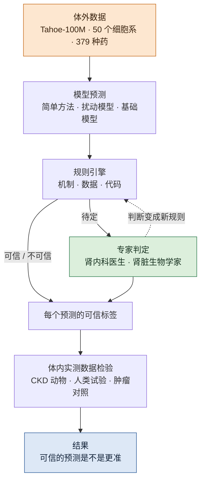
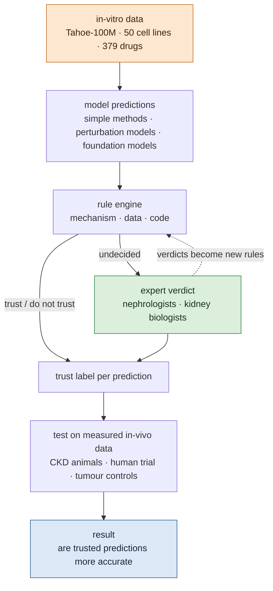

# 可检验的虚拟细胞：体外的药物预测什么时候能用到肾组织 / Verifiable Virtual Cells: When Can In-Vitro Drug Predictions Be Trusted in Kidney Tissue?

## 一页看懂 / At a glance {#glance}

<!-- ZH -->
!!! abstract "这个课题要做什么"
    **在做体内实验之前，判断一个虚拟细胞模型对肾组织的用药预测能不能信。**

    - **为什么：**虚拟细胞模型主要在体外的细胞系上训练，最大的公开数据有约一亿个细胞。但药物要作用在病人的组织里。我们核对发现，治疗慢性肾病（CKD）的几类主要药物，它们的靶点在这些细胞系里基本不表达，所以模型在体外学到的"药效"，到肾里可能根本不成立。
    - **我们不和大团队比谁的模型更好，**而是问：一个体外到体内的预测，什么时候能信？能不能在做实验之前就判断出来？
    - **怎么判断：**用规则引擎从三层检查每个预测：机制（靶点在源细胞里表达吗、需要的组织环境在吗）、数据、评测代码。规则拿不准的，交给肾内科医生和肾脏生物学家判定；专家的判断再变成新规则。
    - **怎么检验：**用公开的体内用药数据（CKD 动物模型、一项人类试验，加上肿瘤的阳性对照）量出每个预测的真实误差，看被判为"可信"的预测是不是真的更准。
    - **和 agent 课题共用同一个 harness：**那边检验 agent 的结论，这边检验虚拟细胞的预测。
    - **现状：**2026-11-04 应 Sikander 的要求重新整理成独立课题，方向从"肾脏扰动基准"改为"可检验的体外到体内迁移"，**待讨论**。数据核对做完，代码还没开始。
<!-- EN -->
!!! abstract "What this topic does"
    **Judge, before any in-vivo experiment, whether a virtual-cell model's drug prediction for kidney tissue can be trusted.**

    - **Why:** virtual-cell models are trained mainly on cell lines in vitro; the largest public dataset has about a hundred million cells. But drugs act in patients' tissue. We checked that the targets of the main chronic kidney disease (CKD) drug classes are essentially not expressed in those cell lines, so a "drug effect" the model learned in vitro may simply not hold in the kidney.
    - **We do not compete with large teams on whose model is better.** We ask: when can an in-vitro-to-in-vivo prediction be trusted, and can that be judged before the experiment?
    - **How we judge:** a rule engine checks every prediction on three layers: mechanism (is the target expressed in the source cells, is the needed tissue context there), data, and evaluation code. Cases the rules cannot settle go to nephrologists and kidney biologists, and their verdicts become new rules.
    - **How we test:** public in-vivo drug data (CKD animal models, one human trial, plus tumour positive controls) give each prediction's real error, and we check whether predictions judged "trustworthy" are actually more accurate.
    - **It shares one harness with the agent topic:** there it checks an agent's conclusions, here a virtual cell's predictions.
    - **Status:** restored as its own topic on 2026-11-04 at Sikander's request, reframed from "a kidney perturbation benchmark" to "verifiable in-vitro-to-in-vivo transfer", **for discussion**. Data checks done; no code yet.

## 目录 / Contents {#contents}

<!-- ZH -->
[1 问题](#question) · [2 思路](#idea) · [3 三层检查](#rules) · [4 专家](#experts) · [5 怎么检验](#test) · [6 模型](#models) · [7 数据](#data) · [8 交付](#deliver) · [9 和另外两个课题的关系](#connect) · [10 还没定的](#open) · [11 阅读路线](#reading)

只读每段开头的粗体句，就能看懂主线；医学和数据的细节在折叠块里，完整出处在每节末尾的"参考文献"里。
<!-- EN -->
[1 The question](#question) · [2 Idea](#idea) · [3 Three layers of checks](#rules) · [4 Experts](#experts) · [5 How we test](#test) · [6 Models](#models) · [7 Data](#data) · [8 Deliverables](#deliver) · [9 Other topics](#connect) · [10 Open questions](#open) · [11 Reading path](#reading)

Reading only the bold first sentence of each paragraph gives the storyline; medical and data details are in folds, and full sources in the "References" fold at the end of each part.

## 问题 / The question {#question}

<!-- ZH -->
这一节回答：为什么要做这个课题。

**虚拟细胞想在做实验之前预测药效，但它们几乎都在体外的细胞系上训练。**目前最大的公开用药数据 Tahoe-100M，在 50 个癌细胞系上测了 379 种药、每种三个剂量，约一亿个单细胞，许可是 CC0（[Zhang et al. 2025](https://doi.org/10.1101/2025.02.20.639398)）。基于它的基础模型也已经公开（[Gandhi et al. 2025](https://doi.org/10.1101/2025.10.23.683759)）。药物发现真正关心的，却是药物在病人组织里做了什么。

**即使在体外，复杂模型也常常赢不过简单方法，常用的评分还会高估模型。**五个基础模型和两个深度模型都没有赢过刻意做得很简单的线性方法（[Ahlmann-Eltze et al. 2025](../papers/linear-baselines-natmethods-2025/index.md)）。处理组和对照组本来就有系统差异，常用指标会把"猜中这个差异"算成模型的本事（[Viñas Torné et al. 2025](https://doi.org/10.1038/s41587-025-02777-8)）。2025 年虚拟细胞挑战赛的主办方也总结说，模型还没能在所有指标上稳定赢过朴素的基线（[Arc Institute 2025](https://arcinstitute.org/news/virtual-cell-challenge-2025-wrap-up)）。

**从体外到体内，结果可能直接反过来。**同一批基因敲除，在体内和体外的造血系统里，有的效应方向相反，用 AI 预测这种差异很难（[Geetha et al. 2025](https://doi.org/10.1101/2025.09.02.673692)）。从小鼠预测人的任务，模型基本都失败了（[Radig et al. 2026](https://doi.org/10.1186/s13059-026-04104-z)）。

**对肾脏来说，问题更根本：药物的靶点在细胞系里不存在。**我们核对了 Tahoe 里的 CKD 用药：有两种 SGLT2 抑制剂、两种 ACE 抑制剂、一种盐皮质激素受体拮抗剂和沙库巴曲缬沙坦。Tahoe 唯一的肾细胞系是一株肾癌细胞（A498），它的 SLC5A2（SGLT2）、ACE、AGTR1 和 NR3C2 基本不表达；SLC5A2 在所有 48 个有数据的细胞系里都只有痕量（DepMap 24Q4，见下方折叠块）。也就是说，模型在体外看到的这些"药效"，不是这些药在肾里的作用方式。

**已有的工作在让迁移变得更好，没有人回答"什么时候可以信"。**GENEVA 在小鼠体内放入多株混合的肿瘤细胞，测药物反应（[Yu et al. 2026](https://doi.org/10.1038/s43018-026-01130-5)）；PerturbRx 把体外学到的用药变化用来预测病人是否响应（[Inoue et al. 2026](https://arxiv.org/abs/2608.21349)）；IRIS 把体外的信号扰动图谱迁移到小鼠胚胎（[IRIS 2026](https://doi.org/10.1038/s41592-026-03213-8)）。据我们检索（截至 2026 年 11 月），还没有工作在做预测之前，判断一个体外到体内的单细胞用药预测是否可信，并用体内实测数据检验这种判断。这正是我们组的长处：有肾脏的专家，有可检验的规则。
<!-- EN -->
This part answers why this topic is needed.

**Virtual cells aim to predict drug effects before an experiment, but almost all are trained on cell lines in vitro.** The largest public drug dataset, Tahoe-100M, measured 379 drugs at three doses each in 50 cancer cell lines, about a hundred million single cells, under a CC0 licence ([Zhang et al. 2025](https://doi.org/10.1101/2025.02.20.639398)). A foundation model built on it is public too ([Gandhi et al. 2025](https://doi.org/10.1101/2025.10.23.683759)). What drug discovery actually cares about, though, is what a drug does in a patient's tissue.

**Even in vitro, complex models often do not beat simple methods, and common scores overrate them.** Five foundation models and two deep models did not beat deliberately simple linear methods ([Ahlmann-Eltze et al. 2025](../papers/linear-baselines-natmethods-2025/index.md)). Treated and control cells differ systematically to begin with, and common metrics count "guessing this difference" as model skill ([Viñas Torné et al. 2025](https://doi.org/10.1038/s41587-025-02777-8)). The organisers of the 2025 Virtual Cell Challenge also concluded that models do not yet consistently beat naive baselines across all metrics ([Arc Institute 2025](https://arcinstitute.org/news/virtual-cell-challenge-2025-wrap-up)).

**From in vitro to in vivo, results can flip.** The same gene knockouts had opposite-sign effects in some cases between in-vivo and ex-vivo haematopoiesis, and AI prediction of these differences was hard ([Geetha et al. 2025](https://doi.org/10.1101/2025.09.02.673692)). Predicting human responses from mouse largely failed in a general benchmark ([Radig et al. 2026](https://doi.org/10.1186/s13059-026-04104-z)).

**For the kidney the problem is more basic: the drug targets do not exist in the cell lines.** We checked the CKD drugs in Tahoe: two SGLT2 inhibitors, two ACE inhibitors, one mineralocorticoid-receptor antagonist and sacubitril/valsartan. Tahoe's only kidney line is a renal-cancer line (A498), which essentially does not express SLC5A2 (SGLT2), ACE, AGTR1 or NR3C2; SLC5A2 is at trace levels at most in all 48 lines with data (DepMap 24Q4, see the fold below). So the "drug effects" a model sees in vitro are not how these drugs act in the kidney.

**Existing work makes transfer better; nobody answers "when can it be trusted".** GENEVA places pools of tumour lines in mice to measure drug responses ([Yu et al. 2026](https://doi.org/10.1038/s43018-026-01130-5)); PerturbRx uses drug transitions learned in vitro to predict whether patients respond ([Inoue et al. 2026](https://arxiv.org/abs/2608.21349)); IRIS transfers an in-vitro signalling-perturbation atlas to mouse embryos ([IRIS 2026](https://doi.org/10.1038/s41592-026-03213-8)). To our search (up to November 2026), no work judges, before predicting, whether an in-vitro-to-in-vivo single-cell drug prediction can be trusted, and tests that judgement against measured in-vivo data. This is where our group is strong: kidney experts, and rules that can be checked.

<!-- ZH -->
??? info "给非医学背景的读者：CKD 的几类药，以及为什么细胞系里没有它们的靶点"
<!-- EN -->
??? info "For non-medical readers: the main CKD drugs, and why cell lines lack their targets"
<!-- ZH/EN -->
    <!-- ZH -->
    **CKD 的几类常用药。**ACE 抑制剂和 ARB 阻断肾素–血管紧张素系统（RAS 阻断）；SGLT2 抑制剂最早是降糖药，后来证明能保护肾；盐皮质激素受体拮抗剂（如 finerenone）也能减慢 CKD 进展（[KDIGO 2024](https://doi.org/10.1016/j.kint.2023.10.018)）。

    **为什么细胞系里没有靶点。**SGLT2 是近端小管上皮细胞上回收葡萄糖的转运体；ACE 和血管紧张素受体属于一个跨器官的激素系统，需要血液里的激素和血管；盐皮质激素受体主要在远端肾单位起作用。体外培养的癌细胞系没有这些组织环境，常常也不再表达这些基因。所以同一种药，用在细胞系上，看到的是"脱靶"或者几乎没有反应，不是它在肾里的作用。

    **"靶点在"也不等于能迁移。**地塞米松的受体（NR3C1）和罗格列酮的受体（PPARG）在大多数细胞系里都表达，但这两种药在体内的主要作用依赖免疫细胞或脂肪组织。这类情况介于"可以信"和"不能信"之间，正是需要专家判断的地方。
    <!-- EN -->
    **The main CKD drugs.** ACE inhibitors and ARBs block the renin–angiotensin system (RAS blockade); SGLT2 inhibitors were first developed for diabetes and later shown to protect the kidney; mineralocorticoid-receptor antagonists (such as finerenone) also slow CKD ([KDIGO 2024](https://doi.org/10.1016/j.kint.2023.10.018)).

    **Why cell lines lack the targets.** SGLT2 is the glucose transporter of proximal-tubule epithelial cells; ACE and the angiotensin receptor belong to a hormone system that spans organs and needs blood-borne hormones and vessels; the mineralocorticoid receptor acts mainly in the distal nephron. Cancer cell lines in culture have none of this tissue context and often no longer express these genes. So the same drug on a cell line shows off-target effects or almost nothing, not what it does in the kidney.

    **"Target present" does not mean it transfers.** The receptors of dexamethasone (NR3C1) and rosiglitazone (PPARG) are expressed in most cell lines, but much of these drugs' action in the body depends on immune cells or fat tissue. Such cases sit between "trust" and "do not trust", and that is exactly where experts are needed.

<!-- ZH -->
??? info "我们核对的数据：Tahoe 里的 CKD 药和靶点表达"
<!-- EN -->
??? info "What we checked: CKD drugs in Tahoe and target expression"
<!-- ZH/EN -->
    <!-- ZH -->
    2026-11-04 核对。Tahoe 的药物和细胞系信息来自它在 Hugging Face 上的元数据；表达量来自 DepMap 24Q4，单位 log2(TPM+1)，大于 1 算"表达"（一个宽松的阈值）。

    | 药物类别 | Tahoe 里有的药 | 靶点 | A498（肾） | 48 个细胞系里表达的数量 |
    |---|---|---|---|---|
    | SGLT2 抑制剂 | dapagliflozin、canagliflozin | SLC5A2 | 0.86 | 6 个，最高 1.86，都只是痕量 |
    | ACE 抑制剂 | captopril、perindopril | ACE | 0.15 | 21 个（结直肠、胰腺、肺），不包括 A498 和肝细胞系 |
    | ARB | 只有沙库巴曲/缬沙坦合剂 | AGTR1 | 0.53 | 5 个 |
    | 盐皮质激素受体拮抗剂 | eplerenone | NR3C2 | 0.36 | 8 个，不包括 A498 和肝细胞系 |
    | PPARγ 激动剂 | rosiglitazone、pioglitazone | PPARG | 4.43 | 35 个 |
    | 糖皮质激素 | dexamethasone 等 | NR3C1 | 5.05 | 36 个（多数结直肠细胞系不表达） |

    Tahoe 里没有 empagliflozin、enalapril、lisinopril、ramipril、losartan、irbesartan、finerenone、spironolactone 和 amiloride。每种药都只有 0.05、0.5、5 µM 三个剂量。A498 有约 279 万个细胞，覆盖全部药物。
    <!-- EN -->
    Checked on 2026-11-04. Tahoe's drug and cell-line information comes from its metadata on Hugging Face; expression from DepMap 24Q4, in log2(TPM+1), with "expressed" meaning above 1 (a lenient threshold).

    | Drug class | Drugs in Tahoe | Target | A498 (kidney) | Lines expressing it (of 48) |
    |---|---|---|---|---|
    | SGLT2 inhibitors | dapagliflozin, canagliflozin | SLC5A2 | 0.86 | 6, at most 1.86, all trace |
    | ACE inhibitors | captopril, perindopril | ACE | 0.15 | 21 (colorectal, pancreatic, lung), not A498 or the liver lines |
    | ARB | only the sacubitril/valsartan combination | AGTR1 | 0.53 | 5 |
    | Mineralocorticoid-receptor antagonists | eplerenone | NR3C2 | 0.36 | 8, not A498 or the liver lines |
    | PPARγ agonists | rosiglitazone, pioglitazone | PPARG | 4.43 | 35 |
    | Glucocorticoids | dexamethasone and others | NR3C1 | 5.05 | 36 (most colorectal lines lack it) |

    Tahoe lacks empagliflozin, enalapril, lisinopril, ramipril, losartan, irbesartan, finerenone, spironolactone and amiloride. Every drug has only three doses: 0.05, 0.5 and 5 µM. A498 has about 2.79 million cells covering all drugs.

<!-- ZH -->
??? note "参考文献（完整出处和细节）"
<!-- EN -->
??? note "References (full sources and details)"
<!-- ZH/EN -->
    <!-- ZH -->
    按正文的顺序排列。

    - **Tahoe-100M：**Zhang J et al. bioRxiv 2025. [doi:10.1101/2025.02.20.639398](https://doi.org/10.1101/2025.02.20.639398)；数据在 Hugging Face `tahoebio/Tahoe-100M`（CC0-1.0）。我们只读了元数据，没有读全文
    - **Tahoe-x1：**Gandhi S et al. bioRxiv 2025. [doi:10.1101/2025.10.23.683759](https://doi.org/10.1101/2025.10.23.683759)
    - **线性方法赢：**Ahlmann-Eltze C, Huber W, Anders S. *Nat Methods* 2025;22:1657–1661. [doi:10.1038/s41592-025-02772-6](https://doi.org/10.1038/s41592-025-02772-6)（[精读](../papers/linear-baselines-natmethods-2025/index.md)）。只涉及基因扰动
    - **系统差异（Systema）：**Viñas Torné R et al. *Nat Biotechnol* 2025. [doi:10.1038/s41587-025-02777-8](https://doi.org/10.1038/s41587-025-02777-8)
    - **虚拟细胞挑战赛：**Roohani YH et al. *Cell* 2025;188:3370–3374. [doi:10.1016/j.cell.2025.06.008](https://doi.org/10.1016/j.cell.2025.06.008)（[精读](../papers/virtual-cell-challenge/index.md)）；2025 年的结论来自 Arc 的 [Wrap-Up](https://arcinstitute.org/news/virtual-cell-challenge-2025-wrap-up)（2025-12-06）
    - **体内和体外的差异：**Geetha et al. Differences between in vivo and ex vivo hematopoietic model systems modulate the outcomes of genetic perturbations. bioRxiv 2025. [doi:10.1101/2025.09.02.673692](https://doi.org/10.1101/2025.09.02.673692)（只读了摘要和检索片段）。基因敲除，不是药物
    - **从小鼠到人：**Radig J et al. scArchon. *Genome Biol* 2026. [doi:10.1186/s13059-026-04104-z](https://doi.org/10.1186/s13059-026-04104-z)（只读了摘要；"基本失败"来自全文的检索片段，还没逐字核对）
    - **DepMap：**DepMap Public 24Q4（figshare 27993248），`OmicsExpressionProteinCodingGenesTPMLogp1` 和 `OmicsSomaticMutations`。Tahoe 的 50 个细胞系里有 48 个有 RNA 数据
    - **GENEVA：**Yu JX et al. *Nat Cancer* 2026. [doi:10.1038/s43018-026-01130-5](https://doi.org/10.1038/s43018-026-01130-5)（读了全文的设计部分）。论文声明部分作者是 Tahoe Therapeutics 的联合创始人
    - **PerturbRx：**Inoue et al. [arXiv:2608.21349](https://arxiv.org/abs/2608.21349) (2026)；ICLR 2027 投稿（只读了摘要）。预测的是病人是否响应，不是用药后的单细胞表达
    - **IRIS：**Reconstructing signaling histories of single cells via perturbation screens and transfer learning. *Nat Methods* 2026. [doi:10.1038/s41592-026-03213-8](https://doi.org/10.1038/s41592-026-03213-8)（只读了摘要）。推断的是哪些信号起了作用，不预测用药反应
    - **CKD 治疗指南：**KDIGO 2024. *Kidney Int* 2024;105(4S):S117–S314. [doi:10.1016/j.kint.2023.10.018](https://doi.org/10.1016/j.kint.2023.10.018)
    - **检索范围：**截至 2026 年 11 月，不可能穷尽，所以论文里写"据我们所知"
    <!-- EN -->
    In the order of the text.

    - **Tahoe-100M:** Zhang J et al. bioRxiv 2025. [doi:10.1101/2025.02.20.639398](https://doi.org/10.1101/2025.02.20.639398); data on Hugging Face `tahoebio/Tahoe-100M` (CC0-1.0). We read only the metadata, not the full text
    - **Tahoe-x1:** Gandhi S et al. bioRxiv 2025. [doi:10.1101/2025.10.23.683759](https://doi.org/10.1101/2025.10.23.683759)
    - **Linear methods win:** Ahlmann-Eltze C, Huber W, Anders S. *Nat Methods* 2025;22:1657–1661. [doi:10.1038/s41592-025-02772-6](https://doi.org/10.1038/s41592-025-02772-6) ([deep-read](../papers/linear-baselines-natmethods-2025/index.md)). Genetic perturbations only
    - **Systematic variation (Systema):** Viñas Torné R et al. *Nat Biotechnol* 2025. [doi:10.1038/s41587-025-02777-8](https://doi.org/10.1038/s41587-025-02777-8)
    - **Virtual Cell Challenge:** Roohani YH et al. *Cell* 2025;188:3370–3374. [doi:10.1016/j.cell.2025.06.008](https://doi.org/10.1016/j.cell.2025.06.008) ([deep-read](../papers/virtual-cell-challenge/index.md)); the 2025 conclusion is from Arc's [Wrap-Up](https://arcinstitute.org/news/virtual-cell-challenge-2025-wrap-up) (2025-12-06)
    - **In vivo vs ex vivo:** Geetha et al. Differences between in vivo and ex vivo hematopoietic model systems modulate the outcomes of genetic perturbations. bioRxiv 2025. [doi:10.1101/2025.09.02.673692](https://doi.org/10.1101/2025.09.02.673692) (abstract and search snippets only). Gene knockouts, not drugs
    - **From mouse to human:** Radig J et al. scArchon. *Genome Biol* 2026. [doi:10.1186/s13059-026-04104-z](https://doi.org/10.1186/s13059-026-04104-z) (only abstract read; "largely fails" comes from a search snippet of the full text, not yet checked word for word)
    - **DepMap:** DepMap Public 24Q4 (figshare 27993248), `OmicsExpressionProteinCodingGenesTPMLogp1` and `OmicsSomaticMutations`. 48 of Tahoe's 50 lines have RNA data
    - **GENEVA:** Yu JX et al. *Nat Cancer* 2026. [doi:10.1038/s43018-026-01130-5](https://doi.org/10.1038/s43018-026-01130-5) (design sections of the full text read). The paper states that some authors are co-founders of Tahoe Therapeutics
    - **PerturbRx:** Inoue et al. [arXiv:2608.21349](https://arxiv.org/abs/2608.21349) (2026); ICLR 2027 submission (only abstract read). Predicts whether patients respond, not post-treatment single-cell expression
    - **IRIS:** Reconstructing signaling histories of single cells via perturbation screens and transfer learning. *Nat Methods* 2026. [doi:10.1038/s41592-026-03213-8](https://doi.org/10.1038/s41592-026-03213-8) (only abstract read). Infers which signals acted; does not predict drug responses
    - **CKD treatment guideline:** KDIGO 2024. *Kidney Int* 2024;105(4S):S117–S314. [doi:10.1016/j.kint.2023.10.018](https://doi.org/10.1016/j.kint.2023.10.018)
    - **Search scope:** up to November 2026; it cannot be exhaustive, so the paper will say "to our knowledge"

## 思路 / Idea {#idea}

<!-- ZH -->
这一节回答：整个课题怎么走。

**先用体外数据做预测，再判断每个预测能不能信，最后用体内实测数据检验这个判断。**模型（包括简单方法）在 Tahoe 上学习，对每一对"药物 × 体内组织"做出预测。规则引擎给每个预测打上"可信 / 待定 / 不可信"，待定的交给专家。然后打开体内数据，量出每个预测的真实误差。

**我们要的结果不是"谁的模型最好"，而是"可信的标签准不准"。**如果被判为可信的预测误差明显更小，不可信的明显更大，这套检查就有用；而且它是在看到体内数据之前做出的判断。我们还要和"只看模型自己的不确定性"比较：只看统计量，能不能分出这三类？

**设计里有三档，用来检验规则本身。**按机制，我们事先知道三档应该怎么样：

- **阳性对照：靶点和驱动突变都对得上。**比如 KRAS G12C 抑制剂作用在带 G12C 突变的肿瘤上。体外到体内应该能迁移；如果连这一档都不行，问题出在模型或数据上。
- **部分迁移：靶点在，但缺少体内的组织环境。**比如罗格列酮（PPARG）和地塞米松（NR3C1）。这一档交给专家判断。
- **机制缺失：靶点在源细胞里不表达。**肾脏的 SGLT2 抑制剂、ACE 抑制剂、盐皮质激素受体拮抗剂。体外预测不应该能迁移；如果模型在这一档上分数看起来很高，多半是评分在高估。
<!-- EN -->
This part answers how the topic runs.

**Predict from in-vitro data, judge whether each prediction can be trusted, then test the judgement on measured in-vivo data.** Models (simple methods included) learn on Tahoe and predict for every "drug × in-vivo tissue" pair. The rule engine labels each prediction "trust / undecided / do not trust", and undecided ones go to experts. Only then are the in-vivo data opened to measure each prediction's real error.

**The result we want is not "whose model is best" but "are the trust labels right".** If predictions labelled trustworthy have clearly smaller errors and untrusted ones clearly larger, the checks work, and they were made before the in-vivo data were seen. We also compare with "the model's own uncertainty only": can statistics alone separate the three groups?

**The design has three tiers, to test the rules themselves.** From the mechanism, we know in advance how each tier should behave:

- **Positive control: target and driver mutation match.** For example a KRAS G12C inhibitor on tumours carrying G12C. Transfer should work; if even this tier fails, the problem is in the model or the data.
- **Partial transfer: target present, tissue context missing.** For example rosiglitazone (PPARG) and dexamethasone (NR3C1). This tier goes to experts.
- **Mechanism missing: target not expressed in the source cells.** The kidney SGLT2 inhibitors, ACE inhibitors and mineralocorticoid-receptor antagonists. In-vitro predictions should not transfer; if a model scores well on this tier, the scoring is most likely overrating it.

<!-- ZH -->

<!-- EN -->

## 三层检查 / Three layers of checks {#rules}

<!-- ZH -->
这一节回答：规则引擎具体查什么。三层和 [agent 课题](hypothesis-agents.md)的规则引擎一一对应。

**机制层：这个药在源细胞里有没有可以作用的对象。**第一条规则就是我们刚核对的：靶点在源细胞系里不表达，预测就不可信。其他规则：药物需要的组织环境（激素系统、免疫细胞、血管）在体外有没有；体外的剂量和体内的暴露量差多少；源细胞和目标细胞是不是同一类（比如肾癌细胞和近端小管细胞）。这些规则先由我们从文献和数据库写出初稿，再请专家改。

**数据层：体内数据能不能回答这个问题。**按动物划分，统计以动物为单位，不以细胞为单位（[Squair et al. 2021](https://doi.org/10.1038/s41467-021-25960-2)）。评分时扣掉"处理组普遍都这样变"的部分（[Viñas Torné et al. 2025](https://doi.org/10.1038/s41587-025-02777-8)）。效应要大于测量本身的差异：同一批受损的肾用单细胞和单核两种方法测（[Gaedcke et al. 2022](../datasets/gaedcke-sc-sn-2022.md)），两者之间的差异给出下限，比它还小的效应分不清是药效还是测法。

**代码层：评测代码本身有没有错。**预测"不变"和预测"训练集均值"这两个简单方法，同时也是评测代码的检查：代码写错时，比如测试细胞被当成了输入，"不变"会拿到满分（[Gallone et al. 2026](https://doi.org/10.64898/2026.10.12.758706)）。误差按差异基因加权，否则"所有细胞都差不多"的预测反而得分高（[Mejia et al. 2025](https://arxiv.org/abs/2506.22641)）；同时用 Cell-Eval 算一遍，让数字能和别人的比（[Adduri et al. 2025](https://doi.org/10.1101/2025.06.26.661135)）。
<!-- EN -->
This part answers what exactly the rule engine checks. The three layers map one to one onto the rule engine of the [agent topic](hypothesis-agents.md).

**Mechanism layer: does the drug have anything to act on in the source cells.** The first rule is the one we just checked: if the target is not expressed in the source cell line, the prediction is not trusted. Other rules: is the tissue context the drug needs (a hormone system, immune cells, vessels) present in vitro; how far apart are the in-vitro dose and the in-vivo exposure; are the source and target cells the same kind (for example a renal-cancer cell and a proximal-tubule cell). We draft these rules from the literature and databases, and experts revise them.

**Data layer: can the in-vivo data answer the question.** Split by animal, with the animal, not the cell, as the statistical unit ([Squair et al. 2021](https://doi.org/10.1038/s41467-021-25960-2)). Scoring removes the part where "treated cells all change like this" ([Viñas Torné et al. 2025](https://doi.org/10.1038/s41587-025-02777-8)). Effects must exceed the difference caused by the assay itself: the same injured kidneys were measured by single cell and by single nucleus ([Gaedcke et al. 2022](../datasets/gaedcke-sc-sn-2022.md)), and the difference between the two sets a floor below which a drug effect cannot be told apart from the assay.

**Code layer: is the evaluation code itself right.** Two simple methods, predicting "no change" and predicting the training mean, also check the evaluation code: when it has a bug, such as feeding the test cells in as input, "no change" gets a perfect score ([Gallone et al. 2026](https://doi.org/10.64898/2026.10.12.758706)). Errors are weighted by differential genes, or a prediction that "all cells look about the same" scores well ([Mejia et al. 2025](https://arxiv.org/abs/2506.22641)); scores are also computed with Cell-Eval so that our numbers can be compared with others' ([Adduri et al. 2025](https://doi.org/10.1101/2025.06.26.661135)).

<!-- ZH -->
??? note "参考文献（完整出处和细节）"
<!-- EN -->
??? note "References (full sources and details)"
<!-- ZH/EN -->
    <!-- ZH -->
    - **按细胞检验的假阳性：**Squair JW et al. *Nat Commun* 2021;12:5692. [doi:10.1038/s41467-021-25960-2](https://doi.org/10.1038/s41467-021-25960-2)
    - **单细胞和单核的配对数据：**Gaedcke S et al. *Am J Physiol Renal Physiol* 2022;323:F171–F181. [doi:10.1152/ajprenal.00453.2021](https://doi.org/10.1152/ajprenal.00453.2021)。每个条件、每种测法只有一份，够比大小，不够做统计
    - **评测代码的常见错误：**Gallone M et al. Auditing Confidence-Calibrated Benchmarking of Single-Cell Perturbation Models. bioRxiv 2026. [doi:10.64898/2026.10.12.758706](https://doi.org/10.64898/2026.10.12.758706)（只读了摘要）
    - **按差异基因加权的指标：**Mejia GM et al. [arXiv:2506.22641](https://arxiv.org/abs/2506.22641) (2025)（只读了摘要）
    - **Cell-Eval：**Adduri AK et al. bioRxiv 2025. [doi:10.1101/2025.06.26.661135](https://doi.org/10.1101/2025.06.26.661135)（只读了摘要）；[cell-eval](https://github.com/ArcInstitute/cell-eval)（MIT）
    - **剂量：**Tahoe 的最高剂量 5 µM 是否远高于这些药在病人血液里的游离浓度，我们还没有核对，规则写进去之前要查
    <!-- EN -->
    - **False positives from per-cell tests:** Squair JW et al. *Nat Commun* 2021;12:5692. [doi:10.1038/s41467-021-25960-2](https://doi.org/10.1038/s41467-021-25960-2)
    - **Paired single-cell and single-nucleus data:** Gaedcke S et al. *Am J Physiol Renal Physiol* 2022;323:F171–F181. [doi:10.1152/ajprenal.00453.2021](https://doi.org/10.1152/ajprenal.00453.2021). One sample per condition and assay: enough for a size comparison, not for statistics
    - **Common bugs in evaluation code:** Gallone M et al. Auditing Confidence-Calibrated Benchmarking of Single-Cell Perturbation Models. bioRxiv 2026. [doi:10.64898/2026.10.12.758706](https://doi.org/10.64898/2026.10.12.758706) (only abstract read)
    - **Metrics weighted by differential genes:** Mejia GM et al. [arXiv:2506.22641](https://arxiv.org/abs/2506.22641) (2025) (only abstract read)
    - **Cell-Eval:** Adduri AK et al. bioRxiv 2025. [doi:10.1101/2025.06.26.661135](https://doi.org/10.1101/2025.06.26.661135) (only abstract read); [cell-eval](https://github.com/ArcInstitute/cell-eval) (MIT)
    - **Dose:** whether Tahoe's top dose of 5 µM is far above these drugs' free plasma levels in patients is not yet checked; it must be before the rule is written

## 专家 / Experts {#experts}

<!-- ZH -->
这一节回答：专家做什么，为什么只有我们能做。

**专家只看规则拿不准的预测，而且由系统挑出最值得看的。**"部分迁移"那一档最需要专家：靶点在，但药物在体内的作用依赖什么组织环境、这个环境对肾的哪类细胞重要，规则写不全。系统把规则之间有冲突、或者模型自己也很不确定的预测排在前面，请肾内科医生和肾脏生物学家判定"可信 / 不可信"，并写一句理由。

**专家的判断变成新规则，下一次就不用再问。**比如专家说"罗格列酮在肾里的主要作用是间接的，体外不可信"，这条理由就写成一条机制层的规则，适用于同一类药。这样系统越用越好，而且每条规则都能追到是谁、因为什么写的。

**专家也会错，所以专家的判断同样要被体内数据检验。**最后报的不是"专家说得对"，而是规则、专家、规则加专家，各自的可信标签和真实误差的关系。

**为什么是我们：**做模型的大团队有数据和算力，没有肾脏的临床和生物学专家；我们组和合作方有，而且 agent 课题本来就在搭"专家参与"的流程。
<!-- EN -->
This part answers what experts do, and why we are the ones who can do it.

**Experts see only predictions the rules cannot settle, and the system picks the most informative ones.** The "partial transfer" tier needs experts most: the target is present, but which tissue context the drug depends on in the body, and which kidney cell types that matters for, cannot all be written as rules. The system ranks first the predictions where rules conflict or the model itself is very uncertain, and nephrologists and kidney biologists judge "trust / do not trust" with a one-line reason.

**Expert verdicts become new rules, so the same question is not asked twice.** If an expert says "rosiglitazone acts on the kidney mainly indirectly; do not trust the in-vitro prediction", that reason becomes a mechanism-layer rule for the same drug class. The system improves with use, and every rule can be traced to who wrote it and why.

**Experts can be wrong too, so their verdicts are tested on in-vivo data as well.** What we report is not "the experts were right" but how trust labels from rules, from experts, and from both relate to the real error.

**Why us:** the large modelling teams have data and compute but no kidney clinicians or biologists; our group and collaborators do, and the agent topic is already building the expert-in-the-loop process.

## 怎么检验 / How we test {#test}

<!-- ZH -->
这一节回答：怎么知道这套检查有用。

**检验 1：可信标签能不能预测真实误差。**每个"药物 × 体内组织"的预测都有一个可信标签，也有一个体内实测的误差。如果标签有用，"可信"组的误差应该小于"不可信"组。我们和三种不做检查的做法比：所有预测都信；只看模型自己的不确定性；只看源细胞和目标细胞的统计距离。

**检验 2：三档的结果是否符合机制。**阳性对照应该能迁移，机制缺失应该不能。如果某个模型在机制缺失的那一档上分数很高，说明评分在高估，这本身就是一个发现。

**检验 3：在肾脏上，对着动物和病人。**机制缺失和部分迁移的两档都落在 CKD 的体内数据上：小鼠和大鼠的用药实验，以及人类的 SGLT2 抑制剂试验（ATTEMPT）。ATTEMPT 用的是 dapagliflozin，和 Tahoe 里的药完全相同；人类数据只有 11 份随访活检，而且没法配对同一个人的前后两次，只能按组比较方向和大小。

**简单方法赢了怎么办？**不影响这个课题：我们检验的是"可信标签"，不是哪个模型最好。简单方法本身就是被检验的模型之一。
<!-- EN -->
This part answers how we know the checks are useful.

**Test 1: do trust labels predict the real error.** Every "drug × in-vivo tissue" prediction has a trust label and a measured in-vivo error. If the labels are useful, the "trust" group should have smaller errors than the "do not trust" group. We compare with three approaches without checks: trust everything; use only the model's own uncertainty; use only the statistical distance between source and target cells.

**Test 2: do the three tiers behave as the mechanism says.** The positive control should transfer, and the mechanism-missing tier should not. If a model scores well on the mechanism-missing tier, the scoring overrates it, which is itself a finding.

**Test 3: in the kidney, against animals and patients.** The mechanism-missing and partial tiers both land on CKD in-vivo data: mouse and rat drug experiments, and the human SGLT2-inhibitor trial (ATTEMPT). ATTEMPT used dapagliflozin, exactly the drug in Tahoe; the human data have only 11 follow-up biopsies, and the two biopsies of one person cannot be paired, so only the direction and size of group-level changes can be compared.

**What if simple methods win?** It does not matter for this topic: we test the trust labels, not which model is best. Simple methods are among the models being checked.

## 模型 / Models {#models}

<!-- ZH -->
这一节回答：检验哪些模型的预测。

**先做简单方法，再加现有模型。**简单方法有三个：预测"不变"、预测训练集的组均值、线性模型（[Ahlmann-Eltze et al. 2025](../papers/linear-baselines-natmethods-2025/index.md)）。现有模型按能不能处理用药数据来选；GEARS 只能预测基因扰动，不用。具体名单等简单方法跑通以后再定。

| 模型 | 为什么选它 | 代码许可 |
|---|---|---|
| scGen | 最早的扰动预测方法之一，原文就做过跨物种 | GPL-3.0 |
| CPA | 能把药物、剂量、时间、物种分开建模 | BSD-3 |
| chemCPA | CPA 加上药物分子结构，能推到没见过的药 | MIT |
| CellOT | 用最优传输预测；原文在没见过的病人和跨物种上测过 | BSD-3 |
| STATE | 在一亿多个扰动细胞上训练的大模型，可以微调 | 代码 CC BY-NC-SA 4.0，权重非商用 |
| Tahoe-x1 | 直接在 Tahoe-100M 上训练的基础模型 | Apache-2.0，权重公开 |
<!-- EN -->
This part answers whose predictions are checked.

**Simple methods first, then existing models.** Three simple methods: predict "no change", predict the training-set group mean, and a linear model ([Ahlmann-Eltze et al. 2025](../papers/linear-baselines-natmethods-2025/index.md)). Existing models are chosen by whether they handle drug data; GEARS predicts only genetic perturbations and is not used. The exact list is set once the simple methods run.

| Model | Why it is chosen | Code licence |
|---|---|---|
| scGen | one of the first perturbation-prediction methods; its paper already tested across species | GPL-3.0 |
| CPA | models drug, dose, time and species separately | BSD-3 |
| chemCPA | CPA plus the drug's molecular structure; extends to unseen drugs | MIT |
| CellOT | predicts by optimal transport; tested on unseen patients and across species | BSD-3 |
| STATE | a large model trained on over a hundred million perturbed cells; can be fine-tuned | code CC BY-NC-SA 4.0, weights non-commercial |
| Tahoe-x1 | a foundation model trained directly on Tahoe-100M | Apache-2.0, weights public |

<!-- ZH -->
??? note "参考文献（完整出处和细节）"
<!-- EN -->
??? note "References (full sources and details)"
<!-- ZH/EN -->
    <!-- ZH -->
    许可是 2026-11-04 在各自 GitHub 和 Hugging Face 页面上看的。

    - **scGen：**Lotfollahi M, Wolf FA, Theis FJ. *Nat Methods* 2019. [doi:10.1038/s41592-019-0494-8](https://doi.org/10.1038/s41592-019-0494-8)
    - **CPA：**Lotfollahi M et al. *Mol Syst Biol* 2023. [doi:10.15252/msb.202211517](https://doi.org/10.15252/msb.202211517)
    - **chemCPA：**Hetzel L et al. NeurIPS 2022. [arXiv:2204.13545](https://arxiv.org/abs/2204.13545)
    - **CellOT：**Bunne C et al. *Nat Methods* 2023. [doi:10.1038/s41592-023-01969-x](https://doi.org/10.1038/s41592-023-01969-x)
    - **STATE：**Adduri AK et al. bioRxiv 2025. [doi:10.1101/2025.06.26.661135](https://doi.org/10.1101/2025.06.26.661135)
    - **Tahoe-x1：**Gandhi S et al. bioRxiv 2025. [doi:10.1101/2025.10.23.683759](https://doi.org/10.1101/2025.10.23.683759)
    <!-- EN -->
    Licences were checked on the GitHub and Hugging Face pages on 2026-11-04.

    - **scGen:** Lotfollahi M, Wolf FA, Theis FJ. *Nat Methods* 2019. [doi:10.1038/s41592-019-0494-8](https://doi.org/10.1038/s41592-019-0494-8)
    - **CPA:** Lotfollahi M et al. *Mol Syst Biol* 2023. [doi:10.15252/msb.202211517](https://doi.org/10.15252/msb.202211517)
    - **chemCPA:** Hetzel L et al. NeurIPS 2022. [arXiv:2204.13545](https://arxiv.org/abs/2204.13545)
    - **CellOT:** Bunne C et al. *Nat Methods* 2023. [doi:10.1038/s41592-023-01969-x](https://doi.org/10.1038/s41592-023-01969-x)
    - **STATE:** Adduri AK et al. bioRxiv 2025. [doi:10.1101/2025.06.26.661135](https://doi.org/10.1101/2025.06.26.661135)
    - **Tahoe-x1:** Gandhi S et al. bioRxiv 2025. [doi:10.1101/2025.10.23.683759](https://doi.org/10.1101/2025.10.23.683759)

## 数据 / Data {#data}

<!-- ZH -->
这一节回答：每份数据用在哪。肾脏数据的动物数、下载方式和许可见各自的数据集页；肿瘤对照的数据还没收进数据集页。

| 数据 | 用在哪 | 要注意的 |
|---|---|---|
| Tahoe-100M（体外，CC0） | 源数据：所有模型在这上面学 | 只有一个肾细胞系（A498，肾癌）；每种药三个剂量 |
| [Wu 2022 · DKD 五种治疗](../datasets/wu-dkd-2022.md)（小鼠） | 机制缺失（SGLT2i、ACEi）和部分迁移（罗格列酮），在同一份肾数据里 | 每组 4–6 只 |
| [Wu 2022 · SGLT2i 和 ARB](../datasets/wu-sglt2-arb-2022.md)（小鼠） | 机制缺失：换一个实验室 | 药物、性别、疗程和测法都和上一份不同 |
| [Abedini 2024 · 大鼠](../datasets/abedini-doca-rat-2024.md) | 机制缺失：盐皮质激素受体拮抗剂 | 用的是 finerenone 和螺内酯，Tahoe 里只有同类的 eplerenone |
| [Balzer 2026 · 大鼠](../datasets/balzer-zsf1-rat-2026.md) | 机制缺失：ACE 抑制剂 | 用的是 enalapril，Tahoe 里只有同类的 captopril 和 perindopril；处理组只有 3 只 |
| [ATTEMPT 2026](../datasets/attempt-sglt2i-2026.md)（人） | 机制缺失：对着病人 | 和 Tahoe 同一种药（dapagliflozin）；只有 11 份随访活检，只能按组比较 |
| [Gaedcke 2022](../datasets/gaedcke-sc-sn-2022.md)（小鼠） | 数据层：测量差异的下限 | 每个条件一份 |
| GENEVA 体内移植瘤（GEO GSE311813） | 阳性对照：KRAS G12C | 和 Tahoe 重合的 G12C 细胞系只有 NCI-H2122，处理组约 1000 个细胞；用的药 ARS-1620 不在 Tahoe 里，Tahoe 有同类的 adagrasib |
| GSE319598（小鼠肺肿瘤） | 阳性对照：KRAS G12C | sotorasib 对比安慰剂，每组 3–4 个肿瘤；小鼠基因要换成人的同源基因 |
| GSE116237（黑色素瘤 PDX） | 阳性对照：BRAF V600E | dabrafenib + trametinib，两种药都在 Tahoe 里；只有约 865 个细胞，对照是用药前，不是同期的安慰剂 |

**最大的缺口是阳性对照太薄。**三份肿瘤数据加起来，样本都很少，而且两份是小鼠。GENEVA 的体外三维混合培养可以作为体外二维和体内之间的中间一档。
<!-- EN -->
This part answers what each dataset is used for. Animal counts, downloads and licences of the kidney data are on each dataset page; the tumour-control data are not on dataset pages yet.

| Data | Used for | Watch out for |
|---|---|---|
| Tahoe-100M (in vitro, CC0) | source data: all models learn here | only one kidney line (A498, renal cancer); three doses per drug |
| [Wu 2022 · DKD under five treatments](../datasets/wu-dkd-2022.md) (mouse) | mechanism missing (SGLT2i, ACEi) and partial (rosiglitazone) in the same kidney data | 4–6 per group |
| [Wu 2022 · SGLT2i and ARB](../datasets/wu-sglt2-arb-2022.md) (mouse) | mechanism missing: another lab | drug, sex, duration and assay all differ from the previous one |
| [Abedini 2024 · rat](../datasets/abedini-doca-rat-2024.md) | mechanism missing: mineralocorticoid-receptor antagonists | uses finerenone and spironolactone; Tahoe has only eplerenone of this class |
| [Balzer 2026 · rat](../datasets/balzer-zsf1-rat-2026.md) | mechanism missing: ACE inhibitor | uses enalapril; Tahoe has only captopril and perindopril of this class; only 3 treated rats |
| [ATTEMPT 2026](../datasets/attempt-sglt2i-2026.md) (human) | mechanism missing: against patients | the same drug as in Tahoe (dapagliflozin); only 11 follow-up biopsies, group comparisons only |
| [Gaedcke 2022](../datasets/gaedcke-sc-sn-2022.md) (mouse) | data layer: floor set by the assay difference | one sample per condition |
| GENEVA in-vivo xenograft (GEO GSE311813) | positive control: KRAS G12C | NCI-H2122 is the only G12C line shared with Tahoe, about 1,000 treated cells; its drug ARS-1620 is not in Tahoe, which has adagrasib of the same class |
| GSE319598 (mouse lung tumours) | positive control: KRAS G12C | sotorasib vs vehicle, 3–4 tumours per arm; mouse genes must be mapped to human orthologs |
| GSE116237 (melanoma PDX) | positive control: BRAF V600E | dabrafenib + trametinib, both in Tahoe; only about 865 cells, and the control is pre-treatment, not a concurrent vehicle |

**The biggest gap is a thin positive control.** All three tumour datasets are small, and two are mouse. GENEVA's in-vitro 3D pooled cultures can serve as an intermediate tier between 2D in vitro and in vivo.

## 交付 / Deliverables {#deliver}

<!-- ZH -->
| # | 交付 | 是什么 |
|---|---|---|
| 1 | 体外到体内的检验集 | 每一对"药物 × 体内组织"的划分、三档标签和评测代码，开源 |
| 2 | 规则库 | 机制、数据、代码三层的规则，每条写明出处，以及来自哪位专家的哪个判断 |
| 3 | 结果 | 可信标签和真实误差的关系：规则、专家、两者合起来，和不做检查的做法比 |
| 4 | 和 agent 课题共用的 harness 模块 | 同一个规则引擎和专家流程，用在虚拟细胞的预测上 |

原始数据不重新分发；只发布代码、划分文件、规则和结果。
<!-- EN -->
| # | Deliverable | What it is |
|---|---|---|
| 1 | in-vitro-to-in-vivo test set | splits, three-tier labels and evaluation code for every "drug × in-vivo tissue" pair, open |
| 2 | rule library | rules on the mechanism, data and code layers, each with its source and the expert verdict it came from |
| 3 | results | how trust labels relate to real error, for rules, experts and both, against approaches without checks |
| 4 | a harness module shared with the agent topic | the same rule engine and expert process, applied to virtual-cell predictions |

Raw data are not redistributed; we release code, split files, rules and results.

## 和另外两个课题的关系 / How it connects to the other topics {#connect}

<!-- ZH -->
**和 agent 课题共用同一个 harness，检验的对象不同。**[agent 课题](hypothesis-agents.md)检验 agent 关于 CKD 的结论，这个课题检验虚拟细胞对 CKD 用药的预测。两者用同一个规则引擎（领域知识、数据、代码三层）、同一套专家参与的流程、同一批 CKD 用药数据做独立检验。这里的机制规则，比如"靶点不表达就不可信""统计以动物为单位"，可以直接用在 agent 的结论上。

**和伪影注入课题的接口是"测量造成的差异"。**技术伪影（双细胞、背景污染、低质量细胞、换测法）是"不是药效的差异"的来源之一。[伪影注入课题](anomaly-benchmark.md)能造出已知的技术扰动，用来检验数据层的规则能不能把它们挡住。
<!-- EN -->
**It shares one harness with the agent topic; what is checked differs.** The [agent topic](hypothesis-agents.md) checks an agent's conclusions about CKD; this topic checks virtual-cell predictions of CKD drug effects. Both use the same rule engine (domain knowledge, data, code), the same expert-in-the-loop process, and the same CKD drug data for independent testing. Mechanism rules from here, such as "target not expressed → do not trust" and "statistics per animal", apply directly to the agent's conclusions.

**It meets the artifact-injection topic in "differences caused by measurement".** Technical artifacts (doublets, ambient RNA, low-quality cells, a change of assay) are one source of differences that are not drug effects. The [artifact-injection topic](anomaly-benchmark.md) creates known technical perturbations, which test whether the data-layer rules catch them.

## 还没定的 / Open questions {#open}

<!-- ZH -->
- **阳性对照太薄。**体内肿瘤数据只有三份，而且都很小；要么再找，要么把 GENEVA 的体外三维培养作为中间一档。
- **组里能不能做湿实验？**如果能在肾类器官或肾小管类器官上用 SGLT2 抑制剂处理后测单细胞，就能补上"肾脏体外用药"的空白，直接检验规则。这要问 Sikander 和 Kramann 组。
- **专家是谁、花多少时间。**需要几位肾内科医生和肾脏生物学家；每人判定多少个预测，还没估算。
- **竞争。**GENEVA 的部分作者是 Tahoe 的联合创始人，ICLR 2027 也有好几篇做跨情境迁移的投稿。我们的角度（什么时候可信、专家参与）和他们不同，但动作要快。
- **投哪里。**NeurIPS 的 Evaluations & Datasets 方向最合适；时间线还没定。
- **还要核对：**Tahoe 的处理时长和剂量与体内暴露量的差距；GSE116237 每个时间点有几只小鼠；ATTEMPT 数据实际能否下载使用。
- **谁来做。**这一页是给 Sikander 讨论用的，还没定和哪个学生一起做。
<!-- EN -->
- **The positive control is thin.** There are only three in-vivo tumour datasets, all small; either find more or use GENEVA's in-vitro 3D cultures as an intermediate tier.
- **Can the group run wet-lab experiments?** Single-cell data from kidney organoids or tubuloids treated with an SGLT2 inhibitor would fill the "kidney drug data in vitro" gap and test the rules directly. To ask Sikander and the Kramann group.
- **Who the experts are, and how much time they need.** We need a few nephrologists and kidney biologists; how many predictions each judges is not yet estimated.
- **Competition.** Some GENEVA authors are Tahoe co-founders, and several ICLR 2027 submissions work on cross-context transfer. Our angle (when to trust, experts in the loop) differs, but we need to move fast.
- **Where to submit.** The NeurIPS Evaluations & Datasets track fits best; the timeline is not set.
- **Still to check:** Tahoe's treatment duration and how far its doses are from in-vivo exposure; how many mice per time point in GSE116237; whether the ATTEMPT data can actually be downloaded and used.
- **Who does it.** This page is for discussion with Sikander; which student works on it is not decided.

## 阅读路线 / Reading path {#reading}

<!-- ZH -->
1. **[Ahlmann-Eltze et al. 2025](../papers/linear-baselines-natmethods-2025/index.md)**：为什么线性方法会赢；为什么必须先有简单方法。
2. **[Systema](https://doi.org/10.1038/s41587-025-02777-8)**（不在文献库里）：系统差异的陷阱。
3. **[Geetha et al. 2025](https://doi.org/10.1101/2025.09.02.673692)**（不在文献库里）：体内和体外的结果可以相反。
4. **[GENEVA](https://doi.org/10.1038/s43018-026-01130-5)**（不在文献库里）：离我们最近的体内用药单细胞数据，也是竞争者。
5. **[agent 课题](hypothesis-agents.md)**：规则引擎和专家流程是在那边设计的。
<!-- EN -->
1. **[Ahlmann-Eltze et al. 2025](../papers/linear-baselines-natmethods-2025/index.md)**: why linear methods win; why simple methods must come first.
2. **[Systema](https://doi.org/10.1038/s41587-025-02777-8)** (not in the library): the systematic-variation trap.
3. **[Geetha et al. 2025](https://doi.org/10.1101/2025.09.02.673692)** (not in the library): in-vivo and in-vitro results can be opposite.
4. **[GENEVA](https://doi.org/10.1038/s43018-026-01130-5)** (not in the library): the closest in-vivo single-cell drug data, and a competitor.
5. **[The agent topic](hypothesis-agents.md)**: where the rule engine and the expert process are designed.
